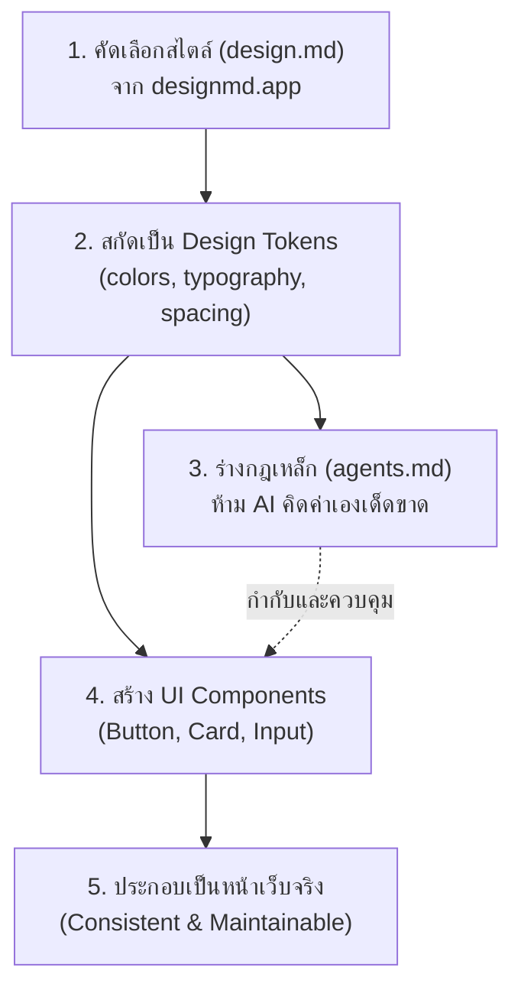

# คู่มือการสร้าง UI/UX Design System ด้วย AI Agent (ฉบับใช้งานจริง)

คู่มือนี้สรุปแนวทางปฏิบัติที่ดีที่สุด (Best Practice) ในการใช้ AI Agent (เช่น Cursor, Antigravity, Claude Code, Windsurf) เพื่อพัฒนาหน้าตาเว็บไซต์หรือแอปพลิเคชันให้สวยงาม มีมาตรฐาน คุมโทน 100% และป้องกันไม่ให้ AI มั่วสไตล์เอง

---

## 1. ภาพรวมกระบวนการ (Workflow Overview)

ปัญหาทั่วไปของการสั่งให้ AI เขียนหน้าเว็บคือ **"AI ชอบแต่งสี คิดขนาด และคิดระยะห่างเองตามใจชอบ"** ส่งผลให้แต่ละหน้าตาไม่เข้ากัน ดีไซน์แตก และดูแลรักษายากในระยะยาว

แนวทางแก้ไขคือการสร้าง **Design Pipeline** ที่มีกฎเกณฑ์ชัดเจน:



---

## 2. ขั้นตอนปฏิบัติอย่างละเอียด (4 Steps Implementation)

### ขั้นตอนที่ 1: คัดเลือกและเตรียม `design.md`
1. เข้าไปที่เว็บไซต์ [designmd.app](https://designmd.app) หรือคลังดีไซน์ที่คุณชื่นชอบ
2. เลือกดีไซน์/มู้ดแอนด์โทนที่เหมาะกับโปรเจกต์ของคุณ
3. คัดลอกเนื้อหามาบันทึกเป็นไฟล์ `design.md` ไว้ที่โฟลเดอร์หลัก (Root) ของโปรเจกต์

> [!TIP]
> `design.md` เปรียบเสมือน "Mood Board + พิมพ์เขียวภาษาข้อความ" ที่ AI สามารถอ่านและเข้าใจได้ง่ายกว่ารูปภาพ

---

### ขั้นตอนที่ 2: สกัด Design Tokens (ตัวแปรมาตรฐาน)
สั่งให้ AI แกะโครงสร้างพื้นฐาน (Foundation) จาก `design.md` ออกมาเป็นไฟล์ตัวแปรกลางของโปรเจกต์ เช่น `tokens.css`, `theme.ts` หรือ `tailwind.config.js`

**สิ่งที่ต้องสกัดออกมา:**
* **Colors:** Primary, Secondary, Accent, Background, Surface, Text (Primary/Secondary), Border
* **Typography:** Font Family, Scale (xs, sm, base, lg, xl, 2xl...), Font Weights, Line Heights
* **Spacing:** 4px scale หรือ 8px scale (เช่น 4, 8, 12, 16, 24, 32, 48px)
* **Elevation & Borders:** Box Shadows, Border Radius (sm, md, lg, full)

---

### ขั้นตอนที่ 3: ตั้งกฎเหล็กใน `agents.md` (หรือ `.cursorrules`)
สร้างไฟล์กฎสำหรับควบคุม AI เพื่อป้องกันไม่ให้มันคิดสีหรือระยะห่างขึ้นมาเอง

**หลักการสำคัญของกฎ:**
1. **Strict Token Usage:** ทุกสไตล์ต้องอ้างอิงจาก Design Tokens เท่านั้น
2. **Zero Hardcoding:** ห้ามใส่ค่าสีดิบ (Hex/RGB) หรือระยะห่างดิบ (Pixel) ใน Component
3. **Confirmation Gate:** หากจำเป็นต้องใช้สไตล์ใหม่ที่อยู่นอกเหนือจาก Token ต้องขอคำยืนยันจากผู้ใช้ก่อนเสมอ

---

### ขั้นตอนที่ 4: สร้าง UI Component สำเร็จรูป
นำ Design Tokens ที่ได้ มาประกอบเป็นชิ้นส่วนพื้นฐาน (Atomic Components) เช่น:
* ปุ่ม (Button: Primary, Secondary, Ghost, Destructive)
* การ์ด (Card, Surface Container)
* ช่องกรอกข้อมูล (Input, Select, Checkbox)
* ส่วนหัวและแถบเมนู (Navbar, Sidebar)

---

## 3. คลัง Prompt พร้อมใช้งาน (Copy & Paste Prompts)

### 📌 รูปแบบที่ 1: สั่งทีละขั้นตอน (แนะนำสำหรับงานคุณภาพสูง)

#### **Prompt 1: สกัด Design Tokens**
```markdown
ฉันมีไฟล์ `design.md` อยู่ในโปรเจกต์แล้ว ช่วยวิเคราะห์ Design Foundation จากไฟล์นี้ แล้วสกัดออกมาเป็น Design Tokens ให้หน่อย
โดยครอบคลุมหัวข้อต่อไปนี้:
1. Colors (Primary, Secondary, Background, Surface, Text, Status/Feedback)
2. Typography (Font Family, Font Sizes, Weights, Line Heights)
3. Spacing & Sizing Scale
4. Border Radius & Box Shadows

กรุณาสร้างออกมาเป็นไฟล์ [ระบุ เช่น tokens.css / tailwind.config.js / theme.ts] ที่พร้อมนำไป import ใช้งานในโปรเจกต์ได้ทันที
```

#### **Prompt 2: สร้างไฟล์กฎเหล็ก `agents.md`**
```markdown
ช่วยสร้างไฟล์ `agents.md` เพื่อเป็นข้อตกลงและกฎเหล็กให้ AI ในการเขียนโค้ดหน้าตา UI ของโปรเจกต์นี้ โดยระบุเงื่อนไขดังนี้:
1. ทุกการเขียนสไตล์และ UI ต้องเรียกใช้ค่าจาก Design Tokens ที่กำหนดไว้เท่านั้น
2. ห้าม Hardcode ค่าสี (เช่น ห้ามใส่ #2563EB ลอย ๆ) หรือขนาดช่องไฟเองโดยเด็ดขาด
3. หากมีกรณีจำเป็นต้องใช้สไตล์ใหม่ที่ไม่มีในระบบ Token ห้ามคิดขึ้นมาเอง ให้หยุดถามและขอคำยืนยันจากฉันก่อนเสมอ
4. แยกชิ้นส่วน UI ให้เป็น Reusable Components ที่นำกลับมาใช้ซ้ำได้ง่ายและรองรับ Accessibility พื้นฐาน
```

#### **Prompt 3: สร้าง UI Component ตัวอย่าง**
```markdown
ช่วยสร้าง UI Components ต่อไปนี้ตามแนวทางใน `agents.md` และใช้ค่าจาก Design Tokens ที่สร้างไว้:
- Components ที่ต้องการ: [เช่น Button พร้อมทุก Variant, Card, Input Field]
- Framework: [เช่น React + Tailwind CSS / Vanilla HTML + CSS]

โปรดตรวจสอบให้มั่นใจว่าไม่มีการละเมิดกฎการ Hardcode สไตล์
```

---

### 📌 รูปแบบที่ 2: All-in-One Prompt (สั่งรวบยอดครั้งเดียว)

```markdown
ฉันได้เพิ่มไฟล์ `design.md` ลงในโปรเจกต์แล้ว รบกวนช่วยติดตั้งระบบ UI Design System แบบครบวงจรตาม 3 ขั้นตอนนี้:

1. **สกัด Design Tokens**:
   - อ่าน `design.md` แล้วสกัด Colors, Typography, Spacing, Radius, Shadow ออกมาเป็นไฟล์ [เช่น src/styles/tokens.css หรือ tailwind.config.js]

2. **สร้างไฟล์ `agents.md` (AI Guardrails)**:
   - บันทึกกฎว่าต่อจากนี้ การเขียน UI ทั้งหมดต้องยึดตาม Design Tokens เท่านั้น
   - ห้ามคิดค่าสี ขนาด หรือระยะห่างเองเด็ดขาด (No Hardcoded Values)
   - หากมีสไตล์ที่ไม่ตรงกับ Token ต้องหยุดถามขอคำยืนยันจากผู้ใช้ก่อน

3. **สร้าง Base UI Components (Proof of Concept)**:
   - สร้าง Component ตัวอย่าง เช่น Button (Primary, Secondary, Outline) และ Card
   - โดยเชื่อมโยงสไตล์เข้ากับ Design Token 100%

โปรดดำเนินการทีละขั้นตอนและสรุปผลให้ฉันทราบ
```

---

## 4. ตัวอย่างไฟล์ที่ควรได้ในโปรเจกต์ (Templates)

### ตัวอย่าง: `tokens.css`
```css
:root {
  /* Colors */
  --color-primary: #2563eb;
  --color-primary-hover: #1d4ed8;
  --color-bg-base: #0f172a;
  --color-bg-surface: #1e293b;
  --color-text-main: #f8fafc;
  --color-text-muted: #94a3b8;
  --color-border: #334155;

  /* Spacing Scale */
  --space-xs: 4px;
  --space-sm: 8px;
  --space-md: 16px;
  --space-lg: 24px;
  --space-xl: 32px;

  /* Radii */
  --radius-sm: 6px;
  --radius-md: 10px;
  --radius-lg: 16px;
  --radius-full: 9999px;
}
```

### ตัวอย่าง: `agents.md`
```markdown
# AI UI/UX Development Guidelines

## กฎเหล็กในการจัดสไตล์ (Styling Rules)
1. **บังคับใช้ Design Token**: ทุกสี, ระยะห่าง, ขนาดตัวอักษร ต้องอ้างอิงจาก `tokens.css` หรือ Tailwind Theme ที่กำหนดไว้
2. **ห้าม Hardcode สไตล์**:
   - ❌ ห้าม: `style={{ color: '#123456', padding: '15px' }}`
   - ✅ ถูกต้อง: `className="text-primary p-md"` หรือ `var(--color-primary)`
3. **การขออนุมัติค่าใหม่ (Confirmation Gate)**:
   - หากงานชิ้นใดจำเป็นต้องใช้มิติหรือสีที่ไม่มีใน Token ให้ **หยุดและถามผู้ใช้ก่อนเสมอ**
   - ห้ามคาดเดาหรือสร้างตัวแปรชั่วคราวขึ้นมาเองโดยไม่ได้รับอนุญาต
```

---

## 5. สรุปคุณค่าที่ได้รับ

| ด้าน | วิธีการแบบเดิม (ปล่อย AI ทำเอง) | วิธีการใช้ Design System + Rules |
| :--- | :--- | :--- |
| **ความเข้ากันของหน้าตา** | สีและฟอนต์กระจัดกระจาย ไม่คุมโทน | คุมโทน 100% สวยงามเหมือนมืออาชีพทำ |
| **การบำรุงรักษา (Maintenance)** | แก้ยาก ต้องตามแก้ทีละไฟล์ | แก้ที่ `tokens` จุดเดียว เปลี่ยนทั้งโปรเจกต์ |
| **การทำงานของ AI** | เพ้อเจ้อ (Hallucination) สไตล์เรื่อยเปื่อย | ทำงานอยู่ในกรอบ แม่นยำ ไม่เสียเวลาแก้ซ้ำ |
