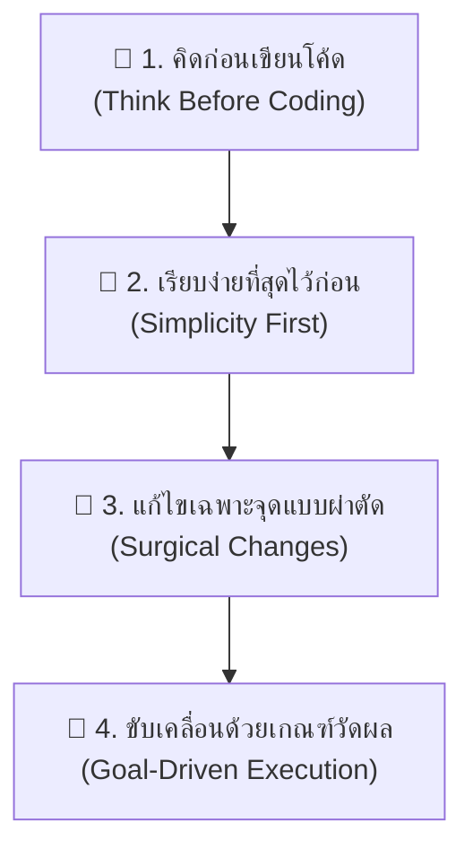

# Andrej Karpathy Guidelines Skill Guide

คู่มือสรุปแนวทางปฏิบัติของสกิล **[karpathy-guidelines](https://github.com/multica-ai/andrej-karpathy-skills)** ซึ่งถอดบทเรียนมาจากข้อสังเกตและหลักคิดของ **Andrej Karpathy** (อดีต Director of AI ที่ Tesla และผู้ร่วมก่อตั้ง OpenAI) ในการควบคุม AI Agent ไม่ให้เขียนโค้ดมั่ว ซับซ้อนเกินจำเป็น หรือก่อความเสียหาย

---

## 1. ปรัชญาและแก่นความคิด (Core Philosophy)

> *"Tradeoff: Guidelines เหล่านี้เน้นความรอบคอบและปลอดภัย มากกว่าความเร็วแบบฉาบฉวย"*

AI มีนิสัยชอบ "คิดไปเอง" และชอบเขียนโค้ดเผื่ออนาคตที่ไม่มีอยู่จริง สกิลนี้จึงตั้งกฎเหล็ก 4 ข้อเพื่อลดข้อผิดพลาดของ LLM:

---

## 2. กฎเหล็ก 4 ประการ (The 4 Pillars)

### 🔹 1. คิดก่อนเขียน (Think Before Coding)
- **ห้ามเดา / ห้ามซ่อนความสงสัย / เปิดเผย Tradeoff ให้ผู้ใช้เห็น:**
  - ต้องระบุสมมติฐานให้ชัดเจนก่อนลงมือ ถ้าไม่แน่ใจให้ถามทันที
  - หากโจทย์ตีความได้หลายแบบ ต้องแจกแจงทางเลือกออกมา ห้ามเลือกเองเงียบๆ
  - ถ้ามีวิธีที่ง่ายกว่า ต้องบอกผู้ใช้และโต้แย้งอย่างมีเหตุผล

### 🔹 2. เรียบง่ายที่สุดไว้ก่อน (Simplicity First)
- **เขียนโค้ดให้น้อยที่สุดเท่าที่แก้ปัญหาได้ อย่าเขียนเผื่อ:**
  - ห้ามแอบเพิ่มฟีเจอร์ที่ผู้ใช้ไม่ได้สั่ง
  - ห้ามสร้าง Abstraction / Class ซับซ้อนสำหรับโค้ดที่เรียกใช้ครั้งเดียว
  - ห้ามเพิ่มความยืดหยุ่น (Configurability) ที่ไม่มีใครขอ
  - ห้ามเขียน Error Handling ดักเคสที่เป็นไปไม่ได้
  - **กฎทองคำ:** *"ถ้าเขียน 200 บรรทัดแล้วพบว่าเขียน 50 บรรทัดก็ทำงานได้เท่ากัน ให้รื้อเขียนใหม่ทันที"*

### 🔹 3. แก้ไขเฉพาะจุดแบบผ่าตัด (Surgical Changes)
- **แตะต้องเฉพาะจุดที่ต้องแก้ และทำความสะอาดเฉพาะขยะที่ตัวเองสร้าง:**
  - ห้ามไป "แอบปรับปรุง" โค้ดหรือคอมเมนต์ข้างเคียงที่ไม่เกี่ยวข้อง
  - ห้ามรีแฟกเตอร์สิ่งที่ไม่ได้พัง
  - ปรับสไตล์ให้เข้ากับโค้ดเดิม แม้ว่าตัวเองจะไม่ชอบสไตล์นั้นก็ตาม
  - หากพบ Dead Code เดิมในโปรเจกต์ ให้แค่แจ้งผู้ใช้ ห้ามลบเองโดยพลการ
  - **เกณฑ์ทดสอบ:** ทุกบรรทัดที่เปลี่ยนแปลงต้องมีที่มาเชื่อมโยงกับสิ่งที่ผู้ใช้สั่งโดยตรง

### 🔹 4. ขับเคลื่อนด้วยเป้าหมายที่วัดผลได้ (Goal-Driven Execution)
- **กำหนดเกณฑ์ความสำเร็จ แล้ววนลูปจนกว่าจะผ่านการพิสูจน์:**
  - ห้ามสั่งลอยๆ ว่า *"ทำให้มันเวิร์ก"*
  - แปลงโจทย์ให้เป็นเป้าหมายที่มีบททดสอบ:
    - *"เพิ่ม Validation"* $\rightarrow$ เขียนเทสต์ดัก Invalid Input ก่อน แล้วทำให้เทสต์ผ่าน
    - *"แก้บั๊ก"* $\rightarrow$ เขียนเทสต์จำลองบั๊กให้แดงก่อน แล้วแก้ให้เขียว
    - *"รีแฟกเตอร์"* $\rightarrow$ เช็กให้แน่ใจว่าเทสต์ผ่านทั้งก่อนและหลังทำ

---

## 3. วิธีการเรียกใช้งาน

สกิลนี้สามารถเปิดใช้งานได้ทั้งแบบคำสั่งตรง หรือจะให้ Agent ดึงมาใช้ในใจเสมอ:

- **เรียกใช้แบบคำสั่ง:**  
  > `/karpathy-guidelines ช่วยรีวิวโค้ดโมดูลนี้ตามหลักคิดของ Karpathy หน่อย`  
  > `/karpathy-guidelines ช่วยแก้ฟังก์ชันนี้ โดยขอแบบ Surgical Changes เท่านั้น`

- **ผลลัพธ์ที่ได้:**  
  AI จะระบุสมมติฐานก่อนเริ่ม ถามคำถามที่ค้างคา และเสนอโค้ดที่สั้น ตรงจุด และไม่แตะต้องไฟล์ข้างเคียงที่ไม่จำเป็น
