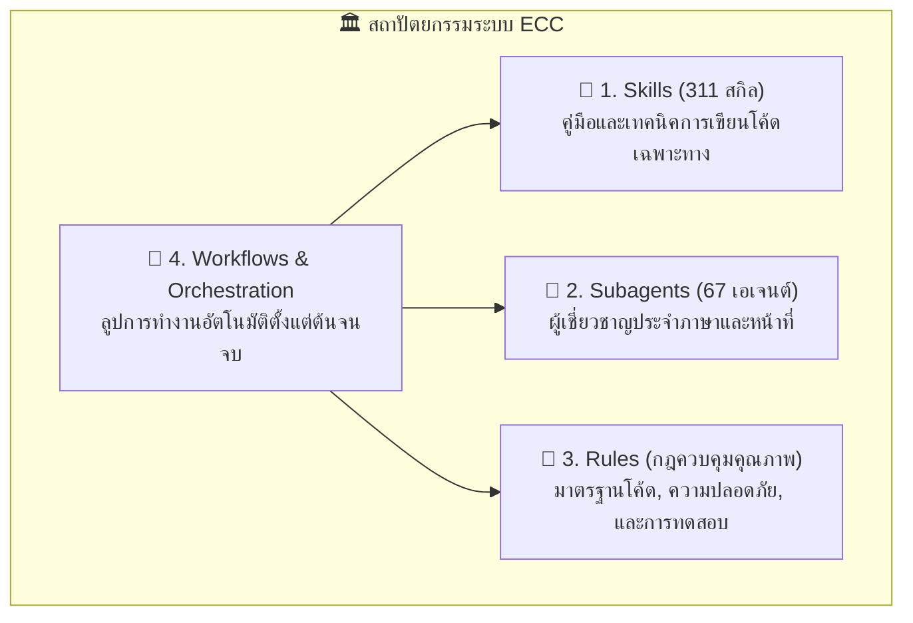
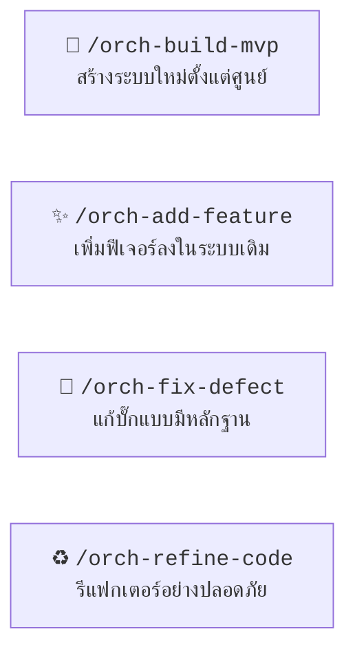

# ECC (Everything Claude Code) Skill Guide

คู่มือฉบับสมบูรณ์สำหรับการใช้งานระบบ **[ECC (Everything Claude Code / Everything Code Companion)](https://github.com/affaan-m/ECC)** ภายในโปรเจกต์นี้ รวบรวมแนวทางปฏิบัติระดับ Production, คลังสกิลกว่า 311 สกิล, กฎควบคุมคุณภาพตามภาษา และ Subagents ผู้เชี่ยวชาญเฉพาะด้าน 67 ตัว

---

## 1. โครงสร้างสถาปัตยกรรมของ ECC (ECC Ecosystem)

ECC ไม่ใช่แค่คำสั่งสั่งการทั่วไป แต่เป็น **Agent Harness Operating System** ที่ประกอบด้วย 4 เสาหลัก:



1. **Skills (`.agents/skills/`)**: คลังความรู้และ Best Practices ครอบคลุมกว่า 20 ภาษา, เฟรมเวิร์ก, ฐานข้อมูล, และ Cloud Infrastructure
2. **Subagents (`.agents/agents/`)**: เอเจนต์จำเพาะงาน เช่น รีวิวโค้ดตามภาษา (`*-reviewer`), ซ่อมแซม Build/Type Error (`*-build-resolver`), และสถาปนิกออกแบบระบบ (`code-architect`)
3. **Rules (`.agents/rules/`)**: กฎเหล็กที่ควบคุมคุณภาพโค้ด 5 มิติในแต่ละภาษา (Coding Style, Patterns, Security, Testing, Hooks)
4. **Workflows (`.agents/workflows/`)**: โฟลว์การทำงานแบบอัตโนมัติที่ประสานงานระหว่างเอเจนต์และสกิลต่างๆ

---

## 2. 4 เวิร์กโฟลว์หลักระดับ Orchestration (`orch-*`)

เมื่อต้องการพัฒนางานขนาดใหญ่ ให้ใช้เวิร์กโฟลว์ระดับ **Orchestration** เพื่อให้ ECC ประสานงานสกิลและเอเจนต์ให้โดยอัตโนมัติ:



### 🔹 1. สร้างระบบใหม่ตั้งแต่ศูนย์ (`/orch-build-mvp`)
- **การทำงาน:** AI จะเริ่มค้นคว้าและวางสถาปัตยกรรม $\rightarrow$ ออกแบบ Schema $\rightarrow$ สร้าง Core Services $\rightarrow$ เขียนเทสต์รองรับ $\rightarrow$ สแกนความปลอดภัย
- **คำสั่งตัวอย่าง:**
  > `/orch-build-mvp สร้างระบบจัดการคลังสินค้าขนาดเล็กด้วย Node.js + Express และ SQLite`

### 🔹 2. เพิ่มฟีเจอร์ใหม่ (`/orch-add-feature`)
- **การทำงาน:** สำรวจ Interface เดิมในระบบ $\rightarrow$ วางแผนการเชื่อมต่อโดยไม่กระทบของเก่า $\rightarrow$ เขียนเทสต์ของฟีเจอร์ใหม่ $\rightarrow$ ลงมือเขียนโค้ด $\rightarrow$ ตรวจสอบคุณภาพ
- **คำสั่งตัวอย่าง:**
  > `/orch-add-feature เพิ่มระบบ Export รายงานยอดขายเป็นไฟล์ CSV และ Excel`

### 🔹 3. แก้ไขข้อบกพร่อง/บั๊ก (`/orch-fix-defect`)
- **การทำงาน:** สร้าง Regression Test ที่ทำให้ผลลัพธ์ **แดง (Fail)** เพื่อยืนยันว่าเจอบั๊กจริง $\rightarrow$ ค้นหาสาเหตุรากเหง้า (Root Cause) $\rightarrow$ แก้โค้ดให้เทสต์ **เขียว (Pass)** $\rightarrow$ ตรวจสอบว่าไม่มีผลข้างเคียง
- **คำสั่งตัวอย่าง:**
  > `/orch-fix-defect แก้ปัญหากด Checkout แล้วยอดเงินไม่หักส่วนลดเมื่อใช้คูปองพิเศษ`

### 🔹 4. ปรับโครงสร้างโค้ด (`/orch-refine-code`)
- **การทำงาน:** รันเทสต์เดิมทั้งหมดให้ผ่านก่อน $\rightarrow$ ปรับโครงสร้างให้อ่านง่าย/เป็นระเบียบ $\rightarrow$ รันเทสต์ซ้ำเพื่อยืนยันว่าพฤติกรรมการทำงานภายนอกเหมือนเดิม 100%
- **คำสั่งตัวอย่าง:**
  > `/orch-refine-code จัดระเบียบโมดูล UserService ให้แยก Logic ของ Email ออกมาเป็น Service ย่อย`

---

## 3. ระบบ Subagents ผู้เชี่ยวชาญเฉพาะทาง (Specialized Subagents)

ECC มีเอเจนต์เฉพาะทางใน `.agents/agents/` ที่สามารถเรียกใช้งาน หรือให้ระบบเรียกมาช่วยงานได้โดยตรง:

| หมวดหมู่ Subagents | ตัวอย่าง Agent | หน้าที่หลัก |
| :--- | :--- | :--- |
| **Code Reviewers** | `react-reviewer`<br/>`python-reviewer`<br/>`golang-reviewer`<br/>`database-reviewer` | สวมหมวกผู้ตรวจโค้ดอิสระเฉพาะภาษานั้นๆ ตรวจสอบความถูกต้อง, ประสิทธิภาพ, และ Concurrency |
| **Security & Safety** | `security-reviewer`<br/>`silent-failure-hunter` | ดักจับช่องโหว่ OWASP Top 10, ตรวจจับ Error ที่ถูกกลืนทิ้ง (Swallowed Errors) |
| **Build Resolvers** | `build-error-resolver`<br/>`pytorch-build-resolver`<br/>`rust-build-resolver` | แก้ปัญหา TypeScript Error, Compiler Error, หรือ Dependency Conflict แบบตรงจุด |
| **Architects & E2E**| `code-architect`<br/>`e2e-runner`<br/>`performance-optimizer` | ออกแบบ Blueprint โครงสร้างระบบ และรันการทดสอบจำลองผู้ใช้จริง |

---

## 4. คลังสกิลของ ECC แยกตามหมวดหมู่ (Skill Cheatsheet)

### 🌐 1. หมวด Frontend & Web Development
- `/react-patterns`: เขียน React 18/19 ให้ถูกหลัก Hooks, Boundaries, และ State Architecture
- `/react-testing`: กลยุทธ์การเขียนเทสต์ React Component ด้วย React Testing Library
- `/nextjs-turbopack`: ปรับแต่ง Next.js App Router, SSR, Server Actions, และ Turbopack
- `/vue-patterns`: รูปแบบการเขียน Vue 3 Composition API, Pinia, และ Template Security
- `/vite-patterns`: ปรับแต่ง Vite config, Plugin, Code Splitting, และ Bundling
- `/browser-qa`: ทดสอบและตรวจสอบหน้าเว็บจริงผ่าน Browser Automation

### ⚙️ 2. หมวด Backend & Programming Languages
- `/python-patterns` & `/python-testing`: มาตรฐาน PEP 8, Type Hints, และ Pytest
- `/fastapi-patterns`: สถาปัตยกรรม FastAPI, Async Route, Dependency Injection, Pydantic v2
- `/golang-patterns` & `/golang-testing`: Idiomatic Go, Goroutines, Channels, และ Table-driven tests
- `/rust-patterns` & `/rust-testing`: Ownership, Lifetimes, Memory Safety, และ Unit/Integration tests
- `/springboot-patterns` & `/springboot-tdd`: Layered architecture, JPA, Security, และ MockMvc
- `/nestjs-patterns`: สถาปัตยกรรม Nest.js แบบ Modular, Decorators, Guards, และ Interceptors

### 🗄️ 3. หมวด Database & Data Engineering
- `/postgres-patterns`: การออกแบบ Schema, Indexing, Query Optimization, Connection Pool บน PostgreSQL
- `/mysql-patterns`: แนวทางปฏิบัติสำหรับ MySQL/MariaDB, Indexing, Transactions, และ Replication
- `/redis-patterns`: กลยุทธ์ Caching, Pub/Sub, Data Structures, และ Eviction Policy
- `/database-migrations`: การวางแผน Migration แบบ Zero-downtime และ Backward Compatibility
- `/clickhouse-io`: ออกแบบคิวรีและการประมวลผลข้อมูลปริมาณมหาศาลบน ClickHouse

### 🛡️ 4. หมวด Security & Quality Gates
- `/security-review`: สแกนช่องโหว่ความปลอดภัย: OWASP Top 10, Auth bypass, Injection, Secrets
- `/security-scan`: ตรวจสอบ Dependencies และโค้ดเพื่อค้นหาช่องโหว่แบบ Static Analysis
- `/delivery-gate`: ตรวจสอบคุณภาพและความพร้อมของระบบก่อนปล่อยขึ้น Production
- `/conventional-commit-review`: ช่วยเขียนและตรวจทาน Git Commit Message ตามมาตรฐานสากล
- `/safety-guard`: การ์ดป้องกันคำสั่งอันตราย (ป้องกันการลบไฟล์สำคัญหรือคำสั่งที่เสี่ยงต่อข้อมูลสูญหาย)

### 🚀 5. หมวด DevOps, Cloud & System Operations
- `/docker-patterns`: เขียน Dockerfile และ Docker Compose ให้เบา ปลอดภัย และเป็น Multi-stage
- `/kubernetes-patterns`: จัดการ Manifests, Deployments, Services, ConfigMaps, Ingress
- `/deployment-patterns`: วางแผนกลยุทธ์การ Release: Blue/Green, Canary, Rolling Updates
- `/canary-watch`: มอนิเตอร์และตรวจจับ Error ทันทีหลัง Deploy ขึ้น Production
- `/dashboard-builder`: ออกแบบ Dashboard มอนิเตอร์สำหรับ Grafana, SigNoz, หรือ Prometheus

### 🤖 6. หมวด AI, Machine Learning & Media
- `/mle-workflow`: วงจรการพัฒนา Machine Learning ตั้งแต่ Data Contracts ถึง Model Serving
- `/pytorch-patterns`: เขียนโค้ด PyTorch สำหรับ Training/Inference, CUDA Optimization
- `/remotion-video-creation`: สร้างวิดีโอแบบ Programmatic ด้วย React ผ่าน Remotion
- `/manim-video`: สร้างภาพเคลื่อนไหวทางคณิตศาสตร์และอธิบายคอนเซปต์ด้วย Manim
- `/fal-ai-media`: เชื่อมต่อสร้างภาพและมัลติมีเดียผ่าน Fal.ai API

---

## 5. กฎควบคุมคุณภาพ 5 มิติของ ECC (The 5 Rules Pillars)

ในโฟลเดอร์ `.agents/rules/` ของ ECC จะมีชุดกฎเกณฑ์มาตรฐานที่กำกับดูแลการเขียนโค้ดใน 5 มิติ:

```text
[ภาษา]-coding-style.md     -> ควบคุมรูปแบบการเขียนโค้ดและไวยากรณ์
[ภาษา]-patterns.md         -> ควบคุมสถาปัตยกรรมและ Best Practices
[ภาษา]-security.md         -> ควบคุมความปลอดภัยและป้องกันช่องโหว่
[ภาษา]-testing.md          -> ควบคุมมาตรฐานการเขียนเทสต์และความครอบคลุม (Coverage)
[ภาษา]-hooks.md            -> ควบคุมจุดเชื่อมโยงระบบ Lifecycle อัตโนมัติ
```

---

## 6. ตัวอย่างการรันเวิร์กโฟลว์ของ ECC (Pure ECC Execution)

### สเต็ปที่ 1: สั่งเริ่มเวิร์กโฟลว์ด้วย `/orch-add-feature`
> **คุณพิมพ์:**  
> `/orch-add-feature ต้องการเพิ่มระบบ Rate Limiting ให้กับ API ทุก Route โดยใช้ Redis`

### สเต็ปที่ 2: ECC วางแผนและเรียกใช้ Pattern ที่ถูกต้อง
- AI จะเปิดใช้งานสกิล `/redis-patterns` และ `/fastapi-patterns` (หรือตามภาษาที่โปรเจกต์ใช้)
- วิเคราะห์จุดเชื่อมต่อ Middleware และกำหนดค่าคงที่

### สเต็ปที่ 3: ดำเนินการและตรวจความปลอดภัยด้วย `/security-review`
- AI เขียนโค้ด Rate Limiter พร้อมเทสต์
- เรียกใช้งาน `security-reviewer` ตรวจสอบว่ามีช่องโหว่ Denial of Service หรือ Memory Leak หรือไม่

### สเต็ปที่ 4: สรุปและเตรียมคอมมิตด้วย `/conventional-commit-review`
- AI ช่วยร่างข้อความ Git Commit ตามมาตรฐาน Conventional Commits เช่น:
  `feat(api): implement distributed rate limiting middleware via redis`

---

## 7. โครงสร้างไฟล์ของ ECC ภายในโปรเจกต์

```text
.agents/
├── skills/                     # คลังสกิลของ ECC (311 สกิล)
├── rules/                      # กฎควบคุมคุณภาพ 5 มิติประจำแต่ละภาษา
├── agents/                     # Subagents ผู้เชี่ยวชาญเฉพาะทาง (67 ตัว)
├── workflows/                  # ลูปเวิร์กโฟลว์อัตโนมัติของ ECC
└── ecc-install-state.json      # บันทึกสถานะการติดตั้งของ ECC
```
