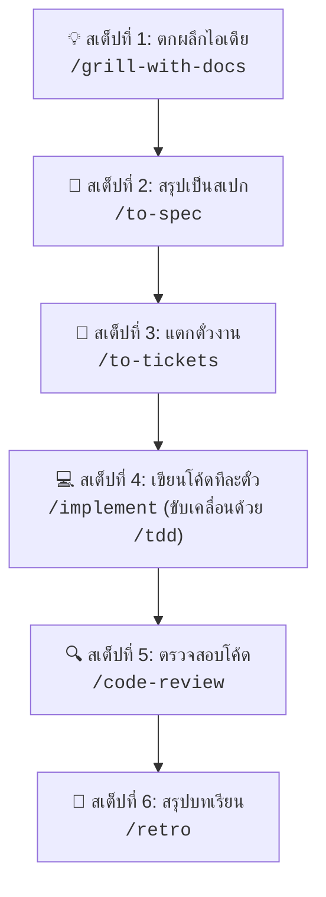

# Matt Pocock Edition Skill Guide

คู่มือฉบับสรุปสำหรับการใช้งานชุดคำสั่งและระเบียบวิธีปฏิบัติ (Agent Skills) จาก [mattpocock/skills](https://github.com/mattpocock/skills) ภายในโปรเจกต์นี้ เพื่อยกระดับการพัฒนาด้วย AI จาก **"Vibe Coding"** สู่ **"Real Engineering"**

---

## 1. ปรัชญาและแนวคิดหลัก

1. **คุยให้เคลียร์ก่อนเริ่มโค้ด (Misalignment Prevention)**: การเข้าใจไม่ตรงกันคือสาเหตุอันดับ 1 ที่ทำให้ AI เขียนโค้ดไม่ตรงใจ ต้องใช้การสัมภาษณ์เจาะลึก (**Grilling**) เพื่อให้ทุกเงื่อนไขตกผลึกก่อนเริ่มลงมือ
2. **ภาษาที่เป็นหนึ่งเดียว (Ubiquitous Language)**: ใช้ศัพท์เฉพาะตาม [GLOSSARY.md](GLOSSARY.md) และเก็บบันทึกการตัดสินใจสถาปัตยกรรมไว้ใน [docs/adr/](docs/adr/) เพื่อให้คนและ AI สื่อสารด้วยคำเดียวกัน
3. **ฟีดแบ็กลูปที่รัดกุม (Tight Feedback Loops)**: การเขียนโค้ดต้องขับเคลื่อนด้วย **TDD (Red $\rightarrow$ Green $\rightarrow$ Refactor)** โดยกำหนด **Seams** (จุดเชื่อมต่อ Interface) ให้ชัดเจนก่อนเสมอ
4. **รักษาความสะอาดของสถาปัตยกรรม (Deep Modules)**: ป้องกันไม่ให้โค้ดกลายเป็นก้อนยุ่งเหยิง (Ball of Mud) ด้วยการออกแบบโมดูลที่มีความสามารถลึกแต่อินเทอร์เฟซเรียบง่าย

---

## 2. ขั้นตอนการทำงานจริงและการโต้ตอบ (คุยทีละสเต็ป: Idea $\rightarrow$ Ship)

หลักการสำคัญ: **"ทำทีละขั้น โดยมีคนคอยตรวจรับงานเสมอ (Human-in-the-Loop)"** ไม่สั่งรวดเดียวจบ



---

### 🔹 สเต็ปที่ 1: ตกผลึกไอเดีย (คำสั่ง: `/grill-with-docs`)
*AI จะสวมบทสัมภาษณ์เจาะลึก ยังไม่เขียนโค้ด เพื่อป้องกันปัญหาเข้าใจไม่ตรงกัน*
- **คุณพิมพ์:**  
  > `/grill-with-docs อยากทำระบบ Login ด้วย Email/Password ในโปรเจกต์นี้`
- **สิ่งที่ AI ทำและตอบกลับ:**  
  AI จะยิงคำถามเจาะลึก 3-5 ข้อ พร้อมเสนอทางเลือกที่แนะนำ (Recommended):
  > ❓ **Q1 - Password Hashing**: จะเก็บรหัสผ่านด้วยอัลกอริทึมใด?  
  > ➡️ *แนะนำ: Argon2id เพื่อความปลอดภัยสูงสุด*  
  > ❓ **Q2 - Session Management**: จะใช้ JWT หรือ Server-side Session?  
  > ➡️ *แนะนำ: JWT เก็บใน HttpOnly Cookie*
- **สิ่งที่คุณทำต่อ:** ตอบคำถามกลับไป (สามารถพิมพ์ว่า *"ตกลงตามที่แนะนำ"* หรือปรับแก้ตามใจชอบ) คุยกัน 1-2 รอบจนเข้าใจตรงกันทุกข้อ
- **ผลลัพธ์ที่ได้:** อัปเดตศัพท์เฉพาะลง `GLOSSARY.md` และบันทึกข้อตกลงลง `docs/adr/` อัตโนมัติ

---

### 🔹 สเต็ปที่ 2: สรุปเป็นสเปก (คำสั่ง: `/to-spec`)
*สังเคราะห์ข้อตกลงที่ได้จากการสัมภาษณ์ออกมาเป็นเอกสาร Specification ทางเทคนิค*
- **คุณพิมพ์:**  
  > `/to-spec`
- **สิ่งที่ AI ทำและตอบกลับ:**  
  AI จะรวบรวมข้อสรุปทั้งหมด เขียนเป็นไฟล์สเปกที่ `.scratch/auth/spec.md` ซึ่งระบุขอบเขตงาน โมเดลข้อมูล และ API Contract ชัดเจน
- **สิ่งที่คุณทำต่อ (Checkpoint):** เปิดไฟล์ `.scratch/auth/spec.md` ตรวจดูความถูกต้อง หากต้องการปรับแก้จุดไหน สามารถสั่งให้แก้สเปกก่อนได้ทันที

---

### 🔹 สเต็ปที่ 3: แตกตั๋วงาน (คำสั่ง: `/to-tickets`)
*แตกสเปกเป็นตั๋วงานย่อย (Tracer-bullet Tickets) เพื่อให้ทำทีละส่วนได้โดยบริบทไม่บวม*
- **คุณพิมพ์:**  
  > `/to-tickets`
- **สิ่งที่ AI ทำและตอบกลับ:**  
  AI จะแตกงานออกเป็นไฟล์ตั๋วใน `.scratch/auth/issues/` พร้อมบอกว่าตั๋วไหน Block ตั๋วไหน เช่น:
  - `01-user-schema.md` (สร้างตาราง User และ Validation)
  - `02-password-hashing.md` (ฟังก์ชันแฮชและตรวจสอบรหัสผ่าน)
  - `03-login-endpoint.md` (API Route สำหรับ Login - *Blocked by 01, 02*)
- **สิ่งที่คุณทำต่อ (Checkpoint):** ตรวจสอบลำดับงานและความชัดเจนของแต่ละตั๋ว

---

### 🔹 สเต็ปที่ 4: ลงมือเขียนโค้ดทีละตั๋ว (คำสั่ง: `/implement`)
*ดึงตั๋วมาลงมือทำทีละใบ โดยขับเคลื่อนด้วย TDD (เขียนเทสต์ก่อนเสมอ)*
- **คุณพิมพ์:**  
  > `/implement .scratch/auth/issues/01-user-schema.md`
- **สิ่งที่ AI ทำและตอบกลับ:**  
  AI จะเรียกใช้สกิล `/tdd` โดยอัตโนมัติ:
  1. ตกลงจุดเชื่อมต่อ Interface (Seam)
  2. เขียน Unit/Integration Test ขึ้นมาก่อน (รันแล้วต้อง **แดง/Fail**)
  3. เขียนโค้ดจริงเท่าที่จำเป็นเพื่อให้เทสต์ผ่าน (รันแล้ว **เขียว/Pass**)
  4. ทำการตรวจเช็กและคอมมิตงานของตั๋วนี้
- **สิ่งที่คุณทำต่อ:** เมื่อตั๋วที่ 1 เสร็จสิ้น ให้สั่ง `/implement` ตั๋วถัดไปทีละตั๋ว (สามารถเคลียร์ Context เพื่อรักษาความฉลาดของ AI ได้)

---

### 🔹 สเต็ปที่ 5: ตรวจสอบคุณภาพโค้ด (คำสั่ง: `/code-review`)
*สวมหมวกผู้ตรวจโค้ดอิสระ ตรวจสอบคุณภาพแบบ 2 แกนขนานกัน*
- **คุณพิมพ์:**  
  > `/code-review`
- **สิ่งที่ AI ทำและตอบกลับ:**  
  AI จะรีวิวความเปลี่ยนแปลงของโค้ด (Diff) 2 ด้านพร้อมกัน:
  - **ด้าน Standards:** โค้ดสะอาดไหม มี Code Smell หรือผิดหลัก Clean Architecture หรือไม่
  - **ด้าน Spec:** โค้ดที่เขียนขึ้นมา ทำงานได้ตรงตามที่ระบุไว้ใน `spec.md` ครบถ้วนหรือไม่
- **สิ่งที่คุณทำต่อ:** ปรับปรุงโค้ดตามข้อเสนอแนะที่ AI รายงาน

---

### 🔹 สเต็ปที่ 6: สรุปบทเรียนและพัฒนา Agent (คำสั่ง: `/retro`)
*ทบทวนการทำงานของเซสชัน เพื่ออัปเกรดความสามารถและสภาพแวดล้อมของ AI*
- **คุณพิมพ์:**  
  > `/retro`
- **สิ่งที่ AI ทำและตอบกลับ:**  
  AI จะมองย้อนกลับไปในการทำงานรอบนี้ สรุปจุดที่ติดขัด และเสนอสิ่งที่ควรปรับปรุง เช่น เสนอเพิ่มคำสั่งตรวจสอบอัตโนมัติ หรือเพิ่มกฎใน `AGENTS.md`
- **สิ่งที่คุณทำต่อ:** กดยอมรับการอัปเดต เพื่อให้การทำงานในรอบถัดไปแม่นยำและราบรื่นยิ่งขึ้น

---

## 3. สรุปคำสั่งและหน้าที่ของแต่ละสกิล (Cheatsheet)

### 🛠️ หมวดพัฒนาซอฟต์แวร์ (Engineering Skills)

| คำสั่ง | ประเภท | รายละเอียดหน้าที่ |
| :--- | :--- | :--- |
| `/ask-matt` | User | **ตัวนำทาง (Router)**: ถามเมื่อไม่แน่ใจว่าจะใช้สกิลไหนกับสถานการณ์ปัจจุบัน |
| `/grill-with-docs` | User | ซักไซ้ความต้องการโค้ด + บันทึกศัพท์และ ADR |
| `/to-spec` | User | เปลี่ยนบทสนทนาเป็นเอกสาร Specification ทางเทคนิค |
| `/to-tickets` | User | แตกแผนงานเป็นตั๋วย่อย (Tracer-bullet tickets) |
| `/implement` | User | สร้างโค้ดตามตั๋วงานด้วย TDD และปิดท้ายด้วยการรีวิว |
| `/implement-spec` | User | สั่ง Agent ขนานงานสร้างโค้ดตาม Task Graph ของทั้งสเปกในครั้งเดียว |
| `/tdd` | Model/User | ทำงานแบบ Test-Driven Development (Red-Green Loop) เน้นทดสอบที่ Seam |
| `/diagnosing-bugs` | Model/User | ลูปวินัยการแก้บั๊กยาก: ทำเทสต์ให้แดง $\rightarrow$ ย่อปัญหา $\rightarrow$ สมมติฐาน $\rightarrow$ ใส่ logs $\rightarrow$ แก้ $\rightarrow$ ป้องกันเกิดซ้ำ |
| `/code-review` | Model/User | รีวิวคู่ขนาน: ด้าน Standards (Clean code) และด้าน Spec (ตรงโจทย์) |
| `/improve-codebase-architecture` | User | สแกน Codebase เพื่อหาโอกาสปรับปรุงเป็น Deep Modules |
| `/wayfinder` | User | วางแผนงานโปรเจกต์ขนาดใหญ่ที่ยังคลุมเครือ ด้วยการทำแผนที่ Decision Tickets ทีละขั้น |
| `/pr` | Model | จัดรูปแบบข้อความ PR Body ให้มีหลักฐาน Before/After และประเมินความเสี่ยง |
| `/retro` | User | สรุปบทเรียนเพื่อปรับปรุงสภาพแวดล้อมและกฎเกณฑ์ของ Agent |

---

### 💡 หมวดเพิ่มประสิทธิภาพและการเรียนรู้ (Productivity Skills)

| คำสั่ง | ประเภท | รายละเอียดหน้าที่ |
| :--- | :--- | :--- |
| `/grill-me` | User | สัมภาษณ์ซักไซ้แผนงานทั่วไปแบบ Stateless (ไม่สร้างเอกสารลง repo) |
| `/teach` | User | สวมบทเป็นครูสอนทักษะหรือแนวคิดใหม่ มี Glossary, Mission, และบันทึกการเรียนรู้ |
| `/wait-what` | User | เรียกใช้เมื่อ Agent อธิบายศัพท์ยากเกินไป สั่งให้อธิบายใหม่ด้วยภาษาง่ายๆ |
| `/handoff` | User | สรุปบริบทเพื่อส่งต่องานข้าม session หรือส่งให้ Agent ตัวอื่น |
| `/to-questionnaire` | User | เปลี่ยนคำถามที่ติดขัดเป็นแบบสอบถามสำหรับนำไปถามผู้มีอำนาจตัดสินใจ |
| `/writing-for-agents` | Model | แนวทางการเขียนเอกสาร กฎเกณฑ์ และสเปกที่ Agent อ่านเข้าใจได้ดีที่สุด |

---

## 4. โครงสร้างไฟล์ในโปรเจกต์ที่เกี่ยวข้อง

```text
/
├── .agents/skills/              # โฟลเดอร์เก็บโค้ดคำสั่งของทุกสกิล
├── docs/
│   ├── agents/
│   │   ├── issue-tracker.md     # กำหนดระบบการเก็บตั๋วงาน (.scratch/)
│   │   ├── domain.md            # กำหนดการอ่านศัพท์และ ADR
│   │   └── triage-labels.md     # กำหนดประเภทสถานะตั๋วงาน
│   └── adr/                     # บันทึกการตัดสินใจทางสถาปัตยกรรม (Architecture Decision Records)
├── .scratch/                    # โฟลเดอร์เก็บ feature specs และ tickets ประจำงาน
├── AGENTS.md                    # กฎและบริบทหลักของ Agent สำหรับโปรเจกต์นี้
├── GLOSSARY.md                  # พจนานุกรมศัพท์เฉพาะของโปรเจกต์
└── คู่มือ สกิล Matt Pocock Edition.md  # คู่มือการใช้งานนี้
```
