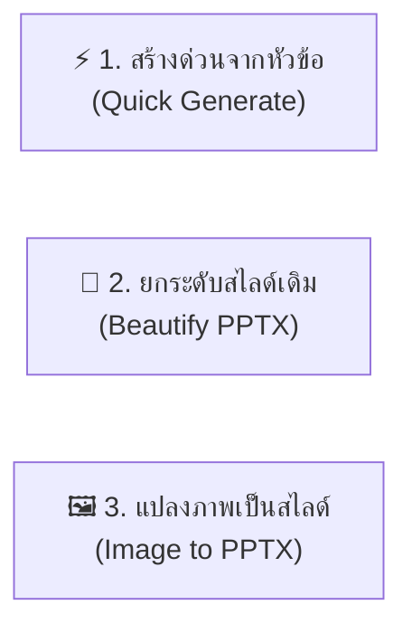

# PPT Master Skill Guide

คู่มือฉบับสรุปสำหรับการใช้งานสกิล **[ppt-master](https://github.com/hugohe3/ppt-master)** ระบบสร้าง ออกแบบ และปรับปรุงสไลด์ PowerPoint (.pptx) ระดับมืออาชีพแบบอัตโนมัติด้วย AI Agent

---

## 1. จุดเด่นของ PPT Master

- **Native Editable PPTX**: สร้างไฟล์ `.pptx` จริงที่สามารถเปิดและแก้ไขข้อความ รูปร่าง และสีต่อใน Microsoft PowerPoint หรือ Keynote ได้ 100%
- **สัดส่วนมาตรฐาน 16:9 (Widescreen)**: จัดสเปซและ Typography ตามหลักสากล ไม่ตกขอบและไม่อัดแน่น
- **ระบบธีมและเทมเพลตระดับมืออาชีพ**: มี Layouts สำหรับ Metric Cards, Comparison Matrix, Timeline, Process Flow, และ Architecture Breakdown

---

## 2. 3 เวิร์กโฟลว์หลักของ PPT Master

### 🔹 1. สร้างสไลด์ใหม่จากหัวข้อ (`quick-generate`)
- **การทำงาน:** AI จะค้นคว้าข้อมูลหัวข้อ $\rightarrow$ วางโครงสร้างสไลด์ (Outline) $\rightarrow$ เลือกสไตล์ที่เหมาะสม $\rightarrow$ สร้างไฟล์ `.pptx` พร้อมข้อมูลและกราฟิก
- **คำสั่งตัวอย่าง:**
  > `/ppt-master สร้างสไลด์ Pitch Deck แนะนำโปรเจกต์ AI สัดส่วน 16:9 ความยาว 10 สไลด์ในสไตล์ Minimalist Dark`

### 🔹 2. ปรับปรุงสไลด์เดิมให้สวยงาม (`beautify-pptx`)
- **การทำงาน:** อ่านสไลด์ PPTX ดิบที่มีอยู่ $\rightarrow$ ปรับจัดระเบียบ Typography, Palette สี, Spacing และแปลงตารางทึบๆ ให้กลายเป็น Cards/Matrix ที่อ่านง่าย
- **คำสั่งตัวอย่าง:**
  > `/ppt-master ช่วยปรับปรุงไฟล์ presentation.pptx นี้ให้ดูเป็นมืออาชีพในสไตล์ Executive Pitch`

### 🔹 3. แปลงภาพร่างหรือดีไซน์เป็นสไลด์ (`image-to-pptx`)
- **การทำงาน:** วิเคราะห์ภาพสเก็ตช์หรือ Screenshot $\rightarrow$ แปลงเป็น Native Shapes และกล่องข้อความที่แก้ไขได้ใน PowerPoint

---

## 3. สไตล์ดีไซน์ที่มีให้เลือกใช้งาน (Design Styles)

| สไตล์ | จุดเด่น | เหมาะสำหรับงาน |
| :--- | :--- | :--- |
| **Executive Pitch** | สีคอนทราสต์ชัดเจน, ตัวเลข KPI ขนาดใหญ่, พาดหัวกระชับ | นำเสนอผู้บริหาร, นักลงทุน, สรุปผลงานประจำไตรมาส |
| **Technical Deepdive** | ธีมโทนเข้ม, มีบล็อกแสดงโค้ดและ Flow สถาปัตยกรรม | งานประชุมวิศวกรรม, เอกสาร System Architecture, Tech Talk |
| **Clean Business** | พื้นขาว คลีน ลายเส้นคมชัด การ์ดข้อมูลเป็นสัดส่วน | รายงานทางการ, การนำเสนอองค์กร, สไลด์ขายงาน B2B |
| **Workshop / Teaching**| ลำดับขั้นตอน 1-2-3 ชัดเจน, กล่องข้อความเน้นการจดจำ | สื่อการสอน, การอบรมพนักงาน, คอร์สออนไลน์ |

---

## 4. ตัวอย่างคำสั่งใช้งานจริง

- **สร้างสไลด์นำเสนอทางเทคนิค:**
  > `/ppt-master สร้างสไลด์หัวข้อ 'สถาปัตยกรรม Microservices กับ Event-Driven Architecture' ความยาว 8 สไลด์ สไตล์ Technical Deepdive`
- **สร้างสไลด์สรุปเปรียบเทียบฟีเจอร์:**
  > `/ppt-master สร้างสไลด์หน้า Comparison Matrix เปรียบเทียบระหว่าง Solution A vs B`
