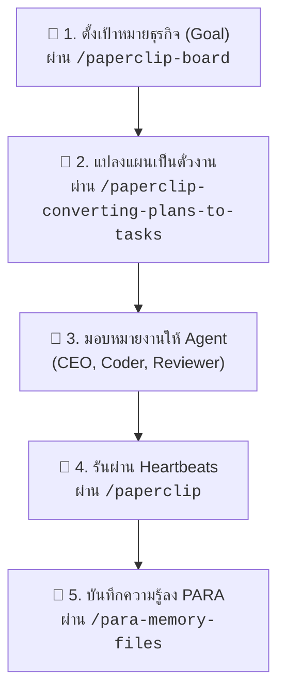

# Paperclip Skill Guide

คู่มือฉบับสรุปสำหรับการใช้งานชุดคำสั่งและสกิลจาก **[Paperclip](https://github.com/paperclipai/paperclip)** ซึ่งเป็นระบบปฏิบัติการสำหรับการบริหารจัดการและควบคุมทีม AI Agent ระดับองค์กร (Multi-Agent Organization Orchestration)

---

## 1. ปรัชญาและแนวคิดของ Paperclip

> *"If OpenClaw / Claude Code is an employee, Paperclip is the company."*

Paperclip มองว่าการสร้างซอฟต์แวร์หรือธุรกิจในยุค AI ไม่ควรเป็นการสั่งงานบอทตัวเดียว แต่เป็นการ **บริหารทีม AI** (มีทั้ง CEO, CTO, Engineer, Designer) โดย Paperclip ทำหน้าที่เป็น Control Plane:

- **บริหารเป้าหมายธุรกิจ ไม่ใช่แค่ Pull Request**: ตั้งเป้าหมายหลัก (Goal) $\rightarrow$ มอบหมายงาน $\rightarrow$ ควบคุมงบประมาณ (Budget)
- **สถาปัตยกรรม Heartbeats**: Agent ไม่ได้ทำงานแช่ตลอดเวลา แต่จะตื่นขึ้นมาทำงานเป็นรอบสั้นๆ (Wake $\rightarrow$ Read task $\rightarrow$ Execute $\rightarrow$ Update status $\rightarrow$ Exit)

---

## 2. คลังคำสั่งและสกิลของ Paperclip

| สกิล | คำสั่งเรียกใช้ | หน้าที่และการใช้งาน |
| :--- | :--- | :--- |
| **Paperclip Core** | `/paperclip` | ควบคุมลูป Heartbeat, อ่านบริบทงาน, ส่งมอบ Document/Files, และประสานงานผ่าน API |
| **Paperclip Board** | `/paperclip-board` | สวมบทบาทเป็นบอร์ดบริหาร ควบคุมดูแล Agent, ตรวจสอบผลงาน, อนุมัติงบ และติดตาม Task |
| **Plan to Tasks** | `/paperclip-converting-plans-to-tasks` | เปลี่ยนแผนงานใหญ่ (Plan) ให้กลายเป็นตั๋วงานย่อยที่มีผู้รับผิดชอบชัดเจนและระบุ Dependency |
| **Create Agent** | `/paperclip-create-agent` | ร่างโปรไฟล์และว่าจ้าง Agent ตัวใหม่เข้าสู่ระบบ พร้อมกำหนดบทบาท สิทธิ์ และ Adapter |
| **AgentMail** | `/agentmail` | เชื่อมต่อกล่องข้อความและอีเมล ให้ Agent สามารถอ่าน จัดการ และตอบเมลในเวิร์กโฟลว์ได้ |
| **Slack Integration**| `/slack` | ประสานงานและโต้ตอบกับทีม Agent ผ่านห้องแชท Slack |
| **PARA Memory** | `/para-memory-files` | บันทึกความจำระยะยาวขององค์กรด้วยระบบไฟล์แบบ PARA (Projects, Areas, Resources, Archives) |
| **Feedback Loop** | `/suggestion-box` `/complain` | กลไกให้ Agent ส่งข้อเสนอแนะหรือรายงานจุดติดขัดในกระบวนการทำงานได้โดยอัตโนมัติ |

---

## 3. รูปแบบการทำงานจริงของ Paperclip

### ตัวอย่างการสั่งงาน:
1. **วางโครงสร้างงาน:**  
   > `/paperclip-converting-plans-to-tasks ช่วยแตกแผนงานเปิดตัวฟีเจอร์นี้ออกเป็นงานย่อยและกำหนดคนรับผิดชอบ`
2. **ตรวจงานในฐานะบอร์ด:**  
   > `/paperclip-board สรุปสถานะความคืบหน้าของตั๋วงานทั้งหมดและงบประมาณที่ใช้ไปในสัปดาห์นี้`
