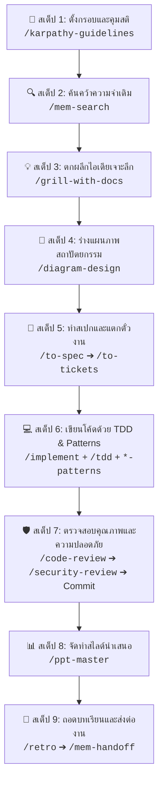

# คู่มือการใช้งาน (Master Skills Guide)

เอกสารฉบับนี้รวบรวมสรุปย่อของชุดสกิลทั้งหมดในโปรเจกต์ ลิงก์แหล่งที่มา คำสั่งสำคัญ ตัวอย่างการใช้งาน และ **ขั้นตอนการทำงานร่วมกันของทุกสกิลตั้งแต่ต้นจนจบตามลำดับ**

---

## 📚 สรุปย่อของแต่ละชุดสกิล (Skills Overview)

---

### 1. Matt Pocock Edition Skills
- **แหล่งที่มา:** [https://github.com/mattpocock/skills](https://github.com/mattpocock/skills)
- **ไฟล์คู่มือฉบับเต็ม:** [คู่มือ สกิล Matt Pocock Edition.md](คู่มือ%20สกิล%20Matt%20Pocock%20Edition.md)
- **คืออะไรแบบกระชับ:** ระเบียบวิธีพัฒนาซอฟต์แวร์ระดับมืออาชีพ (Real Engineering) เน้นวินัยการซักไซ้เจาะลึก (Grill) เพื่อไม่ให้เข้าใจผิดพลาด, แตกตั๋วงาน, และเขียนโค้ดด้วย TDD
- **คำสั่งสำคัญและตัวอย่างการใช้:**
  | คำสั่ง | คำอธิบาย | ตัวอย่างการใช้งาน |
  | :--- | :--- | :--- |
  | `/grill-with-docs` | สัมภาษณ์ซักไซ้ไอเดีย พร้อมจดศัพท์ลง `GLOSSARY.md` และสร้าง ADR | `/grill-with-docs อยากทำระบบยืนยันตัวตนด้วย JWT ในโปรเจกต์นี้` |
  | `/to-spec` | สังเคราะห์บทสนทนาเป็นเอกสาร Specification (`spec.md`) | `/to-spec` |
  | `/to-tickets` | แตกสเปกเป็นตั๋วงานย่อยใน `.scratch/` พร้อมกำหนดลำดับ Blocking | `/to-tickets` |
  | `/implement` | ลงมือทำตั๋วงานทีละใบ ขับเคลื่อนด้วย TDD และตรวจโค้ด | `/implement .scratch/auth/issues/01-user-schema.md` |
  | `/tdd` | พัฒนาแบบ Test-Driven Development (Red $\rightarrow$ Green $\rightarrow$ Refactor) ผ่าน Seam | `/tdd ช่วยเขียนเทสต์และฟังก์ชันคำนวณราคาสินค้า` |
  | `/code-review` | รีวิวโค้ด 2 แกนคู่ขนาน: มาตรฐานโค้ด (Standards) vs ความถูกต้องตามสเปก (Spec) | `/code-review` |
  | `/diagnosing-bugs`| วินัยการแก้บั๊ก: บังคับเขียนเทสต์ให้แดงก่อน $\rightarrow$ หา Root Cause $\rightarrow$ แก้ให้เขียว | `/diagnosing-bugs เกิด Error 500 ตอนกด Checkout ตะกร้าสินค้า` |
  | `/retro` | ทบทวนเซสชันเพื่อเพิ่มกฎป้องกันใน `AGENTS.md` | `/retro` |

---

### 2. ECC (Everything Claude Code)
- **แหล่งที่มา:** [https://github.com/affaan-m/ECC](https://github.com/affaan-m/ECC)
- **ไฟล์คู่มือฉบับเต็ม:** [คู่มือ สกิล ECC.md](คู่มือ%20สกิล%20ECC.md)
- **คืออะไรแบบกระชับ:** คลัง Best Practices, กฎ 5 มิติ และ Subagents 67 ตัว ครอบคลุม 20+ ภาษา, Database, DevOps, และ Security เพื่อยกระดับโค้ดสู่ระดับ Production
- **คำสั่งสำคัญและตัวอย่างการใช้:**
  | คำสั่ง | คำอธิบาย | ตัวอย่างการใช้งาน |
  | :--- | :--- | :--- |
  | `/orch-build-mvp` | ออร์เคสเตรตสร้างแอปใหม่ตั้งแต่ศูนย์พร้อมโครงสร้างระบบ | `/orch-build-mvp สร้าง REST API ระบบจัดการคลังสินค้าด้วย FastAPI + SQLite` |
  | `/orch-add-feature`| ออร์เคสเตรตเพิ่มฟีเจอร์ลงในระบบเดิมโดยไม่กระทบของเก่า | `/orch-add-feature เพิ่มระบบ Export ข้อมูลเป็น Excel และ CSV` |
  | `*-patterns` | รูปแบบโค้ดมาตรฐานตามภาษา (เช่น `fastapi-patterns`, `react-patterns`) | `เขียน API Endpoint นี้ตามแนวทาง /fastapi-patterns` |
  | `/security-review` | สแกนหาช่องโหว่ความปลอดภัย OWASP Top 10, Injection, Auth Bypass | `/security-review ตรวจสอบความปลอดภัยของโมดูล Payment นี้` |
  | `/conventional-commit-review` | ร่างและตรวจทานข้อความ Git Commit ตามมาตรฐานสากล | `/conventional-commit-review` |
  | `/docker-patterns` | เขียน Dockerfile และ Compose แบบ Multi-stage และเบาปลอดภัย | `/docker-patterns ช่วยสร้าง Dockerfile สำหรับแอป Node.js นี้` |

---

### 3. Andrej Karpathy Guidelines
- **แหล่งที่มา:** [https://github.com/multica-ai/andrej-karpathy-skills](https://github.com/multica-ai/andrej-karpathy-skills)
- **ไฟล์คู่มือฉบับเต็ม:** [คู่มือ สกิล Andrej Karpathy.md](คู่มือ%20สกิล%20Andrej%20Karpathy.md)
- **คืออะไรแบบกระชับ:** กฎเหล็ก 4 ข้อลดข้อผิดพลาดของ LLM: Think Before Coding, Simplicity First, Surgical Changes (แก้เฉพาะจุด ไม่แตะโค้ดข้างเคียง), Goal-Driven
- **คำสั่งสำคัญและตัวอย่างการใช้:**
  | คำสั่ง | คำอธิบาย | ตัวอย่างการใช้งาน |
  | :--- | :--- | :--- |
  | `/karpathy-guidelines` | คุมสติ AI ห้ามเดาใจ, ห้ามเขียนโค้ดเผื่ออนาคต, และแก้ไขเฉพาะจุดที่สั่ง | `/karpathy-guidelines รีวิวโค้ดส่วนนี้และตัดฟังก์ชันที่ซับซ้อนเกินจำเป็นออก` |

---

### 4. Paperclip
- **แหล่งที่มา:** [https://github.com/paperclipai/paperclip](https://github.com/paperclipai/paperclip)
- **ไฟล์คู่มือฉบับเต็ม:** [คู่มือ สกิล Paperclip.md](คู่มือ%20สกิล%20Paperclip.md)
- **คืออะไรแบบกระชับ:** ระบบบริหารจัดการและควบคุมทีม AI Agent ระดับองค์กร (Multi-Agent Org) ควบคุมเป้าหมายธุรกิจ, งบประมาณ (Budget), และรอบการทำงาน (Heartbeats)
- **คำสั่งสำคัญและตัวอย่างการใช้:**
  | คำสั่ง | คำอธิบาย | ตัวอย่างการใช้งาน |
  | :--- | :--- | :--- |
  | `/paperclip-board` | สวมบทบาทบอร์ดบริหาร ติดตาม Task, ตรวจสอบผลงาน และคุมงบ | `/paperclip-board สรุปสถานะความคืบหน้าของตั๋วงานและงบประมาณประจำสัปดาห์` |
  | `/paperclip-converting-plans-to-tasks` | แตกแผนงานเป็นตั๋วงานย่อยพร้อมกำหนดบทบาท (Roles) และ Dependency | `/paperclip-converting-plans-to-tasks แตกแผนงานนี้ออกเป็นตั๋วงานย่อย` |
  | `/para-memory-files` | จัดระเบียบโน้ตและไฟล์ความรู้ตามหลัก PARA (Projects/Areas/Resources/Archives) | `/para-memory-files บันทึกผลการตัดสินใจสถาปัตยกรรมลงหมวด Resources` |

---

### 5. Claude-Mem
- **แหล่งที่มา:** [https://github.com/thedotmack/claude-mem](https://github.com/thedotmack/claude-mem)
- **ไฟล์คู่มือฉบับเต็ม:** [คู่มือ สกิล Claude-Mem.md](คู่มือ%20สกิล%20Claude-Mem.md)
- **คืออะไรแบบกระชับ:** ระบบความจำถาวรข้ามเซสชัน (Persistent Memory) บันทึกประวัติศาสตร์การทำงาน สิ่งที่ลองแล้วพัง และสืบค้นบริบทแบบประหยัดโทเคน
- **คำสั่งสำคัญและตัวอย่างการใช้:**
  | คำสั่ง | คำอธิบาย | ตัวอย่างการใช้งาน |
  | :--- | :--- | :--- |
  | `/mem-search` | ค้นหาประวัติ การตัดสินใจ และข้อตกลงที่เคยคุยไว้ในอดีต | `/mem-search สเปก Database ที่เราเคยตกลงกันไว้เมื่อสัปดาห์ก่อน` |
  | `/mem-handoff` | สร้างไฟล์ `HANDOFF.md` บันทึกสถานะปัจจุบัน และ **"สิ่งที่ลองแล้วพัง"** เพื่อส่งต่องาน | `/mem-handoff สร้างสรุปเพื่อส่งต่องานสำหรับเริ่มวันใหม่` |
  | `/smart-explore` | สำรวจโครงสร้างโค้ดด้วย AST Tree-sitter แบบประหยัดโทเคน | `/smart-explore ค้นหาโครงสร้าง Function และ Interface ในโฟลเดอร์ src` |
  | `/learn-codebase` | สั่งให้ AI อ่านทำความเข้าใจโค้ดทั้งหมดเพื่อเตรียมเริ่มงาน | `/learn-codebase` |

---

### 6. PPT Master
- **แหล่งที่มา:** [https://github.com/hugohe3/ppt-master](https://github.com/hugohe3/ppt-master)
- **ไฟล์คู่มือฉบับเต็ม:** [คู่มือ สกิล PPT Master.md](คู่มือ%20สกิล%20PPT%20Master.md)
- **คืออะไรแบบกระชับ:** เครื่องมือสร้าง ออกแบบ และปรับแต่งสไลด์ PowerPoint (`.pptx` 16:9) อัตโนมัติด้วย AI ในระดับมืออาชีพ พร้อมเทมเพลตและเมตริกการ์ด
- **คำสั่งสำคัญและตัวอย่างการใช้:**
  | คำสั่ง | คำอธิบาย | ตัวอย่างการใช้งาน |
  | :--- | :--- | :--- |
  | `/ppt-master` (Quick Generate) | สร้างสไลด์ PPTX ใหม่จากหัวข้อพร้อมกราฟิกและ Layouts | `/ppt-master สร้างสไลด์ Pitch Deck 10 หน้า สไตล์ Executive Pitch` |
  | `/ppt-master` (Beautify PPTX) | อัปเกรดสไลด์เดิมที่มีอยู่ให้สวยงาม จัด Typography และสีใหม่ | `/ppt-master ปรับปรุงไฟล์ presentation.pptx ให้ดูเป็นมืออาชีพ` |

---

### 7. Diagram Design
- **แหล่งที่มา:** [https://github.com/cathrynlavery/diagram-design](https://github.com/cathrynlavery/diagram-design)
- **ไฟล์คู่มือฉบับเต็ม:** [คู่มือ สกิล Diagram Design.md](คู่มือ%20สกิล%20Diagram%20Design.md)
- **คืออะไรแบบกระชับ:** เครื่องมือออกแบบและสร้างแผนภาพสถาปัตยกรรมระบบ โฟลว์ข้อมูล ERD และแผนภูมิธุรกิจ รองรับ SVG, Mermaid, Excalidraw และ Draw.io
- **คำสั่งสำคัญและตัวอย่างการใช้:**
  | คำสั่ง | คำอธิบาย | ตัวอย่างการใช้งาน |
  | :--- | :--- | :--- |
  | `/diagram-design` (Architecture) | สร้างแผนภาพ System Architecture, Deployment, โฟลว์ระบบ | `/diagram-design สร้าง High-level Architecture ของระบบ Microservices ส่งออกเป็น SVG` |
  | `/diagram-design` (Database) | สร้างแผนผัง Database ERD และความสัมพันธ์ระหว่าง Table | `/diagram-design สร้าง ER Diagram ของระบบ E-Commerce ส่งออกเป็น Mermaid` |
  | `/diagram-design` (Sequence) | สร้าง Sequence Diagram แสดงขั้นตอนการทำงานระหว่าง Services | `/diagram-design สร้าง Sequence Diagram ของขั้นตอน OAuth2 Flow` |

---

## 🔄 แผนผังและขั้นตอนการใช้งานสกิลทั้งหมดร่วมกันตามลำดับ (The Integrated End-to-End Workflow)

นี่คือขั้นตอนการประสานงานของสกิลทั้งหมดตั้งแต่เริ่มต้นไอเดียจนถึงการส่งมอบงานจริง:

---

### รายละเอียดขั้นตอนการปฏิบัติงานจริง (Step-by-Step Execution):

#### 🔹 สเต็ปที่ 1: ตั้งกรอบความคิด (Mindset & Guardrails)
- **สกิลที่ใช้:** [`/karpathy-guidelines`](คู่มือ%20สกิล%20Andrej%20Karpathy.md)
- **การปฏิบัติ:** ตั้งกฎเหล็กในใจและในคำสั่ง: *"ห้ามเขียนโค้ดเผื่ออนาคต, ทำเฉพาะจุดที่สั่ง (Surgical changes), และคิดก่อนเขียนเสมอ"*

#### 🔹 สเต็ปที่ 2: รื้อฟื้นความจำเดิม (Context Recall)
- **สกิลที่ใช้:** [`/mem-search`](คู่มือ%20สกิล%20Claude-Mem.md)
- **การปฏิบัติ:** ค้นหาสิ่งที่เคยตกลงกันไว้ในอดีต เช่น:  
  > `/mem-search ค้นหาโครงสร้างฐานข้อมูลและข้อตกลงเรื่อง Auth ที่เคยคุยกันไว้`

#### 🔹 สเต็ปที่ 3: สัมภาษณ์เจาะลึกตกผลึกไอเดีย (Ideation & Framing)
- **สกิลที่ใช้:** [`/grill-with-docs`](คู่มือ%20สกิล%20Matt%20Pocock%20Edition.md)
- **การปฏิบัติ:** บอกไอเดียที่ต้องการทำ แล้วตอบคำถามซักไซ้ 3-5 ข้อต่อรอบจนได้ข้อสรุปที่คมชัด ระบบจะบันทึกศัพท์ลง `GLOSSARY.md` และข้อตกลงลง `docs/adr/` อัตโนมัติ

#### 🔹 สเต็ปที่ 4: ออกแบบแผนภาพระบบ (System Visualization)
- **สกิลที่ใช้:** [`/diagram-design`](คู่มือ%20สกิล%20Diagram%20Design.md)
- **การปฏิบัติ:** ร่างแผนภาพสถาปัตยกรรมหรือ ERD เพื่อให้เห็นภาพระบบตรงกันก่อนเขียนโค้ด เช่น:  
  > `/diagram-design สร้าง High-level Architecture และ ERD ของฟีเจอร์นี้เป็นไฟล์ SVG`

#### 🔹 สเต็ปที่ 5: สรุปเป็นสเปกและแตกตั๋วงาน (Spec & Task Breakdown)
- **สกิลที่ใช้:** [`/to-spec`](คู่มือ%20สกิล%20Matt%20Pocock%20Edition.md) ตามด้วย [`/to-tickets`](คู่มือ%20สกิล%20Matt%20Pocock%20Edition.md) *(หรือ [`/paperclip-converting-plans-to-tasks`](คู่มือ%20สกิล%20Paperclip.md) ถ้าทำงานเป็นทีมบอท)*
- **การปฏิบัติ:** สั่ง `/to-spec` สร้างไฟล์ `.scratch/<feature>/spec.md` แล้วสั่ง `/to-tickets` เพื่อแตกเป็นตั๋วย่อย `01-xxx.md`, `02-xxx.md`

#### 🔹 สเต็ปที่ 6: เขียนโค้ดด้วย TDD ผสานมาตรฐานภาษา (Implementation)
- **สกิลที่ใช้:** [`/implement`](คู่มือ%20สกิล%20Matt%20Pocock%20Edition.md) ร่วมกับ [`/tdd`](คู่มือ%20สกิล%20Matt%20Pocock%20Edition.md) และ `*-patterns` ของ [ECC](คู่มือ%20สกิล%20ECC.md)
- **การปฏิบัติ:** หยิบตั๋วงานมาทำทีละใบ กำหนด Seam เขียนเทสต์ให้แดงก่อน แล้วเขียนโค้ดจริงให้เขียวตาม Best Practices ของภาษานั้นๆ

#### 🔹 สเต็ปที่ 7: ตรวจสอบความปลอดภัยและคอมมิตงาน (Quality Gates & Ship)
- **สกิลที่ใช้:** [`/code-review`](คู่มือ%20สกิล%20Matt%20Pocock%20Edition.md) $\rightarrow$ [`/security-review`](คู่มือ%20สกิล%20ECC.md) $\rightarrow$ [`/conventional-commit-review`](คู่มือ%20สกิล%20ECC.md)
- **การปฏิบัติ:** ตรวจสอบความสอดคล้องตามสเปก $\rightarrow$ สแกนหาช่องโหว่ความปลอดภัย $\rightarrow$ ร่างข้อความ Commit ตามมาตรฐาน

#### 🔹 สเต็ปที่ 8: จัดทำเอกสารและสไลด์นำเสนอ (Presentation)
- **สกิลที่ใช้:** [`/ppt-master`](คู่มือ%20สกิล%20PPT%20Master.md)
- **การปฏิบัติ:** เมื่อต้องส่งมอบงานให้ทีมหรือลูกค้า สั่งสร้างสไลด์สรุปผลงาน:  
  > `/ppt-master สร้างสไลด์สรุปผลงานการพัฒนาระบบนี้ 8 หน้า สไตล์ Executive Pitch`

#### 🔹 สเต็ปที่ 9: ถอดบทเรียน ล้างไฟล์ชั่วคราว และส่งมอบงานสะอาด (Retrospective & Clean Teardown)
- **สกิลที่ใช้:** [`/retro`](คู่มือ%20สกิล%20Matt%20Pocock%20Edition.md)
- **การปฏิบัติ:** สั่ง `/retro` เพื่อบันทึกกฎถาวรลงใน `AGENTS.md` และ **ลบไฟล์ที่ไม่ใช่เนื้องานโปรเจกต์ทิ้งทั้งหมดทันที (`.scratch/`, สเปก, ตั๋วงานที่เสร็จแล้ว, สคริปต์ทดสอบเฉพาะกิจ, และ `HANDOFF.md`)** เพื่อให้เซสชันถัดไปเริ่มต้นจากเนื้องานจริงที่สะอาด 100% ไม่ดึงบริบทเก่ามาปะปน
