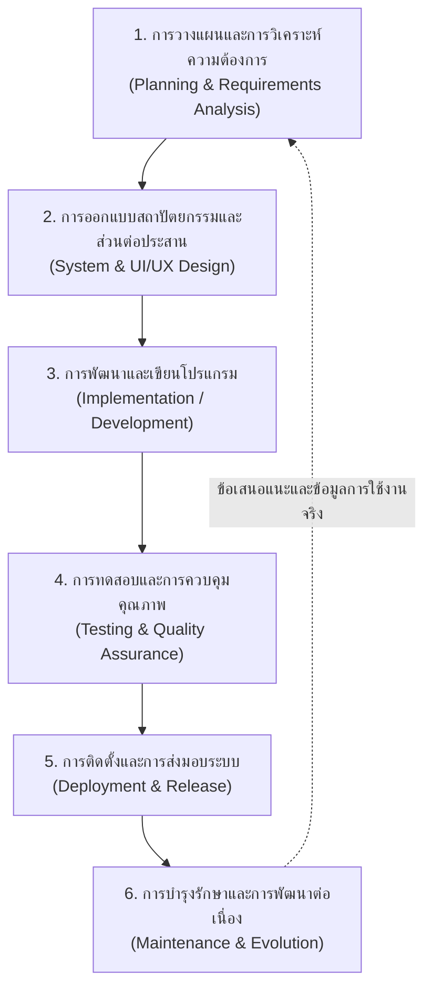

# บทที่ 1: วงจรการพัฒนาซอฟต์แวร์และการออกแบบแนวคิดแอปพลิเคชัน
*(Software Development Life Cycle & App Concept Canvas)*

---

## บทนำ: พลังของแอปพลิเคชันบนอุปกรณ์สื่อสารแบบพกพาในยุคธุรกิจดิจิทัล

ในอดีต ซอฟต์แวร์คอมพิวเตอร์ถูกจำกัดการใช้งานอยู่เพียงบนโต๊ะทำงานผ่านเครื่องคอมพิวเตอร์ส่วนบุคคล (Desktop PC) ธุรกิจที่ต้องการบันทึกข้อมูลต้องรอให้พนักงานกลับมานั่งหน้าจอ หรือต้องพึ่งพาเอกสารกระดาษในการจดบันทึกหน้างาน แต่ในปัจจุบัน **อุปกรณ์สื่อสารแบบพกพา (Mobile Devices)** โดยเฉพาะสมาร์ตโฟนและแท็บเล็ต ได้เข้ามาเปลี่ยนแปลงวิถีชีวิตของผู้คนและกระบวนการทำงานของธุรกิจไปอย่างสิ้นเชิง

สมาร์ตโฟนไม่ได้เป็นเพียงเครื่องมือติดต่อสื่อสาร แต่เปรียบเสมือน **"คอมพิวเตอร์พกพาอัจฉริยะ"** ที่ผู้ใช้งานพกติดตัวตลอด 24 ชั่วโมง มีคุณลักษณะเด่นเฉพาะตัวที่ระบบคอมพิวเตอร์ตั้งโต๊ะทั่วไปไม่สามารถทำได้ทัดเทียม:
- **ความสามารถในการพกพาและความพร้อมใช้งานทันที (Portability & Instant Access):** เข้าถึงข้อมูล ทำธุรกรรม หรือสั่งงานได้ทุกที่ทุกเวลา (Anywhere, Anytime)
- **การผสานฮาร์ดแวร์และเซนเซอร์อัจฉริยะ (Hardware & Sensor Integration):** 
  - **กล้องถ่ายภาพ (Camera):** ใช้สแกนคิวอาร์โค้ด (QR Code), บาร์โค้ดสินค้า (Barcode), ถ่ายภาพหลักฐานการทำงาน หรือสลิปการโอนเงิน
  - **ระบบระบุตำแหน่งพิกัดดาวเทียม (GPS / Location Services):** เช็คอินพิกัดร้านค้า ติดตามสถานะยานพาหนะ หรือคำนวณระยะทางจัดส่ง
  - **หน้าจอสัมผัส (Touchscreen):** รองรับการเซ็นลายมือชื่อดิจิทัล (Digital Signature) เพื่ออนุมัติเอกสารหรือรับมอบสิ่งของ
  - **ระบบแจ้งเตือนแบบทันที (Push Notifications):** ส่งข้อความเตือนเข้าสู่หน้าจอล็อกของผู้ใช้ได้แบบเรียลไทม์

อย่างไรก็ดี การสร้างโมบายล์แอปพลิเคชันให้ประสบความสำเร็จไม่ได้เริ่มต้นที่การเขียนโค้ด แต่เริ่มต้นที่ **"ความเข้าใจปัญหาที่แท้จริงของผู้ใช้งานและการวางแผนเชิงระบบ"** สถิติในอุตสาหกรรมเทคโนโลยีระบุว่า แอปพลิเคชันมากกว่า 80-90% ที่ถูกปล่อยสู่ตลาดต้องล้มเหลวและถูกลบทิ้งภายใน 30 วันแรก สาเหตุหลักไม่ได้เกิดจากบั๊กของโปรแกรม แต่เกิดจาก **"การสร้างสิ่งที่ไม่มีใครต้องการใช้งานจริง"** ดังนั้น การเข้าใจวงจรการพัฒนาซอฟต์แวร์ (SDLC) และการใช้เครื่องมือวางกรอบแนวคิด (App Concept Canvas) จึงเป็นรากฐานที่สำคัญที่สุดสำหรับนักพัฒนาระบบและผู้ประกอบการดิจิทัล

---

## 1. วงจรการพัฒนาซอฟต์แวร์ (Software Development Life Cycle : SDLC)

**วงจรการพัฒนาซอฟต์แวร์ (SDLC)** คือ กรอบแนวคิดเชิงกระบวนการที่เป็นมาตรฐานสากล ใช้ควบคุมและขับเคลื่อนการสร้างซอฟต์แวร์ตั้งแต่ขั้นตอนแรกเริ่มที่เกิดความคิดริเริ่ม จนกระทั่งซอฟต์แวร์ถูกนำไปติดตั้ง ใช้งาน และบำรุงรักษาอย่างมีประสิทธิภาพ

การพัฒนาแอปพลิเคชันโดยปราศจาก SDLC เปรียบเสมือนการสร้างตึกสูงโดยไม่มีพิมพ์เขียว แม้ช่างก่อสร้างจะขยันขันแข็งก่ออิฐฉาบปูนเพียงใด อาคารนั้นย่อมเสี่ยงต่อการพังทลายหรือใช้งานจริงไม่ได้ในที่สุด



### ขั้นที่ 1: การวางแผนและการวิเคราะห์ความต้องการ (Planning & Requirements Analysis)
ขั้นตอนแรกและสำคัญที่สุด เป็นการตอบคำถามว่า:
- เรากำลังจะแก้ปัญหาอะไร?
- ใครคือผู้ที่จะเข้ามาใช้งานระบบนี้?
- ทำไมวิธีแก้ปัญหาเดิม (เช่น การจดกระดาษ หรือแอปพลิเคชันอื่น) ถึงไม่ตอบโจทย์?
- ขอบเขตของระบบ (Project Scope) มีมากน้อยเพียงใด?

ในขั้นตอนนี้ นักพัฒนาจะต้องลงพื้นที่สัมภาษณ์ผู้มีส่วนได้ส่วนเสีย (Stakeholders) สังเกตหน้างานจริง และสรุปความต้องการออกมาเป็น **ข้อกำหนดเชิงหน้าที่ (Functional Requirements)** เช่น ระบบต้องสามารถสแกนบาร์โค้ดได้ และ **ข้อกำหนดที่ไม่ใช่เชิงหน้าที่ (Non-Functional Requirements)** เช่น ระบบต้องประมวลผลได้ภายใน 2 วินาที และข้อมูลต้องมีความปลอดภัย

### ขั้นที่ 2: การออกแบบสถาปัตยกรรมและส่วนต่อประสาน (System & UI/UX Design)
นำข้อกำหนดที่ได้จากขั้นตอนแรกมาแปลงเป็นแบบจำลองเชิงเทคนิคและหน้าตาของระบบ:
1. **การออกแบบเชิงโครงสร้างข้อมูล (Database & Architecture Design):** กำหนดตารางเก็บข้อมูล ความสัมพันธ์ระหว่างข้อมูล (Entity Relationship) เช่น ลูกค้า 1 คน สามารถมีได้หลายใบสั่งซื้อ
2. **การออกแบบประสบการณ์ผู้ใช้ (UX - User Experience):** วางเส้นทางการเคลื่อนที่ของผู้ใช้ (User Flow) เพื่อให้บรรลุเป้าหมายได้อย่างรวดเร็ว ไม่สับสน
3. **การออกแบบส่วนติดต่อผู้ใช้ (UI - User Interface):** วาดโครงร่างหน้าจอแบบขาว-ดำ (Wireframe) ไปจนถึงภาพจำลองเสมือนจริงที่มีสีสัน สัญลักษณ์ และตัวอักษรตามอัตลักษณ์ของแบรนด์ (Mockup & Prototype)

### ขั้นที่ 3: การพัฒนาและเขียนโปรแกรม (Implementation / Development)
ขั้นตอนนี้คือการนำภาพร่างและตรรกะที่ออกแบบไว้มาสร้างให้เกิดเป็นซอฟต์แวร์ที่ทำงานได้จริง ปัจจุบันการพัฒนามี 2 แนวทางหลัก:
- **Traditional Coding:** การเขียนภาษาโปรแกรมเฉพาะ เช่น Swift (สำหรับ iOS), Kotlin (สำหรับ Android), หรือ Flutter/React Native (Cross-Platform) เหมาะสำหรับระบบที่ต้องการความซับซ้อนสูงมาก
- **No-Code / Low-Code Development (เช่น Google AppSheet):** การใช้แพลตฟอร์มสำเร็จรูปที่เชื่อมต่อฐานข้อมูลบนคลาวด์ เช่น Google Sheets แล้วแปลงเป็นแอปพลิเคชันมือถือผ่านการกำหนดค่าตรรกะทางธุรกิจ ช่วยลดเวลาการพัฒนาจากหลักเดือนเหลือเพียงไม่กี่วัน และเป็นที่นิยมอย่างยิ่งในการปฏิรูปธุรกิจดิจิทัลยุคใหม่

### ขั้นที่ 4: การทดสอบและการควบคุมคุณภาพ (Testing & Quality Assurance)
นำแอปพลิเคชันไปทดสอบในสภาพแวดล้อมเสมือนจริงและบนอุปกรณ์จริง เพื่อค้นหาข้อผิดพลาด (Bugs) ก่อนส่งถึงมือผู้ใช้:
- **Functional Testing:** ทุกปุ่ม ทุกฟอร์ม ทำงานถูกต้องตามเงื่อนไขหรือไม่ เช่น ห้ามกรอกราคาติดลบ, สแกนแล้วรหัสตรงกับสินค้าหรือไม่
- **Usability Testing:** ผู้ใช้จริงรู้สึกอย่างไร สะดวกหรือไม่ ตัวหนังสือเล็กเกินไปหรือไม่
- **Device Compatibility Testing:** ทดสอบบนสมาร์ตโฟนหลายขนาดหน้าจอ ทั้งระบบปฏิบัติการ Android และ iOS

### ขั้นที่ 5: การติดตั้งและการส่งมอบระบบ (Deployment & Release)
การนำแอปพลิเคชันขึ้นสู่สภาพแวดล้อมการทำงานจริง (Production):
- เผยแพร่ผ่าน App Store / Google Play Store หรือแชร์ลิงก์ติดตั้งภายในองค์กร
- ติดตั้งป้ายประชาสัมพันธ์ QR Code หน้าร้าน หรือจัดอบรมการใช้งานให้กับพนักงาน

### ขั้นที่ 6: การบำรุงรักษาและการพัฒนาต่อเนื่อง (Maintenance & Evolution)
ซอฟต์แวร์ไม่เคยมีคำว่า "เสร็จสิ้นอย่างถาวร" เมื่อผู้ใช้เริ่มใช้งานจริง จะเกิดคำติชม ปัญหาใหม่ๆ หรือความต้องการใหม่ๆ เสมอ:
- การแก้ไขข้อผิดพลาดที่เพิ่งถูกค้นพบ (Bug Fixes)
- การอัปเดตระบบให้รองรับระบบปฏิบัติการเวอร์ชันใหม่
- การพัฒนาฟีเจอร์เพิ่มเติมเพื่อต่อยอดธุรกิจ (Feature Expansion)

---

## 2. การกำหนดกรอบปัญหาและการค้นหาโอกาสทางธุรกิจ (Problem Framing)

ก่อนจะหยิบเครื่องมือพัฒนาขึ้นมาเปิดใช้งาน คำถามสำคัญที่สุดที่ต้องตอบให้กระจ่างคือ **"เราสร้างแอปนี้ไปเพื่ออะไร?"**

### 2.1 เข้าใจธรรมชาติของ "จุดเจ็บปวด (Pain Points)"
จุดเจ็บปวด คือ ความยุ่งยาก ความล่าช้า ความสูญเสีย หรือข้อผิดพลาดที่เกิดขึ้นซ้ำๆ ในการดำเนินชีวิตหรือการทำงาน ซึ่งแบ่งออกเป็น 4 มิติหลัก:

```
┌────────────────────────────────────────────────────────────────────────┐
│                        4 มิติของจุดเจ็บปวด (Pain Points)                 │
├───────────────────┬────────────────────────────────────────────────────┤
│ 1. ความล่าช้า     │ ต้องรอนาน ขั้นตอนซ้ำซ้อน เสียเวลาต่อคิว            │
│    (Time)         │ *ตัวอย่าง:* ลูกค้ารอน้ำชงนานในชั่วโมงเร่งด่วน      │
├───────────────────┼────────────────────────────────────────────────────┤
│ 2. ตัวเงิน        │ เกิดรายจ่ายที่ไม่จำเป็น รายได้รั่วไหล สต๊อกสูญหาย  │
│    (Financial)    │ *ตัวอย่าง:* สินค้าหมดอายุค้างสต๊อกเพราะไม่รู้วันหมด│
├───────────────────┼────────────────────────────────────────────────────┤
│ 3. ความผิดพลาด    │ เกิดจากฝีมือมนุษย์ (Human Error) จดผิด ทำหาย       │
│    (Process)      │ *ตัวอย่าง:* ลายมืออ่านไม่ออก จัดส่งสินค้าผิดบ้าน   │
├───────────────────┼────────────────────────────────────────────────────┤
│ 4. ความรู้สึก     │ หงุดหงิด กังวล ไม่มั่นใจ ขาดความชัดเจน             │
│    (Support/UX)   │ *ตัวอย่าง:* ลูกค้าส่งผ้าซักแล้วไม่รู้ว่าจะได้เมื่อไหร่│
└───────────────────┴────────────────────────────────────────────────────┘
```

> [!NOTE]
> **ข้อแตกต่างระหว่าง Pain Point ที่แท้จริง กับ ความต้องการลอยๆ (Nice-to-Have):**
> - *Pain Point แท้จริง:* "ถ้าไม่มีสิ่งนี้ งานจะเดินต่อไม่ได้ หรือสูญเสียเงินทุกวัน" (ผู้ใช้ยอมเปลี่ยนพฤติกรรมเพื่อใช้งาน)
> - *Nice-to-Have:* "มีก็ดี ไม่มีก็ได้ ไม่ได้เดือดร้อนอะไร" (ผู้ใช้ตื่นเต้นวันแรกๆ แล้วก็เลิกใช้ไป)

### 2.2 โอกาสในตลาด (Market Opportunities)
โอกาสทางธุรกิจมักซ่อนอยู่ใน **"ช่องว่าง (Gap)"** ระหว่างสิ่งที่เทคโนโลยีขนาดใหญ่ทำได้ กับสิ่งที่ร้านค้าท้องถิ่นเข้าถึงได้:
- แอปพลิเคชันฟู้ดเดลิเวอรี่ขนาดใหญ่เก็บค่าธรรมเนียม (GP) สูงถึง 30-35% ทำให้ร้านค้าขนาดเล็กในชุมชนสู้ต้นทุนไม่ไหว
- ระบบซอฟต์แวร์จัดซื้อหรือ ERP ระดับองค์กรมีราคาแพงและใช้งานซับซ้อนเกินไปสำหรับร้านค้าที่มีเจ้าของดูแลเพียงคนเดียว
- **ช่องว่างนี้คือโอกาสทอง:** การพัฒนาโมบายล์แอปพลิเคชันที่เรียบง่าย ต้นทุนต่ำ และปรับแต่งให้เข้ากับบริบทของธุรกิจชุมชนโดยเฉพาะ

---

## 3. กระดานแนวคิดแอปพลิเคชัน (App Concept Canvas)

**App Concept Canvas** คือ เครื่องมือทางสถาปัตยกรรมแนวคิดที่ถูกออกแบบขึ้นเพื่อกลั่นกรองและสรุปภาพรวมของแอปพลิเคชันลงในกระดาษหน้าเดียว ช่วยให้นักพัฒนา ผู้มีส่วนได้ส่วนเสีย และผู้ใช้งาน มองเห็นภาพตรงกันก่อนจะลงทุนลงแรงเขียนโปรแกรมจริง

ผังแคนวาสประกอบด้วย **9 องค์ประกอบยุทธศาสตร์** ที่ร้อยเรียงเชื่อมโยงกันอย่างเป็นระบบ:

```
┌────────────────────────────────────────────────────────────────────────────────────────┐
│                                 APP CONCEPT CANVAS                                     │
├──────────────────────────┬──────────────────────────┬──────────────────────────────────┤
│ 1. ปัญหาและโอกาส          │ 3. คุณค่าที่ส่งมอบ       │ 2. กลุ่มเป้าหมาย                 │
│    (Problems & Pain)     │    (Value Proposition)   │    (Target Audience & Personas)  │
│                          ├──────────────────────────┼──────────────────────────────────┤
│                          │ 4. ฟีเจอร์หลัก (MVP)     │ 5. ประสบการณ์ & หน้าจอสำคัญ       │
│                          │    (Key Features)        │    (User Flow & Key Screens)     │
├──────────────────────────┴──────────────────────────┼──────────────────────────────────┤
│ 6. แพลตฟอร์ม & เทคโนโลยี   │ 7. ช่องทาง & การเข้าถึง │ 8. ตัวชี้วัดความสำเร็จ           │
│    (Platform & Tech)     │    (Channels & Retention)│    (Key Metrics)                 │
├──────────────────────────┴──────────────────────────┴──────────────────────────────────┤
│ 9. ระบบสนับสนุน & ส่วนประกอบที่อยากให้มี (Web & Extension Ecosystem)                     │
└────────────────────────────────────────────────────────────────────────────────────────┘
```

---

### หัวข้อย่อยที่ 1: ปัญหาและโอกาส (Problems & Pain Points)
รากฐานแรกของแอปพลิเคชัน การระบุหัวข้อนี้ต้องมีความคมชัดและอิงจากข้อมูลจริง:
- **ปัญหาของกลุ่มเป้าหมาย (Customer Problems):** อะไรคือความยากลำบากที่เกิดขึ้นเป็นประจำ อุปสรรคทางกายภาพและจิตวิทยาที่ผู้ใช้งานต้องเผชิญ
- **โอกาสในตลาด (Market Window):** ทำไมปัญหานี้จึงต้องได้รับการแก้ไขในทันที มีปัจจัยหนุนอะไร (เช่น การเข้าถึงระบบสแกนจ่ายเงินดิจิทัล, ความนิยมในการใช้สมาร์ตโฟน) และจุดบกพร่องของโซลูชันเดิมคืออะไร

---

### หัวข้อย่อยที่ 2: กลุ่มเป้าหมายและบุคคลจำลอง (Target Audience & Personas)
การออกแบบแอปพลิเคชันต้องระบุให้ชัดเจนว่าสร้างมาเพื่อให้ใครใช้งาน โดยจำแนกออกเป็น 2 มุมมองหลัก:
1. **ผู้ใช้งานฝั่งลูกค้า/ผู้รับบริการ (Front-End Users):** ระบุเพศ ช่วงอายุ อาชีพ ระดับความเชี่ยวชาญด้านเทคโนโลยี พฤติกรรมการใช้ชีวิต เช่น นักเรียนมัธยมปลายที่ต้องเดินทางด้วยรถประจำทาง มีเวลาพักเที่ยงจำกัด 45 นาที
2. **ผู้ใช้งานฝั่งผู้ดูแลระบบ/เจ้าของร้าน (Back-End / Administrative Users):** ผู้ที่มีหน้าที่จัดการออร์เดอร์ บันทึกสต๊อก หรือดูภาพรวมธุรกิจ เช่น เจ้าของร้านวัย 50 ปี ที่ต้องการหน้าจอตัวอักษรขนาดใหญ่ เมนูปุ่มกดชัดเจน ไม่ซับซ้อน
3. **การสร้างบุคคลจำลอง (User Persona):** การสมมติตัวละครตัวแทนของผู้ใช้จริงขึ้นมา พร้อมระบุชื่อ รูปภาพ แรงจูงใจ (Motivations) และความกังวล (Frustrations) เพื่อช่วยให้นักพัฒนายึดเป็นศูนย์กลางในทุกขั้นตอนของการตัดสินใจ

---

### หัวข้อย่อยที่ 3: คุณค่าที่ส่งมอบ (Value Proposition)
คุณค่าที่ส่งมอบคือ **"คำมั่นสัญญา (Promise)"** ว่าผู้ใช้จะได้อะไรเมื่อเปิดแอปพลิเคชันนี้:
- **ความแตกต่างที่โดดเด่น (Unfair Advantage / Differentiator):** สิ่งที่ทำให้แอปนี้เหนือกว่าคู่แข่งหรือวิธีการเดิม ไม่ใช่แค่ "ดีกว่า" แต่ต้อง "ตอบโจทย์และแก้ปัญหาได้ตรงจุดกว่า"
- **ประโยชน์สูงสุด (Core Benefit):** ช่วยประหยัดเวลา ช่วยลดค่าใช้จ่าย หรือช่วยขจัดความกังวลใจให้หมดไป เช่น *"สั่งเครื่องดื่มล่วงหน้าใน 3 คลิก ไม่ต้องยืนรอคิว ได้รับเครื่องดื่มรสชาติถูกต้อง 100% พร้อมรับทันทีที่เดินทางถึง"*

---

### หัวข้อย่อยที่ 4: ฟีเจอร์หลักและขอบเขตขั้นต่ำที่ทำงานได้ (Key Features & MVP)
หนึ่งในข้อผิดพลาดร้ายแรงของนักพัฒนาคือการพยายามใส่ฟีเจอร์ทุกอย่างที่คิดได้ลงไปในแอปตั้งแต่เวอร์ชันแรก ส่งผลให้ใช้เวลาสร้างนาน ใช้งานยาก และเกินความจำเป็น

หัวใจสำคัญในหัวข้อนี้คือการประยุกต์ใช้แนวคิด **Minimum Viable Product (MVP)** หรือ **"ผลิตภัณฑ์ขั้นต่ำที่ทำงานได้จริง"**:
- **Must-Have Features (ฟังก์ชันที่ต้องมี):** ฟังก์ชันแกนหลักที่ขาดไม่ได้ หากไม่มีแอปจะไม่สามารถแก้ปัญหาหลักได้เลย เช่น รายการเมนูสินค้า, ตะกร้าสั่งซื้อ, การคำนวณยอดเงิน, และการบันทึกสถานะลงฐานข้อมูล
- **Nice-to-Have Features (ฟังก์ชันเสริมที่น่าจะมี):** ฟังก์ชันที่ช่วยเพิ่มความสะดวกแต่ยังไม่ใช่แกนหลัก เช่น ระบบสะสมแต้มแลกของรางวัล, ระบบแนะนำสินค้าด้วยปัญญาประดิษฐ์, แอนิเมชันลูกเล่นพิเศษ (ฟังก์ชันเหล่านี้ควรถูกจัดลำดับความสำคัญไปอยู่ในเวอร์ชันถัดไป)

---

### หัวข้อย่อยที่ 5: ประสบการณ์ผู้ใช้และหน้าจอสำคัญ (User Experience & Key Screens)
การแปลงแนวคิดให้กลายเป็นลำดับขั้นตอนการโต้ตอบที่มองเห็นได้:
1. **เส้นทางผู้ใช้ (User Flow):** ผังแสดงการเคลื่อนที่ของผู้ใช้ทีละขั้นตอน ตั้งแต่เริ่มต้นเปิดแอปพลิเคชัน จนกระทั่งทำภารกิจสำเร็จ (Task Completion):
   $$\text{เปิดแอป} \longrightarrow \text{เลือกหมวดหมู่} \longrightarrow \text{ดูรายละเอียดสินค้า} \longrightarrow \text{หยิบใส่ตะกร้า} \longrightarrow \text{ยืนยันคำสั่งซื้อ} \longrightarrow \text{ติดตามสถานะ}$$
2. **รายชื่อหน้าจอหลัก (Key Screens Architecture):**
   - *หน้าแรก/หน้าแคตตาล็อก (Home / Catalog Screen):* แสดงรายการสินค้าพร้อมรูปภาพ ราคา และแถบค้นหา
   - *หน้ารายละเอียดและปรับแต่ง (Item Detail Screen):* ให้ผู้ใช้ระบุตัวเลือกย่อย เช่น ขนาดแก้ว, ระดับความหวาน, การเพิ่มท็อปปิ้ง
   - *หน้าตะกร้าและชำระเงิน (Cart & Checkout Screen):* สรุปยอดเงินรวม คำนวณส่วนลด และแสดงช่องทางชำระเงิน
   - *หน้าติดตามสถานะ (Order Tracking Screen):* แสดงหมายเลขคิวและแถบความคืบหน้า (เช่น รับคำสั่งซื้อ -> กำลังทำ -> พร้อมรับสินค้า)
   - *หน้าจัดการสำหรับร้านค้า (Admin Management Screen):* หน้าจอรับรายการสั่งซื้อแบบเรียลไทม์ พร้อมปุ่มปรับสถานะ

---

### หัวข้อย่อยที่ 6: แพลตฟอร์มและเทคโนโลยี (Platform & Technology)
การเลือกโครงสร้างพื้นฐานทางเทคโนโลยีที่เหมาะสมกับขนาดของธุรกิจและข้อจำกัดของทรัพยากร:
- **แพลตฟอร์มปลายทาง (Target Platforms):** การรองรับแบบข้ามแพลตฟอร์ม (Cross-Platform) เพื่อให้แอปพลิเคชันสามารถทำงานได้ทั้งบนสมาร์ตโฟนระบบ **Android**, **iOS** รวมถึงการเปิดผ่าน **เว็บเบราว์เซอร์ (Web App)** บนแท็บเล็ตและคอมพิวเตอร์
- **สถาปัตยกรรมข้อมูลเบื้องหลัง (Backend & Database):** การใช้บริการคลาวด์ เช่น **Google Sheets** ซึ่งมีความยืดหยุ่น เข้าใจง่าย มีตารางข้อมูลที่แก้ไขได้ทันที เหมาะกับการเป็นฐานข้อมูลขนาดกะทัดรัด
- **แพลตฟอร์มการสร้างแอปพลิเคชัน (App Engine):** การนำ **Google AppSheet** เข้ามาช่วยแปลงตารางข้อมูลให้กลายเป็นโมบายล์แอปพลิเคชันระดับองค์กร โดยไม่ต้องเขียนโค้ดภาษาเครื่อง
- **เครื่องมือการออกแบบ (Design Stack):** การใช้ **Figma** ในการจัดวางสัดส่วนหน้าจอ ทดสอบระบบการคลิก (Interactive Prototype) และควบคุมคู่สีให้สวยงามเป็นมาตรฐาน

---

### หัวข้อย่อยที่ 7: ช่องทางและการเข้าถึง (Channels & Retention)
แอปพลิเคชันที่ดีจะไม่มีประโยชน์หากผู้ใช้งานไม่รู้ว่าจะเข้าถึงได้อย่างไร:
- **การเข้าถึงผู้ใช้ใหม่ (Acquisition):**
  - การติดตั้งป้ายตั้งโต๊ะ (Table Stand) พร้อมพิมพ์ **สแกนเนอร์ QR Code ขนาดใหญ่** วางไว้หน้าร้าน เพื่อให้ลูกค้าใช้กล้องมือถือสแกนแล้วเปิดใช้งานแอปได้ทันทีโดยไม่ต้องค้นหาในสโตร์
  - การประชาสัมพันธ์ผ่านสื่อสังคมออนไลน์ท้องถิ่น เช่น กลุ่มเฟซบุ๊กชุมชน หรือเพจประชาสัมพันธ์ของสถาบัน
- **การรักษาผู้ใช้ให้ใช้งานต่อเนื่อง (Retention):**
  - **ระบบบันทึกรายการโปรด (One-Click Reorder):** จดจำสิ่งที่ลูกค้าชอบสั่ง ทำให้การสั่งซื้อครั้งถัดไปทำได้ภายในเวลาไม่กี่วินาที
  - **ระบบแจ้งเตือนอัตโนมัติ (Automated Alerts):** แจ้งเตือนเมื่อสินค้าพร้อมรับ หรือแจ้งโปรโมชันพิเศษในช่วงเวลาที่ลูกค้าน่าจะมีความต้องการ

---

### หัวข้อย่อยที่ 8: ตัวชี้วัดความสำเร็จ (Metrics / Key Results)
การประเมินว่าแอปพลิเคชันที่สร้างขึ้นมานั้นประสบผลสำเร็จตามเป้าหมายหรือไม่ ต้องวัดผลได้เป็นรูปธรรมตามหลักการเชิงปริมาณและคุณภาพ:
- **ตัวชี้วัดประสิทธิภาพการทำงาน (Efficiency Metrics):**
  - ระยะเวลาเฉลี่ยในการรอคิวหน้าร้านลดลง (เช่น ลดจาก 15 นาที เหลือไม่เกิน 2 นาที)
  - อัตราความผิดพลาดในการเตรียมสินค้าหรือการจดออร์เดอร์ลดลงสู่ 0%
- **ตัวชี้วัดการยอมรับของผู้ใช้ (Adoption & Engagement Metrics):**
  - สัดส่วนยอดสั่งซื้อผ่านแอปพลิเคชันเทียบกับยอดขายหน้าร้านทั้งหมด (เช่น มากกว่า 50% ภายในเดือนแรก)
  - จำนวนผู้ใช้งานที่มีการใช้งานสม่ำเสมอในแต่ละวัน (Daily Active Users - DAU)
- **ตัวชี้วัดความพึงพอใจ (User Satisfaction):**
  - คะแนนความพึงพอใจของลูกค้าและเจ้าของร้าน (คะแนนประเมินเฉลี่ยสูงกว่า 4.5 จาก 5.0)

---

### หัวข้อย่อยที่ 9: ระบบสนับสนุนและส่วนประกอบส่วนขยาย (Web & Extension Ecosystem)
ในโลกของธุรกิจจริง โมบายล์แอปพลิเคชันสำหรับลูกค้าเป็นเพียงแค่ "หน้าร้าน" ความสมบูรณ์ของระบบจึงจำเป็นต้องมีระบบสนับสนุนหลังบ้านควบคู่กัน:
- **เว็บพอร์ทัลสำหรับผู้ดูแลระบบ (Web Admin Dashboard):** หน้าจอสรุปข้อมูลสถิติที่เปิดบนคอมพิวเตอร์หรือแท็บเล็ต แสดงกราฟยอดขายรายวัน เมนูขายดี และรายงานสินค้าคงคลัง
- **ระบบสร้างเอกสารอัตโนมัติ (Automated Document Generation):** ระบบที่สามารถสร้างใบเสร็จรับเงินหรือใบส่งของในรูปแบบไฟล์ดิจิทัล (PDF) และส่งตรงเข้าอีเมลของลูกค้าทันทีที่ปิดการขาย
- **ระบบเชื่อมโยงภายนอก (Third-Party & API Integrations):** การผูกระบบเข้ากับช่องทางสื่อสารหลัก เช่น การส่งข้อความแจ้งเตือนผ่าน LINE Official Account (LINE OA) หรือการเชื่อมต่อกับระบบแผนที่ Google Maps เพื่อการนำทางอย่างแม่นยำ

---

## 4. กรณีศึกษาเชิงลึก (Comprehensive Case Studies)

---

### กรณีศึกษาที่ 1: ระบบสั่งเครื่องดื่มล่วงหน้าและจัดการคิว "ร้านกาแฟมิตรภาพ คาเฟ่"
*(Smart Coffee Pre-order & Queue Management Application)*

#### 1. ความเป็นมาและปัญหาที่พบ (Context & Problem Framing)
ร้านกาแฟมิตรภาพเป็นร้านจำหน่ายเครื่องดื่มยอดนิยมที่ตั้งอยู่ภายในวิทยาลัย ทุกวันในช่วงเวลาพักเที่ยง (11.45 - 12.30 น.) จะมีนักศึกษาและบุคลากรเข้ามาใช้บริการพร้อมกันเป็นจำนวนมากเฉลี่ย 50-60 คน ป้าสมศรีซึ่งเป็นเจ้าของร้านต้องทำหน้าที่คนเดียวทั้งหมด ตั้งแต่รับออร์เดอร์ จดใส่เศษกระดาษ รับเงินสด ทอนเงิน และลงมือชงเครื่องดื่ม

ปัญหาสำคัญที่เกิดขึ้น:
1. ลูกค้าต้องยืนตากแดดรอคิวนานเฉลี่ย 15-20 นาที ทำให้หลายคนตัดสินใจไม่ซื้อและเดินหนีไป
2. เศษกระดาษที่จดรายการเปียกน้ำเสียหาย ลายมืออ่านไม่ออก ทำให้ชงผิดแก้วหรือลืมระดับความหวาน ลูกค้าเกิดความไม่พอใจ
3. การทอนเงินสดล่าช้าและเกิดข้อผิดพลาดคิดเงินตกหล่นในช่วงชุลมุน

#### 2. แผนภาพแนวคิดแอปพลิเคชัน (App Concept Canvas: มิตรภาพ คาเฟ่)

```markdown
┌────────────────────────────────────────────────────────────────────────────────────────┐
│                        APP CONCEPT CANVAS: มิตรภาพ คาเฟ่ (Mittraphap Cafe)               │
├────────────────────────────────────────────────────────────────────────────────────────┤
│ 1. ปัญหาและโอกาส (Problems & Pain Points):                                             │
│    - ปัญหา: คิวยาวช่วงพักเที่ยง รอนานกว่า 15 นาที, รับเงินสดทอนเงินช้า, จดออร์เดอร์ผิดสูตร│
│    - โอกาส: ลูกค้าทุกคนใช้สมาร์ตโฟนและพร้อมเพย์ หากสั่งล่วงหน้าได้จะช่วยกระจายคิวชงน้ำ │
├────────────────────────────────────────────────────────────────────────────────────────┤
│ 2. กลุ่มเป้าหมาย (Target Audience / Personas):                                         │
│    - ลูกค้า: นักศึกษาและอาจารย์ อายุ 16-45 ปี ต้องการความรวดเร็ว ไม่อยากยืนรอคิว        │
│    - เจ้าของร้าน: ป้าสมศรี อายุ 52 ปี ทักษะไอทีระดับพื้นฐาน ต้องการหน้าจออ่านง่าย ตัวหนังสือใหญ่│
├────────────────────────────────────────────────────────────────────────────────────────┤
│ 3. คุณค่าที่ส่งมอบ (Value Proposition):                                                │
│    - "สั่งกาแฟแก้วโปรดล่วงหน้า ไม่ต้องยืนรอคิว ได้รับรสชาติถูกต้อง 100% พร้อมรับทันที" │
├────────────────────────────────────────────────────────────────────────────────────────┤
│ 4. ฟีเจอร์หลัก (Key Features / MVP):                                                   │
│    - แคตตาล็อกเมนูเครื่องดื่ม แยกหมวดหมู่ ชา/กาแฟ/โซดา พร้อมรูปภาพและราคา               │
│    - ระบบปรับแต่งระดับความหวาน (0%, 25%, 50%, 100%) และการเลือกท็อปปิ้ง                 │
│    - ตะกร้าสรุปยอด คำนวณเงินรวม และแสดง QR Code สำหรับสแกนจ่ายเงิน                     │
│    - หน้ารับออร์เดอร์สำหรับป้าสมศรี พร้อมปุ่มกด "กำลังชง" และ "เสร็จแล้ว"               │
│    - ระบบส่งสัญญาณสถานะออร์เดอร์แจ้งเตือนลูกค้า                                        │
├────────────────────────────────────────────────────────────────────────────────────────┤
│ 5. ประสบการณ์และหน้าจอสำคัญ (User Flow & Key Screens):                                 │
│    - User Flow: เลือกเครื่องดื่ม -> เลือกระดับความหวาน -> ใส่ตะกร้า -> ชำระเงิน -> รอรับ  │
│    - หน้าจอสำคัญ:                                                                      │
│      1) Screen_Catalog (แสดงเมนูและราคา)                                               │
│      2) Screen_Customization (เลือกระดับความหวานและท็อปปิ้ง)                           │
│      3) Screen_Cart (ตรวจสอบยอดเงินและยืนยันคำสั่งซื้อ)                                │
│      4) Screen_LiveQueue (แสดงคิวของฉัน และสถานะการชง)                                 │
│      5) Screen_KitchenBar (หน้าจอแท็บเล็ตสำหรับป้าสมศรีกดรับงาน)                       │
├────────────────────────────────────────────────────────────────────────────────────────┤
│ 6. แพลตฟอร์มและเทคโนโลยี (Platform & Technology):                                      │
│    - แพลตฟอร์ม: Cross-Platform รันบนสมาร์ตโฟนผ่าน Web & Mobile App                     │
│    - ฐานข้อมูล: Google Sheets (ตาราง: Menu_Items, Customer_Orders, Order_Details)      │
│    - เอนจินพัฒนา: Google AppSheet                                                      │
│    - การออกแบบ UI: Figma                                                               │
├────────────────────────────────────────────────────────────────────────────────────────┤
│ 7. ช่องทางและการเข้าถึง (Channels & Retention):                                        │
│    - การเข้าถึง: วางป้ายสแตนดี้ QR Code หน้าร้าน และส่งลิงก์เข้ากลุ่มแชตประจำห้องเรียน │
│    - การรักษาผู้ใช้: ฟังก์ชันบันทึก "แก้วโปรด" เปิดแอปมากดปุ่มเดียวสั่งซ้ำได้ทันที      │
├────────────────────────────────────────────────────────────────────────────────────────┤
│ 8. ตัวชี้วัดความสำเร็จ (Metrics / Key Results):                                        │
│    - เวลารอคิวหน้าร้านลดลงจากเฉลี่ย 15 นาที เหลือไม่เกิน 1 นาที (เดินมาถึงหยิบแก้วได้เลย) │
│    - จำนวนการชงผิดพลาดหรือจำสูตรผิดลดลงเหลือ 0 ครั้งต่อสัปดาห์                         │
│    - สัดส่วนการสั่งซื้อผ่านแอปมากกว่า 60% ของยอดขายทั้งหมดในสัปดาห์ที่ 3               │
├────────────────────────────────────────────────────────────────────────────────────────┤
│ 9. ระบบสนับสนุนและส่วนขยาย (Web & Extension Ecosystem):                                │
│    - แดชบอร์ดสรุปยอดขายและวัตถุดิบที่ใช้ในแต่ละวัน สำหรับเปิดดูบนคอมพิวเตอร์           │
│    - บอทส่งข้อความแจ้งเตือนผ่าน LINE Notify เมื่อน้ำชงเสร็จพร้อมรับ                    │
└────────────────────────────────────────────────────────────────────────────────────────┘
```

---

### กรณีศึกษาที่ 2: ระบบบันทึกงานซ่อมและติดตามอะไหล่ "ช่างศักดิ์ การช่าง มอเตอร์ไซค์"
*(Motorcycle Maintenance Tracking & Spare Parts Inventory System)*

#### 1. ความเป็นมาและปัญหาที่พบ (Context & Problem Framing)
อู่ซ่อมรถมอเตอร์ไซค์ของช่างศักดิ์ในชุมชน มีลูกค้าหมุนเวียนนำรถเข้ามาซ่อม ถ่ายน้ำมันเครื่อง และเปลี่ยนยางวันละ 15-20 คัน ปัจจุบันช่างศักดิ์ใช้สมุดจดบันทึกรายรับ-รายจ่ายเพียงเล่มเดียว

ปัญหาสำคัญที่เกิดขึ้น:
1. ช่างจำไม่ได้ว่ารถคันไหนเป็นของใคร ใครมาก่อน-มาหลัง เมื่อลูกค้าโทรมาสอบถามความคืบหน้า ช่างต้องวางมือจากงานซ่อมเพื่อไปรื้อดูรถรอบอู่
2. อะไหล่ในตู้เก็บมักจะหมดโดยไม่รู้ตัว เมื่อแกะเครื่องรถออกมาแล้วพบว่าไม่มีหัวเทียนหรือผ้าเบรก ต้องเสียเวลาขับรถออกไปซื้อที่ร้านใหญ่ในเมือง
3. ไม่มีประวัติการซ่อมเดิมของรถแต่ละคัน ทำให้วิเคราะห์อาการซ้ำซ้อนและตั้งราคาไม่แม่นยำ

#### 2. แผนภาพแนวคิดแอปพลิเคชัน (App Concept Canvas: ช่างศักดิ์ การช่าง)

```markdown
┌────────────────────────────────────────────────────────────────────────────────────────┐
│                  APP CONCEPT CANVAS: ช่างศักดิ์ การช่าง (Chang-Sak Smart Garage)        │
├────────────────────────────────────────────────────────────────────────────────────────┤
│ 1. ปัญหาและโอกาส (Problems & Pain Points):                                             │
│    - ปัญหา: สับสนคิวรถซ่อม, อะไหล่หมดไม่รู้ตัว, ค้นหาประวัติรถไม่เจอ, โดนลูกค้าโทรตามงาน│
│    - โอกาส: การใช้สมาร์ตโฟนถ่ายรูปและบันทึกข้อมูลรถ ช่วยให้จัดการงานได้โดยไม่ต้องนั่งหน้าคอม│
├────────────────────────────────────────────────────────────────────────────────────────┤
│ 2. กลุ่มเป้าหมาย (Target Audience / Personas):                                         │
│    - ช่างซ่อมและเจ้าของอู่: ช่างศักดิ์ อายุ 42 ปี มือเปื้อนน้ำมันเครื่องตลอดเวลา ต้องการปุ่มใหญ่│
│    - เจ้าของรถ (ลูกค้า): ประชาชนทั่วไปในชุมชน ต้องการทราบราคาล่วงหน้าและความคืบหน้างานซ่อม│
├────────────────────────────────────────────────────────────────────────────────────────┤
│ 3. คุณค่าที่ส่งมอบ (Value Proposition):                                                │
│    - "บันทึกงานซ่อมไวด้วยการถ่ายรูป เช็กสต๊อกอะไหล่ได้เรียลไทม์ และแจ้งเตือนลูกค้าอัตโนมัติ"│
├────────────────────────────────────────────────────────────────────────────────────────┤
│ 4. ฟีเจอร์หลัก (Key Features / MVP):                                                   │
│    - ฟอร์มรับรถใหม่: สแกน/พิมพ์ป้ายทะเบียน ถ่ายภาพรอยแผลเดิม และระบุอาการเสีย          │
│    - ระบบตัดสต๊อกอะไหล่: เลือกอะไหล่ที่ใช้ (เช่น หัวเทียน, น้ำมันเครื่อง) ตัดยอดคงเหลือทันที│
│    - ระบบเตือนสต๊อกใกล้หมด (Low Stock Alert): เตือนเมื่ออะไหล่เหลือน้อยกว่า 3 ชิ้น    │
│    - หน้าบันทึกค่าใช้จ่ายและคำนวณราคาซ่อมรวมค่าแรงอัตโนมัติ                            │
│    - ระบบบันทึกประวัติการซ่อมย้อนหลัง ค้นหาได้ด้วยเลขทะเบียนรถ                          │
├────────────────────────────────────────────────────────────────────────────────────────┤
│ 5. ประสบการณ์และหน้าจอสำคัญ (User Flow & Key Screens):                                 │
│    - User Flow: ลูกค้านำรถมา -> ถ่ายรูปเปิดใบซ่อม -> ซ่อมและเบิกอะไหล่ -> ปิดงานคำนวณเงิน│
│    - หน้าจอสำคัญ:                                                                      │
│      1) Screen_ActiveJobs (รายการรถที่กำลังซ่อม เรียงตามลำดับคิวและสถานะสี)            │
│      2) Screen_NewRepairOrder (ฟอร์มรับรถ ถ่ายรูปจากกล้องมือถือ)                       │
│      3) Screen_PartsCatalog (ค้นหาอะไหล่และจำนวนคงเหลือ)                              │
│      4) Screen_InvoiceReceipt (หน้าสรุปยอดค่าซ่อมและค่าแรง พร้อมปุ่มแชร์สลิป)          │
│      5) Screen_VehicleHistory (ประวัติการซ่อมย้อนหลังของรถแต่ละคัน)                     │
├────────────────────────────────────────────────────────────────────────────────────────┤
│ 6. แพลตฟอร์มและเทคโนโลยี (Platform & Technology):                                      │
│    - แพลตฟอร์ม: แท็บเล็ตและสมาร์ตโฟนระบบ Android ในอู่ซ่อม                             │
│    - ฐานข้อมูล: Google Sheets (ตาราง: Vehicles, Repair_Orders, Spare_Parts, Services)   │
│    - เอนจินพัฒนา: Google AppSheet                                                      │
│    - การผสานฮาร์ดแวร์: ใช้กล้องถ่ายรูปสภาพรถ และสแกนบาร์โค้ดกล่องอะไหล่                 │
├────────────────────────────────────────────────────────────────────────────────────────┤
│ 7. ช่องทางและการเข้าถึง (Channels & Retention):                                        │
│    - การเข้าถึง: ช่างเปิดใช้งานโดยตรงจากแท็บเล็ตประจำอู่                                │
│    - การรักษาลูกค้า: ส่งใบสรุปงานซ่อมและใบเสร็จ PDF เข้าแอปแชตของลูกค้า พร้อมแจ้งเตือนรอบ│
│      เปลี่ยนถ่ายน้ำมันเครื่องในอีก 3 เดือนถัดไป                                        │
├────────────────────────────────────────────────────────────────────────────────────────┤
│ 8. ตัวชี้วัดความสำเร็จ (Metrics / Key Results):                                        │
│    - ข้อผิดพลาดเรื่องอะไหล่ขาดสต๊อกในระหว่างซ่อมลดลงเหลือ 0 ครั้ง                       │
│    - ลดเวลาในการค้นหาประวัติการซ่อมเดิมจากเฉลี่ย 10 นาที เหลือไม่เกิน 15 วินาที         │
│    - เจ้าของรถทราบค่าใช้จ่ายที่ชัดเจนโปร่งใส ความพึงพอใจการบริการเพิ่มขึ้น               │
├────────────────────────────────────────────────────────────────────────────────────────┤
│ 9. ระบบสนับสนุนและส่วนขยาย (Web & Extension Ecosystem):                                │
│    - ระบบพิมพ์ใบเสนอราคาและใบเสร็จรับเงินในรูปแบบไฟล์ PDF อัตโนมัติ                    │
│    - หน้าเว็บรายงานผลประกอบการและกำไรสุทธิรายเดือนสำหรับเจ้าของอู่                      │
└────────────────────────────────────────────────────────────────────────────────────────┘
```

---

## 5. บทสรุปประจำบท (Chapter Summary)

1. **การพัฒนาโมบายล์แอปพลิเคชันสำหรับธุรกิจดิจิทัล** ต้องให้ความสำคัญกับอุปกรณ์พกพา เซนเซอร์ในตัว (กล้อง, GPS, การแจ้งเตือน) และต้องคำนึงถึงบริบทการใช้งานที่ต้องการความสะดวกรวดเร็ว ทุกที่ ทุกเวลา
2. **วงจรการพัฒนาซอฟต์แวร์ (SDLC)** ประกอบด้วย 6 ขั้นตอนสำคัญ ได้แก่:
   - การวางแผนและวิเคราะห์ความต้องการ (Planning & Analysis)
   - การออกแบบสถาปัตยกรรมและ UI/UX (Design)
   - การพัฒนาและเขียนโปรแกรม (Development)
   - การทดสอบระบบ (Testing)
   - การติดตั้งและส่งมอบ (Deployment)
   - การบำรุงรักษาและปรับปรุง (Maintenance)
   การก้าวข้ามขั้นตอนใดขั้นตอนหนึ่งไปโดยไม่มีการวางแผน มักนำมาซึ่งความล้มเหลวของโครงการ
3. **การกำหนดกรอบปัญหา (Problem Framing)** คือจุดเริ่มต้นที่แท้จริง นักพัฒนาต้องแยกแยะให้ออกระหว่าง "ปัญหาที่เจ็บปวดจริง (Real Pain Points)" กับ "ความต้องการเสริม (Nice-to-Have)" เพื่อหลีกเลี่ยงการสร้างระบบที่ไม่มีใครต้องการ
4. **App Concept Canvas ทั้ง 9 ช่อง** เป็นพิมพ์เขียวเชิงยุทธศาสตร์ที่เชื่อมโยงปัญหา กลุ่มเป้าหมาย คุณค่าที่ส่งมอบ ฟีเจอร์ขั้นต่ำ (MVP) โครงสร้างหน้าจอ เทคโนโลยีที่ใช้ ช่องทางการเข้าถึง ตัวชี้วัด และระบบขยายส่วนสนับสนุน เข้าไว้ด้วยกันเป็นเนื้อเดียวอย่างชัดเจนและนำไปปฏิบัติได้จริง

---

## 6. คำถามทบทวนประจำบท (Review Questions)

1. จงอธิบายความแตกต่างระหว่างการพัฒนาแอปพลิเคชันบนสมาร์ตโฟน (Mobile Application) กับระบบคอมพิวเตอร์ตั้งโต๊ะทั่วไป (Desktop Application) ในแง่ของพฤติกรรมผู้ใช้และการนำฮาร์ดแวร์มาประยุกต์ใช้งาน
2. เพราะเหตุใดขั้นตอน "การวางแผนและวิเคราะห์ความต้องการ (Planning & Requirements Analysis)" ในกระบวนการ SDLC จึงมีความสำคัญสูงสุด และหากละเลยขั้นตอนนี้จะส่งผลกระทบต่อขั้นตอนอื่นอย่างไร?
3. จงอธิบายแนวคิด **Minimum Viable Product (MVP)** พร้อมยกตัวอย่างประกอบว่า การเลือกระหว่าง "ฟีเจอร์ที่ต้องมี (Must-Have)" กับ "ฟีเจอร์ที่มีก็ดี (Nice-to-Have)" ส่งผลต่อความสำเร็จในการส่งมอบโครงการซอฟต์แวร์อย่างไร
4. ในการออกแบบแอปพลิเคชัน เหตุใดการกำหนดกลุ่มเป้าหมายว่า "สำหรับทุกคน (For Everyone)" จึงถือเป็นข้อผิดพลาดร้ายแรง และการสร้างบุคคลจำลอง (User Persona) เข้ามาช่วยแก้ปัญหานี้ได้อย่างไร?
5. จากกระดานแนวคิดแอปพลิเคชัน (App Concept Canvas) ทั้ง 9 องค์ประกอบ จงเลือกองค์ประกอบที่ท่านคิดว่ามีความสำคัญที่สุดมา 2 องค์ประกอบ พร้อมให้เหตุผลสนับสนุนเชิงวิชาการอย่างละเอียด
