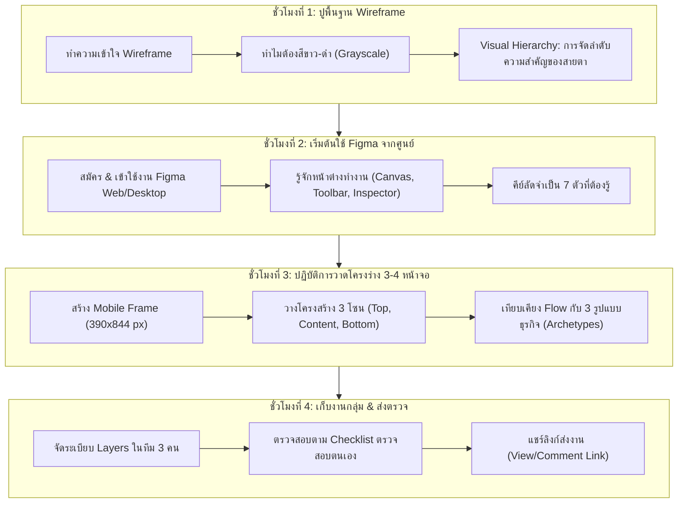

# บทที่ 2: การออกแบบโครงสร้างหน้าจอและโครงร่างจำลองด้วย Figma
*(Mobile App Wireframe Design with Figma - Part 1)*

---

## 🎯 จุดประสงค์การเรียนรู้ประจำบท
เมื่อศึกษาบทเรียนนี้และปฏิบัติการตามขั้นตอนเสร็จสิ้น ผู้เรียนสามารถ:
1. อธิบายความหมาย ประโยชน์ และความสำคัญของ **Wireframe (โครงร่างจำลองขาว-ดำ)** ในกระบวนการพัฒนาแอปพลิเคชันได้
2. สมัครและใช้งานเครื่องมือพื้นฐานของ **Figma** (Frame, Shapes, Text, Alignment, Layer Management) ได้อย่างคล่องแคล่ว
3. ออกแบบ Wireframe ขนาดหน้าจอมือถือมาตรฐาน (390 x 844 px) จำนวน 3-4 หน้าจอตามแนวคิดของกลุ่มตนเองได้ครบถ้วน
4. ประยุกต์ใช้แนวคิดโครงสร้างหน้าจอตาม **3 รูปแบบธุรกิจ (Archetypes)** เพื่อให้ตอบโจทย์การใช้งานจริงได้
5. ทำงานร่วมกันในทีม 3 คนบนไฟล์ Figma เดียวกัน จัดการเลเยอร์อย่างเป็นระบบ และแชร์ลิงก์ส่งงานได้อย่างถูกต้อง

---

## 🧭 แผนผังการเรียนรู้ประจำสัปดาห์ที่ 2 (4 ชั่วโมง)



---

## 1. ทำความเข้าใจ Wireframe: พิมพ์เขียวก่อนลงมือก่อสร้าง

### 1.1 Wireframe คืออะไร?
**Wireframe (ไวร์เฟรม)** คือ "ภาพร่างโครงสร้างเชิงสถาปัตยกรรม" ของหน้าจอแอปพลิเคชัน ที่แสดงเฉพาะ **ตำแหน่งขององค์ประกอบ (Layout), ลำดับความสำคัญของเนื้อหา (Hierarchy), และเส้นทางการทำงาน (Navigation Flow)** โดยตัดองค์ประกอบเรื่องสีสันตกแต่ง, รูปภาพจริง, และฟอนต์กราฟิกวิจิตรออกทั้งหมด คงเหลือไว้เพียงสีขาว, เทา, ดำ และเส้นกรอบเรขาคณิตพื้นฐาน

เปรียบเสมือน **"พิมพ์เขียวของบ้าน (Blueprint)"** ที่สถาปนิกเขียนขึ้นเพื่อระบุว่า ประตูอยู่ตรงไหน ห้องน้ำอยู่ทิศใด บันไดมีความกว้างเท่าไร ก่อนที่จะให้ช่างปูกระเบื้องและช่างทาสีเข้ามาทำงาน หากเราไม่ทำพิมพ์เขียวให้เรียบร้อยก่อน แล้วลงมือทาสีหรือสร้างห้องทันที เมื่อพบว่าลืมเจาะช่องประตู การทุบตึกเพื่อแก้ไขย่อมก่อให้เกิดความสูญเสียมหาศาล ทั้งเวลาและงบประมาณ

```
┌────────────────────────────────────────────────────────────────────────┐
│                        ลำดับขั้นของการออกแบบ UI/UX                      │
├───────────────────────┬────────────────────────────────────────────────┤
│ 1. Sketch             │ วาดมือบนกระดาษอย่างรวดเร็วเพื่อระดมไอเดีย      │
│ 2. Wireframe (บทนี้)   │ โครงร่างขาว-ดำแบบดิจิทัล จัดวางตำแหน่งและสัดส่วน│
│ 3. Mockup (บทที่ 3)   │ ลงสีจริง ใส่รูปภาพจริง ตัวอักษรและแบรนด์ครบถ้วน│
│ 4. Prototype (บทที่ 4)│ เชื่อมโยงหน้าจอให้คลิก/สัมผัสโต้ตอบได้บนมือถือ │
└───────────────────────┴────────────────────────────────────────────────┘
```

---

### 1.2 กฎเหล็ก: ทำไม Wireframe ต้องใช้เฉพาะสีขาว-ดำ-เทา (Grayscale)?
ข้อผิดพลาดอันดับ 1 ของผู้เริ่มต้นออกแบบ UI คือ **"การรีบกระโดดไปเลือกสีและหารูปสวย ๆ มาใส่"** ซึ่งจะทำให้เกิดปัญหาต่อไปนี้:
1. **เสียสมาธิจากฟังก์ชันหลัก (Distraction):** สมาชิกในกลุ่มจะเริ่มถกเถียงกันว่า "สีชมพูนี้สวยกว่าสีฟ้าหรือไม่" แทนที่จะสนใจว่า "ปุ่มกดสั่งซื้อวางอยู่ตำแหน่งที่นิ้วโป้งกดถึงง่ายหรือไม่"
2. **ภาพลวงตาทางสายตา (Visual Bias):** รูปภาพที่สวยงามอาจหลอกตาให้เรารู้สึกว่าหน้านั้นออกแบบดีแล้ว ทั้งที่จริง ๆ โครงสร้างการจัดวางซับซ้อนและหาปุ่มกดยากมาก
3. **การแก้ไขที่เชื่องช้า:** หากลงสีและใส่กราฟิกเต็มรูปแบบ เมื่อครูผู้สอนหรือเจ้าของร้านขอปรับเปลี่ยน Flow หน้าจอ จะต้องเสียเวลาแก้งานนานกว่าการขยับกล่องสี่เหลี่ยมใน Wireframe ถึง 10 เท่า

> [!IMPORTANT]
> **กฎประจำบทเรียน:** ทุกชิ้นงานที่สร้างในบทที่ 2 นี้ **ห้ามใส่สีสันใด ๆ ทั้งสิ้น** ให้ใช้เฉพาะเฉดสีดังนี้:
> - พื้นหลัง: สีขาว (`#FFFFFF`)
> - กล่องรูปภาพ/การ์ด: สีเทาอ่อน (`#F2F2F2` หรือ `#E5E5E5`)
> - เส้นขอบ/เส้นแบ่ง: สีเทากลาง (`#CCCCCC` หรือ `#B3B3B3`)
> - ข้อความและไอคอน: สีเทาเข้ม (`#666666`) ถึงสีดำ (`#000000`)

---

### 1.3 หลักการจัดลำดับการรับรู้ทางสายตา (Visual Hierarchy)
เมื่อผู้ใช้งานเปิดหน้าจอแอปขึ้นมา สายตาจะกวาดมองสิ่งที่โดดเด่นที่สุดก่อนเสมอ การออกแบบ Wireframe ที่ดีต้องกำหนดทิศทางสายตาของผู้ใช้ได้ทันทีโดยไม่ต้องมีสี ด้วยเทคนิค 3 ประการ:
1. **ขนาด (Scale):** สิ่งสำคัญที่สุดต้องมีขนาดใหญ่ที่สุด เช่น ชื่อหน้าจอ (24px) ย่อมใหญ่กว่าข้อความรายละเอียด (14px)
2. **น้ำหนักและความเข้ม (Weight & Contrast):** หัวข้อสำคัญใช้สีดำทึบหรือฟอนต์หนา ส่วนคำอธิบายประกอบใช้สีเทากลาง
3. **พื้นที่ว่าง (White Space):** องค์ประกอบที่อยู่ชิดกันคือเรื่องเดียวกัน หากเป็นคนละหมวดหมู่ต้องเว้นระยะห่างให้ชัดเจน (อิงตาม Base Unit 8px)

```
[ตัวอย่าง Visual Hierarchy บน Wireframe]

┌───────────────────────────────────────┐
│ [←]               หัวข้อหน้าจอ (20px) │ ← น้ำหนักหนา ชัดเจน
├───────────────────────────────────────┤
│ ┌───────────────────────────────────┐ │
│ │                                   │ │
│ │          กล่องรูปภาพ (16:9)       │ │ ← กล่องเทาอ่อน มีกากบาทไขว้
│ │                                   │ │
│ └───────────────────────────────────┘ │
│                                       │
│ ชื่อนูนเด่น (16px, หนา)                │ ← สายตาอ่านจุดนี้ก่อน
│ คำอธิบายรายละเอียดสินค้าย่อ 2 บรรทัด  │ ← ข้อความเทากลาง (12px)
│ สีเทาอ่านสบายตา...                    │
│                                       │
│ ฿120.00                               │ ← ราคาเด่นชัด
│                                       │
│ ┌───────────────────────────────────┐ │
│ │         [ ปุ่มกดหลัก ดำทึบ ]       │ │ ← Call to Action ใหญ่ ชัดเจน
│ └───────────────────────────────────┘ │
└───────────────────────────────────────┘
```

---

## 2. เริ่มต้นใช้งาน Figma สำหรับการศึกษา (จากศูนย์สู่การใช้งานจริง)

**Figma** เป็นโปรแกรมออกแบบระดับโลกที่ทำงานบนคลาวด์ 100% สามารถเปิดใช้งานผ่านเว็บเบราว์เซอร์ (Chrome, Edge, Safari) หรือติดตั้งเป็นโปรแกรมบนคอมพิวเตอร์ได้ โดยมีจุดเด่นสูงสุดคือ **การทำงานร่วมกันแบบเรียลไทม์ (Real-time Collaboration)** ทำให้สมาชิกในกลุ่มทั้ง 3 คนสามารถเข้ามาวาดหน้าจอในไฟล์เดียวกันพร้อมกันได้ทันที

### 2.1 ขั้นตอนการเข้าใช้งาน Figma (ทีละคลิก)
1. เปิดเบราว์เซอร์ ไปที่เว็บไซต์ [www.figma.com](https://www.figma.com)
2. คลิกปุ่ม **"Get started for free"** หรือ **"Sign up"** ที่มุมขวาบน
3. แนะนำให้เลือก **"Continue with Google"** โดยใช้อีเมลสถานศึกษา (@bpg หรืออีเมล Gmail ประจำกลุ่ม)
4. เมื่อเข้าสู่ระบบเรียบร้อย ให้คลิกที่เมนูด้านซ้ายบน เลือกปุ่ม **"+ Design file"** (ปุ่มสีฟ้า) เพื่อเปิดกระดานทำงานว่างเปล่าขึ้นมาใหม่
5. ตั้งชื่อไฟล์ที่มุมบนซ้าย จาก `Untitled` เปลี่ยนเป็น:  
   `[เลขที่กลุ่ม]_[ชื่อโปรเจกต์]_Wireframe` (เช่น `Group03_TeaTime_Wireframe`)

---

### 2.2 โครงสร้างหน้าจอการทำงานของ Figma (The Figma Interface)

```
┌───────────────────────────────────────────────────────────────────────────────────┐
│ 1. Top Toolbar (แถบเครื่องมือหลักด้านบน)                                           │
│ [Menu] [Move (V)] [Frame (F)] [Shape (R)] [Pen] [Text (T)] [Resources] [Hand] [💬]│
├──────────────────────┬────────────────────────────────────┬───────────────────────┤
│ 2. Left Sidebar      │ 3. Center Canvas                   │ 4. Right Sidebar      │
│    (เลเยอร์และหน้า)  │    (พื้นที่กระดานทำงานสีเทาเข้ม)   │    (แถบปรับแต่งสไตล์) │
│                      │                                    │                       │
│ - Layers             │   ┌──────────┐  ┌──────────┐       │ - Position (X, Y)     │
│   ├─ Frame 1 (Home)  │   │          │  │          │       │ - Dimensions (W, H)   │
│   │   ├─ Header      │   │ Screen 1 │  │ Screen 2 │       │ - Layout / Auto Layout│
│   │   └─ Card        │   │          │  │          │       │ - Fill (สีพื้นหลัง)   │
│   └─ Frame 2 (Detail)│   └──────────┘  └──────────┘       │ - Stroke (เส้นขอบ)    │
│                      │                                    │ - Effects (เงา)       │
└──────────────────────┴────────────────────────────────────┴───────────────────────┘
```

1. **Top Toolbar:** แหล่งรวมเครื่องมือวาดทั้งหมด (คลิกเลือก หรือกดปุ่มคีย์ลัด)
2. **Left Sidebar (Layers Panel):** แสดงรายชื่อหน้าจอ (Frames) และชิ้นส่วนทั้งหมด เรียงลำดับจากบนลงล่าง (ชิ้นที่อยู่บนสุดของรายการจะทับชิ้นอื่นบนหน้าจอ)
3. **Center Canvas:** กระดานทำงานแบบอินฟินิตี้ (ย่อ-ขยายและเลื่อนได้อิสระ)
4. **Right Sidebar (Design Inspector):** แผงตั้งค่าขนาด พิกัด สี เส้นขอบ และฟอนต์ของวัตถุที่กำลังคลิกเลือกอยู่

---

### 2.3 ตารางสรุป 7 คีย์ลัดจำเป็น (Shortcut Cheatsheet)
ช่วยให้การทำงานเร็วขึ้นกว่าการใช้เมาส์คลิกหาเมนูถึง 3 เท่า:

| คีย์ลัด | คำสั่ง | ประโยชน์และการใช้งาน |
|:---:|:---|:---|
| **`V`** | **Move Tool** | เครื่องมือลูกศรพื้นฐาน ใช้คลิกเลือกวัตถุ หรือลากย้ายตำแหน่ง |
| **`F`** | **Frame Tool** | ใช้คลิกแล้วลากเพื่อสร้างขนาดหน้าจอโทรศัพท์ |
| **`R`** | **Rectangle** | สร้างกล่องสี่เหลี่ยม (ใช้แทนรูปภาพ, การ์ด, หรือปุ่มกด) |
| **`O`** | **Ellipse** | สร้างวงกลม (ใช้แทนรูป Avatar โปรไฟล์ผู้ใช้) |
| **`T`** | **Text Tool** | พิมพ์ข้อความ |
| **`Spacebar` + ลากเมาส์** | **Hand Tool** | เลื่อนกระดานทำงาน (Pan Canvas) ไปทิศทางต่าง ๆ อย่างลื่นไหล |
| **`Alt` (Win) / `Option` (Mac) + ลากวัตถุ** | **Duplicate** | ก๊อปปี้วัตถุเดิมออกมาอีก 1 ชิ้นทันทีโดยไม่ต้องกด Ctrl+C / Ctrl+V |

---

## 3. ปฏิบัติการสร้าง Mobile Frame และโครงสร้างหน้าจอ 3 โซน

### 3.1 การสร้าง Frame หน้าจอมือถือมาตรฐาน
ในแวดวงการออกแบบสากล ขนาดหน้าจอมือถือที่นิยมใช้เป็นฐานในการออกแบบ UI มากที่สุดคือ **390 x 844 พิกเซล** (ขนาดหน้าจอ iPhone 13 / 14 / 15) ซึ่งใกล้เคียงกับมาตรฐาน Android ทั่วไป

**ขั้นตอนการสร้าง:**
1. กดปุ่ม **`F`** บนคีย์บอร์ด (สังเกตแผงขวามือจะปรากฏรายการโมเดลโทรศัพท์ให้เลือก)
2. ที่แผงขวา คลิกเลือกหัวข้อ **"Phone"** -> เลือก **"iPhone 14 & 15"** (ขนาดจะถูกตั้งเป็น W: 390, H: 844 ทันที)
3. เปลี่ยนชื่อ Frame ที่มุมซ้ายบนของกรอบ โดยดับเบิลคลิกที่ชื่อ แล้วพิมพ์: `01_Home`
4. กดปุ่ม `Alt` ค้างไว้ แล้วคลิกลากกรอบ `01_Home` ออกไปทางขวา 3 ครั้ง เพื่อสร้างหน้าจอเพิ่มอีก 3 กรอบ จากนั้นเปลี่ยนชื่อเป็น:
   - `02_Detail`
   - `03_Action_Form`
   - `04_Success`

---

### 3.2 โครงสร้างกายวิภาค 3 โซนของแอปพลิเคชันมือถือ (The 3 Anatomy Zones)
ไม่ว่าจะเป็นแอปพลิเคชันรูปแบบใด หน้าจอมือถือจะถูกแบ่งโซนการใช้งานออกเป็น 3 ส่วนหลักเสมอ:

```
┌───────────────────────────────────────┐ ─── [โซนที่ 1: Top Bar / Header Area]
│ [=]           โลโก้ / ชื่อหน้า    [🔔] │  ความสูงคงที่: 56 - 64 px
├───────────────────────────────────────┤
│                                       │ ─── [โซนที่ 2: Main Content Area]
│   (พื้นที่แสดงเนื้อหาหลัก เลื่อน Scroll ได้)│  ความสูงยืดหยุ่นตามเนื้อหา: 700+ px
│                                       │  - กล่องค้นหา
│   ┌───────────────────────────────┐   │  - แถบหมวดหมู่
│   │                               │   │  - รายการการ์ดสินค้า / ข้อมูล
│   │       พื้นที่แสดงผลข้อมูล     │   │
│   │                               │   │
│   └───────────────────────────────┘   │
│                                       │
├───────────────────────────────────────┤ ─── [โซนที่ 3: Bottom Navigation / Action]
│  [🏠 หน้าแรก]   [📋 รายการ]   [👤 ฉัน] │  ความสูงคงที่: 64 - 80 px (โซนนิ้วโป้งเอื้อมถึงง่าย)
└───────────────────────────────────────┘
```

1. **โซนบน (Top Navigation / Header):** สูงประมาณ 56-64 px
   - ประกอบด้วย: ปุ่มเมนู/ปุ่มย้อนกลับ `[←]`, ชื่อหน้าจอปัจจุบัน, และปุ่ม Action เร่งด่วน (เช่น ไอคอนแจ้งเตือน หรือช่องค้นหา)
2. **โซนกลาง (Main Scrollable Content Area):**
   - เป็นพื้นที่เนื้อหาหลักที่เลื่อนขึ้นลงได้ ประกอบด้วยการ์ดข้อมูล, แบนเนอร์, หรือฟอร์มกรอกข้อความ
3. **โซนล่าง (Bottom Navigation / Sticky Action Bar):** สูงประมาณ 64-80 px
   - อยู่ในตำแหน่งที่นิ้วโป้งของผู้ใช้กดได้ง่ายที่สุด (Thumb Zone) นิยมวางแถบเมนูหลัก (Bottom Tabs) 3-4 ปุ่ม หรือปุ่มกดสั่งซื้อยืนยัน (Sticky CTA Button)

---

### 3.3 การวาดสัญลักษณ์จำลองของ Wireframe (Wireframe UI Kit)
เนื่องจากเราไม่ใช้รูปภาพจริง จึงต้องใช้ "สัญลักษณ์มาตรฐานสากล" ในการสื่อสาร:

```
[สัญลักษณ์มาตรฐานบน Wireframe]

1. กล่องรูปภาพ (Image Placeholder):
   ┌───────────────┐
   │ ╲           ╱ │  สร้างสี่เหลี่ยมสีเทาอ่อน (#F2F2F2) 
   │   ╲       ╱   │  แล้วลากเส้นทแยงมุมกากบาทตัดกัน
   │     ╳         │  เพื่อสื่อว่า "ตรงนี้เป็นพื้นที่แสดงรูปถ่าย"
   │   ╱       ╲   │
   │ ╱           ╲ │
   └───────────────┘

2. กล่องข้อความหัวข้อ (Header Text):
   พิมพ์ข้อความจริง หรือใช้กล่องสี่เหลี่ยมสีเทาเข้ม (#666666) ความสูง 16-20 px

3. ย่อหน้าข้อความประกอบ (Body Text Placeholder):
   ══════════════════════════════   ลากเส้นแนวนอนสีเทาอ่อนหนา 2-4 px
   ══════════════════════           เรียงซ้อนกัน 2-3 บรรทัด
   ════════════════════             เพื่อแทนข้อความคำอธิบายยาวๆ

4. ปุ่มกดหลัก (Primary Button):
   ┌───────────────────────────────┐  สี่เหลี่ยมมุมโค้ง (Corner Radius: 8px หรือ Full)
   │         ปุ่มกด (ดำทึบ)         │  พื้นหลังสีดำ (#0F0F0F) ตัวหนังสือขาว (#FFFFFF)
   └───────────────────────────────┘

5. ช่องกรอกข้อมูล (Input Field):
   ┌───────────────────────────────┐  สี่เหลี่ยมสีขาว ขอบเทากลาง (#CCCCCC)
   │  พิมพ์ข้อความค้นหา...         │  มีข้อความ Placeholder สีเทาอ่อนข้างใน
   └───────────────────────────────┘
```

---

## 4. เจาะลึก 3 รูปแบบธุรกิจ (Archetypes) พร้อมตัวอย่าง Wireframe 4 หน้าจอ

เพื่อให้นักเรียนกลุ่ม 3 คนสามารถนำไปเทียบเคียงกับโปรเจกต์ของกลุ่มตนเองได้ทันที ให้เลือกศึกษาและประยุกต์ใช้ตาม 1 ใน 3 รูปแบบโครงสร้างต่อไปนี้:

---

### รูปแบบที่ 1: ธุรกิจสั่งซื้อสินค้าและอาหาร (Catalog & Ordering Flow)
> **กลุ่มธุรกิจที่เข้าข่าย:** ร้านชานมไข่มุก, ร้านเบเกอรี, ร้านขายของชำชุมชน, ร้านจำหน่ายเสื้อผ้าแฟชั่น, ร้านอาหารตามสั่ง

```
┌─────────────────────────┐  ┌─────────────────────────┐  ┌─────────────────────────┐  ┌─────────────────────────┐
│ 1. Home / Catalog       │  │ 2. Product Detail       │  │ 3. Cart & Checkout      │  │ 4. Order Confirmation   │
├─────────────────────────┤  ├─────────────────────────┤  ├─────────────────────────┤  ├─────────────────────────┤
│ [=] Fresh Brew      [🛒]│  │ [← ย้อนกลับ]            │  │ [←] ตะกร้าสินค้า        │  │                         │
│ ┌─────────────────────┐ │  │ ┌─────────────────────┐ │  │ รายการสินค้า (2 รายการ)  │  │         ( ✔ )           │
│ │ 🔍 ค้นหาเครื่องดื่ม... │ │  │ │                     │ │  │ ┌─────────────────────┐ │  │      สั่งซื้อสำเร็จ!     │
│ └─────────────────────┘ │  │ │    รูปสินค้าขนาดใหญ่   │ │  │ │ [IMG] ชานมไต้หวัน   │ │  │                         │
│ [ทั้งหมด] [ชา] [กาแฟ] [ขนม]│ │ └─────────────────────┘ │  │ │  หวาน 50%  x2  ฿110  │ │  │ รหัสคำสั่งซื้อ: #TB-8821│
│ ┌─────────┐ ┌─────────┐ │  │ ชานมไต้หวันบราวชูการ์   │ │  │ └─────────────────────┘ │  │                         │
│ │ [IMG]   │ │ [IMG]   │ │  │ ฿55.00                │ │  │ ┌─────────────────────┐ │  │ ┌─────────────────────┐ │
│ │ ชานม    │ │ ชาเขียว │ │  │ ══════════════════════ │ │  │ │ [IMG] ขนมปังปิ้งเนย │ │  │ │ สรุปยอด: ฿150.00     │ │
│ │ ฿55     │ │ ฿60     │ │  │ ระดับความหวาน:         │ │  │ │  เนยสด    x1   ฿40  │ │  │ │ วิธีชำระ: สแกน QR    │ │
│ └─────────┘ └─────────┘ │  │ ( ) 100%  (•) 50%  ( )0%│ │  │ └─────────────────────┘ │  │ │ รับที่: หน้าร้าน       │ │
│ ┌─────────┐ ┌─────────┐ │  │ ท็อปปิ้ง (+฿10):       │ │  │ สรุปยอดรวม: ฿150.00    │ │  │ └─────────────────────┘ │
│ │ [IMG]   │ │ [IMG]   │ │  │ [✓] ไข่มุก  [ ] พุดดิ้ง │ │  │ สถานที่รับ: [เลือกสาขา ▼]│ │  │                         │
│ │ กาแฟสด  │ │ ขนมปัง  │ │  │ ┌─────────────────────┐ │  │ ┌─────────────────────┐ │  │ ┌─────────────────────┐ │
│ └─────────┘ └─────────┘ │  │ │ [ + เพิ่มลงตะกร้า ]  │ │  │ │   [ ยืนยันสั่งซื้อ ]  │ │  │ │  [ กลับสู่หน้าหลัก ]  │ │
│ [🏠หน้าแรก] [📋ออร์เดอร์] │  │ └─────────────────────┘ │  │ └─────────────────────┘ │  │ └─────────────────────┘ │
└─────────────────────────┘  └─────────────────────────┘  └─────────────────────────┘  └─────────────────────────┘
```

**สาระสำคัญของ Flow นี้:**
- **หน้า 1 (Catalog):** แสดงหมวดหมู่สินค้าแบบแนวนอน (Chips) และตารางสินค้าแบบ 2 คอลัมน์ พร้อมราคาชัดเจน
- **หน้า 2 (Detail):** มีรูปใหญ่ มีตัวเลือกวิทยุ (Radio Button) ให้เลือกระดับความหวาน และ Checkbox สำหรับท็อปปิ้ง
- **หน้า 3 (Cart):** รายการสรุป มีปุ่มปรับจำนวน `[+]` `[-]` และแสดงยอดรวมสุทธิอย่างชัดเจน
- **หน้า 4 (Success):** มีเครื่องหมายถูกตัวใหญ่ เลขรหัสคำสั่งซื้อ และปุ่มพากลับสู่หน้าหลัก

---

### รูปแบบที่ 2: ธุรกิจบริการและจองคิว/นัดหมาย (Service & Appointment Flow)
> **กลุ่มธุรกิจที่เข้าข่าย:** คลินิกสัตว์เลี้ยง/กรูมมิ่ง, ร้านตัดผม/เสริมสวย, คลินิกรักษาสิว, อู่ซ่อมรถ/ล้างรถ, ห้องซ้อมดนตรี

```
┌─────────────────────────┐  ┌─────────────────────────┐  ┌─────────────────────────┐  ┌─────────────────────────┐
│ 1. Service List         │  │ 2. Select Date & Slot   │  │ 3. Customer Info Form   │  │ 4. Booking Ticket       │
├─────────────────────────┤  ├─────────────────────────┤  ├─────────────────────────┤  ├─────────────────────────┤
│ [=] Happy Paws Care [🔔]│  │ [←] เลือกวันและเวลา     │  │ [←] ข้อมูลผู้รับบริการ  │  │                         │
│ ┌─────────────────────┐ │  │ บริการ: อาบน้ำตัดขน     │  │ สรุปการจอง: อาบน้ำตัดขน │  │      ( นัดหมายสำเร็จ )   │
│ │ 📅 คิวว่างวันนี้: 4 คิว│ │  │ ┌─────────────────────┐ │  │ วันที่ 24 ต.ค. เวลา 13:00│  │                         │
│ └─────────────────────┘ │  │ │ [ < ] ตุลาคม 2026 [ > ]│ │  │ ─────────────────────── │  │ บัตรคิวที่: #Q-014     │
│ บริการยอดนิยม:           │  │ │ จ  อ  พ  พฤ  ศ  ส  อา │ │  │ ชื่อสัตว์เลี้ยง:          │  │ ┌─────────────────────┐ │
│ ┌─────────────────────┐ │  │ │    [24] 25 26 27 28 29 │ │  │ [ น้องมอมแมม          ]│  │ │ คลินิก Happy Paws   │ │
│ │ [IMG] อาบน้ำ-ตัดขน   │ │  │ └─────────────────────┘ │  │ สายพันธุ์/ขนาด:          │  │ │ วันที่: 24 ต.ค. 2026 │ │
│ │ สุนัข/แมว  ฿350 - 500│ │  │ รอบเวลาที่ว่าง:        │  │ [ สุนัขพันธุ์เล็ก (ชิวาวา)▼]│  │ │ เวลา: 13:00 - 14:30  │ │
│ └─────────────────────┘ │  │ ┌──────┐ ┌──────┐       │  │ ชื่อเจ้าของ / เบอร์โทร: │  │ │ ช่าง: คุณหมอสมชาย     │ │
│ ┌─────────────────────┐ │  │ │ 10:00│ │ 11:30│ (เต็ม)│  │ [ 081-234-5678        ]│  │ └─────────────────────┘ │
│ │ [IMG] ฉีดวัคซีนรวม   │ │  │ └──────┘ └──────┘       │  │ อาการเพิ่มเติม/ข้อควรระวัง:│  │ กรุณามาถึงก่อนเวลา 10 นาที│
│ │ สุขภาพ  ฿450        │ │  │ ┌──────┐ ┌──────┐       │  │ [ แพ้ยาฆ่าเห็บ         ]│  │                         │
│ └─────────────────────┘ │  │ │ 13:00│ │ 15:00│       │  │ ┌─────────────────────┐ │  │ ┌─────────────────────┐ │
│ ┌─────────────────────┐ │  │ └──────┘ └──────┘       │  │ │   [ ยืนยันการจองคิว ] │ │  │ │  [ บันทึกบัตรนัด ]   │ │
│ │ [ นัดหมายบริการใหม่ ]│ │  │ ┌─────────────────────┐ │  │ └─────────────────────┘ │  │ └─────────────────────┘ │
│ └─────────────────────┘ │  │ │ [ ถัดไป: กรอกข้อมูล ] │ │  │                         │  │                         │
│ [🏠หน้าหลัก] [📅คิวของฉัน]│  │ └─────────────────────┘ │  │                         │  │                         │
└─────────────────────────┘  └─────────────────────────┘  └─────────────────────────┘  └─────────────────────────┘
```

**สาระสำคัญของ Flow นี้:**
- **หน้า 1 (Service List):** เน้นแสดงการ์ดบริการที่มีระยะเวลาและราคาเริ่มต้น พร้อมแถบสถานะคิวว่าง
- **หน้า 2 (Time Slot Selection):** วางโครงร่างปฏิทินแบบมินิ และชิปแสดงช่วงเวลา (Slots) แบ่งสถานะ "ว่าง" และ "เต็ม"
- **หน้า 3 (Booking Form):** ฟอร์มกรอกชื่อผู้รับบริการ, เบอร์ติดต่อ, Dropdown เลือกประเภท และกล่องหมายเหตุ
- **หน้า 4 (Booking Ticket):** มีหน้าตาคล้าย "บัตรนัดดิจิทัล (Digital Appointment Pass)" มีหมายเลขคิวเด่นชัด

---

### รูปแบบที่ 3: ระบบยืม-คืนพัสดุและครุภัณฑ์ภายใน (Asset Tracking & Operations Flow)
> **กลุ่มธุรกิจที่เข้าข่าย:** ยืม-คืนอุปกรณ์กล้อง/โสตฯ แผนกวิชา, คลังเครื่องมือช่าง, ห้องพยาบาล/ยืมเวชภัณฑ์, ห้องสมุด/ยืมหนังสือ, การเบิกจ่ายพัสดุสำนักงาน

```
┌─────────────────────────┐  ┌─────────────────────────┐  ┌─────────────────────────┐  ┌─────────────────────────┐
│ 1. Asset Catalog/Scan   │  │ 2. Asset Specification  │  │ 3. Borrow Checkout Form │  │ 4. Borrow Receipt/QR    │
├─────────────────────────┤  ├─────────────────────────┤  ├─────────────────────────┤  ├─────────────────────────┤
│ [=] IT Equipment    [🔍]│  │ [←] รายละเอียดครุภัณฑ์  │  │ [←] แบบฟอร์มทำรายการยืม │  │                         │
│ ┌─────────────────────┐ │  │ รหัส: #CAM-SONY-04      │  │ รายการที่เลือก: 1 รายการ │  │      ( บันทึกสำเร็จ )   │
│ │ [📷 สแกนบาร์โค้ดหา] │ │  │ ┌─────────────────────┐ │  │ ┌─────────────────────┐ │  │                         │
│ └─────────────────────┘ │  │ │                     │ │  │ │ [IMG] SONY A7 IV    │ │  │ รหัสใบยืม: #BR-2026-092 │
│ สถานะ: [ทั้งหมด] [ว่าง] [ยืม]│ │    รูปถ่ายอุปกรณ์จริง │ │  │ │ หมายเลข: CAM-SONY-04│ │  │ ┌─────────────────────┐ │
│ ┌─────────────────────┐ │  │ └─────────────────────┘ │  │ └─────────────────────┘ │  │ │      [ QR CODE ]      │ │
│ │ [IMG] กล้อง Sony A7 │ │  │ Sony Alpha A7 IV (Body) │ │  │ วันที่ต้องการยืม:       │  │ │    สำหรับสแกนคืนพัสดุ  │ │
│ │ สถานะ: [ ว่าง ]     │ │  │ หมวด: โสตทัศนูปกรณ์    │ │  │ [ 24 ต.ค. 2026       ]│  │ └─────────────────────┘ │
│ └─────────────────────┘ │  │ ตำแหน่งเก็บ: ตู้ B2 ชั้น 3 │  │ กำหนดส่งคืนภายใน:        │  │ ผู้ยืม: นายสมศักดิ์ ปวส.1/1│
│ ┌─────────────────────┐ │  │ สภาพ: พร้อมใช้งาน ดีมาก  │  │ [ 26 ต.ค. 2026 (16:30) ]│  │ กำหนดคืน: 26 ต.ค. 16:30│
│ │ [IMG] ขาตั้งกล้อง   │ │  │ อุปกรณ์ที่ให้ไปพร้อมกัน: │  │ วัตถุประสงค์การใช้งาน:    │  │ ─────────────────────── │
│ │ สถานะ: [ ถูกยืม ]   │ │  │ - แบตเตอรี่ 2 ก้อน, แท่นชาร์จ│ [ ถ่ายงานนิทรรศการ วท. ]│  │ [✓] เซ็นชื่อกำกับแล้ว    │
│ └─────────────────────┘ │  │ ┌─────────────────────┐ │  │ ลายมือชื่อผู้ขอยืม (Sign):│  │ ┌─────────────────────┐ │
│ [🏠คลังของ] [📑ประวัติยืม]│ │ │ [ ทำรายการยืมชิ้นนี้ ]│ │  │ ┌─────────────────────┐ │  │ │  [ ดาวน์โหลดใบยืม ] │ │
│ └─────────────────────┘ │  │ └─────────────────────┘ │  │ │  (เซ็นชื่อดิจิทัลที่นี่)│ │  │ └─────────────────────┘ │
│                         │  │                         │  │ └─────────────────────┘ │  │                         │
└─────────────────────────┘  └─────────────────────────┘  └─────────────────────────┘  └─────────────────────────┘
```

**สาระสำคัญของ Flow นี้:**
- **หน้า 1 (Asset Dashboard):** มีปุ่มใหญ่สำหรับสแกนบาร์โค้ดทันที และการ์ดแสดงสถานะชัดเจนว่า "ว่าง" หรือ "ถูกยืม"
- **หน้า 2 (Specification):** แสดงรหัสครุภัณฑ์, สถานที่จัดเก็บจริง (ตู้/ชั้น), และอุปกรณ์ส่วนควบในเซ็ต
- **หน้า 3 (Checkout Form):** ระบุกำหนดวันคืนอย่างแม่นยำ และมีกรอบสี่เหลี่ยมสำหรับเซ็นชื่อลายมือชื่อดิจิทัล (Digital Signature)
- **หน้า 4 (Borrow Receipt):** สร้าง QR Code ประจำรอบการยืม เพื่อให้เจ้าหน้าที่ใช้ยิงสแกนตอนนำอุปกรณ์มาส่งคืน

---

## 5. การจัดระเบียบเลเยอร์และการทำงานร่วมกันเป็นทีม 3 คน (Collaboration & Best Practices)

เมื่อทำงานในไฟล์เดียวกัน 3 คน ความสับสนและไฟล์ที่เละเทะมักเกิดขึ้นหากไม่มีข้อตกลงร่วมกัน ให้ปฏิบัติตามกฎ 3 ข้อนี้อย่างเคร่งครัด:

### 5.1 การแบ่งหน้าที่ในคาบเรียน (Role Division for 3 Members)
- **สมาชิกคนที่ 1 (Lead Navigator & Home Master):**
  - รับผิดชอบ: สร้างไฟล์ Figma, เชิญเพื่อนร่วมทีมและครู, ออกแบบหน้า `01_Home / Catalog` และวางระบบ Top Bar/Bottom Bar ให้เพื่อนก๊อปปี้ไปใช้
- **สมาชิกคนที่ 2 (Detail & Information Architect):**
  - รับผิดชอบ: ออกแบบหน้า `02_Detail / Specification` ดูแลเรื่องการจัดวางรูปภาพ สัดส่วนข้อความ และตัวเลือกต่าง ๆ
- **สมาชิกคนที่ 3 (Action Flow & Quality Assurance):**
  - รับผิดชอบ: ออกแบบหน้า `03_Action_Form` และหน้า `04_Success` พร้อมทั้งตรวจสอบความเรียบร้อยของชื่อเลเยอร์ในทุกหน้าจอ

---

### 5.2 กฎการตั้งชื่อเลเยอร์ (Layer Hygiene)
❌ **สิ่งที่ห้ามทำเด็ดขาด:** ปล่อยให้ชื่อเลเยอร์ด้านซ้ายมือเป็นชื่อดิบ เช่น `Rectangle 1`, `Rectangle 2`, `Group 45`, `Frame 12`  
✔️ **สิ่งที่ถูกต้อง:** ตั้งชื่อเลเยอร์ตามหน้าที่ของมันทันทีหลังวาดเสร็จ เช่น:
- `Navbar / TopBar`
- `SearchBox`
- `Card_Item_01`
- `Btn_Submit`
- `Txt_Title`

```
[ตัวอย่างโครงสร้าง Layers ที่เป็นระเบียบ]
▼ 01_Home
   ├── TopBar
   ├── SearchBar
   ├── Category_Chips
   ▼ Item_List
   │   ├── Card_Product_01
   │   ├── Card_Product_02
   │   └── Card_Product_03
   └── BottomNav
```

---

## 6. กิจกรรมปฏิบัติการและเกณฑ์การประเมินชิ้นงานประจำสัปดาห์ (Deliverables & Rubric)

### 📋 ใบงานปฏิบัติการประจำบทที่ 2
**คำสั่ง:** ให้นักเรียนทำงานร่วมกันเป็นกลุ่ม 3 คน ดำเนินการดังนี้:
1. สร้างไฟล์ Figma 1 ไฟล์ต่อกลุ่ม ตั้งชื่อว่า `[กลุ่มที่]_[ชื่อแอป]_Wireframe`
2. สร้าง Mobile Frame ขนาด `390 x 844 px` จำนวนอย่างน้อย **3 ถึง 4 หน้าจอ**
3. ออกแบบโครงสร้าง Wireframe ขาว-ดำ-เทา (Grayscale) ให้สอดคล้องกับแนวคิดโปรเจกต์ที่กลุ่มตนเองเลือกจากบทที่ 1
4. ตรวจสอบความเรียบร้อยตามแบบประเมินตนเองก่อนส่งงาน

---

### 🔍 แบบตรวจสอบตนเองก่อนส่งงาน (Self-Checklist)
- [ ] ขนาดหน้าจอทุกหน้าเป็น `390 x 844 px` (iPhone 14/15 หรือสัดส่วนมือถือที่กำหนด) หรือไม่?
- [ ] ใช้เฉพาะเฉดสีขาว-เทา-ดำ ปราศจากสีสันตกแต่ง (Pure Grayscale) หรือไม่?
- [ ] มีโครงสร้าง 3 โซนครบถ้วน (Top Bar, Content Area, Bottom Bar) หรือไม่?
- [ ] ข้อความหัวข้อ ปุ่มกด และพื้นที่รูปภาพ มีการจัดลำดับสายตา (Hierarchy) ชัดเจนหรือไม่?
- [ ] มีการตั้งชื่อหน้าจอและชื่อเลเยอร์อย่างเป็นระเบียบ ไม่ปรากฏชื่อ Rectangle รกเลเยอร์หรือไม่?
- [ ] สมาชิกในกลุ่มทั้ง 3 คนมีประวัติการร่วมแก้ไขงานในไฟล์เดียวกันหรือไม่?

---

### 📊 เกณฑ์การประเมินชิ้นงานประจำบทที่ 2 (Scoring Rubric : รวม 10 คะแนน)

| เกณฑ์การประเมิน | ระดับดีมาก (เต็ม) | ระดับพอใช้ (ครึ่งคะแนน) | ระดับต้องปรับปรุง (ต่ำกว่าครึ่ง) |
|:---|:---|:---|:---|
| **1. ความครบถ้วนของโครงสร้างหน้าจอ (3 คะแนน)** | มีครบ 3-4 หน้าจอหลัก แสดงเส้นทางการทำงาน (Flow) จากหน้าแรกจนถึงหน้าสำเร็จได้อย่างสมบูรณ์ (3 คะแนน) | มี 2-3 หน้าจอ แต่ Flow ยังขาดตอน ไม่เห็นภาพการทำรายการจนจบ (2 คะแนน) | มีเพียง 1-2 หน้าจอ โครงสร้างไม่สมบูรณ์ (1 คะแนน) |
| **2. ความถูกต้องตามหลัก Wireframe (3 คะแนน)** | ใช้เฉพาะ Grayscale จัดวาง Visual Hierarchy ขนาดตัวหนังสือ และปุ่มกดเด่นชัดตามสัดส่วนนิ้วสัมผัส (3 คะแนน) | มีการแอบใส่สีสันเล็กน้อย หรือสัดส่วนปุ่มกดยังเล็กเกินไปจนกดได้ยาก (2 คะแนน) | นำรูปจริงหรือสีสันมาใช้ผิดวัตถุประสงค์ของการทำ Wireframe (1 คะแนน) |
| **3. ความเป็นระเบียบของไฟล์และเลเยอร์ (2 คะแนน)** | ตั้งชื่อ Frame และ Layers สื่อความหมายชัดเจน จัดกลุ่มหมวดหมู่อย่างเป็นระบบ (2 คะแนน) | ตั้งชื่อ Frame ถูกต้องแต่เลเยอร์ภายในยังเป็น Rectangle ปะปนอยู่ (1 คะแนน) | เลเยอร์รก ไม่มีการจัดกลุ่มหรือตั้งชื่อใด ๆ เลย (0 คะแนน) |
| **4. การมีส่วนร่วมและการแชร์ส่งงาน (2 คะแนน)** | สมาชิกทั้ง 3 คนล็อกอินร่วมทำในไฟล์จริง และแชร์ลิงก์เปิดสิทธิ์ View/Comment ได้ถูกต้อง (2 คะแนน) | สมาชิกทำเพียง 1-2 คน หรือลิงก์ยังติดสิทธิ์ Private ต้องขอ Access (1 คะแนน) | ไม่ได้ทำงานร่วมกัน หรือส่งไฟล์ไม่ทันตามกำหนด (0 คะแนน) |

---

### 📤 ขั้นตอนการส่งงานผ่านระบบ (How to Submit Link)
1. ที่มุมขวาบนของหน้าต่าง Figma คลิกปุ่มสีฟ้า **"Share"**
2. ในช่องด้านล่าง เปลี่ยนตัวเลือกสิทธิ์จาก `Only people invited` ให้เป็น:  
   👉 **"Anyone with the link"** และสิทธิ์เป็น **"can view"**
3. คลิกปุ่ม **"Copy link"**
4. นำลิงก์ที่ได้ไปแนบส่งในระบบส่งงานของสถานศึกษา (Google Classroom / Microsoft Teams) พร้อมระบุรายชื่อสมาชิกกลุ่มทั้ง 3 คน
