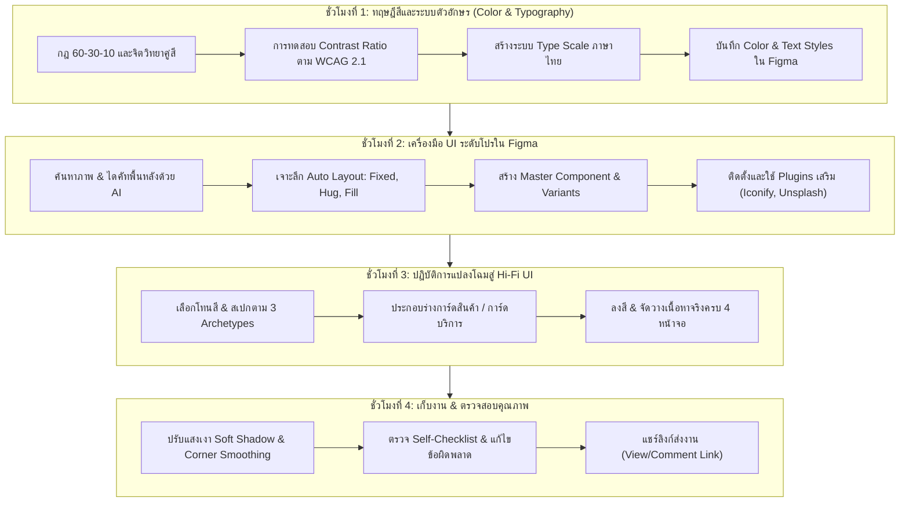

# บทที่ 3: การลงสีและออกแบบ UI ฉบับสมบูรณ์ด้วย Figma
*(High-Fidelity UI Design, Design Systems & Prototyping Preparation - Part 2)*

---

## 🎯 จุดประสงค์การเรียนรู้ประจำบท
เมื่อศึกษาบทเรียนนี้และปฏิบัติการตามขั้นตอนเสร็จสิ้น ผู้เรียนสามารถ:
1. ประยุกต์ใช้ **กฎการใช้สี 60-30-10** และทฤษฎีจิตวิทยาของคู่สี (Color Psychology) ให้สอดคล้องกับภาพลักษณ์ของแบรนด์ได้อย่างกลมกลืน
2. ตรวจสอบค่าความเปรียบต่างของสีและข้อความตามเกณฑ์มาตรฐานสากล **WCAG 2.1 (Contrast Ratio ไม่ต่ำกว่า 4.5:1)** เพื่อให้อ่านง่ายในทุกสภาพแสง
3. จัดระบบตัวอักษร (Typography System) ทั้งระดับหัวข้อ เนื้อหา และราคา ด้วยฟอนต์ภาษาไทยของ Google Fonts ได้อย่างถูกต้อง
4. ค้นหาภาพถ่ายความละเอียดสูงจากแหล่งฟรีถูกลิขสิทธิ์ และใช้เครื่องมือ AI ตัดพื้นหลัง (Die-cut) วัตถุให้คมชัด
5. ใช้งานเครื่องมือขั้นสูงใน Figma: **Auto Layout (Shift + A)** โดยเข้าใจความแตกต่างของ `Fixed`, `Hug contents`, และ `Fill container` อย่างถ่องแท้
6. สร้างและจัดการ **Master Components (`Ctrl+Alt+K`)** พร้อมสร้าง **Variants** สำหรับสถานะปุ่มกดและการ์ดที่นำกลับมาใช้ซ้ำได้
7. ออกแบบหน้าจอ **Hi-Fi UI (High-Fidelity UI)** ฉบับสมบูรณ์จำนวน 4 หน้าจอตามแนวทางของ **3 รูปแบบธุรกิจ (Archetypes)**
8. ทำงานร่วมกันในทีม 3 คน ตรวจสอบงานตาม Checklist และแชร์ลิงก์เพื่อส่งมอบงานได้อย่างมืออาชีพ

---

## 🧭 แผนผังการเรียนรู้ประจำสัปดาห์ที่ 3 (4 ชั่วโมง)



---

## 1. ศาสตร์แห่งสีและฟอนต์: เปลี่ยนหน้าจอดิจิทัลให้มีชีวิต

จากบทที่ 2 ที่เราได้โครงร่างพิมพ์เขียวสีขาว-ดำ (Wireframe) มาแล้ว ในบทนี้คือขั้นตอนที่เปรียบเหมือน **"การฉาบผนัง ปูกระเบื้อง ทาสี ติดตั้งระบบไฟ และตกแต่งเฟอร์นิเจอร์จริง"** การลงสีที่ดีไม่ได้ขึ้นอยู่กับความชอบส่วนบุคคล แต่มีหลักการทางจิตวิทยาและวิทยาศาสตร์การมองเห็นรองรับ

### 1.1 กฎทองคำการใช้สี 60 - 30 - 10 (The 60-30-10 Color Rule)
เพื่อป้องกันไม่ให้แอปพลิเคชันดู "เลอะเทอะ" หรือใช้สีมั่วจนตาลาย วงการออกแบบสากลใช้สูตรจัดสัดส่วนสี 3 ระดับ:

```
┌────────────────────────────────────────────────────────────────────────┐
│                        สัดส่วนสี 60 - 30 - 10                          │
├─────────────────────┬──────────────────────────────────────────────────┤
│ 60% สีหลักพื้นหลัง   │ สีขาวบริสุทธิ์, ครีมอ่อน, หรือเทาสว่าง           │
│ (Dominant Base)     │ โค้ดสี: #FFFFFF, #FAFAF9, #F8FAFC                │
│                     │ ทำหน้าที่เป็นพื้นที่หายใจ สบายตา ไม่แย่งซีนเนื้อหา│
├─────────────────────┼──────────────────────────────────────────────────┤
│ 30% สีโครงสร้าง     │ สีแบรนด์รอง, สีการ์ด, สีพื้นผิว, สีเส้นขอบ       │
│ (Secondary Surface) │ โค้ดสี: #F1F5F9, #E2E8F0, #334155                │
│                     │ ใช้กับการ์ดสินค้า, แถบ Top Bar, ไอคอนทั่วไป       │
├─────────────────────┼──────────────────────────────────────────────────┤
│ 10% สีเน้นนำสายตา    │ สีสด สว่าง เด่นชัด โดดออกมาจากหน้าจอ             │
│ (Accent / CTA)      │ โค้ดสี: #FF0000, #F97316, #0D9488, #1D4ED8       │
│                     │ ใช้เฉพาะ: "ปุ่มสั่งซื้อ", "ป้ายลดราคา", "จุดแจ้งเตือน"│
└─────────────────────┴──────────────────────────────────────────────────┘
```

> [!CAUTION]
> **ข้อผิดพลาดอันตราย:** อย่าใช้สีประจำแบรนด์ (Brand Color) เกิน 20-30% ของหน้าจอ! ตัวอย่างเช่น หากร้านใช้สีแดง ห้ามเทพื้นหลังหน้าจอเป็นสีแดงทั้งหน้า เพราะผู้ใช้งานจะแสบตาและปิดแอปหนีภายใน 5 วินาที ให้ใช้สีขาว 60% แล้วแต้มสีแดงเฉพาะปุ่มสั่งซื้อและป้ายราคาเท่านั้น

---

### 1.2 จิตวิทยาของคู่สีประจำธุรกิจ (Color Psychology)
แต่ละประเภทธุรกิจส่งผลต่อความรู้สึกของผู้ใช้งานแตกต่างกัน โดยในหลักสูตรนี้เรากำหนดพาเลทสีมาตรฐานไว้ให้เลือกใช้งาน:

| กลุ่มธุรกิจ | โทนสีแนะนำ | รหัสสี (Hex Codes) | จิตวิทยาและความรู้สึกที่ส่งมอบ |
|:---|:---|:---|:---|
| **อาหาร / เครื่องดื่ม / คาเฟ่** | ส้มคาราเมล, น้ำตาลอบอุ่น, ครีมเนย | Primary: `#D97706`<br>Hover: `#B45309`<br>Base: `#FAFAF9` | กระตุ้นความอยากอาหาร รู้สึกถึงความหอมกรุ่น อบอุ่น เป็นมิตร และความคุ้มค่า |
| **สุขภาพ / สัตว์เลี้ยง / คลินิก** | เขียวมิ้นต์, ฟ้าเทอร์ควอยซ์, เหลืองอำพัน | Primary: `#0D9488`<br>Accent: `#F59E0B`<br>Base: `#F8FAFC` | ให้ความรู้สึกสะอาด ปลอดเชื้อ ปลอดภัย ไว้วางใจ สบายใจ และอ่อนโยนต่อสิ่งมีชีวิต |
| **เทคโนโลยี / โลจิสติกส์ / คลัง** | น้ำเงินรอยัลบลู, กรมท่า, เทาสเลท | Primary: `#1D4ED8`<br>Dark: `#0F172A`<br>Base: `#F1F5F9` | สะท้อนความแม่นยำ เป็นมืออาชีพ น่าเชื่อถือ เป็นระบบระเบียบ และทันสมัย |

---

### 1.3 การตรวจสอบความคมชัดและการเข้าถึง (Visual Contrast & WCAG 2.1)
มาตรฐานสากล **WCAG (Web Content Accessibility Guidelines)** กำหนดว่า ข้อความปกติจะต้องมีอัตราส่วนความเปรียบต่างกับพื้นหลัง (Contrast Ratio) ดังนี้:
- **ข้อความขนาดปกติ (ต่ำกว่า 18px):** ต้องมี Contrast Ratio อย่างน้อย **4.5:1** (ระดับ AA)
- **ข้อความขนาดใหญ่ (18px ขึ้นไป หรือ 14px หนา):** ต้องมี Contrast Ratio อย่างน้อย **3.0:1**
- **ส่วนประกอบ UI และไอคอน (UI Components):** ต้องมี Contrast Ratio อย่างน้อย **3.0:1**

```
[ตัวอย่างการตรวจสอบ Contrast]

1. กรณีไม่ผ่านเกณฑ์ (FAIL ❌):
   - ตัวหนังสือสีส้มอ่อน (#FDBA74) บนพื้นขาว (#FFFFFF) -> Contrast = 1.8:1 (กลืนหาย อ่านไม่ออก)
   - ตัวหนังสือสีเทาอ่อน (#94A3B8) บนพื้นขาว (#FFFFFF) -> Contrast = 2.4:1 (ผู้สูงอายุอ่านไม่ได้)

2. กรณีผ่านเกณฑ์ยอดเยี่ยม (PASS ✔️):
   - ตัวหนังสือสีดำเข้ม (#0F172A) บนพื้นขาว (#FFFFFF) -> Contrast = 19.5:1 (ระดับ AAA)
   - ตัวหนังสือสีขาว (#FFFFFF) บนปุ่มกดสีน้ำเงิน (#1D4ED8) -> Contrast = 8.2:1 (ระดับ AAA)
   - ตัวหนังสือสีขาว (#FFFFFF) บนปุ่มกดสีส้มเข้ม (#D97706) -> Contrast = 4.6:1 (ระดับ AA)
```

> [!TIP]
> **เครื่องมือตรวจสอบ Contrast ฟรี:** ให้นักเรียนติดตั้ง Plugin บน Figma ชื่อ **"Stark"** หรือ **"Contrast"** หรือนำรหัสสีไปเช็กที่เว็บไซต์ [webaim.org/resources/contrastchecker](https://webaim.org/resources/contrastchecker) ก่อนนำสีมาใช้งานจริง

---

### 1.4 ระบบตัวอักษรและการจับคู่ฟอนต์ (Typography Scale)
หน้าจอมือถือมีพื้นที่จำกัด การเลือกฟอนต์ต้องคำนึงถึง **"ความอ่านง่ายสูงสุด (Legibility & Readability)"** เป็นหลัก แนะนำให้เลือกใช้ Google Fonts ภาษาไทยฟรีที่นิยมใช้ในแอปชั้นนำ:

```
[คู่ฟอนต์แนะนำสำหรับโปรเจกต์นักศึกษา]

แบบที่ 1: สไตล์โมเดิร์น สวยหรู ทันสมัย (แนะนำสำหรับทุกโปรเจกต์)
- ฟอนต์หัวข้อ (Headline): 'Prompt' (น้ำหนัก Bold 700 / Medium 500)
- ฟอนต์เนื้อหา (Body): 'Prompt' หรือ 'Sarabun' (น้ำหนัก Regular 400)

แบบที่ 2: สไตล์อบอุ่น เป็นมิตร สดใส (เหมาะกับร้านอาหาร สัตว์เลี้ยง)
- ฟอนต์หัวข้อ (Headline): 'Mitr' (น้ำหนัก Medium 500)
- ฟอนต์เนื้อหา (Body): 'Kanit' หรือ 'Prompt' (น้ำหนัก Regular 400)

แบบที่ 3: สไตล์เทคโนโลยี ทางการ คมชัด (เหมาะกับระบบคลัง ข้อมูลเยอะ)
- ฟอนต์หัวข้อ (Headline): 'Kanit' (น้ำหนัก SemiBold 600)
- ฟอนต์เนื้อหา (Body): 'Sarabun' (น้ำหนัก Regular 400)
```

**ตารางสเกลตัวอักษรมาตรฐานสำหรับแอปพลิเคชันมือถือ (Type Scale Table):**

| ระดับบทบาท (Role) | ขนาด (Size) | ความสูงบรรทัด (Line Height) | น้ำหนัก (Weight) | การนำไปใช้งาน |
|:---|:---:|:---:|:---:|:---|
| **Page Title** | 22 - 24 px | 30 - 32 px | Bold (700) | ชื่อหน้าจอหลัก เช่น "รายการสินค้า", "สรุปการจอง" |
| **Section Title** | 18 - 20 px | 26 - 28 px | SemiBold (600) | หัวข้อหมวดหมู่ เช่น "เมนูแนะนำ", "รอบเวลาว่าง" |
| **Card / Item Title** | 16 px | 22 px | Medium (500) | ชื่อสินค้า, ชื่อน้องหมา, ชื่ออุปกรณ์กล้อง |
| **Price / Highlight** | 18 - 20 px | 24 px | Bold (700) | ตัวเลขราคา `฿55.00`, เลขคิว `#Q-014` |
| **Body (เนื้อหาทั่วไป)** | 14 px | 20 px | Regular (400) | คำอธิบายสินค้า, รายละเอียดบริการ, หมายเหตุ |
| **Caption / Metadata** | 12 px | 16 px | Regular (400) | วันเวลา, ยอดวิว, สถานะสต็อก, สระลอยไม่ทับ |

---

## 2. เครื่องมือ UI ระดับโปรใน Figma (Pro Toolkit)

### 2.1 การบันทึก Color Styles & Text Styles ใน Figma
เพื่อป้องกันไม่ให้สมาชิกในกลุ่มหยอดสีเพี้ยน ต้องบันทึกโทนสีและขนาดตัวอักษรเข้าสู่ระบบ Style ของไฟล์:

```
[วิธีสร้าง Color Style ทีละคลิก]
1. วาดกล่องสี่เหลี่ยม (R) 1 กล่อง เทสีที่ต้องการ เช่น #D97706
2. ที่แผงขวา (Inspector) คลิกไอคอน "จุดสี่จุด (Style)" ข้างคำว่า Fill
3. คลิกเครื่องหมายบวก (+) ที่มุมบนขวา
4. ตั้งชื่อในช่อง Name:
   - Primary/Brand        (สีหลักแบรนด์)
   - Surface/Card_BG      (สีพื้นหลังการ์ด)
   - Status/Success       (สีเขียวสำเร็จ)
   - Status/Warning       (สีส้มเตือน)
   - Status/Error         (สีแดงล้มเหลว)
5. คลิก "Create style"

[วิธีสร้าง Text Style ทีละคลิก]
1. พิมพ์ข้อความตัวอย่าง เช่น 24px ฟอนต์ Prompt Bold
2. ที่แผงขวา คลิกไอคอน "จุดสี่จุด (Style)" ข้างคำว่า Text
3. คลิกเครื่องหมายบวก (+) ตั้งชื่อ:
   - Heading/H1_24px
   - Heading/H2_18px
   - Body/Regular_14px
   - Caption/Meta_12px
4. คลิก "Create style"
```

---

### 2.2 การค้นหาภาพฟรีและการตัดพื้นหลัง (Asset Sourcing & AI Die-cut)
การใช้ภาพถ่ายคมชัดที่มีการตัดพื้นหลังอย่างประณีตจะเพิ่มคะแนนความน่าเชื่อถือให้กับแอปพลิเคชันอย่างมหาศาล

1. **แหล่งค้นหาภาพฟรีคุณภาพสูง:**
   - **Unsplash.com / Pexels.com:** เหมาะสำหรับภาพเครื่องดื่ม, กาแฟ, บรรยากาศคาเฟ่, สัตว์เลี้ยง
   - **Freepik.com:** เหมาะสำหรับภาพอาหารเดี่ยว ๆ, กราฟิกไอคอน 3D
2. **ขั้นตอนการตัดพื้นหลังด้วย AI ภายใน 3 วินาที (Remove.bg):**
   - ถ่ายภาพสินค้าจริงหรือดาวน์โหลดภาพจาก Unsplash
   - เข้าเว็บ [www.remove.bg](https://www.remove.bg) แล้วลากไฟล์รูปภาพไปวาง
   - AI จะลบฉากหลังออกจนเหลือเฉพาะวัตถุแบบโปร่งใส (Transparent PNG)
   - ดาวน์โหลดแล้วลากไฟล์เข้ามาวางลงใน Figma โดยตรง

```
[เทคนิคการจัดวางรูปภาพสินค้าลงในการ์ด]
┌───────────────────────────────┐
│ ┌───────────────────────────┐ │
│ │                           │ │
│ │   [ รูปแก้วชานมไดคัท ]    │ │ ← ใส่รูป PNG ไดคัทตรงกลาง
│ │                           │ │
│ └───────────────────────────┘ │
│ พื้นหลังการ์ดสีขาวนวล (#FFFFFF)  │
│ ใส่เงาอ่อน 0 4px 16px rgba(...) │
└───────────────────────────────┘
```

---

### 2.3 เจาะลึก Auto Layout (Shift + A): Fixed vs Hug vs Fill

**Auto Layout** คือกลไกที่ทำให้องค์ประกอบใน Figma จัดเรียงตัวอย่างเป็นระเบียบและยืดหดได้ตามเนื้อหาจริง สิ่งสำคัญที่สุดที่ต้องเข้าใจคือ **คุณสมบัติการยืดขยาย (Resizing Constraints 3 รูปแบบ)**:

```
┌────────────────────────────────────────────────────────────────────────┐
│                   3 รูปแบบการยืดขยายของ Auto Layout                   │
├───────────────────┬────────────────────────────────────────────────────┤
│ 1. Fixed (คงที่)   │ กำหนดความกว้างหรือสูงเป็นค่าตายตัว (เช่น กว้าง 350px)│
│                   │ กล่องจะไม่ยืดหรือหดแม้ข้อความด้านในจะเปลี่ยน       │
├───────────────────┼────────────────────────────────────────────────────┤
│ 2. Hug contents   │ "กอดรัดเนื้อหา" กล่องจะขยายขนาดตามเนื้อหาข้างใน    │
│    (หุ้มเนื้อหา)  │ เหมาะสำหรับ: ปุ่มกด (Button), ป้ายแท็ก (Badge/Chip) │
│                   │ ถ้าพิมพ์คำยาวขึ้น ปุ่มจะกว้างขึ้นตามโดยอัตโนมัติ  │
├───────────────────┼────────────────────────────────────────────────────┤
│ 3. Fill container │ "ขยายเต็มพื้นที่แม่" กล่องจะยืดเต็มความกว้างของกรอบ │
│    (เต็มกรอบ)     │ เหมาะสำหรับ: การ์ดสินค้า, ช่องค้นหา, ปุ่มยืนยันล่างจอ│
│                   │ ขยายหน้าจอกว้างเท่าใด ชิ้นงานนี้จะกว้างตามทันที    │
└───────────────────┴────────────────────────────────────────────────────┘
```

**เวิร์กช็อปสร้างปุ่มกดแบบ Auto Layout (ทีละสเต็ป):**
1. กด `T` พิมพ์ข้อความ: `"เพิ่มลงตะกร้า"`
2. คลุมข้อความนั้น แล้วกดปุ่มคีย์ลัด: **`Shift + A`**
3. แผงขวามือจะเปิดเมนู Auto Layout ขึ้นมา:
   - Direction: เลือกลูกศรแนวนอน `[ → ]` (Horizontal)
   - Alignment: จัดกึ่งกลาง `[ ☩ ]` (Center)
   - Horizontal padding: ใส่ `24`
   - Vertical padding: ใส่ `12`
   - Corner radius: ใส่ `9999` (ปุ่มแคปซูล) หรือ `8` (ปุ่มมุมมน)
   - Fill: เลือกสี Color Style `Primary/Brand`
   - ข้อความข้างใน: เปลี่ยนเป็นสีขาว `#FFFFFF`
4. ทดสอบพิมพ์เปลี่ยนข้อความเป็น `"สั่งซื้อด่วน"` -> ปุ่มจะยุบตัวลงพอดีคำทันที!

---

### 2.4 การสร้าง Master Component & Variants (Ctrl + Alt + K)

```
┌────────────────────────────────────────────────────────────────────────┐
│                        สถาปัตยกรรม Component & Instance                │
├────────────────────────────────────────────────────────────────────────┤
│                                                                        │
│       ❖ Master Component (แม่แบบ)                                      │
│       ┌───────────────────────────────┐                                │
│       │        [ + สั่งซื้อ ]         │ (สีส้มแอมเบอร์ #D97706)        │
│       └───────────────────────────────┘                                │
│                       │                                                │
│         กระจายไปยังหน้าจอต่าง ๆ (กด Alt + ลาก)                         │
│         ┌─────────────┴─────────────┐                                  │
│         ▼                           ▼                                  │
│   ◇ Instance 1 (หน้าแคตตาล็อก) ◇ Instance 2 (หน้ารายละเอียด)           │
│   ┌────────────────────────┐  ┌────────────────────────┐               │
│   │     [ + สั่งซื้อ ]     │  │     [ + สั่งซื้อ ]     │               │
│   └────────────────────────┘  └────────────────────────┘               │
│                                                                        │
│ *เมื่อเปลี่ยนสีที่ ❖ Master ตัวลูก ◇ ทั้งหมดจะเปลี่ยนสีตามทันที 100%!   │
└────────────────────────────────────────────────────────────────────────┘
```

**ขั้นตอนการสร้าง Variants (ปุ่มกดหลายสถานะ):**
1. คลิกที่ปุ่ม Master Component ที่สร้างไว้
2. ที่แผงขวามือ คลิกเครื่องหมายบวก (+) ข้างคำว่า **"Variants"**
3. Figma จะสร้างกรอบสีม่วงครอบชิ้นงาน ให้คลิกสร้างปุ่มเพิ่มอีก 2 ชิ้นในกรอบ:
   - **Variant 1 (Default):** สีส้มทึบ ตัวหนังสือขาว
   - **Variant 2 (Hover/Active):** สีส้มเข้ม `#B45309`
   - **Variant 3 (Disabled):** สีเทาอ่อน `#E2E8F0` ตัวหนังสือสีเทา `#94A3B8`
4. เมื่อนำไปใช้ในหน้าจอ เราสามารถสลับสถานะของปุ่มได้จากกล่อง Dropdown ที่แผงขวามือทันที!

---

### 2.5 การติดตั้งและเรียกใช้ Plugins สำคัญใน Figma
ไม่ต้องวาดไอคอนเองให้เสียเวลา ให้นักเรียนติดตั้ง 2 Plugins มาตรฐานโลก:
1. **Iconify:** แหล่งรวมไอคอนเวกเตอร์กว่า 100,000 ชิ้น (ค้นหา Home, Search, Cart, Bell, User, Check, Back)
2. **Unsplash:** ค้นหาภาพถ่ายและนำมาใส่ลงในกล่องสี่เหลี่ยมได้ในคลิกเดียว

**วิธีเปิดใช้งาน Plugin:**
- กดคีย์ลัด **`Ctrl + /`** (Windows) หรือ **`Cmd + /`** (Mac)
- พิมพ์ชื่อปลั๊กอิน เช่น `Iconify` แล้วกด `Enter`
- ค้นหาไอคอนที่ต้องการ ลากเข้ามาวางบน Canvas แล้วเปลี่ยนสีได้อิสระ

---

## 3. ปฏิบัติการแปลงโฉม: สเปก Hi-Fi UI ของ 3 รูปแบบธุรกิจ (Archetypes)

ให้นักเรียนเลือกทำตามกรณีศึกษาต้นแบบที่ตรงกับกลุ่มของตนเอง:

---

### รูปแบบที่ 1: Fresh Brew & Bakery (ร้านอาหารและเครื่องดื่ม)
> **กลุ่มธุรกิจ:** ร้านชานมไข่มุก, ร้านกาแฟสด, ร้านขนมปังเบเกอรี, ร้านอาหารจานด่วน

```
┌────────────────────────────────────────────────────────────────────────┐
│ ตารางสเปก Design Tokens: Fresh Brew & Bakery                           │
├───────────────────┬───────────────────┬────────────────────────────────┤
│ องค์ประกอบ        │ รหัสสี (Hex Code) │ การนำไปใช้                     │
├───────────────────┼───────────────────┼────────────────────────────────┤
│ Primary Brand     │ #D97706 (Amber)   │ ปุ่มสั่งซื้อ, ป้ายราคา, ไอคอน Active │
│ Primary Hover     │ #B45309 (Dark Amb)│ สถานะเมื่อแตะปุ่มสั่งซื้อ       │
│ Secondary / Accent│ #0284C7 (Sky Blue)│ ข้อความลิงก์, แท็กโปรโมชัน     │
│ Background        │ #FAFAF9 (Stone 50)│ พื้นหลังแอปทั้งหมด (60%)       │
│ Surface / Card    │ #FFFFFF (Pure Wht)│ การ์ดสินค้า, ช่องค้นหา, แถบล่าง │
│ Border            │ #E7E5E4 (Stone 200│ เส้นแบ่งการ์ดและเส้นขอบบาง 1px │
│ Text Primary      │ #1C1917 (Stone 900│ ชื่อเครื่องดื่ม, หัวข้อหน้าจอ  │
│ Text Secondary    │ #78716C (Stone 500│ รายละเอียด, ปริมาณ, ส่วนผสม    │
│ Radius            │ Card: 16px        │ Button / Chip: 9999px (Pill)   │
│ Shadow            │ 0 4px 16px rgba(120, 53, 15, 0.08) - เงาโทนอุ่น│
└───────────────────┴───────────────────┴────────────────────────────────┘
```

```
[โครงสร้าง Hi-Fi UI 4 หน้าจอ: Fresh Brew & Bakery]

┌─────────────────────────┐  ┌─────────────────────────┐  ┌─────────────────────────┐  ┌─────────────────────────┐
│ 1. Home / Catalog       │  │ 2. Product Detail       │  │ 3. Cart & Checkout      │  │ 4. Order Confirmation   │
├─────────────────────────┤  ├─────────────────────────┤  ├─────────────────────────┤  ├─────────────────────────┤
│ [=] Fresh Brew      [🛒]│  │ [← ย้อนกลับ]            │  │ [←] ตะกร้าของฉัน (2)    │  │                         │
│ ┌─────────────────────┐ │  │ ┌─────────────────────┐ │  │ ┌─────────────────────┐ │  │         ( ✔ )           │
│ │ 🔍 ค้นหาเครื่องดื่ม... │ │  │ │                     │ │  │ │ [แก้วชา] ชานมไต้หวัน│ │  │    ชำระเงินสำเร็จ!      │
│ └─────────────────────┘ │  │ │  รูปแก้วชานมไข่มุก    │ │  │ │ หวาน 50%  x2  ฿110 │ │  │                         │
│ [ทั้งหมด] [ชา] [กาแฟ] [ขนม]│ │ │   ไดคัทเงาฟุ้งสวยงาม │ │  │ └─────────────────────┘ │  │ หมายเลขออร์เดอร์:      │
│ ┌─────────┐ ┌─────────┐ │  │ └─────────────────────┘ │  │ ┌─────────────────────┐ │  │ #FB-2026-8821          │
│ │ [แก้วชา]│ │ [แก้วเขียว│ │  │ ชานมไต้หวันบราวชูการ์   │ │  │ │ [ครัวซอง] ครัวซองต์เนย│ │  │ ┌─────────────────────┐ │
│ │ ชานมบราว│ │ ชาเขียวมัท│ │  │ ฿55.00                │ │  │ │ ธรรมดา    x1   ฿45 │ │  │ │ สรุปยอดเงิน: ฿155.00 │ │
│ │ ฿55.00  │ │ ฿65.00  │ │  │ นมหอมละมุน เคี่ยวสดใหม่│ │  │ └─────────────────────┘ │  │ │ การรับ: รับที่หน้าร้าน │ │
│ └─────────┘ └─────────┘ │  │ ────────────────────── │ │  │ โค้ดส่วนลด: [ TEA10 -10฿]│ │  │ │ เวลาเตรียม: 10 นาที  │ │
│ ┌─────────┐ ┌─────────┐ │  │ ระดับความหวาน:         │ │  │ ยอดสุทธิ: ฿145.00       │ │  │ └─────────────────────┘ │
│ │ [เค้กส้ม]│ │ [ครัวซอง]│ │  │ ( ) 100%  (•) 50% [ส้ม]│ │  │ ช่องทางชำระเงิน:       │ │  │ [ส้ม]                   │
│ │ เค้กส้ม │ │ ครัวซองต์│ │  │ [ส้ม]                   │ │  │ (•) พร้อมเพย์ QR Code │ │  │ ┌─────────────────────┐ │
│ │ ฿50.00  │ │ ฿45.00  │ │  │ ┌─────────────────────┐ │  │ ┌─────────────────────┐ │  │ │  [ กลับสู่หน้าหลัก ]  │ │
│ └─────────┘ └─────────┘ │  │ │ [ + เพิ่มลงตะกร้า ]  │ │  │ │ [ ยืนยันและชำระเงิน ]│ │  │ └─────────────────────┘ │
│ [🏠หน้าแรก] [📋ออร์เดอร์] │  │ └─────────────────────┘ │  │ └─────────────────────┘ │  │                         │
└─────────────────────────┘  └─────────────────────────┘  └─────────────────────────┘  └─────────────────────────┘
```

---

### รูปแบบที่ 2: Happy Paws Care (คลินิกและบริการสัตว์เลี้ยง)
> **กลุ่มธุรกิจ:** คลินิกสัตว์เลี้ยง, บริการตัดขนกรูมมิ่ง, ร้านเสริมสวย, ร้านตัดผมชาย, คลินิกทันตกรรม

```
┌────────────────────────────────────────────────────────────────────────┐
│ ตารางสเปก Design Tokens: Happy Paws Care                               │
├───────────────────┬───────────────────┬────────────────────────────────┤
│ องค์ประกอบ        │ รหัสสี (Hex Code) │ การนำไปใช้                     │
├───────────────────┼───────────────────┼────────────────────────────────┤
│ Primary Brand     │ #0D9488 (Teal 600)│ ปุ่มนัดหมาย, แถบสถานะหลัก, ไอคอน│
│ Primary Hover     │ #0F766E (Teal 700)│ สถานะกดปุ่มนัดหมาย            │
│ Accent Highlight  │ #F59E0B (Amber 500│ ป้ายแจ้งเตือน, ป้ายคิวสำคัญ    │
│ Background        │ #F8FAFC (Slate 50)│ พื้นหลังสะอาด สุขอนามัย (60%)  │
│ Surface / Card    │ #FFFFFF (Pure Wht)│ การ์ดบริการ, กล่องข้อมูลนัดหมาย│
│ Border            │ #E2E8F0 (Slate 200│ เส้นขอบการ์ดบางเรียบหรู 1px    │
│ Text Primary      │ #0F172A (Slate 900│ ชื่อบริการ, ชื่อสัตวแพทย์      │
│ Text Secondary    │ #64748B (Slate 500│ ระยะเวลา, คำแนะนำการเตรียมตัว  │
│ Radius            │ Card: 12px        │ Time Slot: 8px | Button: 12px  │
│ Shadow            │ 0 4px 20px rgba(13, 148, 136, 0.08) - เงาคลีนบริสุทธิ์│
└───────────────────┴───────────────────┴────────────────────────────────┘
```

```
[โครงสร้าง Hi-Fi UI 4 หน้าจอ: Happy Paws Care]

┌─────────────────────────┐  ┌─────────────────────────┐  ┌─────────────────────────┐  ┌─────────────────────────┐
│ 1. หน้ารายการบริการ     │  │ 2. ปฏิทินและรอบเวลา     │  │ 3. กรอกข้อมูลสัตว์เลี้ยง│  │ 4. บัตรคิวนัดหมายดิจิทัล│
├─────────────────────────┤  ├─────────────────────────┤  ├─────────────────────────┤  ├─────────────────────────┤
│ [=] Happy Paws Care [🔔]│  │ [←] เลือกวันและเวลา     │  │ [←] ข้อมูลผู้รับบริการ  │  │                         │
│ ┌─────────────────────┐ │  │ บริการ: สปาอาบน้ำตัดขน │  │ สรุป: สปาอาบน้ำตัดขน    │  │     ( นัดหมายสำเร็จ )   │
│ │ 📅 คิวว่างวันนี้: 4 คิว│ │  │ ┌─────────────────────┐ │  │ วันที่ 24 ต.ค. เวลา 13:00│  │                         │
│ └─────────────────────┘ │  │ │ [ < ] ต.ค. 2026 [ > ]  │ │  │ ────────────────────── │  │ บัตรคิวที่: #HP-014     │
│ บริการยอดนิยม:           │  │ │ จ  อ  พ  พฤ  ศ  ส  อา │ │  │ ชื่อสัตว์เลี้ยง:          │  │ ┌─────────────────────┐ │
│ ┌─────────────────────┐ │  │ │    [24] 25 26 27 28 29 │ │  │ [ น้องมอมแมม          ]│  │ │ 🎫 คลินิก Happy Paws  │ │
│ │ [รูปหมาชิวาว่ายิ้ม] │ │  │ └─────────────────────┘ │  │ สายพันธุ์:               │  │ │ สัตว์เลี้ยง: น้องมอมแมม│ │
│ │ สปาอาบน้ำ-ตัดขนฟู   │ │  │ เลือกรอบเวลา:           │  │ [ สุนัขพันธุ์เล็ก (ชิวาวา)▼]│  │ │ วันที่: 24 ต.ค. 2026 │ │
│ │ ฿350 - ฿500 [Teal]  │ │  │ ┌──────┐ ┌──────┐       │  │ ชื่อเจ้าของ / เบอร์โทร: │  │ │ เวลา: 13:00 - 14:30  │ │
│ └─────────────────────┘ │  │ │ 10:00│ │ 11:30│ (เต็ม)│  │ [ สมชาย 081-234-5678   ]│  │ │ ช่าง: คุณหมอสมพร     │ │
│ ┌─────────────────────┐ │  │ └──────┘ └──────┘       │  │ ข้อควรระวังพิเศษ:       │  │ └─────────────────────┘ │
│ │ [รูปแมวเปอร์เซีย]   │ │  │ [Teal]                   │  │ [ แพ้ยาฆ่าเห็บหมัด      ]│  │ นำสัตว์เลี้ยงมาถึงก่อน 10น.│
│ │ บริการฉีดวัคซีนรวม  │ │  │ ┌──────┐ ┌──────┐       │  │ [Teal]                   │  │ [Teal]                   │
│ │ ฿450.00             │ │  │ │ 13:00│ │ 15:00│       │  │ ┌─────────────────────┐ │  │ ┌─────────────────────┐ │
│ └─────────────────────┘ │  │ └──────┘ └──────┘       │  │ │   [ ยืนยันการจองคิว ] │ │  │ │  [ บันทึกลงปฏิทิน ] │ │
│ ┌─────────────────────┐ │  │ ┌─────────────────────┐ │  │ └─────────────────────┘ │  │ └─────────────────────┘ │
│ │ [ จองคิวนัดหมายใหม่ ]│ │  │ │ [ ถัดไป: กรอกข้อมูล ] │ │  │                         │  │                         │
│ └─────────────────────┘ │  │ └─────────────────────┘ │  │                         │  │                         │
└─────────────────────────┘  └─────────────────────────┘  └─────────────────────────┘  └─────────────────────────┘
```

---

### รูปแบบที่ 3: Smart Equipment Borrow (ระบบยืม-คืนอุปกรณ์และครุภัณฑ์)
> **กลุ่มธุรกิจ:** ยืม-คืนอุปกรณ์กล้อง แผนกวิชา, ยืมเครื่องมือช่าง, เบิกพัสดุสำนักงาน, ยืมหนังสือห้องสมุด

```
┌────────────────────────────────────────────────────────────────────────┐
│ ตารางสเปก Design Tokens: Smart Equipment Borrow                        │
├───────────────────┬───────────────────┬────────────────────────────────┤
│ องค์ประกอบ        │ รหัสสี (Hex Code) │ การนำไปใช้                     │
├───────────────────┼───────────────────┼────────────────────────────────┤
│ Primary Brand     │ #1D4ED8 (Blue 700)│ ปุ่มยืมพัสดุ, ปุ่มสแกนบาร์โค้ด  │
│ Primary Hover     │ #1E40AF (Blue 800)│ สถานะแตะปุ่มยืม               │
│ Status: Available │ #16A34A (Green)   │ ป้ายแท็กสถานะ "● พร้อมใช้งาน" │
│ Status: Borrowed  │ #DC2626 (Red)     │ ป้ายแท็กสถานะ "● ถูกยืมแล้ว"   │
│ Background        │ #F1F5F9 (Slate 100│ พื้นหลังระบบเทคโนโลยี (60%)    │
│ Surface / Card    │ #FFFFFF (Pure Wht)│ การ์ดอุปกรณ์, แบบฟอร์มทำรายการ │
│ Border            │ #CBD5E1 (Slate 300│ เส้นขอบคมชัดระดับอุตสาหกรรม    │
│ Text Primary      │ #0F172A (Slate 900│ รหัสครุภัณฑ์, ชื่อโมเดลอุปกรณ์ │
│ Text Secondary    │ #475569 (Slate 600│ ตำแหน่งตู้จัดเก็บ, หมายเหตุ    │
│ Radius            │ Card: 8px         │ Button: 8px | Status Tag: 4px  │
│ Shadow            │ 0 1px 3px rgba(0, 0, 0, 0.1) - เงาคมชัดไม่เบลอเกินไป│
└───────────────────┴───────────────────┴────────────────────────────────┘
```

```
[โครงสร้าง Hi-Fi UI 4 หน้าจอ: Smart Equipment Borrow]

┌─────────────────────────┐  ┌─────────────────────────┐  ┌─────────────────────────┐  ┌─────────────────────────┐
│ 1. หน้ารายการครุภัณฑ์   │  │ 2. หน้ารายละเอียดและสเปก│  │ 3. แบบฟอร์มการยืมพัสดุ │  │ 4. บัตรยืมและ QR Code   │
├─────────────────────────┤  ├─────────────────────────┤  ├─────────────────────────┤  ├─────────────────────────┤
│ [=] IT Equipment    [🔍]│  │ [←] รายละเอียดครุภัณฑ์  │  │ [←] ทำรายการยืมอุปกรณ์  │  │                         │
│ ┌─────────────────────┐ │  │ รหัส: #CAM-SONY-04      │  │ รายการ: SONY Alpha A7 IV│  │     ( ทำรายการสำเร็จ )  │
│ │ [📷 สแกนบาร์โค้ดหา] │ │  │ ┌─────────────────────┐ │  │ ─────────────────────── │  │                         │
│ └─────────────────────┘ │  │ │ [รูปกล้อง Sony A7 IV │ │  │ วันที่ทำรายการ:         │  │ รหัสใบยืม: #BR-2026-092 │
│ สถานะ: [ทั้งหมด] [ว่าง]   │  │ │  ภาพถ่ายสินค้าคมชัด] │ │  │ 24 ต.ค. 2026 (13:30)    │  │ ┌─────────────────────┐ │
│ ┌─────────────────────┐ │  │ └─────────────────────┘ │  │ กำหนดส่งคืนภายใน:        │  │ │     ███████████     │ │
│ │ [รูปกล้อง] SONY A7  │ │  │ สถานะ: [● พร้อมใช้งาน]เขียว│ [ 26 ต.ค. 2026 (16:30) ] │  │ │     ██  QR   ██     │ │
│ │ สถานะ: [● ว่าง]เขียว│ │  │ ตู้จัดเก็บ: ตู้ B2 ชั้น 3 │  │ วัตถุประสงค์การใช้งาน:    │  │ │     ███████████     │ │
│ └─────────────────────┘ │  │ อุปกรณ์ควบ: แบต x2, แท่น│ │  │ [ ถ่ายงานนิทรรศการ วท. ]│  │ │   ยื่นสแกนตอนคืนของ │ │
│ ┌─────────────────────┐ │  │ ─────────────────────── │  │ ลายมือชื่อผู้ขอยืม (Sign):│  │ └─────────────────────┘ │
│ │ [รูปขาตั้ง] ขาตั้งไฟ │ │  │ [น้ำเงิน]               │  │ ┌─────────────────────┐ │  │ ผู้ยืม: นายสมศักดิ์ ปวส.1/1│
│ │ สถานะ: [● ถูกยืม]แดง│ │  │ ┌─────────────────────┐ │  │ │  [ลายเซ็นดิจิทัล]      │ │  │ กำหนดคืน: 26 ต.ค. 16:30│
│ └─────────────────────┘ │  │ │ [ ดำเนินการขอยืม ]    │ │  │ └─────────────────────┘ │  │ ─────────────────────── │
│ [🏠คลังของ] [📑ประวัติ]  │  │ └─────────────────────┘ │  │ [น้ำเงิน]                 │  │ [น้ำเงิน]                 │
│                         │  │                         │  │ ┌─────────────────────┐ │  │ ┌─────────────────────┐ │
│                         │  │                         │  │ │   [ ยืนยันการขอยืม ]  │ │  │ │  [ บันทึกใบยืม PDF ] │ │
│                         │  │                         │  │ └─────────────────────┘ │  │ └─────────────────────┘ │
└─────────────────────────┘  └─────────────────────────┘  └─────────────────────────┘  └─────────────────────────┘
```

---

## 4. เทคนิคแสงเงาและการเก็บรายละเอียดระดับพรีเมียม (UI Polish)

### 4.1 เทคนิค Soft Elevation (เงาแบบแอปชั้นนำระดับโลก)
แทนที่จะใช้ค่าเริ่มต้นของ Figma ที่มักจะดำปื้น ให้ใช้สูตรเงานุ่ม 2 ชั้น (Two-layer Shadow):

```
[สูตรการตั้งค่าเงาแบบ Soft Modern Shadow]
คลิกที่วัตถุ -> ที่หัวข้อ Effects คลิก Drop Shadow -> ปรับค่าดังนี้:
- Layer 1 (เงาใกล้): X: 0, Y: 2, Blur: 4, Spread: 0, Color: #000000 (Opacity: 4%)
- Layer 2 (เงาฟุ้ง): X: 0, Y: 12, Blur: 24, Spread: -4, Color: #000000 (Opacity: 6%)
ผลลัพธ์: การ์ดสินค้าจะดูลอยตัวขึ้นมาจากพื้นหลังอย่างนุ่มนวล เป็นธรรมชาติ ไม่หลอกตา
```

---

### 4.2 ความโค้งมนแบบ Squircle (Corner Smoothing 60%)
แอปเปิล (iOS) ไม่ได้ใช้ความโค้งมนแบบวงกลมธรรมดา แต่ใช้สมการทางคณิตศาสตร์ที่เรียกว่า **Squircle**:
- ใน Figma เมื่อปรับ Corner Radius (เช่น 16px) ให้คลิกที่ไอคอนจุดสามจุด `[...]` ข้างช่อง Corner Radius
- ปรับแถบ **"Corner smoothing"** ไปที่ **60% (iOS)**
- เส้นโค้งของขอบมุมการ์ดจะเนียนตา กลมกลืน สวยงามระดับแอปพลิเคชันของ Apple ทันที!

---

## 5. การทำงานร่วมกันในทีม 3 คน (Collaboration Matrix)

เพื่อให้ชิ้นงานเสร็จสมบูรณ์ภายใน 4 ชั่วโมง ให้แบ่งงานและรับผิดชอบร่วมกันดังนี้:

```
┌────────────────────────────────────────────────────────────────────────┐
│                        ตารางแบ่งหน้าที่ในทีม 3 คน                       │
├─────────────────────┬──────────────────────────────────────────────────┤
│ สมาชิกคนที่ 1       │ 1. สร้างและจัดการ Color Styles & Typography Styles│
│ (Design System Lead)│ 2. สร้าง Master Components (ปุ่มกด, การ์ดสินค้า)  │
│                     │ 3. ออกแบบและลงสีหน้า 01_Home / Catalog           │
├─────────────────────┼──────────────────────────────────────────────────┤
│ สมาชิกคนที่ 2       │ 1. ค้นหาภาพถ่ายสินค้าความละเอียดสูงจาก Unsplash  │
│ (Asset & Content)   │ 2. ไดคัทตัดพื้นหลังรูปภาพด้วย Remove.bg ให้คมกริบ │
│                     │ 3. ออกแบบและลงสีหน้า 02_Detail / Specification   │
├─────────────────────┼──────────────────────────────────────────────────┤
│ สมาชิกคนที่ 3       │ 1. ออกแบบหน้า 03_Form / Cart และ 04_Confirmation │
│ (Flow & QA Lead)    │ 2. ตรวจสอบ Contrast Ratio ทุกจุดตามเกณฑ์ WCAG   │
│                     │ 3. ตรวจสอบการจัด Spacing เลเยอร์ และแชร์ลิงก์ส่งงาน│
└─────────────────────┴──────────────────────────────────────────────────┘
```

---

## 6. ปัญหาที่พบบ่อยและวิธีแก้ไข (Troubleshooting & FAQs)

### Q1: ทำไมพอพิมพ์ข้อความยาวขึ้นในการ์ด แล้วรูปภาพหรือปุ่มกดโดนบีบเบี้ยว?
* **สาเหตุ:** ไม่ได้ตั้งค่า Resizing ใน Auto Layout
* **วิธีแก้:** คลิกที่กล่องข้อความ เปลี่ยนจาก `Fixed` ให้เป็น `Fill container` และตั้งค่าการตัดคำ (Text Truncation) หรือกำหนดให้เป็น Multi-line

### Q2: ฟอนต์ภาษาไทย สระบน-สระล่าง ซ้อนทับกัน หรือตกขอบ?
* **สาเหตุ:** ค่า Line Height (ความสูงบรรทัด) ตั้งไว้แน่นเกินไป (Auto บางครั้งบีบเกินไป)
* **วิธีแก้:** ให้กำหนด Line Height เป็นเปอร์เซ็นต์อย่างน้อย `140% - 150%` หรือกำหนดเป็นพิกเซล เช่น ตัวหนังสือ 14px ให้ตั้ง Line Height เป็น `20px - 22px`

### Q3: จะรู้ได้อย่างไรว่าสีของปุ่มที่เลือก ผ่านเกณฑ์การอ่านง่ายจริงหรือไม่?
* **วิธีแก้:** เปิดปลั๊กอิน `Contrast` หรือเข้าเว็บ `webaim.org` กรอกสีตัวหนังสือ (Foreground) และสีพื้นหลัง (Background) หากผลลัพธ์ขึ้นตัวเขียว `Pass (AA)` แสดงว่าใช้ได้ 100%

---

## 7. กิจกรรมปฏิบัติการและเกณฑ์การประเมินชิ้นงานประจำสัปดาห์ (Deliverables & Rubric)

### 📋 ใบงานปฏิบัติการประจำบทที่ 3
**คำสั่ง:** ให้นักเรียนทำงานร่วมกันเป็นกลุ่ม 3 คน ดำเนินการดังนี้:
1. เปิดไฟล์ Figma จากบทที่ 2 ทำการ Duplicate หน้าจอ Wireframe ออกมาเพื่อลงสีจริง
2. ออกแบบเป็น **Hi-Fi UI ฉบับสมบูรณ์จำนวน 4 หน้าจอ** (Home, Detail, Action/Form, Confirmation)
3. มีการใช้รูปภาพสินค้าจริงที่ไดคัทแล้ว มีการตั้งค่า Color Styles และบันทึก Text Styles
4. มีการใช้ Auto Layout ในการสร้างปุ่มกดและ Component การ์ดสินค้าอย่างถูกต้อง

---

### 🔍 แบบตรวจสอบตนเองก่อนส่งงาน (Self-Checklist)
- [ ] สัดส่วนสีเป็นไปตามกฎ 60-30-10 ไม่ใช้สีแสบตา หรือสีแย่งซีนเนื้อหาใช่หรือไม่?
- [ ] มีการบันทึก Color Styles อย่างน้อย 3 สี (Primary, Surface, Text) ในไฟล์ใช่หรือไม่?
- [ ] ตัวหนังสือทุกจุดอ่านง่าย ผ่านเกณฑ์ Contrast Ratio (อย่างน้อย 4.5:1) ใช่หรือไม่?
- [ ] รูปภาพสินค้าเป็นภาพจริงที่ไดคัทพื้นหลังเรียบร้อย ไม่มีลายน้ำ ไม่แตกมัวใช่หรือไม่?
- [ ] มีการสร้างอย่างน้อย 1 Master Component พร้อม Variants ปุ่มกดใช่หรือไม่?
- [ ] หน้าจอเรียงลำดับ Flow ครบทั้ง 4 หน้าจอ และสมาชิกในกลุ่มร่วมทำทุกคนใช่หรือไม่?

---

### 📊 เกณฑ์การประเมินชิ้นงานประจำบทที่ 3 (Scoring Rubric : รวม 10 คะแนน)

| เกณฑ์การประเมิน | ระดับดีมาก (เต็ม) | ระดับพอใช้ (ครึ่งคะแนน) | ระดับต้องปรับปรุง (ต่ำกว่าครึ่ง) |
|:---|:---|:---|:---|
| **1. การประยุกต์ใช้สีและระบบตัวอักษร (3 คะแนน)** | ใช้สีตามกฎ 60-30-10 สมบูรณ์แบบ อารมณ์แอปตรงกับแบรนด์ธุรกิจ Contrast Ratio ผ่านเกณฑ์ WCAG อ่านง่ายชัดเจน (3 คะแนน) | คุมโทนสีได้ดีแต่อาจมีบางจุดสีฉูดฉาดไปเล็กน้อย หรือฟอนต์หัวข้อยังไม่เด่นพอ (2 คะแนน) | สีเลอะเทอะ ไม่มีการคุมโทน ตัวหนังสืออ่านยากมาก กลืนไปกับพื้นหลัง (1 คะแนน) |
| **2. คุณภาพของชิ้นงานกราฟิกและภาพถ่าย (3 คะแนน)** | รูปภาพจริงคมชัดสูง ไดคัทตัดขอบประณีต ไอคอนเวกเตอร์สม่ำเสมอ เงาการ์ดนุ่มนวลมีมิติแบบมืออาชีพ (3 คะแนน) | ภาพสินค้าชัดเจนแต่ไดคัทยังมีรอยแหว่งเล็กน้อย หรือเงาขอบแข็งไปบ้าง (2 คะแนน) | ภาพแตกมัว ติดลายน้ำชัดเจน ไม่มีการไดคัทตัดพื้นหลัง (1 คะแนน) |
| **3. ทักษะการใช้ฟังก์ชันระดับสูงของ Figma (2 คะแนน)** | ใช้ Auto Layout (Fixed, Hug, Fill) ถูกต้อง สร้าง Master Component และ Variants ใช้งานได้จริง (2 คะแนน) | มีการใช้ Auto Layout แต่ยังไม่ได้ทำ Component หรือทำ Component แต่ยังไม่ใช้ Variants (1 คะแนน) | วาดด้วยมือทีละชิ้น ไม่ได้ใช้ Auto Layout หรือ Component ใด ๆ (0 คะแนน) |
| **4. ความสมบูรณ์ของ Flow และการส่งงาน (2 คะแนน)** | หน้าจอครบทั้ง 4 เฟรมสมบูรณ์ต่อเนื่อง สมาชิกทั้ง 3 คนมีประวัติการทำงาน และแชร์ลิงก์เปิดสิทธิ์ตรวจได้ทันที (2 คะแนน) | หน้าจอครบแต่สมาชิกทำไม่ครบทุกคน หรือลิงก์ยังติดสิทธิ์ Private ต้องขอ Access (1 คะแนน) | ส่งงานไม่ครบ 4 หน้าจอ หรือส่งเกินเวลาที่กำหนด (0 คะแนน) |

---

### 📤 ขั้นตอนการส่งงานผ่านระบบ
1. ที่มุมขวาบนของหน้าต่าง Figma คลิกปุ่มสีฟ้า **"Share"**
2. ตรวจสอบสิทธิ์: **"Anyone with the link"** -> **"can view"**
3. คลิก **"Copy link"**
4. ส่งลิงก์เข้าสู่ระบบส่งงานประจำวิชา พร้อมแนบภาพสกรีนช็อตผลงาน Hi-Fi UI ทั้ง 4 หน้าจอ และระบุชื่อสมาชิกกลุ่มพร้อมบทบาทหน้าที่
