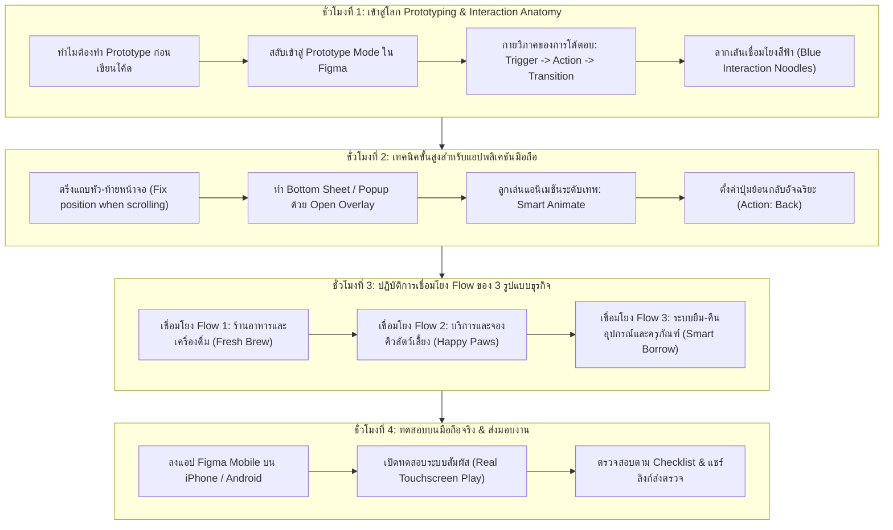
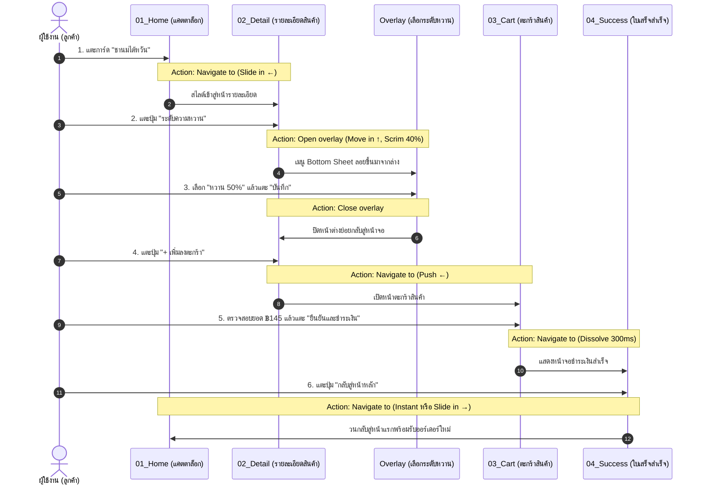
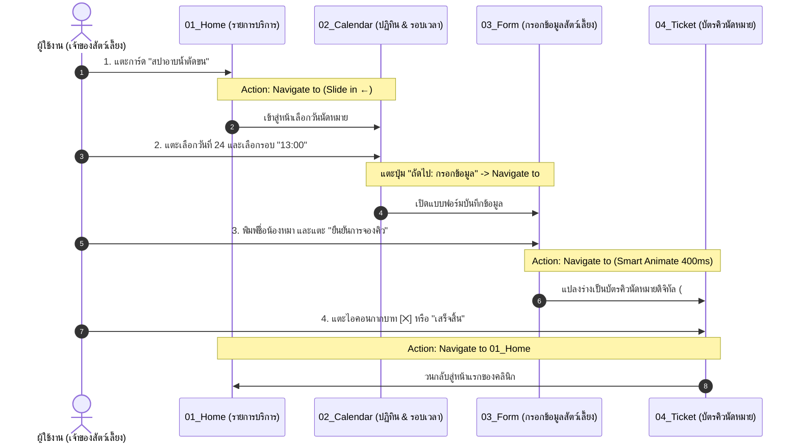
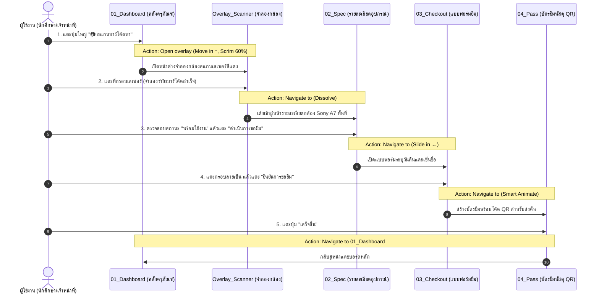

# บทที่ 4: การสร้างต้นแบบเชิงโต้ตอบและการทดสอบบนสมาร์ตโฟนจริงด้วย Figma
*(Interactive Mobile Prototyping & Real Device Testing with Figma - Part 3)*

---

## 🎯 จุดประสงค์การเรียนรู้ประจำบท
เมื่อศึกษาบทเรียนนี้และปฏิบัติการตามขั้นตอนเสร็จสิ้น ผู้เรียนสามารถ:
1. อธิบายความสำคัญของ **Interactive Prototype (ต้นแบบเชิงโต้ตอบ)** ในการจำลองประสบการณ์ผู้ใช้จริงก่อนเริ่มพัฒนาแอปพลิเคชันได้
2. สลับโหมดการทำงานเข้าสู่ **Prototype Mode** ใน Figma และทำความเข้าใจโครงสร้างกายวิภาคของการเชื่อมโยง (Interaction Anatomy) ได้อย่างถูกต้อง
3. ลากเส้นเชื่อมโยง (Blue Interaction Noodles) กำหนด **Trigger (On tap)**, **Action (Navigate to, Back, Open overlay)**, และ **Transition (Slide in, Dissolve, Smart Animate)** ได้อย่างคล่องแคล่ว
4. ตั้งค่าองค์ประกอบที่ต้องตรึงอยู่กับที่ระหว่างเลื่อนหน้าจอ เช่น แถบเมนูด้านบนและด้านล่าง (**Fix position when scrolling / Stay in place**) ได้อย่างถูกต้อง
5. สร้างหน้าต่างป๊อปอัปและเมนูเลื่อนขึ้นจากขอบล่าง (**Bottom Sheet / Modal ด้วย Open Overlay**) พร้อมใส่ฉากหลังมัว (Dim background) ได้
6. เชื่อมโยงและทดสอบเส้นทางการใช้งาน (User Flows) ครบทั้ง 4 หน้าจอตามแนวคิดของ **3 รูปแบบธุรกิจ (Archetypes)**
7. ติดตั้งแอปพลิเคชัน **Figma Mobile App** บนสมาร์ตโฟนจริง (iOS หรือ Android) และเปิดทดสอบระบบสัมผัส (Touchscreen Testing) ได้ 100%
8. ร่วมมือกันในทีม 3 คน ตรวจสอบข้อผิดพลาดในการนำทาง (Broken Links) และแชร์ลิงก์ Interactive Prototype ส่งตรวจตามเกณฑ์มาตรฐาน

---

## 🧭 แผนผังการเรียนรู้ประจำสัปดาห์ที่ 4 (4 ชั่วโมง)



---

## 1. จากภาพนิ่งสู่แอปที่มีชีวิต: ทำความเข้าใจ Interactive Prototype

ในบทที่ 3 เราได้หน้าจอที่ลงสีสัน ใส่ภาพถ่าย และจัดวางฟอนต์สวยงามระดับมืออาชีพแล้ว แต่งานทั้งหมดนั้นยังคงเป็นเพียง **"ภาพนิ่ง (Static Mockup)"** ที่กดปุ่มแล้วไม่มีอะไรตอบสนอง

### 1.1 ทำไมต้องทำ Prototype ก่อนลงมือเขียนโค้ดจริง?
ในกระบวนการพัฒนาซอฟต์แวร์ระดับโลก ต้นทุนในการแก้ไขข้อผิดพลาดจะพุ่งสูงขึ้นอย่างก้าวกระโดดตามแต่ละขั้นตอน:
- **แก้ตอนเป็น Prototype (บทนี้):** ใช้เวลาแก้ 1 นาที เพียงแค่คลิกลบแล้วลากเส้นเชื่อมใหม่ (ต้นทุน = 0 บาท)
- **แก้ตอนเขียนโปรแกรมบน AppSheet แล้ว:** ต้องรื้อสูตร รื้อตารางฐานข้อมูล เสียเวลาหลายวัน
- **แก้หลังปล่อยแอปให้ลูกค้าใช้งานจริง:** ลูกค้าด่า ลบแอปทิ้ง ธุรกิจเสียชื่อเสียง (ต้นทุนมหาศาล)

```
┌────────────────────────────────────────────────────────────────────────┐
│                   เปรียบเทียบระดับความสมจริงของงานออกแบบ               │
├───────────────────────┬────────────────────────────────────────────────┤
│ 1. Wireframe (บทที่ 2) │ พิมพ์เขียวขาว-ดำ วางผังและโครงสร้าง            │
│ 2. Hi-Fi UI (บทที่ 3) │ ลงสีจริง ใส่รูปภาพ คุมอัตลักษณ์แบรนด์           │
│ 3. Prototype (บทนี้)  │ เชื่อมโยงปุ่มกด เด้งหน้าจอ มีภาพเคลื่อนไหว     │
│ 4. Working App (บทที่ 6)│ เขียนโค้ดเชื่อมฐานข้อมูล จัดการข้อมูลได้จริง │
└───────────────────────┴────────────────────────────────────────────────┘
```

การสร้าง **Interactive Prototype** จะช่วยให้เราและเจ้าของธุรกิจสามารถ **"หยิบโทรศัพท์ขึ้นมาลองกดเล่นจริง"** ได้ทันที ทำให้ค้นพบจุดบกพร่องได้ก่อน เช่น:
- "ลืมใส่ปุ่มกดย้อนกลับในหน้ารายละเอียด ทำให้ผู้ใช้ติดค้างในหน้าจอ ออกไปไหนไม่ได้"
- "ปุ่มยืนยันสั่งซื้ออยู่สูงเกินไป นิ้วโป้งเอื้อมไม่ถึงเมื่อถือโทรศัพท์มือเดียว"
- "ขั้นตอนการสั่งซื้อซับซ้อนเกินไป ควรยุบจาก 5 ขั้นตอนเหลือ 3 ขั้นตอน"

---

## 2. เริ่มต้นเข้าสู่โหมด Prototype ใน Figma (The Prototype Interface)

### 2.1 วิธีสลับเข้าสู่โหมด Prototype
1. เปิดไฟล์งาน Hi-Fi UI บน Figma
2. สังเกตที่มุมบนของแผงควบคุมด้านขวามือ (Right Sidebar) จะมีแท็บ 2 ตัวเลือก:
   - **`Design`**: โหมดจัดวาง วาดรูป ลงสี ปรับฟอนต์
   - **`Prototype`**: โหมดสร้างปฏิสัมพันธ์และเชื่อมโยงเส้นทาง (ให้คลิกที่แท็บนี้!)
3. เมื่อเข้าสู่โหมด Prototype พื้นที่บนหน้าจอ Canvas จะเปลี่ยนไป: เมื่อเรานำเมาส์ไปชี้ที่ปุ่มกด, กล่องข้อความ, หรือการ์ดใด ๆ จะปรากฏ **"จุดวงกลมสีฟ้าพร้อมเครื่องหมายบวก (+)"** อยู่ที่ขอบของวัตถุนั้น

```
┌────────────────────────────────────────────────────────────────────────┐
│ แผงควบคุมด้านขวา (Right Inspector) เมื่อสลับเป็นโหมด Prototype         │
├────────────────────────────────────────────────────────────────────────┤
│  [ Design ]   [ Prototype ] ◄── (คลิกแท็บนี้)                          │
├────────────────────────────────────────────────────────────────────────┤
│ Interaction details                                                    │
│ ┌────────────────────────────────────────────────────────────────────┐ │
│ │ 1. Trigger:    [ On tap                          ▼ ]                │ │
│ │ 2. Action:     [ Navigate to                     ▼ ]                │ │
│ │ 3. Target:     [ 02_Product_Detail               ▼ ]                │ │
│ │ 4. Animation:  [ Slide in                 [ → ]  ▼ ]                │ │
│ │    Duration:   [ 300ms ]   Easing: [ Ease out    ▼ ]                │ │
│ └────────────────────────────────────────────────────────────────────┘ │
└────────────────────────────────────────────────────────────────────────┘
```

---

### 2.2 กายวิภาคของการเชื่อมโยง (The 3 Anatomy of Interactions)
ทุกครั้งที่สร้างการโต้ตอบ 1 จุด จะต้องกำหนดค่า 3 องค์ประกอบหลักเสมอ:

```
    [ผู้ใช้ทำอะไร?]          [ระบบทำอะไร?]             [เคลื่อนไหวอย่างไร?]
┌────────────────────┐   ┌────────────────────┐   ┌────────────────────────┐
│ 1. TRIGGER         │──>│ 2. ACTION          │──>│ 3. TRANSITION          │
│ (ตัวจุดชนวน)       │   │ (การกระทำที่เกิด)  │   │ (แอนิเมชันการเปลี่ยนจอ)│
└────────────────────┘   └────────────────────┘   └────────────────────────┘
  - On tap (แตะนิ้ว)       - Navigate to (ไปหน้า...) - Instant (ทันที ไม่ขยับ)
  - On drag (ปาดนิ้ว)      - Open overlay (เด้งทับ)  - Dissolve (ค่อย ๆ จางซ้อน)
  - While hovering (ชี้)   - Back (ย้อนกลับ)         - Smart Animate (อัจฉริยะ)
                           - Scroll to (เลื่อนไปที่) - Slide in (เลื่อนเข้ามา)
```

1. **Trigger (ตัวจุดชนวน):** บนหน้าจอมือถือกว่า 95% จะใช้คำสั่ง **`On tap` (เมื่อแตะนิ้วลงบนปุ่ม)**
2. **Action (การกระทำ):** สิ่งที่ต้องการให้เกิดขึ้น เช่น
   - `Navigate to`: เปลี่ยนจากหน้าจอปัจจุบันไปยังหน้าจอเป้าหมาย
   - `Back`: ย้อนกลับไปยังหน้าจอก่อนหน้านี้อัตโนมัติ (ไม่ต้องระบุชื่อหน้าจอ)
   - `Open overlay`: สั่งให้หน้าต่างย่อย (Modal / Bottom sheet) ลอยขึ้นมาซ้อนทับหน้าปัจจุบัน
   - `Close overlay`: สั่งปิดหน้าต่างย่อยที่ลอยอยู่
3. **Transition & Animation (ลูกเล่นการเคลื่อนไหว):**
   - `Instant`: สลับภาพทันที (ใช้กับการเปลี่ยนแถบแท็บด้านล่าง)
   - `Dissolve`: ภาพค่อย ๆ จางซ้อนสลับกัน (ดูนุ่มนวล คลาสสิก)
   - `Slide in [←]`: หน้าจอใหม่เลื่อนสไลด์เข้ามาจากขวาไปซ้าย (มาตรฐานของแอปสมาร์ตโฟนเมื่อกดเข้าไปดูรายละเอียด)
   - `Push [←]`: หน้าจอใหม่ดันหน้าจอเก่าออกไปทางซ้าย
   - `Smart Animate`: Figma คำนวณการย่อ-ขยายและเคลื่อนที่ของวัตถุที่มีชื่อตรงกันโดยอัตโนมัติ

---

### 2.3 ขั้นตอนการลากเส้นเชื่อมโยง (Blue Interaction Noodles) ทีละสเต็ป
1. คลิกเลือกปุ่มหรือการ์ดที่ต้องการให้กดได้ (เช่น การ์ดสินค้าในหน้า `01_Home`)
2. นำเมาส์ไปชี้ที่ขอบขวาของปุ่ม จะเห็น **จุดวงกลมสีฟ้า (+)**
3. คลิกค้างไว้ แล้วลากเส้นสีฟ้า (Interaction Wire) ดึงไปปล่อยลงบนกรอบหน้าจอเป้าหมาย (หน้า `02_Detail`)
4. เมื่อปล่อยเมาส์ หน้าต่าง **"Interaction details"** จะเด้งขึ้นมา
5. ตั้งค่า:
   - Trigger: `On tap`
   - Action: `Navigate to` -> เลือกหน้า `02_Detail`
   - Animation: เลือก `Slide in` -> ทิศทางลูกศรชี้ไปทางซ้าย `[ ← ]`
   - Duration: ใส่ `300ms` (ความเร็วมาตรฐาน 0.3 วินาที ไม่ช้าไม่เร็วจนเกินไป)
   - Easing: เลือก `Ease out` (เริ่มต้นเร็ว แล้วค่อย ๆ ชะลอตอนเข้าที่อย่างนุ่มนวล)

---

## 3. เทคนิคขั้นสูงสำหรับแอปพลิเคชันมือถือ (Mobile Prototyping Essentials)

### 3.1 การตรึงแถบหัว-ท้ายหน้าจอ (Fix position when scrolling)
ในแอปจริง เมื่อผู้ใช้ใช้นิ้วปาดเลื่อนดูรายการสินค้าที่ยาวเหยียดลงมา แถบหัวหน้าจอ (Header) และแถบเมนูด้านล่าง (Bottom Navigation) จะต้อง **"ลอยนิ่งอยู่กับที่ตลอดเวลา ไม่เลื่อนหายไปตามเนื้อหา"**

```
┌───────────────────────────────────────┐ ─── [ตรึงอยู่กับที่: Stay in place]
│ [=]        Top Navigation         [🔔]│     (เลือกตำแหน่ง: Fix position)
├───────────────────────────────────────┤
│                                       │ ─── [พื้นที่เลื่อนเนื้อหา: Scroll Area]
│      (รายการสินค้าเลื่อนขึ้น-ลงได้)   │     (ตั้งค่า Overflow: Vertical)
│                                       │
│   ┌───────────────────────────────┐   │
│   │        การ์ดสินค้า 01         │   │
│   └───────────────────────────────┘   │
│   ┌───────────────────────────────┐   │
│   │        การ์ดสินค้า 02         │   │
│   └───────────────────────────────┘   │
│   ┌───────────────────────────────┐   │
│   │        การ์ดสินค้า 03         │   │
│   └───────────────────────────────┘   │
│                                       │
├───────────────────────────────────────┤ ─── [ตรึงอยู่กับที่: Stay in place]
│  [🏠 หน้าแรก]   [📋 รายการ]   [👤 ฉัน] │     (เลือกตำแหน่ง: Fix position)
└───────────────────────────────────────┘
```

**ขั้นตอนการตั้งค่า (ทีละคลิก):**
1. คลิกเลือกชิ้นงานแถบ `TopBar` หรือ `BottomNav` ในเลเยอร์
2. สลับไปที่แท็บ **`Prototype`** ที่แผงขวามือ
3. มองหาหัวข้อ **"Scroll behavior"**
4. ในช่อง Position ให้เปลี่ยนจาก `Scroll with parent` เป็น 👉 **`Fixed (stay in place)`**
5. คลิกเลือกที่ตัว Frame หน้าจอหลัก (เช่น `01_Home`) -> ที่แผงขวาหัวข้อ Scroll behavior ให้เลือก **Overflow: `Vertical scrolling`**

---

### 3.2 การทำ Bottom Sheet / Modal เด้งขึ้นมาด้วย Open Overlay
แทนที่จะต้องสร้างหน้าจอใหม่ทั้งหน้า การทำเมนูย่อย เช่น ตัวเลือกระดับความหวาน, หน้าต่างเลือกท็อปปิ้ง, หรือกล่องยืนยันการลบ ควรใช้เทคนิค **"Open Overlay"**:

```
[แผนผังการทำงานของ Open Overlay]

    หน้าจอหลัก (02_Detail)                   หน้าต่างย่อย (Bottom Sheet)
┌─────────────────────────┐               ┌─────────────────────────┐
│ [←] หน้ารายละเอียด      │               │ ✕ เลือกระดับความหวาน     │
│                         │   เมื่อแตะ    │ (•) หวาน 100% (ปกติ)    │
│ [ รูปแก้วชานม ]         │ ────────────> │ ( ) หวาน 50% (หวานน้อย) │
│                         │               │ ( ) หวาน 0% (ไม่หวาน)   │
│ [ปุ่ม: ปรับแต่งความหวาน]│               │ [ บันทึกตัวเลือก ]       │
└─────────────────────────┘               └─────────────────────────┘
                                                       │
                                      ลอยซ้อนทับขึ้นมาจากขอบล่าง
                                      พร้อมฉากหลังมืดสลัว 40% (Scrim)
```

**ขั้นตอนการตั้งค่า Open Overlay:**
1. สร้าง Frame ขนาดกว้าง 390px สูง 250px แยกไว้ต่างหาก ตั้งชื่อว่า `Overlay_Sweetness`
2. ใส่ตัวเลือกความหวานและปุ่มบันทึกให้สวยงาม
3. กลับมาที่หน้า `02_Detail` คลิกที่ปุ่ม "ปรับแต่งความหวาน" ลากเส้นสีฟ้าไปยังกรอบ `Overlay_Sweetness`
4. ในหน้าต่าง Interaction details ตั้งค่าดังนี้:
   - Action: เปลี่ยนเป็น **`Open overlay`**
   - Overlay position: เลือก **`Bottom center`** (โผล่จากขอบล่างของจอ)
   - ติ๊กถูกที่ช่อง: ☑ **`Close when clicking outside`** (เมื่อแตะพื้นที่ว่างข้างนอก ให้ปิดหน้าต่างอัตโนมัติ)
   - ติ๊กถูกที่ช่อง: ☑ **`Add background behind overlay`** -> เลือกสีดำ `#000000` ความโปร่งแสง **`40%`**
   - Animation: เลือก **`Move in [ ↑ ]`** (เลื่อนพุ่งขึ้นมาจากด้านล่าง)

---

### 3.3 แอนิเมชันระดับเทพ Smart Animate
**Smart Animate** คือฟีเจอร์มหัศจรรย์ของ Figma ที่ใช้สร้างการเปลี่ยนผ่านที่ดูไฮเทคและสมจริงระดับแอป iOS / Android:
- **หลักการทำงาน:** ถ้าในหน้าจอที่ 1 และหน้าจอที่ 2 มีวัตถุที่ **"ชื่อเลเยอร์ตรงกันทุกตัวอักษร"** (เช่น ชื่อว่า `Product_Image`) แต่มีขนาดและตำแหน่งต่างกัน เมื่อกดเปลี่ยนหน้า Figma จะทำการเคลื่อนย้ายและขยายรูปภาพนั้นอย่างลื่นไหลต่อเนื่องโดยอัตโนมัติ!

**ตัวอย่างการประยุกต์ใช้:**
- ในหน้าแคตตาล็อก: รูปแก้วชาเป็นรูปเล็กขนาด 80x80 px วางอยู่ในการ์ด
- ในหน้ารายละเอียด: รูปแก้วชาขยายใหญ่เต็มจอขนาด 350x250 px
- เมื่อตั้งค่า Animation เป็น **`Smart Animate` (Ease out, 300ms)** -> รูปแก้วชาจะขยายตัวพุ่งออกมาสู่สายตาผู้ใช้เสมือนแอปจริงทันที!

---

## 4. เวิร์กช็อปภาคปฏิบัติ: เชื่อมโยง Flow สมบูรณ์ของ 3 รูปแบบธุรกิจ

ให้นักเรียนเชื่อมโยงเส้นทางของกลุ่มตนเองให้ครบวงจร (Closed Loop Flow) สามารถกดเล่นวนซ้ำได้โดยไม่เจอทางตัน:

---

### รูปแบบที่ 1: Fresh Brew & Bakery (ร้านอาหารและเครื่องดื่ม)



**ตารางการตั้งค่า Interactions ของรูปแบบที่ 1:**

| จุดที่กด (Source Element) | อยู่ในหน้าจอ | คำสั่ง Action | หน้าจอเป้าหมาย (Destination) | แอนิเมชัน (Animation) |
|:---|:---|:---|:---|:---|
| การ์ดชานมบราวชูการ์ | `01_Home` | `Navigate to` | `02_Detail` | `Slide in [ ← ]` (300ms) |
| ปุ่มย้อนกลับ `[ ← ]` | `02_Detail` | `Back` | (หน้าจอก่อนหน้า) | `Slide out [ → ]` (300ms) |
| ตัวเลือกระดับความหวาน | `02_Detail` | `Open overlay` | `Overlay_Sweetness` | `Move in [ ↑ ]`, Scrim 40% |
| ปุ่มบันทึกความหวาน | `Overlay_Sweetness`| `Close overlay`| - | `Move out [ ↓ ]` |
| ปุ่ม `+ เพิ่มลงตะกร้า` | `02_Detail` | `Navigate to` | `03_Cart` | `Push [ ← ]` (300ms) |
| ปุ่ม `ยืนยันและชำระเงิน` | `03_Cart` | `Navigate to` | `04_Success` | `Dissolve` (300ms) |
| ปุ่ม `กลับสู่หน้าหลัก` | `04_Success` | `Navigate to` | `01_Home` | `Instant` |

---

### รูปแบบที่ 2: Happy Paws Care (คลินิกและบริการสัตว์เลี้ยง)



**ตารางการตั้งค่า Interactions ของรูปแบบที่ 2:**

| จุดที่กด (Source Element) | อยู่ในหน้าจอ | คำสั่ง Action | หน้าจอเป้าหมาย (Destination) | แอนิเมชัน (Animation) |
|:---|:---|:---|:---|:---|
| การ์ดสปาอาบน้ำตัดขน | `01_Home` | `Navigate to` | `02_Calendar` | `Slide in [ ← ]` (300ms) |
| ปุ่มย้อนกลับ `[ ← ]` | `02_Calendar` | `Back` | (หน้าจอก่อนหน้า) | `Slide out [ → ]` |
| ชิปรอบเวลา `13:00` | `02_Calendar` | สลับสถานะชิป | Active State | `Instant` |
| ปุ่ม `ถัดไป: กรอกข้อมูล`| `02_Calendar` | `Navigate to` | `03_Form` | `Slide in [ ← ]` (300ms) |
| ปุ่ม `ยืนยันการจองคิว` | `03_Form` | `Navigate to` | `04_Ticket` | `Smart Animate` (400ms) |
| ปุ่ม `บันทึกลงปฏิทิน` | `04_Ticket` | `Open overlay` | `Modal_Saved` | `Dissolve` |
| ปุ่ม `กลับหน้าแรก` | `04_Ticket` | `Navigate to` | `01_Home` | `Instant` |

---

### รูปแบบที่ 3: Smart Equipment Borrow (ระบบยืม-คืนอุปกรณ์และครุภัณฑ์)



**ตารางการตั้งค่า Interactions ของรูปแบบที่ 3:**

| จุดที่กด (Source Element) | อยู่ในหน้าจอ | คำสั่ง Action | หน้าจอเป้าหมาย (Destination) | แอนิเมชัน (Animation) |
|:---|:---|:---|:---|:---|
| ปุ่ม `📷 สแกนบาร์โค้ดหา` | `01_Dashboard` | `Open overlay` | `Overlay_Scanner` | `Move in [ ↑ ]`, Scrim 60% |
| กรอบเลเซอร์สแกนเนอร์ | `Overlay_Scanner`| `Navigate to` | `02_Spec` | `Dissolve` (200ms) |
| การ์ดกล้อง Sony A7 IV | `01_Dashboard` | `Navigate to` | `02_Spec` | `Slide in [ ← ]` (300ms) |
| ปุ่ม `ดำเนินการขอยืม` | `02_Spec` | `Navigate to` | `03_Checkout` | `Slide in [ ← ]` (300ms) |
| ปุ่ม `ยืนยันการขอยืม` | `03_Checkout` | `Navigate to` | `04_Pass` | `Smart Animate` (350ms) |
| ปุ่ม `เสร็จสิ้น/หน้าหลัก`| `04_Pass` | `Navigate to` | `01_Dashboard` | `Instant` |

---

## 5. การทดสอบจริงบนสมาร์ตโฟนผ่าน Figma Mobile App (Real Device Testing)

ความรู้สึกของการใช้เมาส์คลิกบนจอคอมพิวเตอร์ **แตกต่างอย่างสิ้นเชิง** จากการใช้นิ้วโป้งสัมผัสบนหน้าจอมือถือจริง! ในขั้นตอนนี้ นักเรียนทุกคนจะได้สัมผัสประสบการณ์จริงบนสมาร์ตโฟนของตนเอง:

```
┌────────────────────────────────────────────────────────────────────────┐
│               ขั้นตอนการเปิดทดสอบ Prototype บนมือถือจริง                │
├────────────────────────────────────────────────────────────────────────┤
│ 1. หยิบสมาร์ตโฟนขึ้นมา เปิด App Store (iOS) หรือ Google Play (Android)  │
│ 2. ค้นหาแอปพลิเคชันชื่อ: "Figma" (พัฒนาโดย Figma, Inc.)               │
│ 3. ทำการติดตั้งแอปพลิเคชันลงบนโทรศัพท์ (ฟรี 100%)                       │
│ 4. เปิดแอป Figma แล้วล็อกอินด้วยบัญชี Google บัญชีเดียวกับที่ทำบนคอมฯ   │
│ 5. สลับไปที่แถบเมนู "Mirrror" หรือเลือกเปิดไฟล์โปรเจกต์ของกลุ่ม        │
│ 6. คลิกปุ่ม Play [ ▶ ] เพื่อเปิดโหมด Interactive Prototype เต็มจอ!     │
└────────────────────────────────────────────────────────────────────────┘
```

```
[สิ่งที่ต้องสังเกตและทดสอบจริงบนสมาร์ตโฟน]
📱 1. ขนาดของปุ่มกด (Touch Target Size): 
      ปุ่มกดมีความสูงอย่างน้อย 44-48px หรือไม่? นิ้วโป้งแตะโดนง่ายหรือไม่ หรือแตะแล้วติดปุ่มข้างเคียง?
👀 2. ความคมชัดของตัวอักษร (Readability): 
      ตัวหนังสือ 14px อ่านออกสบายตาหรือไม่ หรือต้องหรี่ตาเพ่ง?
📜 3. ความลื่นไหลในการเลื่อนหน้าจอ (Scrolling Smoothness): 
      แถบ Top Bar และ Bottom Bar ลอยนิ่งอยู่กับที่จริงหรือไม่? เลื่อนเนื้อหาแล้วสะดุดหรือไม่?
🔄 4. วงจรการนำทาง (Navigation Flow): 
      กดย้อนกลับได้ทุกหน้าจอหรือไม่? มีหน้าไหนที่หลุดไปเจอหน้าว่างเปล่าหรือไม่?
```

---

## 6. การทำงานร่วมกันในทีม 3 คน (Collaboration Matrix)

เพื่อให้ Prototype ทำงานได้สมบูรณ์แบบโดยไม่มีเส้นทางตกหล่น ให้แบ่งงานในกลุ่ม 3 คนดังนี้:

```
┌────────────────────────────────────────────────────────────────────────┐
│                        ตารางแบ่งหน้าที่ในทีม 3 คน                       │
├─────────────────────┬──────────────────────────────────────────────────┤
│ สมาชิกคนที่ 1       │ 1. ทำหน้าที่เป็น Link Master ลากเส้นเชื่อมโยง    │
│ (Flow Architect)    │    ปุ่มหลักจากหน้า 01_Home ไปจนถึงหน้า 04_Success│
│                     │ 2. ตั้งค่า Transitions (Slide in, Dissolve, Ease)│
├─────────────────────┼──────────────────────────────────────────────────┤
│ สมาชิกคนที่ 2       │ 1. สร้างหน้าต่างย่อย Overlay (Bottom Sheet/Modal)│
│ (Overlay & States)  │ 2. ตั้งค่าปุ่มย้อนกลับ [←] (Action: Back) ทุกหน้า│
│                     │ 3. ตั้งค่า Scroll Behavior (Fixed Header & Nav)  │
├─────────────────────┼──────────────────────────────────────────────────┤
│ สมาชิกคนที่ 3       │ 1. ติดตั้ง Figma Mobile App บนสมาร์ตโฟน         │
│ (QA & Tester Lead)  │ 2. กดทดสอบจริงทุกปุ่ม ค้นหา Broken Links และจดบั๊ก│
│                     │ 3. ทดสอบการแชร์ลิงก์ส่งงาน และบันทึกคลิปสั้น 15 วิ│
└─────────────────────┴──────────────────────────────────────────────────┘
```

---

## 7. ปัญหาที่พบบ่อยและวิธีแก้ไข (Troubleshooting & FAQs)

### Q1: ทำไมลากเส้นเชื่อมโยงไปยังหน้าจอเป้าหมายแล้ว แต่พอกด Play กลับกดไม่ไป?
* **สาเหตุที่ 1:** หน้าจอเป้าหมายไม่ได้ถูกสร้างเป็น Frame อิสระ (อาจเป็นเพียง Group ธรรมดา)
  * **วิธีแก้:** คลิกขวาที่ชิ้นงานเป้าหมาย เลือก `Frame selection` เพื่อแปลงเป็น Frame
* **สาเหตุที่ 2:** มีเลเยอร์อื่นที่มองไม่เห็นลอยทับปุ่มกดอยู่
  * **วิธีแก้:** เปิดดู Layers panel ด้านซ้าย ตรวจสอบว่าปุ่มกดอยู่ลำดับบนสุดของ Frame

### Q2: พอเลื่อนหน้าจอ (Scroll) แถบเมนูด้านบนหลุดเลื่อนหายไปด้วย?
* **สาเหตุ:** ไม่ได้ตั้งค่า Position เป็น Fixed
* **วิธีแก้:** คลิกเลือกแถบเมนู Top Bar ไปที่แท็บ Prototype หัวข้อ Scroll behavior เปลี่ยน Position เป็น `Fixed (stay in place)` และตรวจสอบว่าเลเยอร์ Top Bar อยู่ชั้นบนสุด ไม่ได้ถูกเลเยอร์เนื้อหาทับ

### Q3: จะตั้งค่าหน้าแรกของการเริ่มเล่น Prototype ได้อย่างไร?
* **วิธีแก้:** คลิกที่ Frame หน้า `01_Home` สังเกตที่แผงขวามือหัวข้อ **"Flow starting point"** ให้คลิกเครื่องหมายบวก (+) จะปรากฏป้ายสีน้ำเงินชื่อ `Flow 1` อยู่เหนือหน้าจอแรกเสมอ เมื่อกดปุ่ม Play ระบบจะเริ่มเล่นจากหน้านี้เป็นหน้าแรก

---

## 8. กิจกรรมปฏิบัติการและเกณฑ์การประเมินชิ้นงานประจำสัปดาห์ (Deliverables & Rubric)

### 📋 ใบงานปฏิบัติการประจำบทที่ 4
**คำสั่ง:** ให้นักเรียนทำงานร่วมกันเป็นกลุ่ม 3 คน ดำเนินการดังนี้:
1. เปิดไฟล์ Figma จากบทที่ 3 เข้าสู่โหมด **Prototype**
2. ลากเส้นเชื่อมโยงปุ่มกดต่าง ๆ ให้ครบทั้ง **4 หน้าจอหลัก** สามารถกดคลิกนำทางได้ต่อเนื่องตั้งแต่ต้นจนจบ
3. มีการใช้คำสั่ง **Navigate to**, **Back**, และอย่างน้อย 1 จุดที่ใช้ **Open overlay** (เช่น เมนูย่อย หรือหน้าต่างยืนยัน)
4. มีการล็อกแถบหัวและท้ายหน้าจอด้วย **Fixed position when scrolling**
5. สมาชิกในกลุ่มเปิดทดสอบสัมผัสจริงผ่าน **Figma Mobile App** บนสมาร์ตโฟนอย่างน้อย 1 เครื่อง

---

### 🔍 แบบตรวจสอบตนเองก่อนส่งงาน (Self-Checklist)
- [ ] เมื่อกดปุ่ม Play [ ▶ ] บน Figma หน้าจอเริ่มต้นจากหน้า `01_Home` ถูกต้องใช่หรือไม่?
- [ ] สามารถคลิกการ์ดเพื่อเข้าไปดูหน้ารายละเอียด และกดย้อนกลับ `[←]` ออกมาได้ใช่หรือไม่?
- [ ] สามารถกดสั่งซื้อ/จองคิว/ยืมของ จนกระทั่งถึงหน้าสรุปสำเร็จ (`04_Success`) ได้ใช่หรือไม่?
- [ ] มีปุ่มพากลับสู่หน้าหลักจากหน้าสุดท้าย เพื่อให้สามารถกดเล่นวนรอบใหม่ได้ใช่หรือไม่?
- [ ] แถบเมนูด้านบนและล่างถูกตรึงอยู่กับที่ ไม่เลื่อนหลุดตามเนื้อหาใช่หรือไม่?
- [ ] ทดสอบเปิดเล่นบนสมาร์ตโฟนจริงผ่านแอปพลิเคชัน Figma Mobile สำเร็จใช่หรือไม่?

---

### 📊 เกณฑ์การประเมินชิ้นงานประจำบทที่ 4 (Scoring Rubric : รวม 10 คะแนน)

| เกณฑ์การประเมิน | ระดับดีมาก (เต็ม) | ระดับพอใช้ (ครึ่งคะแนน) | ระดับต้องปรับปรุง (ต่ำกว่าครึ่ง) |
|:---|:---|:---|:---|
| **1. ความสมบูรณ์ของเส้นทางการใช้งาน (Flow Integrity) (3 คะแนน)** | เส้นทางครบวงจรตั้งแต่หน้าแรกจนถึงหน้าสำเร็จ ไม่มีทางตัน มีปุ่มย้อนกลับและปุ่มกลับสู่หน้าหลักครบถ้วน (3 คะแนน) | เชื่อมโยงได้เกือบครบ แต่มีบางปุ่มกดไม่ไป หรือลืมใส่ปุ่มย้อนกลับในบางหน้า (2 คะแนน) | เชื่อมโยงได้เพียง 1-2 หน้าจอ มีทางตันหลายจุด ไม่สามารถเล่นจนจบ Flow ได้ (1 คะแนน) |
| **2. เทคนิคการโต้ตอบและการเคลื่อนไหว (Interactions & Motion) (3 คะแนน)** | มีการใช้ Transitions เหมาะสม (เช่น Slide in นุ่มนวล), มีการล็อก Fixed Bar และมีการใช้ Open Overlay อย่างถูกต้อง (3 คะแนน) | มีการเปลี่ยนหน้าจอได้ดี แต่ยังไม่ได้ล็อก Fixed Bar หรือแอนิเมชันยังดูแข็งกระด้าง (2 คะแนน) | ใช้เฉพาะ Instant สลับหน้าธรรมดา ไม่มีการตั้งค่าลูกเล่นการเคลื่อนไหวใด ๆ (1 คะแนน) |
| **3. ประสบการณ์บนสมาร์ตโฟนจริง (Mobile Usability) (2 คะแนน)** | ขนาดปุ่มกดและระยะเว้นพอดีกับนิ้วสัมผัสบนมือถือจริง เลื่อนหน้าจอลื่นไหล สมาชิกผ่านการทดสอบบนแอปจริง (2 คะแนน) | เปิดบนมือถือได้แต่ปุ่มบางปุ่มเล็กเกินไปจนกดยาก หรือข้อความบางจุดล้นจอ (1 คะแนน) | ไม่ได้ทดสอบบนมือถือจริง หรือหน้าจอเละเมื่อเปิดในแอป (0 คะแนน) |
| **4. ความพร้อมและการแชร์ลิงก์ส่งงาน (Deliverable Sharing) (2 คะแนน)** | ลิงก์ Prototype เปิดสิทธิ์ View สมบูรณ์ สามารถกดเล่นในโหมด Presentation ได้ทันทีโดยไม่ต้องขอสิทธิ์ (2 คะแนน) | ส่งลิงก์มาถูกต้องแต่เปิดเข้าโหมดแก้ไข (Editor) แทนโหมด Prototype หรือส่งช้ากว่าเวลา (1 คะแนน) | ลิงก์ติดสิทธิ์ Private ครูไม่สามารถเข้าตรวจได้ (0 คะแนน) |

---

### 📤 ขั้นตอนการคัดลอกลิงก์ Prototype ส่งงาน (How to Share Prototype Link)
1. ในหน้าต่าง Figma คลิกปุ่ม **Play [ ▶ ]** ที่มุมบนขวา เพื่อเปิดหน้าต่างพรีวิวเต็มจอ (Presentation View)
2. เมื่อหน้าพรีวิวโหลดเสร็จ ที่มุมขวาบนของหน้าต่างพรีวิว คลิกปุ่มสีฟ้า **"Share prototype"**
3. ตรวจสอบให้แน่ใจว่าเลือก: **"Anyone with the link"** -> **"can view"**
4. คลิกปุ่ม **"Copy link"**
5. นำลิงก์ที่ได้ไปส่งในระบบส่งงานประจำวิชา (Google Classroom) พร้อมแนบภาพถ่ายสมาร์ตโฟนของตนเองขณะกำลังเปิดทดสอบ Prototype ของกลุ่ม
