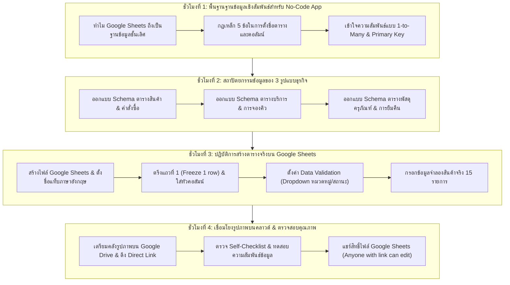
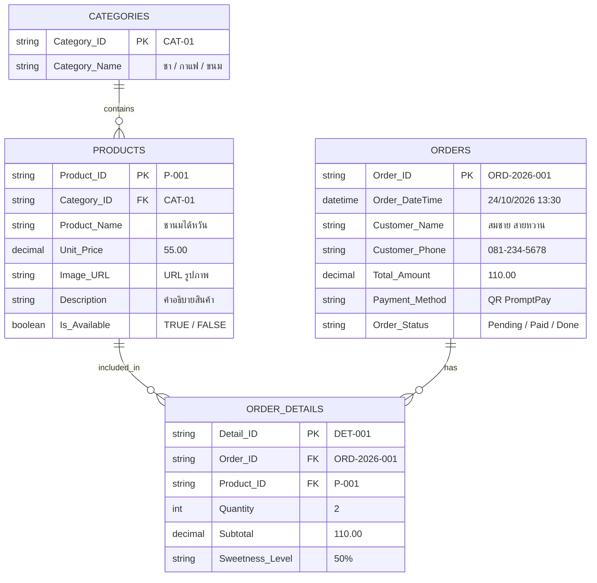
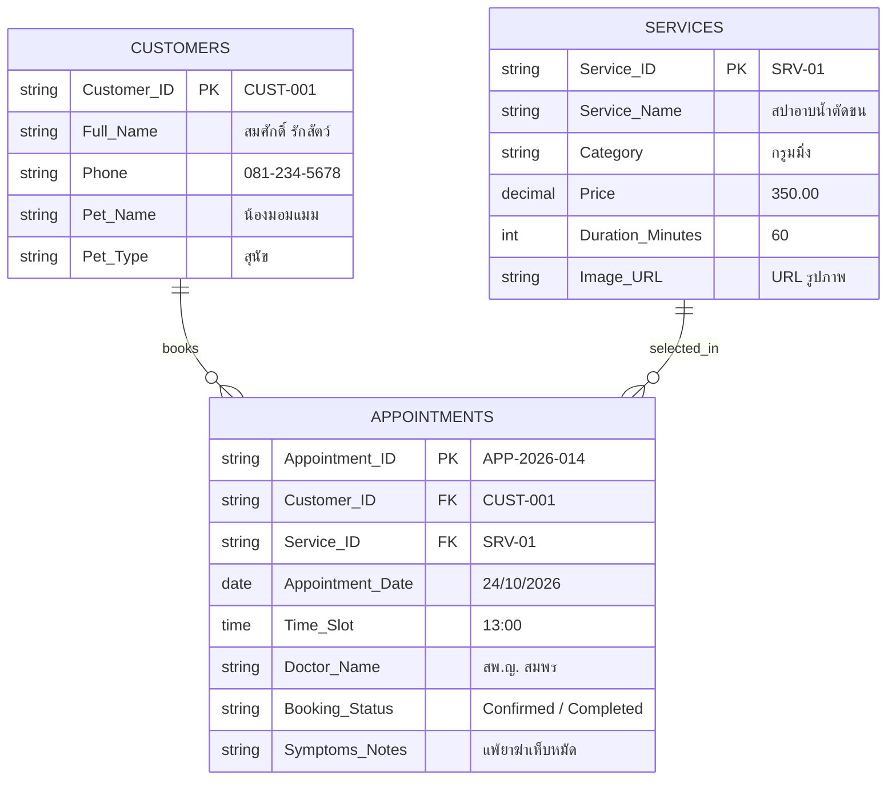
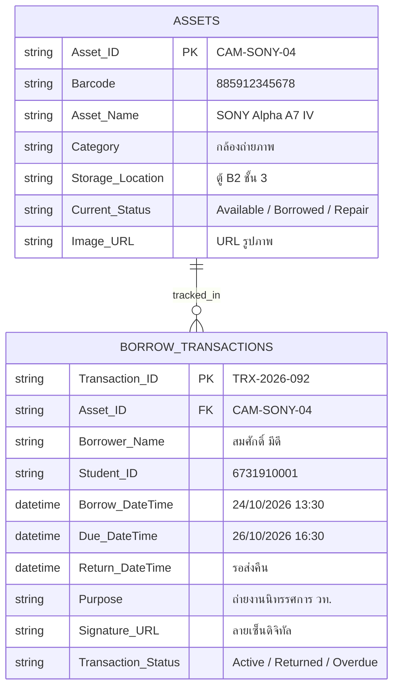

# บทที่ 5: การวางโครงสร้างฐานข้อมูลร้านค้าด้วย Google Sheets
*(Relational Database Architecture & Cloud Data Modeling for AppSheet)*

---

## 🎯 จุดประสงค์การเรียนรู้ประจำบท
เมื่อศึกษาบทเรียนนี้และปฏิบัติการตามขั้นตอนเสร็จสิ้น ผู้เรียนสามารถ:
1. อธิบายบทบาทของ **Google Sheets ในฐานะระบบฐานข้อมูลเชิงสัมพันธ์บนคลาวด์ (Cloud Relational Database)** สำหรับการสร้างแอปพลิเคชันด้วย AppSheet ได้
2. ประยุกต์ใช้หลักการ **การออกแบบตารางตามหลัก Normalization ขั้นพื้นฐาน** โดยแยกข้อมูลออกเป็นตารางที่เกี่ยวข้องอย่างเป็นระบบ
3. กำหนด **Primary Key (คีย์หลัก)**, ชนิดข้อมูล (Data Types), และตั้งชื่อหัวคอลัมน์ตามกฎเหล็กสากล (ห้ามเว้นวรรค ใช้ภาษาอังกฤษ) ได้อย่างถูกต้อง
4. สร้างตารางฐานข้อมูลครบถ้วนทั้ง 3-4 ตารางหลัก พร้อมกรอกข้อมูลจำลองจริง (Mock Data) อย่างน้อย 15 แถวตามแนวทางของ **3 รูปแบบธุรกิจ (Archetypes)**
5. ตั้งค่าการตรึงแถวหัวตาราง (Freeze Header Row), การตรวจสอบความถูกต้องของข้อมูล (Data Validation Dropdown), และการจัดรูปแบบตัวเลข/วันที่ได้อย่างถูกต้อง
6. ทำงานร่วมกันในทีม 3 คน ตรวจสอบความสมบูรณ์ของข้อมูล และแชร์สิทธิ์การเข้าถึงไฟล์ Google Sheets เพื่อเตรียมเชื่อมต่อ AppSheet ในสัปดาห์ถัดไป

---

## 🧭 แผนผังการเรียนรู้ประจำสัปดาห์ที่ 5 (4 ชั่วโมง)



---

## 1. Google Sheets ในฐานะระบบจัดการฐานข้อมูล (Database Engine)

คนส่วนใหญ่มักมองว่า **Google Sheets** เป็นเพียงตารางคำนวณ (Spreadsheet) สำหรับทำบัญชีหรือจดบันทึกรายรับ-รายจ่าย แต่ในโลกของการพัฒนาแอปพลิเคชันยุคใหม่แบบ No-Code โดยเฉพาะ **Google AppSheet**:
> **Google Sheets คือ "ฐานข้อมูลเชิงสัมพันธ์บนคลาวด์ (Cloud Relational Database)"** ที่ทรงพลัง มีความปลอดภัยสูง ทำงานแบบเรียลไทม์ และฟรี 100%

### 1.1 ตารางเปรียบเทียบ: เอกสารทั่วไป vs ฐานข้อมูลแอปพลิเคชัน

```
┌────────────────────────────────────────────────────────────────────────┐
│             ความแตกต่างระหว่างตารางทั่วไป กับ ฐานข้อมูลสำหรับแอป        │
├─────────────────────┬──────────────────────────────────────────────────┤
│ ตาราง Excel ทั่วไป  │ - รวมทุกอย่างไว้ในหน้าเดียว (ปนชื่อคน สินค้า ราคา)│
│ (Flat Spreadsheet)  │ - มีการผสานเซลล์ (Merge Cells) เพื่อความสวยงาม   │
│                     │ - มีหัวตารางหลายบรรทัด บรรทัดที่ 1-3 เว้นว่างไว้ │
│                     │ - ใส่สูตรผลรวมแทรกไว้กลางตาราง                   │
│                     │ ❌ ผลลัพธ์: AppSheet อ่านค่าไม่ได้ เกิด Error ทันที! │
├─────────────────────┼──────────────────────────────────────────────────┤
│ ฐานข้อมูลเชิงโครงสร้าง│ - บรรทัดที่ 1 เป็น "ชื่อคอลัมน์" เท่านั้น ห้ามว่าง │
│ (App Database Sheet)│ - ห้ามผสานเซลล์ (No Merge Cells) โดยเด็ดขาด       │
│                     │ - แต่ละบรรทัด (Row) คือข้อมูล 1 รายการที่ไม่ซ้ำกัน │
│                     │ - แยกตารางตามหน้าที่ เช่น Products, Orders, Users │
│                     │ ✔️ ผลลัพธ์: AppSheet ดึงไปสร้างแอปได้ภายใน 30 วินาที│
└─────────────────────┴──────────────────────────────────────────────────┘
```

---

### 1.2 กฎเหล็ก 5 ประการในการสร้างตารางฐานข้อมูล (The 5 Golden Rules)

หากละเมิดกฎ 5 ข้อนี้ แอปพลิเคชันของคุณจะพัง เกิดบั๊กข้อมูลสูญหาย หรือ AppSheet จะอ่านข้อมูลผิดเพี้ยน:

1. **กฎข้อที่ 1: บรรทัดที่ 1 ต้องเป็น "ชื่อหัวคอลัมน์ (Column Headers)" เท่านั้น**  
   ห้ามพิมพ์ชื่อร้าน ห้ามใส่โลโก้ และห้ามเว้นบรรทัดที่ 1 ว่างไว้เด็ดขาด ข้อมูลจริงต้องเริ่มบันทึกที่บรรทัดที่ 2 เป็นต้นไป
2. **กฎข้อที่ 2: ห้ามมีช่องว่างในชื่อคอลัมน์เด็ดขาด (No Spaces in Column Names)**  
   - ❌ *ห้ามใช้:* `รหัส สินค้า`, `Product Name`, `Price per unit`
   - ✔️ *ต้องใช้:* `Product_ID`, `ProductName`, `Unit_Price`  
   *(เหตุผล: ช่องว่างจะทำให้การเขียนสูตรใน AppSheet ซับซ้อนและเกิดข้อผิดพลาดในการอ้างอิง)*
3. **กฎข้อที่ 3: ใช้ชื่อภาษาอังกฤษสำหรับหัวคอลัมน์เสมอ (English Only for Headers)**  
   แม้เนื้อหาข้างในจะเป็นภาษาไทย แต่หัวคอลัมน์ภาษาอังกฤษ (เช่น `Customer_Name`, `Status`) จะช่วยให้การเขียนสูตรตรรกะใน AppSheet เป็นมาตรฐานสากลและไม่เพี้ยน
4. **กฎข้อที่ 4: ห้ามผสานเซลล์ (Never Merge Cells)**  
   ทุกช่องเซลล์ต้องเป็นอิสระต่อกัน การผสานเซลล์จะทำให้ระบบฐานข้อมูลไม่สามารถระบุพิกัดแถวและคอลัมน์ที่แท้จริงได้
5. **กฎข้อที่ 5: ทุกตารางต้องมี "Primary Key (คีย์หลัก)" เสมอ**  
   คอลัมน์แรกสุดต้องเป็นรหัสที่ไม่ซ้ำกัน (Unique Value) เช่น `Product_ID` (P001, P002), `Order_ID` (ORD-01) เพื่อให้ระบบรู้ว่ากำลังแก้ไขข้อมูลแถวใด

---

### 1.3 ความเข้าใจเรื่อง Primary Key (คีย์หลัก) และ Foreign Key (คีย์เชื่อมโยง)

ทำไมเราต้องมีรหัสสินค้า? ทำไมไม่ใช้ชื่อสินค้าเป็นตัวระบุ?
- ลองคิดภาพ: ในร้านกาแฟมีเมนู "ชานมเย็น" ขนาดแก้วปกติ (฿45) กับ "ชานมเย็น" ขนาดแก้วใหญ่ (฿55) หากเราใช้ชื่อ "ชานมเย็น" ในการสั่งซื้อ ระบบจะไม่รู้ว่าลูกค้าสั่งแก้วไหน!
- หรือกรณีลูกค้าชื่อ "สมชาย" เข้ามาซื้อของ 2 คน หากไม่มี `Customer_ID` ระบบจะรวมยอดเงินของสมชายทั้ง 2 คนเข้าด้วยกันจนบัญชีผิดพลาด

```
┌────────────────────────────────────────────────────────────────────────┐
│                        กลไกการเชื่อมโยงความสัมพันธ์                     │
├────────────────────────────────────────────────────────────────────────┤
│                                                                        │
│   ตารางสินค้า (Products)                   ตารางรายการสั่งซื้อ (Orders) │
│   ┌────────────┬─────────────┐             ┌──────────┬──────────────┐ │
│   │ Product_ID │ Name        │             │ Order_ID │ Product_ID   │ │
│   ├────────────┼─────────────┤             ├──────────┼──────────────┤ │
│   │ P-001 [PK] │ ชานมไต้หวัน │ ◄─────────┐ │ ORD-01   │ P-001   [FK] │ │
│   │ P-002 [PK] │ ชาเขียวมัทฉะ│           └─┼──────────┼──────────────┤ │
│   └────────────┴─────────────┘             │ ORD-02   │ P-001   [FK] │ │
│                                            └──────────┴──────────────┘ │
│                                                                        │
│   * PK (Primary Key): รหัสเฉพาะของตารางตัวเอง ห้ามซ้ำกันเด็ดขาด         │
│   * FK (Foreign Key): รหัสนอกที่หยิบยืมมาจากตารางอื่น เพื่อเชื่อมโยงหาข้อมูล│
└────────────────────────────────────────────────────────────────────────┘
```

---

## 2. โครงสร้างสถาปัตยกรรมข้อมูลของ 3 รูปแบบธุรกิจ (Archetype Schemas)

ให้นักเรียนเลือกใช้โครงสร้าง Schema ให้ตรงกับรูปแบบธุรกิจที่กลุ่มตนเองเลือก:

---

### รูปแบบที่ 1: Fresh Brew & Bakery (ร้านอาหารและเครื่องดื่ม)
> **ลักษณะระบบ:** มีการจำแนกหมวดหมู่สินค้า, รายการสั่งซื้อ (Order), และรายละเอียดสินค้าในบิล (Order_Details)



**ตารางที่ 1: `Products` (รายการสินค้า - แท็บที่ 1):**

| คอลัมน์ (Column) | ชนิดข้อมูล (Data Type) | คีย์ (Key) | ตัวอย่างข้อมูล (Sample Value) | ความหมาย |
|:---|:---:|:---:|:---|:---|
| `Product_ID` | Text | **PK** | `P-001` | รหัสสินค้า ห้ามซ้ำกัน |
| `Product_Name` | Text | - | ชานมไต้หวันบราวชูการ์ | ชื่อเมนูเครื่องดื่ม/ขนม |
| `Category_Name`| Text / Enum | - | ชานม | หมวดหมู่สินค้า |
| `Unit_Price` | Price (Currency)| - | `55.00` | ราคาต่อหน่วย (บาท) |
| `Cost_Price` | Price (Currency)| - | `25.00` | ต้นทุนสินค้า (สำหรับคำนวณกำไร) |
| `Stock_Qty` | Number (Int) | - | `100` | จำนวนสต็อกคงเหลือ |
| `Image_URL` | Image / URL | - | `https://...` | ลิงก์รูปภาพแก้วเครื่องดื่ม |
| `Description` | LongText | - | นมหอมหวานละมุน เคี่ยวสดใหม่ | คำอธิบายรายละเอียดสินค้า |
| `Is_Available` | Boolean | - | `TRUE` | สถานะพร้อมจำหน่าย (เปิด/ปิดเมนู) |

**ตารางที่ 2: `Categories` (หมวดหมู่สินค้า - แท็บที่ 2):**

| คอลัมน์ | ชนิดข้อมูล | คีย์ | ตัวอย่างข้อมูล | ความหมาย |
|:---|:---:|:---:|:---|:---|
| `Category_ID` | Text | **PK** | `CAT-01` | รหัสหมวดหมู่ |
| `Category_Name`| Text | - | ชานมและชาผลไม้ | ชื่อหมวดหมู่ภาษาไทย |
| `Display_Order`| Number | - | `1` | ลำดับการแสดงผลบนหน้าจอ |

**ตารางที่ 3: `Orders` (รายการสั่งซื้อหลัก - แท็บที่ 3):**

| คอลัมน์ | ชนิดข้อมูล | คีย์ | ตัวอย่างข้อมูล | ความหมาย |
|:---|:---:|:---:|:---|:---|
| `Order_ID` | Text | **PK** | `ORD-2026-001` | รหัสใบเสร็จคำสั่งซื้อ |
| `Order_DateTime`| DateTime | - | `24/10/2026 13:45:00` | วันและเวลาที่สั่งซื้อ |
| `Customer_Name`| Text | - | คุณกนกวรรณ ปวส.1 | ชื่อลูกค้าผู้สั่ง |
| `Customer_Phone`| Phone | - | `089-999-8888` | เบอร์โทรศัพท์สำหรับติดต่อ |
| `Total_Amount` | Price | - | `155.00` | ยอดเงินรวมสุทธิ |
| `Payment_Method`| Enum | - | `QR PromptPay` | วิธีชำระเงิน (เงินสด/QR) |
| `Payment_Slip` | Image | - | `https://...` | สลิปหลักฐานการโอนเงิน |
| `Order_Status` | Enum | - | `Pending` | สถานะ: `Pending`, `Cooking`, `Completed`, `Cancelled` |

---

### รูปแบบที่ 2: Happy Paws Care (คลินิกและบริการสัตว์เลี้ยง)
> **ลักษณะระบบ:** เน้นการจับคู่ระหว่าง บริการ (Services), ลูกค้า (Customers), และการนัดหมาย (Appointments)



**ตารางที่ 1: `Services` (รายการบริการ - แท็บที่ 1):**

| คอลัมน์ | ชนิดข้อมูล | คีย์ | ตัวอย่างข้อมูล | ความหมาย |
|:---|:---:|:---:|:---|:---|
| `Service_ID` | Text | **PK** | `SRV-01` | รหัสบริการ |
| `Service_Name` | Text | - | สปาอาบน้ำ-ตัดขนขนฟู | ชื่อบริการ |
| `Category` | Enum | - | กรูมมิ่ง | ประเภท: กรูมมิ่ง / ตรวจรักษา / วัคซีน |
| `Price` | Price | - | `350.00` | ราคาค่าบริการเริ่มต้น |
| `Duration_Mins`| Number | - | `60` | ระยะเวลาที่ใช้บริการ (นาที) |
| `Image_URL` | Image | - | `https://...` | รูปถ่ายการให้บริการ |
| `Description` | LongText | - | อาบน้ำด้วยแชมพูออร์แกนิก ตัดเล็บ เช็ดหู | รายละเอียดขั้นตอนบริการ |

**ตารางที่ 2: `Appointments` (ตารางการจองคิวนัดหมาย - แท็บที่ 2):**

| คอลัมน์ | ชนิดข้อมูล | คีย์ | ตัวอย่างข้อมูล | ความหมาย |
|:---|:---:|:---:|:---|:---|
| `Appointment_ID`| Text | **PK** | `APP-2026-014` | รหัสการนัดหมาย |
| `Customer_Name`| Text | - | นายสมชาย พิทักษ์ | ชื่อเจ้าของสัตว์เลี้ยง |
| `Customer_Phone`| Phone | - | `081-111-2222` | เบอร์โทรศัพท์เจ้าของ |
| `Pet_Name` | Text | - | น้องมอมแมม | ชื่อสัตว์เลี้ยง |
| `Pet_Breed` | Text | - | ชิวาวา (ขนสั้น) | สายพันธุ์สัตว์เลี้ยง |
| `Service_ID` | Text / Ref | **FK** | `SRV-01` | รหัสบริการที่จอง |
| `Appoint_Date` | Date | - | `24/10/2026` | วันที่นัดหมาย |
| `Time_Slot` | Enum / Time| - | `13:00` | รอบเวลาที่นัด (10:00, 11:30, 13:00) |
| `Doctor_Incharge`| Text | - | คุณหมอสมพร | สัตวแพทย์/ช่างผู้รับผิดชอบ |
| `Special_Notes`| Text | - | แพ้ยาฆ่าเห็บ อารมณ์ตกใจง่าย | ข้อควรระวังพิเศษ |
| `Status` | Enum | - | `Confirmed` | สถานะ: `Waiting`, `Confirmed`, `Done`, `Cancelled` |

---

### รูปแบบที่ 3: Smart Equipment Borrow (ระบบยืม-คืนอุปกรณ์และครุภัณฑ์)
> **ลักษณะระบบ:** เน้นการติดตามสถานะอุปกรณ์ (Assets) ด้วยรหัสบาร์โค้ด และประวัติการยืม-คืน (Transactions)



**ตารางที่ 1: `Assets` (รายการครุภัณฑ์และอุปกรณ์ - แท็บที่ 1):**

| คอลัมน์ | ชนิดข้อมูล | คีย์ | ตัวอย่างข้อมูล | ความหมาย |
|:---|:---:|:---:|:---|:---|
| `Asset_ID` | Text | **PK** | `CAM-SONY-04` | รหัสครุภัณฑ์ภายในสถาบัน |
| `Barcode` | Text | - | `885901234567` | หมายเลขบาร์โค้ดสำหรับสแกน |
| `Asset_Name` | Text | - | SONY Alpha A7 IV (Body) | ชื่ออุปกรณ์และยี่ห้อรุ่น |
| `Category` | Enum | - | โสตทัศนูปกรณ์ | หมวด: กล้อง / ขาตั้ง / ไมโครโฟน / ไฟสตูดิโอ |
| `Storage_Box` | Text | - | ตู้ B2 ชั้น 3 แผนก ธจ | ตำแหน่งจัดเก็บทางกายภาพ |
| `Accessory_Items`| Text | - | แบตเตอรี่ 2 ก้อน, แท่นชาร์จ, สายคล้อง | อุปกรณ์ส่วนควบที่ให้ไปพร้อมกัน |
| `Current_Status`| Enum | - | `Available` | สถานะ: `Available` (ว่าง), `Borrowed` (ถูกยืม), `Maintenance` (ซ่อม) |
| `Image_URL` | Image | - | `https://...` | ภาพถ่ายสภาพอุปกรณ์จริง |

**ตารางที่ 2: `Borrow_Logs` (ประวัติการทำรายการยืม-คืน - แท็บที่ 2):**

| คอลัมน์ | ชนิดข้อมูล | คีย์ | ตัวอย่างข้อมูล | ความหมาย |
|:---|:---:|:---:|:---|:---|
| `Borrow_ID` | Text | **PK** | `BR-2026-092` | รหัสใบยืมพัสดุ |
| `Asset_ID` | Text / Ref | **FK** | `CAM-SONY-04` | รหัสอุปกรณ์ที่ขอยืม |
| `Borrower_Name`| Text | - | นายสมศักดิ์ แสนสุข | ชื่อ-นามสกุล ผู้ขอยืม |
| `Borrower_ID` | Text | - | `6731910001` | รหัสนักศึกษา หรือรหัสอาจารย์ |
| `Borrow_DateTime`| DateTime | - | `24/10/2026 13:30:00` | วันและเวลาที่รับอุปกรณ์ไป |
| `Due_DateTime` | DateTime | - | `26/10/2026 16:30:00` | กำหนดเวลาส่งคืน |
| `Return_DateTime`| DateTime | - | *(เว้นว่างไว้จนกว่าจะคืน)*| วันและเวลาที่นำมาส่งคืนจริง |
| `Purpose_Notes`| Text | - | ถ่ายงานนิทรรศการ วท. สัปดาห์วิชาการ | วัตถุประสงค์การยืม |
| `Signature_Image`| Image / Sign | - | `https://...` | รูปภาพลายมือชื่อดิจิทัล |
| `Status` | Enum | - | `Active` | สถานะ: `Active` (กำลังยืม), `Returned` (คืนแล้ว), `Overdue` (เกินกำหนด) |

---

## 3. ปฏิบัติการสร้างฐานข้อมูลบน Google Sheets (Step-by-Step Hands-on)

### 3.1 ขั้นตอนสร้างไฟล์และตั้งชื่อแท็บ (ทีละคลิก)
1. เปิดเบราว์เซอร์ เข้าสู่ [drive.google.com](https://drive.google.com) ด้วยบัญชี Google ประจำกลุ่ม
2. คลิกปุ่ม **"+ ใหม่ (+ New)"** ที่มุมบนซ้าย -> เลือก **"Google ชีต (Google Sheets)"**
3. เปลี่ยนชื่อไฟล์ที่มุมบนซ้าย จาก `สเปรดชีตไม่มีชื่อ` เป็น:  
   👉 `[กลุ่มที่]_[ชื่อโปรเจกต์]_Database` (เช่น `Group03_FreshBrew_Database`)
4. สังเกตที่แถบด้านล่าง ดับเบิลคลิกที่ชื่อชีต `แผ่นงาน1` หรือ `Sheet1` เปลี่ยนชื่อเป็นภาษาอังกฤษตามชื่อตารางหลัก เช่น **`Products`**
5. คลิกเครื่องหมายบวก **`[ + ]`** ที่มุมล่างซ้าย เพื่อเพิ่มแท็บชีตใหม่ ตั้งชื่อว่า **`Orders`** และ **`Categories`**

---

### 3.2 การตรึงแถวที่ 1 (Freeze Row 1)
เพื่อป้องกันไม่ให้หัวตารางเลื่อนหายเมื่อเลื่อนดูข้อมูล:
1. คลิกที่แถวที่ 1 (คลิกที่เลข `1` ด้านซ้ายสุด)
2. ไปที่เมนูด้านบน คลิก **"ดู (View)"** -> **"ตรึง (Freeze)"** -> เลือก **"1 แถว (1 row)"**
3. สังเกตจะปรากฏเส้นแบ่งสีเทาหนาอยู่ใต้บรรทัดที่ 1 แสดงว่าการตรึงสำเร็จ

---

### 3.3 การสร้างเมนูเลือกข้อมูล (Data Validation Dropdown)
ในคอลัมน์ที่มีตัวเลือกแน่นอน เช่น `Category` หรือ `Status` เราต้องสร้าง Dropdown เพื่อป้องกันไม่ให้คนกรอกพิมพ์คำสะกดผิด (เช่น ชานม พิมพ์เป็น ชานมเย็น หรือ ชานมไต้หวัน):

```
[ขั้นตอนทำ Dropdown บน Google Sheets]
1. คลุมแถบคอลัมน์ที่ต้องการ (เช่น คอลัมน์ C แถวที่ 2 ลงไป)
2. ไปที่เมนู "ข้อมูล (Data)" -> คลิก "การตรวจสอบความถูกต้องของข้อมูล (Data validation)"
3. ที่แผงขวามือ คลิก "+ เพิ่มกฎ (+ Add rule)"
4. ที่ช่อง "เกณฑ์ (Criteria)" เลือก: "เมนูแบบเลื่อนลง (Dropdown)"
5. พิมพ์ตัวเลือกที่ต้องการ เช่น:
   - ตัวเลือก 1: ชานมและชาผลไม้ (ใส่สีส้ม)
   - ตัวเลือก 2: กาแฟสด (ใส่สีน้ำตาล)
   - ตัวเลือก 3: เบเกอรีและขนมหวาน (ใส่สีเหลือง)
6. คลิก "เสร็จสิ้น (Done)" -> เซลล์ทั้งหมดจะมีลูกศร Dropdown ให้คลิกเลือกทันที!
```

---

### 3.4 การจัดเตรียมคลังภาพถ่ายบน Google Drive (Image Hosting)
ในแอปพลิเคชันมือถือ รูปภาพจะถูกดึงผ่าน URL หรือโฟลเดอร์บน Google Drive:
1. ใน Google Drive ของกลุ่ม สร้างโฟลเดอร์ใหม่ชื่อ: `App_Images`
2. อัปโหลดภาพสินค้าจริงที่ไดคัทแล้ว (ไฟล์ PNG/JPG ขนาดไม่เกิน 500 KB) เข้าไปในโฟลเดอร์นี้
3. **การเปิดสิทธิ์การเข้าถึง:** คลิกขวาที่โฟลเดอร์ `App_Images` -> เลือก **"แชร์ (Share)"** -> เปลี่ยนสิทธิ์ทั่วไปเป็น **"ทุกคนที่มีลิงก์ (Anyone with the link)"** เป็นสิทธิ์ **"ผู้มีสิทธิ์อ่าน (Viewer)"**
4. เมื่ออัปโหลดไฟล์ภาพ ให้คัดลอกลิงก์มาวางในคอลัมน์ `Image_URL` ของตารางสินค้า

> [!TIP]
> **วิธีแปลงลิงก์ Google Drive ให้ AppSheet แสดงรูปได้ 100%:**  
> ลิงก์ปกติจาก Drive: `https://drive.google.com/file/d/FILE_ID/view?usp=sharing`  
> ลิงก์ที่ใช้แสดงภาพ: `https://drive.google.com/uc?export=view&id=FILE_ID`  
> *(นำ `FILE_ID` รหัสยาว ๆ ไปใส่แทนที่ เพื่อให้รูปภาพโหลดขึ้นหน้าจอแอปได้ทันที)*

---

### 3.5 ภารกิจกรอกข้อมูลจำลองจริง 15 รายการ (Mock Data 15 Rows)
ให้นักเรียนในกลุ่มช่วยกันระดมพิมพ์ข้อมูลสินค้าหรือบริการจริงของกลุ่มตนเองลงในตารางให้ครบอย่างน้อย **15 แถว** (Row 2 ถึง Row 16):
- ข้อมูลต้องมีความสมจริง มีชื่อสินค้า ราคา รายละเอียด และลิงก์รูปภาพครบทุกช่อง
- ห้ามเว้นช่องเซลล์ว่างไว้ในคอลัมน์ที่เป็น Key หรือราคา
- หลีกเลี่ยงการใส่สัญลักษณ์สกุลเงิน `฿` ในเซลล์ ให้ใส่เฉพาะตัวเลขล้วน (เช่น `55` หรือ `55.00`) แล้วใช้คำสั่ง `รูปแบบ (Format) -> ตัวเลข (Number) -> สกุลเงิน (Currency)` แทน

---

## 4. การทำงานร่วมกันในทีม 3 คน (Collaboration Matrix)

การสร้างฐานข้อมูลที่ดีต้องอาศัยการแบ่งบทบาทที่รอบคอบเพื่อไม่ให้ข้อมูลซ้ำซ้อน:

```
┌────────────────────────────────────────────────────────────────────────┐
│                        ตารางแบ่งหน้าที่ในทีม 3 คน                       │
├─────────────────────┬──────────────────────────────────────────────────┤
│ สมาชิกคนที่ 1       │ 1. สร้างไฟล์ Google Sheets และตั้งชื่อชีตทั้งหมด │
│ (Data Architect)    │ 2. กำหนดชื่อหัวคอลัมน์ภาษาอังกฤษ และตั้ง Primary Key│
│                     │ 3. ตรึงแถวที่ 1 และตั้งค่า Data Validation Dropdown│
├─────────────────────┼──────────────────────────────────────────────────┤
│ สมาชิกคนที่ 2       │ 1. สร้างโฟลเดอร์ App_Images บน Google Drive      │
│ (Asset Manager)     │ 2. อัปโหลดภาพถ่ายสินค้าไดคัท 15 ภาพขึ้น Drive     │
│                     │ 3. นำ Direct Link รูปภาพมาหยอดลงในคอลัมน์ Image_URL│
├─────────────────────┼──────────────────────────────────────────────────┤
│ สมาชิกคนที่ 3       │ 1. ระดมกรอกข้อมูลจำลองจริง 15 แถวให้สมบูรณ์       │
│ (Content & QA Lead) │ 2. ตรวจสอบความถูกต้องของราคา ตัวเลข และตัวสะกด   │
│                     │ 3. ตรวจสอบสิทธิ์การแชร์ไฟล์ชีต และคัดลอกลิงก์ส่งงาน│
└─────────────────────┴──────────────────────────────────────────────────┘
```

---

## 5. ปัญหาที่พบบ่อยและวิธีแก้ไข (Troubleshooting & FAQs)

### Q1: ทำไมพิมพ์ราคาแล้วมีตัวหนังสือติด เช่น "55 บาท" แล้ว AppSheet คำนวณเงินไม่ได้?
* **สาเหตุ:** ใส่ตัวอักษรปนกับตัวเลข ทำให้ชีตมองคอลัมน์นั้นเป็นข้อความ (Text) ไม่ใช่ตัวเลข (Number/Price)
* **วิธีแก้:** ให้ลบคำว่า "บาท" ออกทั้งหมด ใส่เฉพาะตัวเลข `55` แล้วใช้เครื่องมือจัดรูปแบบตัวเลขของ Google Sheets แทน

### Q2: หัวคอลัมน์พิมพ์ภาษาไทยได้หรือไม่?
* **คำแนะนำ:** พิมพ์ภาษาไทยได้ AppSheet อ่านออก แต่ **"ไม่แนะนำอย่างยิ่ง"** เพราะเมื่อถึงบทที่ 8 ที่ต้องเขียนสูตรคำนวณ เช่น `[Unit_Price] * [Quantity]` หากหัวตารางเป็นภาษาไทย เวลาเขียนสูตรที่มีเครื่องหมายคำพูดหรือวงเล็บมักจะเกิดบั๊กและพิมพ์ยากกว่าภาษาอังกฤษ

### Q3: จะแชร์ไฟล์อย่างไรให้ AppSheet และเพื่อนในกลุ่มเข้าถึงข้อมูลได้?
* **วิธีแก้:** คลิกปุ่มสีเขียว **"แชร์ (Share)"** ที่มุมบนขวา -> ที่หัวข้อ "การเข้าถึงทั่วไป" เปลี่ยนเป็น **"ทุกคนที่มีลิงก์ (Anyone with the link)"** และเปลี่ยนสิทธิ์จากผู้มีสิทธิ์อ่าน เป็น **"ผู้แก้ไข (Editor)"**

---

## 6. กิจกรรมปฏิบัติการและเกณฑ์การประเมินชิ้นงานประจำสัปดาห์ (Deliverables & Rubric)

### 📋 ใบงานปฏิบัติการประจำบทที่ 5
**คำสั่ง:** ให้นักเรียนทำงานร่วมกันเป็นกลุ่ม 3 คน ดำเนินการดังนี้:
1. สร้างไฟล์ Google Sheets 1 ไฟล์ต่อกลุ่ม ตั้งชื่อว่า `[กลุ่มที่]_[ชื่อโปรเจกต์]_Database`
2. ออกแบบโครงสร้างตารางข้อมูลตาม Schema ที่กำหนด อย่างน้อย **2 ถึง 3 แท็บชีต** (เช่น ตารางสินค้า, หมวดหมู่, ออร์เดอร์)
3. มีการตรึงแถวที่ 1 (Freeze Row 1) และหัวคอลัมน์เป็นภาษาอังกฤษปราศจากช่องว่าง
4. มีการตั้งค่า Data Validation เมนูเลื่อนลง (Dropdown) อย่างน้อย 1 คอลัมน์
5. กรอกข้อมูลจำลองจริงพร้อมลิงก์รูปภาพอย่างน้อย **15 รายการ** ครบถ้วนทุกแถว

---

### 🔍 แบบตรวจสอบตนเองก่อนส่งงาน (Self-Checklist)
- [ ] บรรทัดที่ 1 ของทุกชีตเป็นชื่อคอลัมน์ภาษาอังกฤษ ปราศจากช่องว่างใช่หรือไม่?
- [ ] ไม่มีเซลล์ใดในตารางที่ถูกผสาน (No Merge Cells) ใช่หรือไม่?
- [ ] คอลัมน์แรกสุดของทุกตารางเป็น Primary Key ที่รหัสไม่ซ้ำกันใช่หรือไม่?
- [ ] แถวที่ 1 ถูกตรึงไว้ (Freeze Row 1) ครบทุกชีตใช่หรือไม่?
- [ ] มีข้อมูลสินค้า/บริการจำลองครบถ้วนอย่างน้อย 15 แถวใช่หรือไม่?
- [ ] สิทธิ์การแชร์ไฟล์ตั้งค่าเป็น "ทุกคนที่มีลิงก์สามารถแก้ไขได้ (Editor)" แล้วใช่หรือไม่?

---

### 📊 เกณฑ์การประเมินชิ้นงานประจำบทที่ 5 (Scoring Rubric : รวม 10 คะแนน)

| เกณฑ์การประเมิน | ระดับดีมาก (เต็ม) | ระดับพอใช้ (ครึ่งคะแนน) | ระดับต้องปรับปรุง (ต่ำกว่าครึ่ง) |
|:---|:---|:---|:---|
| **1. ความถูกต้องของโครงสร้างฐานข้อมูล (3 คะแนน)** | บรรทัดที่ 1 ถูกต้อง ไม่มีช่องว่าง ไม่มี Merge Cell มี Primary Key ชัดเจน และตรึงแถวที่ 1 ทุกแท็บ (3 คะแนน) | โครงสร้างเกือบสมบูรณ์ แต่อาจมีหัวคอลัมน์บางชื่อมีช่องว่าง หรือลืมตรึงแถวที่ 1 ในบางชีต (2 คะแนน) | ผสานเซลล์ หัวคอลัมน์เว้นบรรทัด หรือไม่มี Primary Key ทำให้ระบบอ่านไม่ได้ (1 คะแนน) |
| **2. ความสัมพันธ์และการออกแบบ Schema (3 คะแนน)** | แยกตารางข้อมูลตามหลักการได้ถูกต้อง (เช่น แยกสินค้ากับหมวดหมู่) และมีคีย์เชื่อมโยง Foreign Key แม่นยำ (3 คะแนน) | แยกตารางข้อมูลได้ดี แต่บางข้อมูลยังซ้ำซ้อนรวมอยู่ในตารางเดียวกัน (2 คะแนน) | รวมข้อมูลทุกประเภทไว้ในแผ่นงานเดียว ไม่มีการจัดสถาปัตยกรรมข้อมูล (1 คะแนน) |
| **3. ความสมบูรณ์ของข้อมูลจำลอง 15 รายการ (2 คะแนน)** | ข้อมูลสมบูรณ์ ครบ 15 แถว มีภาพถ่าย ตัวเลขราคา และคำอธิบายตรงตามธุรกิจจริง (2 คะแนน) | ข้อมูลมี 10-14 แถว หรือมีบางช่องเว้นว่างไว้ยังกรอกไม่ครบ (1 คะแนน) | ข้อมูลมีน้อยกว่า 10 แถว หรือกรอกข้อมูลซ้ำ ๆ ไม่สมจริง (0 คะแนน) |
| **4. การตั้งค่าเทคนิคและการแชร์สิทธิ์ (2 คะแนน)** | มีการใช้ Data Validation Dropdown ถูกต้อง และแชร์สิทธิ์ลิงก์เปิดให้เข้าถึงระดับ Editor ได้ทันที (2 คะแนน) | มี Dropdown แต่แชร์สิทธิ์ยังติด Private หรือส่งงานช้ากว่าเวลาที่กำหนด (1 คะแนน) | ไม่ได้ทำ Dropdown และลิงก์เข้าถึงไม่ได้ (0 คะแนน) |

---

### 📤 ขั้นตอนการส่งงานผ่านระบบ
1. ที่มุมขวาบนของ Google Sheets คลิกปุ่มสีเขียว **"แชร์ (Share)"**
2. ในหน้าต่างแชร์ ที่หัวข้อ "การเข้าถึงทั่วไป" เลือก: **"ทุกคนที่มีลิงก์ (Anyone with the link)"**
3. เปลี่ยนสิทธิ์จาก "ผู้มีสิทธิ์อ่าน" ให้เป็น: 👉 **"ผู้แก้ไข (Editor)"**
4. คลิกปุ่ม **"คัดลอกลิงก์ (Copy link)"**
5. นำลิงก์ที่ได้ไปส่งในระบบส่งงานประจำวิชา (Google Classroom) พร้อมแนบภาพสกรีนช็อตตาราง Google Sheets ของกลุ่ม
