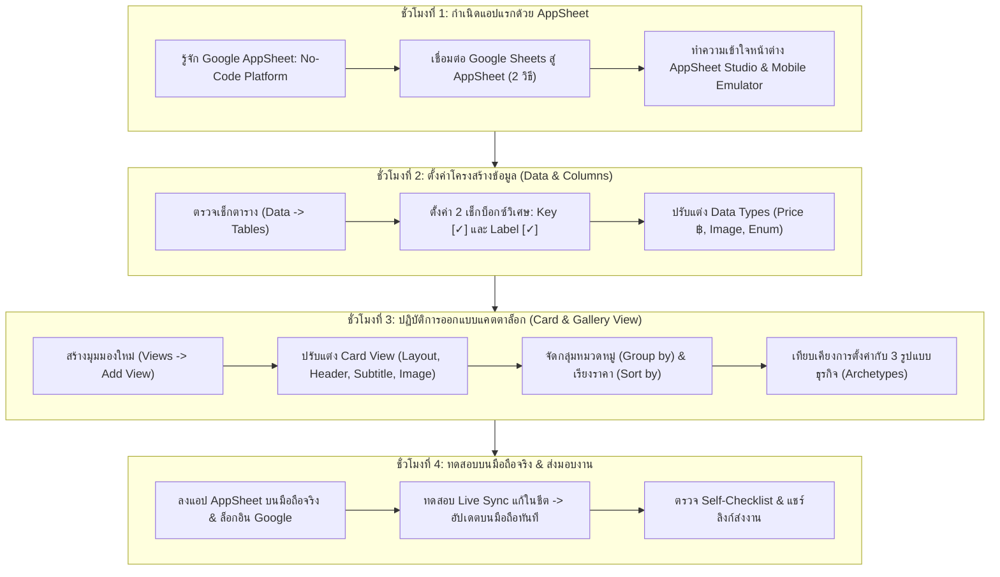

# บทที่ 6: การสร้างแอปแรกและดึงข้อมูลขึ้นหน้าจอมือถือด้วย AppSheet
*(AppSheet Basics: Connecting Google Sheets & Designing Mobile Catalog Views)*

---

## 🎯 จุดประสงค์การเรียนรู้ประจำบท
เมื่อศึกษาบทเรียนนี้และปฏิบัติการตามขั้นตอนเสร็จสิ้น ผู้เรียนสามารถ:
1. อธิบายสถาปัตยกรรมและหลักการทำงานของ **Google AppSheet** ในการแปลงข้อมูลบน Google Sheets ให้กลายเป็นโมบายล์แอปพลิเคชันได้
2. เชื่อมต่อไฟล์ Google Sheets (จากบทที่ 5) เข้าสู่ระบบ AppSheet เพื่อสร้างแอปพลิเคชันแรกได้สำเร็จโดยไม่เกิดข้อผิดพลาด
3. ตั้งค่าโครงสร้างคอลัมน์ (Column Structure) โดยกำหนด **Key Column (คีย์หลัก)** และ **Label Column (คอลัมน์แสดงผล)** ได้อย่างถูกต้อง
4. ปรับแต่งประเภทข้อมูล (Data Types) เช่น `Price (สกุลเงินบาท ฿)`, `Image (รูปภาพ)`, `Enum (ตัวเลือก)`, และ `Number (ตัวเลข)` ได้อย่างแม่นยำ
5. ออกแบบมุมมองส่วนติดต่อผู้ใช้ (UX Views) ประเภท **Card View** และ **Gallery View** พร้อมจัดกลุ่มข้อมูล (Group By) และเรียงลำดับ (Sort By) ตามแนวทางของ **3 รูปแบบธุรกิจ (Archetypes)**
6. ติดตั้งแอปพลิเคชัน **AppSheet** บนสมาร์ตโฟนจริง (iOS หรือ Android) และทดสอบระบบการซิงก์ข้อมูลแบบสองทาง (Bi-directional Live Sync) ได้ 100%
7. ทำงานร่วมกันในทีม 3 คน ตรวจสอบคุณภาพแอปพลิเคชัน และแชร์ลิงก์ทดสอบแอป (Share App Link) ส่งตรวจตามเกณฑ์มาตรฐาน

---

## 🧭 แผนผังการเรียนรู้ประจำสัปดาห์ที่ 6 (4 ชั่วโมง)



---

## 1. รู้จัก Google AppSheet: เปลี่ยนสเปรดชีตให้เป็นแอปมือถือใน 30 วินาที

ในบทที่ 5 เราได้สร้างพิมพ์เขียวฐานข้อมูลบน Google Sheets ไว้อย่างถูกต้องตามกฎเหล็ก 5 ประการแล้ว ในบทนี้คือช่วงเวลาที่น่าตื่นเต้นที่สุด: **"การนำข้อมูลเหล่านั้นมาเปลี่ยนเป็นแอปพลิเคชันบนมือถือจริง!"**

### 1.1 Google AppSheet คืออะไร?
**Google AppSheet** เป็นแพลตฟอร์มการพัฒนาซอฟต์แวร์แบบ **No-Code (ไม่จำเป็นต้องเขียนโค้ดบรรทัดเดียว)** ที่พัฒนาโดย Google มีจุดเด่นคือ:
- **ทำงานร่วมกับ Google Workspace 100%:** ดึงข้อมูลจาก Google Sheets, อ่านรูปภาพจาก Google Drive, และส่งเมลแจ้งเตือนผ่าน Gmail ได้ทันที
- **สร้างแอปพลิเคชันแบบ Cross-Platform อัตโนมัติ:** สร้างครั้งเดียว ใช้งานได้ทั้งบน iPhone (iOS), Android สมาร์ตโฟน, แท็บเล็ต, และหน้าจอคอมพิวเตอร์ (Web Desktop)
- **ใช้งานฟรีสำหรับการศึกษา:** สามารถสร้างและทดสอบระบบได้ฟรีโดยไม่มีค่าใช้จ่าย (รองรับผู้ใช้งานทดสอบได้สูงสุด 10 คนต่อแอป)

```
┌────────────────────────────────────────────────────────────────────────┐
│                   กลไกการทำงานของ Google AppSheet                       │
├────────────────────────────────────────────────────────────────────────┤
│                                                                        │
│   [ Google Sheets ] ──(อ่านโครงสร้างตาราง)──> [ AppSheet Cloud Engine ]│
│   - ตาราง Products                           - สร้าง UI หน้าจอมือถือ   │
│   - คอลัมน์ Product_ID, Price                - สร้างปุ่มกดและแบบฟอร์ม  │
│   - ข้อมูล 15 แถว                            - ควบคุมตรรกะความปลอดภัย  │
│                                                          │             │
│                                              (ซิงก์ข้อมูลไป-กลับ)       │
│                                                          ▼             │
│                                              [ สมาร์ตโฟนของผู้ใช้ ]    │
│                                              - แคตตาล็อกภาพสวยงาม     │
│                                              - แตะกดสั่งซื้อได้จริง    │
└────────────────────────────────────────────────────────────────────────┘
```

---

### 1.2 สองวิธีในการสร้างแอป AppSheet จาก Google Sheets

นักเรียนสามารถเลือกใช้วิธีใดวิธีหนึ่งในการสร้างแอปแรก:

#### วิธีที่ 1: สร้างโดยตรงจากหน้า Google Sheets (แนะนำ: สะดวกและเร็วที่สุด)
1. เปิดไฟล์ Google Sheets ของกลุ่มที่ทำไว้ในบทที่ 5 (เช่น `Group03_FreshBrew_Database`)
2. ที่แถบเมนูด้านบน คลิกที่คำว่า **"ส่วนขยาย (Extensions)"**
3. เลื่อนเมาส์ไปที่หัวข้อ **"AppSheet"**
4. คลิกคำว่า **"สร้างแอป (Create an app)"**
5. ระบบจะพาเข้าสู่หน้าต่าง AppSheet และทำการอ่านตารางข้อมูล แปลงร่างเป็นแอปพลิเคชันมือถือเบื้องต้นให้ทันทีภายในไม่กี่วินาที!

#### วิธีที่ 2: สร้างผ่านเว็บไซต์ AppSheet.com
1. เปิดเบราว์เซอร์ เข้าเว็บไซต์ [www.appsheet.com](https://www.appsheet.com)
2. คลิกปุ่ม **"Sign In"** ด้านขวาบน เลือก **"Google"** (ใช้อีเมลเดียวกับที่เก็บไฟล์ Google Drive)
3. ที่แถบด้านซ้าย คลิกปุ่ม **"+ Create"** -> เลือก **"App"** -> เลือก **"Start with existing data"**
4. ตั้งชื่อแอปในช่อง App name (เช่น `Fresh Brew Delivery`) และเลือกหมวดหมู่ Category
5. คลิกปุ่ม **"Choose your data"** -> เลือกไฟล์ Google Sheets ของกลุ่มจาก Google Drive

---

### 1.3 โครงสร้างหน้าต่างทำงานของ AppSheet Studio (The AppSheet Interface)

เมื่อระบบสร้างแอปเสร็จ จะปรากฏหน้าต่างควบคุมหลัก (AppSheet Studio):

```
┌───────────────────────────────────────────────────────────────────────────────────┐
│ [Logo] Fresh Brew Delivery                    [Share] [💾 Save] [User Icon]      │
├──────────────────────┬────────────────────────────────────┬───────────────────────┤
│ แถบเครื่องมือซ้าย    │ พื้นที่ตั้งค่า (Inspector)         │ จอจำลองมือถือ (Center)│
│ (Navigation Bar)     │                                    │ (Interactive Emulator)│
│                      │ Customize View: Products_Card      │ ┌───────────────────┐ │
│ 📊 Data (ตารางข้อมูล)│ ---------------------------------- │ │ Fresh Brew    🔍  │ │
│ 📱 Views (หน้าจอ UI) │ View name: [ Products_Card       ] │ │ ┌───────────────┐ │ │
│ ⚡ Actions (ปุ่มกด)  │ For this data: [ Products        ] │ │ │ [ รูปแก้วชา ] │ │ │
│ 🤖 Automation (บอท)  │ View type: [ card              ▼ ] │ │ │ ชานมไต้หวัน   │ │ │
│ ⚙️ Settings (ตั้งค่า) │ Layout: [ Large photo          ▼ ] │ │ │ ฿55.00        │ │ │
│                      │ Title: [ Product_Name          ▼ ] │ │ └───────────────┘ │ │
│                      │ Subtitle: [ Unit_Price         ▼ ] │ │ [🏠 สินค้า] [📋 ออร์เดอร์]│
│                      │                                    │ └───────────────────┘ │
└──────────────────────┴────────────────────────────────────┴───────────────────────┘
```

1. **แถบเครื่องมือซ้าย (Navigation Bar):** เมนูหลักในการควบคุมระบบ ได้แก่:
   - **`Data` (ข้อมูล):** จัดการตาราง คอลัมน์ ชนิดข้อมูล และสูตร
   - **`Views` (หน้าจอ):** สร้างและจัดรูปแบบหน้าจอ (UX) เช่น Card, Gallery, Form
   - **`Actions` (ปุ่มดำเนินการ):** สร้างปุ่มโทรออก สแกนบาร์โค้ด หรือเปลี่ยนสถานะ
   - **`Automation` (ระบบอัตโนมัติ):** สร้างบอทส่งอีเมลและสร้างไฟล์ PDF
2. **พื้นที่ตั้งค่า (Inspector):** ปรับแต่งคุณสมบัติต่าง ๆ อย่างละเอียด
3. **จอจำลองมือถือ (Mobile Emulator):** แสดงผลหน้าตาแอปพลิเคชันจริง สามารถใช้เมาส์คลิกรูดเลื่อนหน้าจอและทดสอบฟังก์ชันได้เสมือนถือโทรศัพท์จริง

---

## 2. การตั้งค่าโครงสร้างข้อมูลและชนิดของคอลัมน์ (Data & Columns Setup)

ก่อนจะไปตกแต่งหน้าตา สิ่งสำคัญที่สุดคือ **"การบอกให้ AppSheet รู้ว่าแต่ละคอลัมน์คืออะไร และเก็บข้อมูลประเภทไหน"**

### 2.1 เข้าสู่เมนู Columns
1. ที่แถบเมนูด้านซ้าย คลิกที่ไอคอน **`Data`** (รูปตาราง)
2. สังเกตรายชื่อตาราง (Tables) คลิกที่ชื่อตารางหลักของตนเอง เช่น **`Products`**
3. คลิกขยายหัวข้อ **"Columns"** เพื่อเปิดดูรายชื่อคอลัมน์ทั้งหมดที่ AppSheet ดึงมาจาก Google Sheets

---

### 2.2 สองเช็กบ็อกซ์วิเศษ: Key [✓] และ Label [✓] (หัวใจสำคัญที่สุด!)
ในแถบตาราง Columns จะมีช่องสี่เหลี่ยมให้ติ๊กถูกอยู่ 2 คอลัมน์ที่ต้องเข้าใจให้ลึกซึ้ง:

```
┌────────────────────────────────────────────────────────────────────────┐
│                   ความแตกต่างระหว่าง Key และ Label                     │
├─────────────────────┬──────────────────────────────────────────────────┤
│ ช่องที่ 1: Key [✓]   │ รหัสที่ระบบคอมพิวเตอร์ใช้ชี้พิกัดแถว ห้ามซ้ำกัน  │
│ (Primary Key)       │ *ตัวอย่าง:* คอลัมน์ `Product_ID` หรือ `Order_ID`  │
│                     │ กฎ: ใน 1 ตาราง ต้องมี Key ได้เพียง 1 คอลัมน์เท่านั้น!│
├─────────────────────┼──────────────────────────────────────────────────┤
│ ช่องที่ 2: Label [✓] │ ชื่อหัวเรื่องที่ "ตามนุษย์มองเห็น" เพื่อสื่อความหมาย│
│ (Display Header)    │ *ตัวอย่าง:* คอลัมน์ `Product_Name` หรือ `Name`   │
│                     │ กฎ: เมื่อตารางอื่นอ้างอิงถึงข้อมูลนี้ AppSheet จะดึง │
│                     │ ชื่อในช่อง Label ไปแสดงบนหน้าจอให้คนอ่านรู้เรื่อง │
└─────────────────────┴──────────────────────────────────────────────────┘
```

> [!IMPORTANT]
> **ข้อควรระวัง:** ห้ามติ๊กช่อง `Key [✓]` ที่คอลัมน์ราคา (`Price`) หรือคอลัมน์รูปภาพเด็ดขาด! ให้ติ๊กที่รหัสประจำตัวของแถวนั้น เช่น `Product_ID` เท่านั้น และติ๊กช่อง `Label [✓]` ที่ชื่อของสินค้า `Product_Name`

---

### 2.3 การปรับแต่งชนิดข้อมูล (Data Types) ให้ตรงตามฟังก์ชันจริง
คลิกที่ช่อง Type ของแต่ละคอลัมน์เพื่อปรับประเภทให้ถูกต้อง:

| คอลัมน์ตัวอย่าง | ปรับเป็น Type | การตั้งค่าเพิ่มเติมที่ต้องทำ |
|:---|:---:|:---|
| `Product_ID` | **Text** | ติ๊กถูกช่อง `Key [✓]` และช่อง `Require? [✓]` |
| `Product_Name` | **Text** | ติ๊กถูกช่อง `Label [✓]` และช่อง `Search? [✓]` |
| `Category_Name`| **Enum** | ที่หัวข้อ Values เพิ่มตัวเลือก: ชานม, กาแฟ, ขนม |
| `Unit_Price` | **Price** | คลิกรูปดินสอ [✎] ที่ช่อง Currency symbol เปลี่ยนเป็น `฿` |
| `Stock_Qty` | **Number** | กำหนดค่าต่ำสุด Minimum value เป็น `0` (ห้ามสต็อกติดลบ) |
| `Image_URL` | **Image** | สำหรับแสดงรูปภาพขนาดใหญ่ |
| `Description` | **LongText** | สำหรับข้อความบรรยายรายละเอียดขนาดยาว |
| `Is_Available` | **Yes/No** | สวิตช์เปิด/ปิด (ค่าเริ่มต้นเป็น TRUE) |

---

## 3. ปฏิบัติการออกแบบมุมมองแคตตาล็อกสินค้า (Designing Mobile Catalog Views)

เมื่อข้อมูลถูกตั้งค่าอย่างถูกต้องแล้ว ตอนนี้เราจะมาเนรมิตหน้าจอแคตตาล็อกสินค้าให้สวยงามเหมือนที่ออกแบบไว้ใน Figma!

### 3.1 การสร้าง View ใหม่ใน AppSheet (ทีละคลิก)
1. ที่แถบเมนูด้านซ้าย คลิกที่ไอคอน **`Views`** (รูปหน้าจอมือถือ)
2. คลิกปุ่ม **"+ Add View"** หรือคลิกแก้ไข View เดิมที่มีอยู่
3. ในช่อง **View name** ตั้งชื่อมุมมอง เช่น `Products_Catalog`
4. ในช่อง **For this data** เลือกตารางข้อมูล: `Products`
5. ในหัวข้อ **View type** ให้คลิกเลือกประเภทหน้าจอที่ต้องการ:
   - 👉 **`card` (การ์ด):** เหมาะที่สุดสำหรับแคตตาล็อกสินค้า มีรูปภาพเด่นชัด
   - 👉 **`gallery` (แกลเลอรี):** เหมาะสำหรับการแสดงภาพตารางแบบตารางไอคอน
   - 👉 **`table` (ตาราง):** เหมาะสำหรับหน้าคลังสต็อกที่ต้องการดูตัวเลขเร็ว ๆ

```
┌────────────────────────────────────────────────────────────────────────┐
│                   เปรียบเทียบรูปแบบมุมมองแคตตาล็อก                      │
├─────────────────────┬──────────────────────────────────────────────────┤
│ 1. Card View        │ มีภาพปกใหญ่ มีชื่อสินค้า ป้ายราคาชัดเจน          │
│ (แนะนำสำหรับร้านค้า)│ สามารถวางปุ่มกดลงตะกร้าใต้ภาพได้ทันที            │
├─────────────────────┼──────────────────────────────────────────────────┤
│ 2. Gallery View     │ จัดเรียงภาพเป็นตารางกริด 2 คอลัมน์ (เหมือน IG)   │
│ (เน้นดูรูปเยอะ ๆ)   │ สวยงาม กะทัดรัด ประหยัดพื้นที่หน้าจอ             │
└─────────────────────┴──────────────────────────────────────────────────┘
```

---

### 3.2 การปรับแต่ง Card View ให้สวยงามระดับมืออาชีพ
เมื่อเลือก View type เป็น **`card`** ให้เลื่อนลงมาปรับแต่งค่าดังนี้:

1. **Layout (เค้าโครง):** เลือกรูปแบบ **`Large`** (ภาพขนาดใหญ่เต็มความกว้าง) หรือ **`Photo`**
2. **การผูกข้อมูลลงในการ์ด (Card Content Binding):**
   - **Title (หัวเรื่องหลัก):** เลือก `Product_Name`
   - **Subtitle (หัวเรื่องรอง):** เลือก `Unit_Price`
   - **Image (รูปภาพ):** เลือก `Image_URL`
   - **Summary (ข้อความสรุปมุมบน/ล่าง):** เลือก `Category_Name`
3. **การจัดกลุ่มข้อมูล (Group by):**
   - ในหัวข้อ **View options** -> คลิกที่ช่อง **`Group by`**
   - เลือกคอลัมน์: **`Category_Name`** -> เลือกเรียงแบบ `Ascending` (ก-ฮ)
   - *ผลลัพธ์:* หน้าจอจะแบ่งสัดส่วนเมนูออกเป็นหมวดหมู่ เช่น "หมวดชานม", "หมวดกาแฟ" โดยอัตโนมัติ!
4. **การเรียงลำดับสินค้า (Sort by):**
   - คลิกที่ช่อง **`Sort by`** -> เลือก `Unit_Price` แบบ `Ascending` (เรียงจากราคาถูกไปแพง)
5. **ตำแหน่งการวางบนแถบเมนูด้านล่าง (Position):**
   - เลือก **`primary`** หรือ **`first`** เพื่อให้ปุ่มเมนูนี้อยู่ที่ตำแหน่งซ้ายสุดของแถบล่างมือถือ

> [!TIP]
> ทุกครั้งที่ปรับแต่งเสร็จสิ้น อย่าลืมคลิกปุ่มสีฟ้า **"💾 Save"** ที่มุมขวาบนของหน้าจอ AppSheet เสมอ เพื่อให้ระบบประมวลผลและบันทึกการเปลี่ยนแปลง

---

## 4. เวิร์กช็อปภาคปฏิบัติ: สเปกการตั้งค่า View สำหรับ 3 รูปแบบธุรกิจ (Archetypes)

ให้นักเรียนเลือกปรับแต่งตามโจทย์ธุรกิจที่กลุ่มตนเองรับผิดชอบ:

---

### รูปแบบที่ 1: Fresh Brew & Bakery (ร้านอาหารและเครื่องดื่ม)
> **เป้าหมาย:** ทำหน้าแคตตาล็อกเครื่องดื่มที่มีรูปแก้วชาเด่น ป้ายราคาชัดเจน และจัดกลุ่มตามประเภทน้ำ

```
┌────────────────────────────────────────────────────────────────────────┐
│ สเปกการตั้งค่า View: Fresh Brew & Bakery                               │
├───────────────────┬────────────────────────────────────────────────────┤
│ View Name         │ Drink_Menu                                         │
│ For this data     │ Products                                           │
│ View Type         │ card                                               │
│ Layout            │ Large                                              │
│ Title             │ [ Product_Name ] (ฟอนต์หนา ชัดเจน)                  │
│ Subtitle          │ [ Unit_Price ] (แสดงราคา เช่น ฿55.00)              │
│ Main Image        │ [ Image_URL ] (รูปแก้วชาไดคัท)                     │
│ Group by          │ [ Category_Name ] (จัดกลุ่ม: ชานม, กาแฟ, ขนม)     │
│ Sort by           │ [ Unit_Price ] (Ascending: ราคาประหยัดขึ้นก่อน)    │
│ Position          │ Left (ปุ่มเมนูแรกสุดแถบล่าง)                       │
│ Icon ประจำปุ่ม    │ ค้นหาไอคอน: 'coffee' หรือ 'local_drink'           │
└───────────────────┴────────────────────────────────────────────────────┘
```

**ผลลัพธ์บนหน้าจอมือถือจำลอง:**
ผู้ใช้จะเห็นแถบหมวดหมู่ "ชานม (4 รายการ)" เมื่อเลื่อนลงมาจะพบการ์ดรูปภาพแก้วชานมคมชัด พร้อมป้ายราคา `฿55.00` และเมื่อใช้นิ้วแตะที่การ์ด ระบบจะพาเข้าสู่หน้ารายละเอียดทันที!

---

### รูปแบบที่ 2: Happy Paws Care (คลินิกและบริการสัตว์เลี้ยง)
> **เป้าหมาย:** ทำหน้ารายการบริการ (Service Catalog) ที่แสดงระยะเวลาการทำบริการและราคาเริ่มต้น

```
┌────────────────────────────────────────────────────────────────────────┐
│ สเปกการตั้งค่า View: Happy Paws Care                                   │
├───────────────────┬────────────────────────────────────────────────────┤
│ View Name         │ Service_List                                       │
│ For this data     │ Services                                           │
│ View Type         │ card                                               │
│ Layout            │ List (แนวนอน รูปภาพอยู่ซ้าย ข้อความอยู่ขวา)       │
│ Title             │ [ Service_Name ] (ชื่อบริการ เช่น สปาอาบน้ำตัดขน) │
│ Subtitle          │ [ Price ] (แสดงราคา เช่น ฿350.00)                  │
│ Description       │ [ Duration_Mins ] (ใส่ข้อความ เช่น 60 นาที)        │
│ Main Image        │ [ Image_URL ] (รูปน้องหมาน้องแมวสดใส)             │
│ Group by          │ [ Category ] (กรูมมิ่ง, ฉีดวัคซีน, สุขภาพ)         │
│ Position          │ Left (ปุ่มเมนูแรกสุด)                              │
│ Icon ประจำปุ่ม    │ ค้นหาไอคอน: 'pets' (รูปรอยเท้าน้องหมา)             │
└───────────────────┴────────────────────────────────────────────────────┘
```

**ผลลัพธ์บนหน้าจอมือถือจำลอง:**
แสดงรายการบริการที่อ่านง่ายแบบรายแถว มีรูปภาพสัตว์เลี้ยงน่ารักอยู่ทางซ้าย และมีป้ายระบุระยะเวลา เช่น "60 นาที" และราคาค่าบริการ ทำให้ลูกค้าตัดสินใจจองคิวได้รวดเร็ว

---

### รูปแบบที่ 3: Smart Equipment Borrow (ระบบยืม-คืนอุปกรณ์และครุภัณฑ์)
> **เป้าหมาย:** ทำหน้าแดชบอร์ดคลังครุภัณฑ์ที่มองเห็นรหัสเครื่อง หมายเลขตู้จัดเก็บ และสถานะ "ว่าง" ชัดเจน

```
┌────────────────────────────────────────────────────────────────────────┐
│ สเปกการตั้งค่า View: Smart Equipment Borrow                            │
├───────────────────┬────────────────────────────────────────────────────┤
│ View Name         │ Equipment_Inventory                                │
│ For this data     │ Assets                                             │
│ View Type         │ card หรือ deck                                     │
│ Layout            │ Photo หรือ List                                    │
│ Title             │ [ Asset_Name ] (เช่น SONY Alpha A7 IV)             │
│ Subtitle          │ [ Asset_ID ] (รหัสครุภัณฑ์ เช่น #CAM-SONY-04)      │
│ Description       │ [ Storage_Box ] (ตำแหน่งตู้เก็บ เช่น ตู้ B2 ชั้น 3)│
│ Badge / Tag       │ [ Current_Status ] (แสดงสถานะ: Available / Borrowed│
│ Main Image        │ [ Image_URL ] (ภาพถ่ายอุปกรณ์จริง)                 │
│ Group by          │ [ Current_Status ] (จัดกลุ่ม: ว่าง vs ถูกยืมแล้ว)  │
│ Position          │ Left (ปุ่มแรก)                                     │
│ Icon ประจำปุ่ม    │ ค้นหาไอคอน: 'photo_camera' หรือ 'inventory'         │
└───────────────────┴────────────────────────────────────────────────────┘
```

**ผลลัพธ์บนหน้าจอมือถือจำลอง:**
ครุภัณฑ์จะถูกแยกหมวดหมู่อย่างเด่นชัด โดยเครื่องที่สถานะ "Available" จะอยู่ด้านบนสุด พร้อมบอกตำแหน่งว่าอยู่ในตู้ใด สะดวกต่อการเดินไปหยิบอุปกรณ์จริง

---

## 5. การติดตั้งแอปพลิเคชันบนสมาร์ตโฟนจริงและการทดสอบระบบ Live Sync

ถึงเวลาที่จะนำแอปที่สร้างขึ้นไปเปิดใช้งานบนโทรศัพท์มือถือจริงในมือของนักเรียนทุกคน:

### 5.1 ขั้นตอนติดตั้งและเปิดแอปบนมือถือจริง
1. หยิบสมาร์ตโฟนขึ้นมา เปิด **App Store (iOS)** หรือ **Google Play (Android)**
2. ค้นหาและติดตั้งแอปพลิเคชันชื่อ: **"AppSheet"** (พัฒนาโดย Google LLC)
3. เปิดแอป AppSheet ขึ้นมา แล้วแตะปุ่ม **"Sign in with Google"**
4. ใช้อีเมล Google บัญชีเดียวกับที่ใช้สร้างไฟล์ในคอมพิวเตอร์
5. เมื่อเข้าสู่ระบบ จะพบชื่อแอปของกลุ่มตนเองปรากฏอยู่ในแท็บ **"Owned by me"** หรือ **"Recent"**
6. แตะเปิดแอปขึ้นมา -> แอปจะแสดงผลหน้าตาแคตตาล็อกสินค้าเต็มหน้าจอสมาร์ตโฟนจริงทันที!

---

### 5.2 การทดสอบปาฏิหาริย์แห่ง Live Sync (Bi-directional Data Sync)
เพื่อให้นักเรียนเข้าใจว่าแอปพลิเคชันเชื่อมโยงกับฐานข้อมูลจริงอย่างไร ให้ทดลองทำเวิร์กช็อปนี้:

```
[ปฏิบัติการทดสอบ Live Sync แบบเรียลไทม์]

1. เพื่อนคนที่ 1 นั่งหน้าจอคอมพิวเตอร์ เปิดไฟล์ Google Sheets ขึ้นมา
2. แก้ไขราคาสินค้าแถวที่ 2 จาก "55.00" เปลี่ยนเป็น "99.00" แล้วกด Enter
3. เพื่อนคนที่ 2 ถือสมาร์ตโฟนจริงที่เปิดแอปอยู่
4. แตะที่ "ไอคอนลูกศรหมุนวน (Sync Button)" ที่มุมขวาบนของหน้าจอมือถือ
5. ปาฏิหาริย์เกิดขึ้น: ราคาบนหน้าจอมือถือจะเปลี่ยนจาก 55.00 เป็น 99.00 บาททันที!
6. จากนั้นให้ลองแตะปุ่มแก้ไขสินค้าบนหน้าจอมือถือ -> ข้อมูลใน Google Sheets บนคอมพิวเตอร์ก็จะเปลี่ยนตามทันทีเช่นกัน!
```

---

## 6. การทำงานร่วมกันในทีม 3 คน (Collaboration Matrix)

```
┌────────────────────────────────────────────────────────────────────────┐
│                        ตารางแบ่งหน้าที่ในทีม 3 คน                       │
├─────────────────────┬──────────────────────────────────────────────────┤
│ สมาชิกคนที่ 1       │ 1. เชื่อมต่อ Google Sheets สู่ AppSheet Studio   │
│ (App Creator & Lead)│ 2. ตรวจสอบความถูกต้องของ Key [✓] และ Label [✓]   │
│                     │ 3. ตั้งค่า Data Types (Price, Image, Number)     │
├─────────────────────┼──────────────────────────────────────────────────┤
│ สมาชิกคนที่ 2       │ 1. สร้างมุมมอง Card View / Gallery View แคตตาล็อก│
│ (UX Designer)       │ 2. ผูกรูปภาพ หัวข้อ ราคา และคำอธิบายลงในการ์ด    │
│                     │ 3. จัดกลุ่ม Group by และจัดเรียง Sort by         │
├─────────────────────┼──────────────────────────────────────────────────┤
│ สมาชิกคนที่ 3       │ 1. ติดตั้ง AppSheet Mobile บนสมาร์ตโฟนจริง       │
│ (Tester & QA Lead)  │ 2. ดำเนินการทดสอบ Live Sync ข้อมูลไป-กลับ        │
│                     │ 3. แชร์สิทธิ์ผู้ใช้งาน (Share app) และคัดลอกลิงก์│
└─────────────────────┴──────────────────────────────────────────────────┘
```

---

## 7. ปัญหาที่พบบ่อยและวิธีแก้ไข (Troubleshooting & FAQs)

### Q1: ทำไมรูปภาพสินค้าในแอปไม่ยอมแสดง กลายเป็นรูปสามเหลี่ยมสีเทาตกใจ?
* **สาเหตุที่ 1:** สิทธิ์ใน Google Drive ยังเป็นแบบ Private (ล็อกไว้)
  * **วิธีแก้:** ไปที่โฟลเดอร์รูปภาพบน Google Drive คลิก "แชร์" เปลี่ยนเป็น "ทุกคนที่มีลิงก์มีสิทธิ์ดู"
* **สาเหตุที่ 2:** รูปแบบลิงก์ผิด ไม่ใช่ Direct Link
  * **วิธีแก้:** แปลงลิงก์ให้อยู่ในรูปแบบ `https://drive.google.com/uc?export=view&id=FILE_ID` ตามสูตรในบทที่ 5

### Q2: AppSheet ขึ้นแถบสีแดงเตือนว่า: "Table Products has no Key"?
* **สาเหตุ:** ลืมติ๊กเลือกคอลัมน์ที่เป็น Key ในเมนู Data -> Columns
* **วิธีแก้:** เข้าไปที่ Data -> Columns -> ที่ตาราง Products ตรวจสอบว่าคอลัมน์ `Product_ID` มีเครื่องหมายถูกในช่อง `Key [✓]` หรือยัง จากนั้นกด Save

### Q3: ราคาในแอปแสดงสัญลักษณ์ดอลลาร์ ($) แทนที่จะเป็นบาท (฿)?
* **วิธีแก้:** ไปที่ Data -> Columns -> คลิกรูปดินสอ [✎] หน้าคอลัมน์ Unit_Price -> เลื่อนลงมาที่ช่อง Currency symbol พิมพ์เครื่องหมาย `฿` หรือพิมพ์คำว่า `THB` แทน

---

## 8. กิจกรรมปฏิบัติการและเกณฑ์การประเมินชิ้นงานประจำสัปดาห์ (Deliverables & Rubric)

### 📋 ใบงานปฏิบัติการประจำบทที่ 6
**คำสั่ง:** ให้นักเรียนทำงานร่วมกันเป็นกลุ่ม 3 คน ดำเนินการดังนี้:
1. เชื่อมต่อไฟล์ Google Sheets จากบทที่ 5 เข้าสู่ **Google AppSheet**
2. ตั้งค่าคอลัมน์ Key และ Label พร้อมกำหนด Data Types ถูกต้องทุกคอลัมน์
3. ออกแบบหน้าจอแสดงแคตตาล็อกสินค้า/บริการแบบ **Card View** หรือ **Gallery View**
4. มีการจัดกลุ่มข้อมูล (Group by) และแสดงรูปภาพสินค้าครบถ้วนทุกรายการ
5. ติดตั้งและเปิดทดสอบบนสมาร์ตโฟนจริงผ่านแอปพลิเคชัน AppSheet

---

### 🔍 แบบตรวจสอบตนเองก่อนส่งงาน (Self-Checklist)
- [ ] แอปพลิเคชันเชื่อมต่อกับ Google Sheets สำเร็จ และไม่มีแถบสีแดงแจ้งเตือน Error ใช่หรือไม่?
- [ ] คอลัมน์รหัส (ID) ถูกตั้งเป็น Key [✓] และคอลัมน์ชื่อถูกตั้งเป็น Label [✓] ถูกต้องใช่หรือไม่?
- [ ] ราคาแสดงผลเป็นสกุลเงินบาท `฿` และตัวเลขถูกต้องใช่หรือไม่?
- [ ] รูปภาพสินค้าแสดงผลครบทุกรูป ไม่ปรากฏไอคอนรูปภาพเสียใช่หรือไม่?
- [ ] หน้าจอแคตตาล็อกมีการจัดกลุ่มหมวดหมู่ (Group by) ชัดเจนใช่หรือไม่?
- [ ] สมาชิกในกลุ่มเปิดทดสอบบนสมาร์ตโฟนจริง และทดสอบ Live Sync ผ่านสำเร็จใช่หรือไม่?

---

### 📊 เกณฑ์การประเมินชิ้นงานประจำบทที่ 6 (Scoring Rubric : รวม 10 คะแนน)

| เกณฑ์การประเมิน | ระดับดีมาก (เต็ม) | ระดับพอใช้ (ครึ่งคะแนน) | ระดับต้องปรับปรุง (ต่ำกว่าครึ่ง) |
|:---|:---|:---|:---|
| **1. การเชื่อมต่อและการตั้งค่าโครงสร้างข้อมูล (3 คะแนน)** | เชื่อมต่อสำเร็จ ไม่ติด Error ตั้งค่า Key และ Label ถูกต้อง Data Types แม่นยำทุกคอลัมน์ (3 คะแนน) | เชื่อมต่อได้ แต่ยังมีบางคอลัมน์ตั้ง Type ผิดประเภท เช่น ราคายังเป็น Text (2 คะแนน) | ติด Error เรื่อง Key หรือระบบไม่สามารถโหลดข้อมูลจากชีตได้ (1 คะแนน) |
| **2. ความสวยงามของมุมมองแคตตาล็อก (3 คะแนน)** | ใช้ Card/Gallery View สวยงาม ผูกภาพ หัวข้อ ราคาถูกต้อง มีการจัดกลุ่ม Group by สบายตา (3 คะแนน) | จัดหน้าจอได้ครบถ้วน แต่รูปภาพยังไม่ขึ้นบางรูป หรือยังไม่ได้จัดกลุ่มหมวดหมู่ (2 คะแนน) | แสดงผลเป็นเพียงตารางดิบ (Table) ไม่มีการปรับแต่ง UX View (1 คะแนน) |
| **3. ประสบการณ์บนสมาร์ตโฟนจริงและ Live Sync (2 คะแนน)** | ติดตั้งบนมือถือจริงสำเร็จ และสาธิตการทำงานของ Live Sync แก้ไขข้อมูลอัปเดตได้แบบเรียลไทม์ (2 คะแนน) | เปิดบนมือถือได้ แต่การซิงก์ข้อมูลยังติดขัด หรือรูปภาพโหลดช้ามาก (1 คะแนน) | ไม่ได้ทดสอบบนมือถือจริง เปิดดูเฉพาะบนคอมพิวเตอร์ (0 คะแนน) |
| **4. การแชร์สิทธิ์และการส่งงาน (2 คะแนน)** | แชร์สิทธิ์ผู้ใช้งาน (Share app) ได้ถูกต้อง ครูสามารถเปิดทดสอบแอปผ่านลิงก์ได้ทันที (2 คะแนน) | แชร์ลิงก์ถูกต้องแต่ยังไม่ได้เพิ่มสิทธิ์อีเมลครูผู้สอน หรือส่งงานช้ากว่าเวลา (1 คะแนน) | ไม่ได้ส่งลิงก์แอป หรือส่งเฉพาะลิงก์ชีต (0 คะแนน) |

---

### 📤 ขั้นตอนการแชร์ลิงก์แอปพลิเคชันส่งงาน (How to Share App Link)
1. ที่มุมบนขวาของหน้าต่าง AppSheet คลิกปุ่ม **"Share"** (รูปคนและเครื่องหมายบวก)
2. ในช่อง **Email address** ให้ใส่อีเมลของครูผู้สอน และอีเมลของสมาชิกในกลุ่มทั้ง 3 คน
3. เลื่อนลงมาที่หัวข้อ **"Copy sharing links"**:
   - คลิกคัดลอกที่ช่อง: 👉 **"Browser Link"** (สำหรับเปิดตรวจบนคอมพิวเตอร์) หรือ **"Install Link"** (สำหรับเปิดติดตั้งบนมือถือ)
4. นำลิงก์ที่ได้ไปส่งในระบบส่งงานประจำวิชา (Google Classroom) พร้อมแนบภาพสกรีนช็อตหน้าจอแอปพลิเคชันบนสมาร์ตโฟนจริงของกลุ่ม
