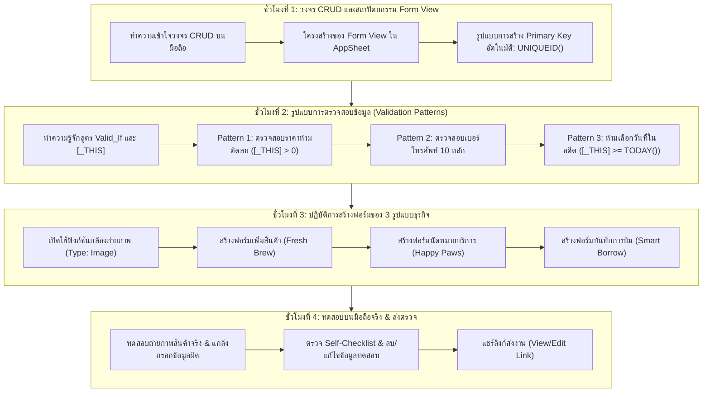

# บทที่ 7: การสร้างฟอร์มเพิ่ม/ลบ/แก้ไขข้อมูล และการตรวจสอบความถูกต้องด้วย AppSheet
*(Mobile Form Design, Hardware Camera Integration & Data Validation Patterns)*

---

## 🎯 จุดประสงค์การเรียนรู้ประจำบท
เมื่อศึกษาบทเรียนนี้และปฏิบัติการตามขั้นตอนเสร็จสิ้น ผู้เรียนสามารถ:
1. อธิบายสถาปัตยกรรม **CRUD (Create, Read, Update, Delete)** ในการจัดการวงจรชีวิตของข้อมูลบนแอปพลิเคชันมือถือได้
2. ออกแบบและปรับแต่ง **Form View** สำหรับการเพิ่ม (Add) และแก้ไข (Edit) ข้อมูลสินค้าหรือบริการได้อย่างเป็นมืออาชีพ
3. ประยุกต์ใช้ **Form UX Patterns** เช่น การใช้ `Enum Dropdown`, การจัดกลุ่มฟิลด์, และการกำหนดช่องที่จำเป็นต้องกรอก (`Required? [✓]`)
4. เปิดใช้งานฮาร์ดแวร์ **กล้องถ่ายภาพบนสมาร์ตโฟน (Hardware Camera Integration)** เพื่อถ่ายรูปสินค้าจริงและบันทึกขึ้น Google Drive แบบเรียลไทม์
5. ประยุกต์ใช้ **Validation Patterns ด้วยสูตร `Valid_If`** เช่น ป้องกันราคาสินค้าติดลบ (`[_THIS] > 0`), ตรวจสอบเบอร์โทรศัพท์ 10 หลัก, และห้ามเลือกวันนัดหมายย้อนหลัง
6. ใช้งานฟังก์ชัน **`UNIQUEID()`** ในช่อง Initial Value เพื่อสร้างรหัสคีย์หลักอัตโนมัติ ป้องกันปัญหาคีย์ซ้ำชนกัน
7. สร้างและทดสอบแบบฟอร์มที่สมบูรณ์ตามแนวทางของ **3 รูปแบบธุรกิจ (Archetypes)**
8. ร่วมมือกันในทีม 3 คน ทดสอบระบบตรวจสอบข้อมูล (Error Handling Validation) และส่งตรวจชิ้นงานได้อย่างถูกต้อง

---

## 🧭 แผนผังการเรียนรู้ประจำสัปดาห์ที่ 7 (4 ชั่วโมง)



---

## 1. วงจร CRUD และสถาปัตยกรรม Form View บนมือถือ

ในบทที่ 6 เราได้สร้างหน้าจอแสดงผลข้อมูล (Read) ให้ผู้ใช้สามารถเปิดดูแคตตาล็อกสินค้าได้แล้ว แต่แอปพลิเคชันธุรกิจจะสมบูรณ์ไม่ได้หากขาดความสามารถในการ **"บันทึกข้อมูลใหม่ (Create)"**, **"แก้ไขข้อมูลเดิม (Update)"**, และ **"ลบข้อมูลที่ไม่ต้องการ (Delete)"**

### 1.1 วงจร CRUD (The CRUD Lifecycle)

```
┌────────────────────────────────────────────────────────────────────────┐
│                        วงจรชีวิตของข้อมูล (CRUD Matrix)                │
├───────────────┬──────────────────────────────┬─────────────────────────┤
│ C : Create    │ การเพิ่มข้อมูลใหม่ลงในระบบ   │ แตะปุ่มเครื่องหมายบวก [+]│
│ (สร้าง)       │ เช่น เพิ่มเมนูเครื่องดื่มใหม่ │ ➔ เปิด Form View ว่างเปล่า│
├───────────────┼──────────────────────────────┼─────────────────────────┤
│ R : Read      │ การเปิดดูข้อมูลที่มีอยู่แล้ว │ แตะการ์ดสินค้าบนหน้าจอ  │
│ (อ่าน/แสดง)   │ เช่น ดูแคตตาล็อก, ดูราคา     │ ➔ Card View, Detail View │
├───────────────┼──────────────────────────────┼─────────────────────────┤
│ U : Update    │ การแก้ไขข้อมูลเดิมให้ทันสมัย  │ แตะปุ่มรูปดินสอ [✎] Edit │
│ (แก้ไข)       │ เช่น ปรับราคา, เปลี่ยนชื่อช่าง│ ➔ Form View ที่มีข้อมูลเดิม│
├───────────────┼──────────────────────────────┼─────────────────────────┤
│ D : Delete    │ การลบข้อมูลที่ไม่ได้ใช้ออกไป  │ แตะปุ่มรูปถังขยะ [🗑️]   │
│ (ลบ)          │ เช่น ยกเลิกเมนูที่เลิกขายแล้ว│ ➔ แสดงกล่องยืนยันการลบ │
└───────────────┴──────────────────────────────┴─────────────────────────┘
```

---

### 1.2 สถาปัตยกรรม Form View ใน AppSheet
เมื่อผู้ใช้แตะปุ่ม `[+] Add` ที่มุมขวาล่างของหน้าจอ AppSheet จะเรียกใช้งานมุมมองประเภท **`form`** ขึ้นมาโดยอัตโนมัติ:

```
┌───────────────────────────────────────┐
│ [✕ ยกเลิก]   เพิ่มสินค้าใหม่   [💾 บันทึก] │ ─── Top Bar: ยกเลิก / บันทึกข้อมูล
├───────────────────────────────────────┤
│ ชื่อสินค้า *                          │
│ [ ชานมไต้หวันพ่นไฟ                  ] │ ─── Text Input (ช่องบังคับ Required)
│                                       │
│ หมวดหมู่สินค้า *                      │
│ (•) ชานม   ( ) กาแฟสด   ( ) ขนมปัง     │ ─── Enum Buttons (เลือกง่ายด้วยนิ้วสัมผัส)
│                                       │
│ ราคาต่อแก้ว (บาท) *                   │
│ [ 55.00                             ] │ ─── Price Input (มีสูตรเช็กห้ามติดลบ)
│                                       │
│ ภาพถ่ายสินค้าจริง                     │
│ ┌───────────────────────────────────┐ │
│ │          📷 แตะเพื่อถ่ายภาพ       │ │ ─── Camera Input (กดแล้วเปิดกล้องมือถือ)
│ └───────────────────────────────────┘ │
│                                       │
│ สถานะพร้อมจำหน่าย                     │
│ [ ON / มีสินค้า ]                     │ ─── Yes/No Toggle
└───────────────────────────────────────┘
```

---

### 1.3 รูปแบบการสร้าง Primary Key อัตโนมัติ (The UniqueID Pattern)
หนึ่งในปัญหาคลาสสิกที่ทำให้ผู้ใช้งานแอปปวดหัวที่สุดคือ **"การถูกบังคับให้พิมพ์รหัส เช่น P001, P002 ด้วยตนเอง"** ซึ่งผู้ใช้มักจะจำไม่ได้ว่ารหัสล่าสุดคืออะไร และพิมพ์ซ้ำจนระบบพัง

**วิธีแก้ปัญหาแบบมืออาชีพ (Best Practice):**  
เราจะตั้งค่าให้ระบบ AppSheet ทำการสุ่มสร้างรหัสเฉพาะที่ไม่ซ้ำกันในโลกขึ้นมาเองอัตโนมัติ โดยที่ผู้ใช้ไม่ต้องพิมพ์แม้แต่ตัวเดียว!

```
[ขั้นตอนการตั้งค่า UniqueID Pattern]
1. ไปที่เมนู Data -> Columns -> เลือกตาราง Products
2. คลิกรูปดินสอ [✎] หน้าคอลัมน์ที่เป็นคีย์หลัก (เช่น Product_ID)
3. เลื่อนลงมาที่หัวข้อ "Auto Compute"
4. ที่ช่อง "Initial value" คลิกเข้าไปพิมพ์สูตร:
   = UNIQUEID()
5. เลื่อนลงมาที่หัวข้อ "Update behavior":
   - ปลดติ๊กถูกที่ช่อง "Editable?" (เพื่อไม่ให้ผู้ใช้กดแก้รหัสเล่น)
6. คลิก Save -> ต่อไปนี้เมื่อกดเพิ่มสินค้าใหม่ รหัสเฉพาะ 8 หลัก (เช่น 'a7b8c9d0') จะถูกสร้างขึ้นให้อัตโนมัติทันที 100%!
```

---

## 2. รูปแบบการตรวจสอบข้อมูลและความปลอดภัย (Data Validation Patterns)

การสร้างฟอร์มที่ดีต้องมีหลักการ **"ป้องกันความผิดพลาดเชิงรุก (Defensive Form Design)"** อย่าปล่อยให้ผู้ใช้กรอกอะไรก็ได้แล้วค่อยไปตามแก้ใน Google Sheets ภายหลัง

ใน AppSheet เราจะใช้เครื่องมือที่มีชื่อว่า **`Valid_If`** ซึ่งเป็นคำสั่งเชิงตรรกะที่จะอนุญาตให้บันทึกข้อมูลได้ก็ต่อเมื่อ **ผลลัพธ์ของสูตรเป็น TRUE (จริง)** เท่านั้น หากเป็น FALSE ระบบจะล็อกปุ่มบันทึกและแสดงข้อความแจ้งเตือนสีแดงทันที!

> [!NOTE]
> **รู้จักสัญลักษณ์พิเศษ `[_THIS]`:**  
> ในการเขียนสูตรตรวจสอบความถูกต้อง คำว่า `[_THIS]` หมายถึง **"ค่าของช่องเซลล์ปัจจุบันที่ผู้ใช้กำลังพิมพ์อยู่นั่นเอง"**

---

### Pattern 1: การตรวจสอบตัวเลขและราคาห้ามติดลบ (Positive Number Constraint)
ป้องกันพนักงานพิมพ์ราคาผิด หรือเผลอพิมพ์เครื่องหมายลบ เช่น `-50`:

```
┌────────────────────────────────────────────────────────────────────────┐
│ สูตร Valid_If:                                                         │
│ = [_THIS] > 0                                                          │
├────────────────────────────────────────────────────────────────────────┤
│ ข้อความแจ้งเตือน (Invalid value error):                               │
│ "กรุณากรอกราคาเป็นตัวเลขจำนวนเต็มที่มากกว่า 0 บาท"                     │
└────────────────────────────────────────────────────────────────────────┘
```

* **ผลลัพธ์:** หากผู้ใช้พิมพ์ `0` หรือ `-50` ช่องราคาจะขึ้นกรอบสีแดงพร้อมข้อความเตือนทันที และจะไม่สามารถกดปุ่ม Save ได้

---

### Pattern 2: การตรวจสอบรูปแบบเบอร์โทรศัพท์มือถือ 10 หลัก (Phone Number Pattern)
เบอร์โทรศัพท์ในประเทศไทยต้องขึ้นต้นด้วยเลข `0` และมีความยาวครบ 10 หลักพอดี:

```
┌────────────────────────────────────────────────────────────────────────┐
│ สูตร Valid_If:                                                         │
│ = AND(LEN([_THIS]) = 10, STARTSWITH([_THIS], "0"))                     │
├────────────────────────────────────────────────────────────────────────┤
│ ข้อความแจ้งเตือน (Invalid value error):                               │
│ "เบอร์โทรศัพท์ต้องขึ้นต้นด้วยเลข 0 และมีความยาวครบ 10 หลักพอดี"       │
└────────────────────────────────────────────────────────────────────────┘
```

* **คำอธิบายสูตร:**
  - `LEN([_THIS]) = 10`: ความยาวของตัวอักษรต้องเท่ากับ 10 ตัว
  - `STARTSWITH([_THIS], "0")`: ตัวอักษรตัวแรกสุดต้องเป็นเลข 0
  - `AND(...)`: เงื่อนไขทั้งสองข้อต้องถูกต้องพร้อมกัน

---

### Pattern 3: การป้องกันการเลือกวันนัดหมายในอดีต (Future Date Constraint)
สำหรับระบบจองคิว ลูกค้าไม่ควรเลือกนัดหมายวันที่ผ่านมาแล้วเมื่อวานนี้:

```
┌────────────────────────────────────────────────────────────────────────┐
│ สูตร Valid_If:                                                         │
│ = [_THIS] >= TODAY()                                                   │
├────────────────────────────────────────────────────────────────────────┤
│ ข้อความแจ้งเตือน (Invalid value error):                               │
│ "ไม่สามารถเลือกวันนัดหมายย้อนหลังได้ กรุณาเลือกวันปัจจุบันหรือวันข้างหน้า"│
└────────────────────────────────────────────────────────────────────────┘
```

* **คำอธิบายสูตร:** `TODAY()` คือฟังก์ชันคืนค่าวันที่ปัจจุบันของระบบ หากวันที่ที่เลือกน้อยกว่าวันนี้ ระบบจะไม่อนุญาตให้บันทึก

---

### Pattern 4: การตั้งค่าช่องที่จำเป็นต้องกรอก (Required Field Pattern)
ข้อมูลสำคัญ เช่น ชื่อสินค้า หรือเบอร์โทรศัพท์ลูกค้า หากเว้นว่างไว้จะทำให้ระบบมีปัญหา:
- ในตาราง `Data -> Columns`: ให้ติ๊กถูกที่ช่อง **`Require? [✓]`** ในคอลัมน์ที่จำเป็น
- ฟิลด์นั้นจะปรากฏ **เครื่องหมายดอกจันสีแดง (*)** กำกับไว้บนหน้าจอมือถือเสมอ

---

## 3. การเปิดใช้งานฮาร์ดแวร์กล้องถ่ายภาพบนสมาร์ตโฟน (Camera Integration)

หนึ่งในจุดแข็งที่สุดของ AppSheet คือการเชื่อมต่อกับฮาร์ดแวร์จริงของสมาร์ตโฟนได้อย่างแนบเนียน:

### 3.1 ขั้นตอนการตั้งค่าคอลัมน์รูปภาพ
1. ไปที่ `Data -> Columns` -> คลิกที่ตาราง `Products`
2. ที่คอลัมน์รูปภาพ เช่น `Image_URL` ให้เปลี่ยน **Type** จากเดิมที่เป็น Text หรือ URL ให้เป็น 👉 **`Image`**
3. คลิกที่รูปดินสอ [✎] หน้าคอลัมน์ `Image_URL` เพื่อเข้าไปดูการตั้งค่าเชิงลึก:
   - เลื่อนลงมาที่หัวข้อ **"Image/File folder path"** (ปล่อยว่างไว้เพื่อให้ AppSheet สร้างโฟลเดอร์เก็บภาพให้อัตโนมัติบน Google Drive)
4. คลิก "Done" และกด **"💾 Save"**

```
┌────────────────────────────────────────────────────────────────────────┐
│                   เมื่อเปิดฟอร์มในสมาร์ตโฟนจริง                         │
├────────────────────────────────────────────────────────────────────────┤
│ เมื่อผู้ใช้แตะที่ช่อง Image บนมือถือจริง จะปรากฏหน้าต่างตัวเลือก:      │
│   [ 📷 Take Photo ]    ──> เปิดกล้องถ่ายรูปจริงของโทรศัพท์มือถือ       │
│   [ 🖼️ Choose from Library ] ──> เลือกรูปจากอัลบั้มภาพในเครื่อง        │
│                                                                        │
│ เมื่อถ่ายภาพเสร็จ:                                                     │
│ 1. รูปภาพจะถูกย่อขนาดและส่งขึ้นไปเก็บในโฟลเดอร์บน Google Drive อัตโนมัติ│
│ 2. ชื่อไฟล์จะถูกบันทึกเป็น Path ลงในตาราง Google Sheets โดยอัตโนมัติ!   │
└────────────────────────────────────────────────────────────────────────┘
```

---

## 4. เวิร์กช็อปภาคปฏิบัติ: สเปกการสร้างฟอร์มของ 3 รูปแบบธุรกิจ (Archetypes)

ให้นักเรียนสร้างและตั้งค่าฟอร์มตามโจทย์ธุรกิจที่กลุ่มตนเองรับผิดชอบ:

---

### รูปแบบที่ 1: Fresh Brew & Bakery (ฟอร์มเพิ่ม/แก้ไขเมนูสินค้า)
> **เป้าหมาย:** ฟอร์มสำหรับเจ้าของร้าน/ผู้จัดการ ใช้ถ่ายภาพเครื่องดื่มใหม่ กำหนดราคา และเลือกหมวดหมู่

```
┌────────────────────────────────────────────────────────────────────────┐
│ สเปกฟอร์ม: Products_Form (Fresh Brew & Bakery)                         │
├───────────────────┬──────────────┬──────────┬──────────────────────────┤
│ คอลัมน์           │ Type         │ Required?│ เงื่อนไข Validation / สูตร│
├───────────────────┼──────────────┼──────────┼──────────────────────────┤
│ `Product_ID`      │ Text (Hidden)│ [✓]      │ Initial: =UNIQUEID()     │
│ `Product_Name`    │ Text         │ [✓]      │ Valid_If: LEN([_THIS])>=2│
│ `Category_Name`   │ Enum (Buttons│ [✓]      │ Values: ชานม, กาแฟ, ขนม  │
│ `Unit_Price`      │ Price (฿)    │ [✓]      │ Valid_If: [_THIS] > 0    │
│ `Cost_Price`      │ Price (฿)    │ [✓]      │ Valid_If: [_THIS] >= 0   │
│ `Stock_Qty`       │ Number       │ [✓]      │ Valid_If: [_THIS] >= 0   │
│ `Image_URL`       │ Image        │ [ ]      │ กล้องถ่ายภาพสด           │
│ `Description`     │ LongText     │ [ ]      │ คำอธิบายเมนู             │
│ `Is_Available`    │ Yes/No       │ [✓]      │ Initial: TRUE            │
└───────────────────┴──────────────┴──────────┴──────────────────────────┘
```

**การทดสอบฟอร์ม:**
- ลองเปิดฟอร์มบนมือถือ แตะช่อง Image -> ถ่ายภาพแก้วน้ำหน้าร้านจริง
- พิมพ์ราคา `-10` -> ระบบต้องล็อกปุ่ม Save และแจ้งเตือนสีแดงทันที
- เปลี่ยนเป็นราคา `55` -> ปุ่ม Save จะเปลี่ยนเป็นสีฟ้า พร้อมให้กดบันทึก

---

### รูปแบบที่ 2: Happy Paws Care (ฟอร์มบันทึกการนัดหมายบริการ)
> **เป้าหมาย:** ฟอร์มสำหรับให้ลูกค้าหรือแอดมิน กรอกข้อมูลนัดหมายล่วงหน้า เลือกวันเวลา และระบุชื่อสัตว์เลี้ยง

```
┌────────────────────────────────────────────────────────────────────────┐
│ สเปกฟอร์ม: Appointments_Form (Happy Paws Care)                         │
├───────────────────┬──────────────┬──────────┬──────────────────────────┤
│ คอลัมน์           │ Type         │ Required?│ เงื่อนไข Validation / สูตร│
├───────────────────┼──────────────┼──────────┼──────────────────────────┤
│ `Appointment_ID`  │ Text (Hidden)│ [✓]      │ Initial: =UNIQUEID()     │
│ `Customer_Name`   │ Text         │ [✓]      │ ชื่อ-นามสกุล เจ้าของ     │
│ `Customer_Phone`  │ Phone        │ [✓]      │ AND(LEN([_THIS])=10,...) │
│ `Pet_Name`        │ Text         │ [✓]      │ ชื่อน้องหมา/น้องแมว      │
│ `Pet_Breed`       │ Text         │ [✓]      │ สายพันธุ์                │
│ `Service_ID`      │ Ref / Enum   │ [✓]      │ ดึงจากตาราง Services     │
│ `Appoint_Date`    │ Date         │ [✓]      │ Valid_If: [_THIS]>=TODAY(│
│ `Time_Slot`       │ Enum (Buttons│ [✓]      │ Values: 10:00, 11:30,... │
│ `Special_Notes`   │ Text         │ [ ]      │ อาการแพ้ / ข้อควรระวัง   │
│ `Status`          │ Enum         │ [✓]      │ Initial: "Confirmed"     │
└───────────────────┴──────────────┴──────────┴──────────────────────────┘
```

**การทดสอบฟอร์ม:**
- ลองพิมพ์เบอร์โทรศัพท์ `08123` (มีแค่ 5 ตัว) -> ระบบต้องไม่ยอมให้บันทึก
- ลองเลือกวันที่นัดหมายย้อนหลังเป็นเมื่อวานนี้ -> ระบบต้องเตือนว่าไม่สามารถเลือกวันย้อนหลังได้

---

### รูปแบบที่ 3: Smart Equipment Borrow (ฟอร์มบันทึกการยืมพัสดุและครุภัณฑ์)
> **เป้าหมาย:** ฟอร์มสำหรับเจ้าหน้าที่คลัง บันทึกชื่อผู้ยืม รหัสนักศึกษา กำหนดวันส่งคืน และถ่ายภาพสภาพของก่อนยืม

```
┌────────────────────────────────────────────────────────────────────────┐
│ สเปกฟอร์ม: Borrow_Form (Smart Equipment Borrow)                        │
├───────────────────┬──────────────┬──────────┬──────────────────────────┤
│ คอลัมน์           │ Type         │ Required?│ เงื่อนไข Validation / สูตร│
├───────────────────┼──────────────┼──────────┼──────────────────────────┤
│ `Borrow_ID`       │ Text (Hidden)│ [✓]      │ Initial: =UNIQUEID()     │
│ `Asset_ID`        │ Ref / Enum   │ [✓]      │ เลือกรหัสกล้อง/อุปกรณ์   │
│ `Borrower_Name`   │ Text         │ [✓]      │ ชื่อผู้ขอยืม             │
│ `Borrower_ID`     │ Text         │ [✓]      │ รหัสนักศึกษา 10-11 หลัก  │
│ `Borrow_DateTime` │ DateTime     │ [✓]      │ Initial: =NOW() (เวลาจริง│
│ `Due_DateTime`    │ DateTime     │ [✓]      │ Valid_If: [_THIS]>[Borro│
│ `Purpose_Notes`   │ Text         │ [✓]      │ วัตถุประสงค์การนำไปใช้   │
│ `Asset_Photo_Now` │ Image        │ [✓]      │ 📷 ถ่ายภาพสภาพของก่อนยืม │
│ `Status`          │ Enum         │ [✓]      │ Initial: "Active"        │
└───────────────────┴──────────────┴──────────┴──────────────────────────┘
```

**การทดสอบฟอร์ม:**
- ช่องวันเวลาที่ยืม `Borrow_DateTime` จะถูกกรอกเป็นเวลาปัจจุบันอัตโนมัติด้วยสูตร `=NOW()`
- ช่องกำหนดส่งคืน `Due_DateTime` จะต้องมีค่ามากกว่าเวลาที่ยืมเสมอ

---

## 5. การปรับแต่งหน้าตาของ Form View ในเมนู Views (UX Form Polish)

เมื่อตั้งค่าคอลัมน์เรียบร้อย ให้เข้ามาปรับแต่งหน้าตาแบบฟอร์มในเมนู **`Views`**:
1. คลิกที่เมนู **`Views`** ด้านซ้าย
2. ค้นหา View ประเภท `form` (เช่น `Products_Form`)
3. ปรับแต่งการแสดงผล:
   - **Form style:** เลือก **`Page-by-page`** (เหมาะกับฟอร์มยาว ๆ ให้เลื่อนทีละหน้า) หรือ **`Standard`** (เลื่อนลงยาวหน้าเดียว)
   - **Column order:** สามารถคลิกจัดเรียงลำดับคอลัมน์ได้ตามใจชอบ เช่น เอาชื่อขึ้นก่อน แล้วตามด้วยรูปภาพและราคา
   - **Finish view:** เมื่อผู้ใช้กดปุ่ม Save บันทึกเสร็จแล้ว จะให้หน้าจอเด้งกลับไปที่ไหน? (แนะนำให้เลือกกลับไปหน้า `Products_Catalog`)

---

## 6. การทำงานร่วมกันในทีม 3 คน (Collaboration Matrix)

```
┌────────────────────────────────────────────────────────────────────────┐
│                        ตารางแบ่งหน้าที่ในทีม 3 คน                       │
├─────────────────────┬──────────────────────────────────────────────────┤
│ สมาชิกคนที่ 1       │ 1. ตั้งค่า Key อัตโนมัติด้วยสูตร UNIQUEID()      │
│ (Form Architect)    │ 2. กำหนดฟิลด์ Required? [✓] และจัดลำดับคอลัมน์   │
│                     │ 3. ปรับแต่ง Form Style และ Finish View           │
├─────────────────────┼──────────────────────────────────────────────────┤
│ สมาชิกคนที่ 2       │ 1. เขียนสูตรตรวจสอบความถูกต้อง Valid_If ทุกสูตร  │
│ (Validation Lead)   │ 2. เขียนข้อความแจ้งเตือนสีแดง (Error messages)   │
│                     │ 3. ตั้งค่า Enum Dropdown และตั้งค่า Type: Image  │
├─────────────────────┼──────────────────────────────────────────────────┤
│ สมาชิกคนที่ 3       │ 1. ถือสมาร์ตโฟนจริง ทดสอบเปิดกล้องถ่ายภาพสินค้า  │
│ (Mobile Tester & QA)│ 2. แกล้งพิมพ์ข้อมูลผิดเพื่อทดสอบว่าระบบดักจับจริง│
│                     │ 3. ตรวจสอบว่าข้อมูลที่บันทึก เด้งเข้าชีตจริงไหม  │
└─────────────────────┴──────────────────────────────────────────────────┘
```

---

## 7. ปัญหาที่พบบ่อยและวิธีแก้ไข (Troubleshooting & FAQs)

### Q1: กดบันทึกข้อมูลในฟอร์มแล้ว แต่ทำไมใน Google Sheets ข้อมูลไม่ขึ้น?
* **สาเหตุ:** แอปบนมือถือยังไม่ได้ซิงก์ หรือเครื่องไม่ได้ต่ออินเทอร์เน็ต
* **วิธีแก้:** ที่หน้าจอมือถือ สังเกตไอคอนรูปลูกศรหมุนวน (Sync) ที่มุมขวาบน จะมีตัวเลขสีส้มแสดงจำนวนแถวที่รอส่ง ให้แตะไอคอนนั้นเพื่อสั่งซิงก์ข้อมูลขึ้นคลาวด์ทันที

### Q2: สูตร Valid_If ขึ้นแถบสีเหลืองแจ้งเตือน Error เขียนอย่างไรก็ไม่ผ่าน?
* **สาเหตุ:** สะกดชื่อคอลัมน์ผิด หรือลืมใส่วงเล็บก้ามปู `[...]`
* **วิธีแก้:** ตรวจสอบชื่อคอลัมน์ให้ตรงกับในตาราง เช่น `[Unit_Price]` ห้ามพิมพ์ตก และจำไว้เสมอว่าการอ้างอิงค่าปัจจุบันต้องใช้ `[_THIS]` เท่านั้น

### Q3: ถ่ายรูปจากกล้องแล้ว ทำไมรูปไม่ยอมโหลดเข้า Google Drive?
* **สาเหตุ:** พื้นที่เก็บข้อมูล Google Drive ของบัญชีผู้สร้างแอปเต็ม (ครบ 15 GB)
* **วิธีแก้:** ตรวจสอบพื้นที่ว่างใน Google Drive หรือตั้งค่าคุณภาพของภาพใน AppSheet ให้เป็น `Standard` หรือ `Low` เพื่อประหยัดพื้นที่

---

## 8. กิจกรรมปฏิบัติการและเกณฑ์การประเมินชิ้นงานประจำสัปดาห์ (Deliverables & Rubric)

### 📋 ใบงานปฏิบัติการประจำบทที่ 7
**คำสั่ง:** ให้นักเรียนทำงานร่วมกันเป็นกลุ่ม 3 คน ดำเนินการดังนี้:
1. ปรับแต่ง **Form View** สำหรับเพิ่มข้อมูลลงในตารางหลักของโปรเจกต์กลุ่มตนเอง
2. กำหนดคีย์หลักอัตโนมัติด้วย `=UNIQUEID()`
3. เขียนสูตรตรวจสอบความถูกต้อง **`Valid_If`** อย่างน้อย 2 เงื่อนไข (เช่น เช็กราคาห้ามติดลบ, เช็กเบอร์โทร 10 หลัก)
4. เปิดใช้การถ่ายภาพผ่านฮาร์ดแวร์กล้องสมาร์ตโฟนจริง (Type: Image)
5. ทำการทดลองกรอกข้อมูลสินค้า/บริการใหม่ผ่านมือถือจริงอย่างน้อย **3 รายการ** และถ่ายรูปสินค้าจริงส่งเข้าระบบ

---

### 🔍 แบบตรวจสอบตนเองก่อนส่งงาน (Self-Checklist)
- [ ] เมื่อกดปุ่ม [+] ฟอร์มแสดงผลหน้าจออย่างเป็นระเบียบ หัวข้ออ่านง่ายใช่หรือไม่?
- [ ] คอลัมน์ Key ถูกสร้างรหัสอัตโนมัติด้วย `UNIQUEID()` และซ่อนไว้ไม่ให้ผู้ใช้แก้ใช่หรือไม่?
- [ ] เมื่อลองกรอกราคาติดลบ หรือกรอกข้อมูลผิด ระบบแสดงตัวหนังสือสีแดงเตือนและล็อกปุ่ม Save ใช่หรือไม่?
- [ ] ทดสอบเปิดกล้องถ่ายภาพสินค้าจริงบนสมาร์ตโฟน และภาพถูกอัปโหลดขึ้น Google Drive สำเร็จใช่หรือไม่?
- [ ] ข้อมูลใหม่ที่กรอกผ่านมือถือ เด้งเข้าไปบันทึกใน Google Sheets บนคอมพิวเตอร์อย่างถูกต้องใช่หรือไม่?
- [ ] สมาชิกในกลุ่มร่วมกันทดสอบครบทั้ง 3 คนใช่หรือไม่?

---

### 📊 เกณฑ์การประเมินชิ้นงานประจำบทที่ 7 (Scoring Rubric : รวม 10 คะแนน)

| เกณฑ์การประเมิน | ระดับดีมาก (เต็ม) | ระดับพอใช้ (ครึ่งคะแนน) | ระดับต้องปรับปรุง (ต่ำกว่าครึ่ง) |
|:---|:---|:---|:---|
| **1. การออกแบบ Form View และ UX Patterns (3 คะแนน)** | จัดฟอร์มเป็นระเบียบ มีการใช้ Enum ปุ่มกดแทนการพิมพ์เอง คีย์หลักสร้างด้วย UNIQUEID() สมบูรณ์ (3 คะแนน) | ฟอร์มใช้งานได้ครบถ้วน แต่ยังให้ผู้ใช้พิมพ์รหัสเอง หรือฟิลด์จำเป็นยังไม่ได้ใส่ดอกจัน (2 คะแนน) | ฟอร์มกระจัดกระจาย ไม่มีการจัดระเบียบฟิลด์ข้อมูล (1 คะแนน) |
| **2. ความถูกต้องของสูตร Validation (3 คะแนน)** | เขียนสูตร Valid_If ถูกต้องอย่างน้อย 2 สูตร ดักจับข้อผิดพลาดได้แม่นยำ พร้อมข้อความเตือนชัดเจน (3 คะแนน) | มีสูตร Valid_If 1 สูตร หรือเขียนสูตรได้แต่ไม่ได้ใส่ข้อความเตือน Error (2 คะแนน) | ไม่มีการใส่สูตร Valid_If ปล่อยให้กรอกราคาติดลบหรือเบอร์โทรผิดได้ (1 คะแนน) |
| **3. การผสานฮาร์ดแวร์กล้องและการบันทึกข้อมูล (2 คะแนน)** | กล้องถ่ายภาพบนมือถือทำงานได้จริง ภาพถ่ายสินค้าใหม่บันทึกเข้า Drive และชีตสมบูรณ์ (2 คะแนน) | บันทึกข้อมูลได้แต่ระบบกล้องมีปัญหา หรือภาพถ่ายไม่แสดงผล (1 คะแนน) | ไม่สามารถบันทึกข้อมูลใหม่ได้ เกิดข้อผิดพลาดตอนกด Save (0 คะแนน) |
| **4. การทดสอบและการส่งงาน (2 คะแนน)** | มีข้อมูลใหม่ที่บันทึกทดสอบอย่างน้อย 3 รายการ สมาชิกมีส่วนร่วม และแชร์ลิงก์ส่งงานถูกต้อง (2 คะแนน) | บันทึกข้อมูลได้เพียง 1 รายการ หรือส่งงานช้ากว่าเวลาที่กำหนด (1 คะแนน) | ไม่มีข้อมูลทดสอบใหม่ในระบบ หรือลิงก์เข้าถึงไม่ได้ (0 คะแนน) |

---

### 📤 ขั้นตอนการส่งงานผ่านระบบ
1. ในหน้า Google Sheets ให้แคปภาพหน้าจอที่แสดงข้อมูลใหม่ 3 แถวล่าสุดที่เพิ่งกรอกผ่านแอปมือถือ
2. ในแอป AppSheet บนมือถือ ให้แคปภาพหน้าจอขณะกำลังเปิดหน้าแบบฟอร์มที่มีรูปถ่ายสินค้าจริง
3. แคปภาพหน้าจอขณะที่ระบบแสดงข้อความเตือนสีแดง (เมื่อแกล้งกรอกราคาติดลบ) เพื่อยืนยันว่าสูตร Validation ทำงานจริง
4. นำภาพสกรีนช็อตทั้ง 3 ภาพ พร้อมแนบลิงก์แอปพลิเคชัน ส่งเข้าสู่ระบบ Google Classroom
