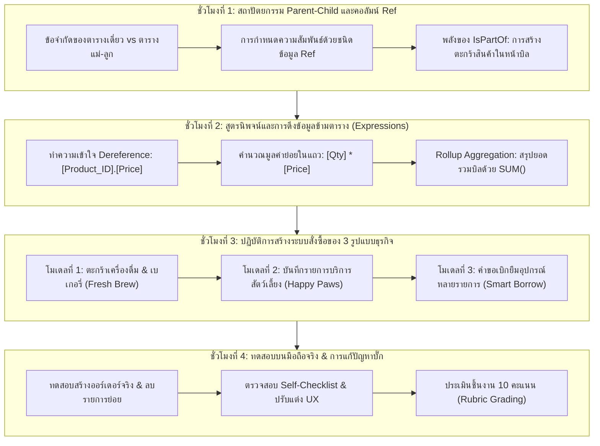

# บทที่ 8: การสร้างระบบสั่งซื้อและคำนวณเงินด้วยความสัมพันธ์และสูตร
*(Parent-Child Relations with Ref, Computed Columns, Dereference Expressions & Rollup Aggregation Patterns)*

---

## 🎯 จุดประสงค์การเรียนรู้ประจำบท
เมื่อศึกษาบทเรียนนี้และปฏิบัติการตามขั้นตอนเสร็จสิ้น ผู้เรียนสามารถ:
1. อธิบายสถาปัตยกรรมฐานข้อมูลแบบ **แม่-ลูก (Parent-Child / Header-Detail Structure)** และความสำคัญต่อระบบสั่งซื้อในชีวิตจริงได้
2. เชื่อมโยงความสัมพันธ์ระหว่างตารางด้วยชนิดข้อมูล **`Ref` (Foreign Key)** บน AppSheet ได้อย่างถูกต้อง
3. ใช้งานคุณสมบัติ **`IsPartOf = TRUE`** เพื่อสร้างแบบฟอร์มการกรอกข้อมูลตารางลูกแบบฝังตัว (Embedded Inline Subform / Cart Experience) ได้
4. ใช้งานเทคนิค **Dereference Expression (`[Ref_Column].[Target_Column]`)** เพื่อดึงราคาและข้อมูลสินค้าจากตารางหลักมาแสดงผลอัตโนมัติ
5. เขียนสูตรคำนวณมูลค่าย่อยระดับแถว (Row Subtotal) ด้วยนิพจน์คณิตศาสตร์ `[Quantity] * [Unit_Price]`
6. ประยุกต์ใช้รูปแบบการรวมผลข้อมูล **Rollup Aggregation Pattern ด้วยฟังก์ชัน `SUM()` และ `COUNT()`** เพื่อสรุปยอดเงินรวมและจำนวนรายการทั้งหมดในบิล
7. พัฒนาระบบสั่งซื้อ/ระบบบันทึกรายการย่อยที่ทำงานได้สมบูรณ์ตามบริบทของ **3 รูปแบบธุรกิจ (Archetypes)**
8. ร่วมมือกันในทีม 3 คนแบ่งบทบาทหน้าที่เชิงวิศวกรรมข้อมูล ตรวจสอบความถูกต้องของสูตร และทดสอบการทำงานบนสมาร์ตโฟนจริงได้

---

## 🧭 แผนผังการเรียนรู้ประจำสัปดาห์ที่ 8 (4 ชั่วโมง)



---

## 1. สถาปัตยกรรมความสัมพันธ์แบบตารางแม่-ลูก (Parent-Child Architecture)

ในระบบธุรกิจดิจิทัลแทบทุกประเภท ไม่ว่าจะเป็นแอปพลิเคชันช็อปปิ้ง (Shopee, Lazada), แอปสั่งอาหาร (GrabFood, LINE MAN), หรือระบบบริหารจัดการองค์กร ข้อมูลหนึ่งรายการมักจะมี **"รายการย่อย"** ประกอบอยู่เสมอ

### 1.1 ปัญหาของตารางเดี่ยว (Single Table Limitations)
หากเราพยายามบันทึกข้อมูลคำสั่งซื้อลงในตารางเดียว ดังตัวอย่าง:

```
❌ บันทึกแบบผิดวิธี: พยายามรวมทุกอย่างไว้ในตารางเดียว (เกิด Data Redundancy)
┌──────────┬──────────────┬────────────┬─────────────┬──────────┬───────────┐
│ Order_ID │ Customer     │ Menu_1     │ Qty_1       │ Menu_2   │ Qty_2     │
├──────────┼──────────────┼────────────┼─────────────┼──────────┼───────────┤
│ ORD-001  │ สมชาย ใจดี   │ ชานมไข่มุก │ 2           │ ครัวซองต์│ 1         │
└──────────┴──────────────┴────────────┴─────────────┴──────────┴───────────┘
ปัญหา:
1. หากลูกค้าสั่ง 10 อย่าง จะต้องมีคอลัมน์ Menu_1 ถึง Menu_10 หรือไม่? (โครงสร้างตารางขยายตัวอย่างไร้ระเบียบ)
2. หากลูกค้าสั่งแค่อย่างเดียว คอลัมน์ที่เหลือจะว่างเปล่า (Sparse Data สิ้นเปลืองพื้นที่)
3. การคำนวณยอดเงินรวมทำได้ยากมาก และไม่สามารถสรุปรายงานยอดขายแยกรายสินค้าได้
```

### 1.2 วิธีที่ถูกต้อง: สถาปัตยกรรม Parent-Child (Header-Detail Structure)
เราแยกข้อมูลออกเป็น **2 ตารางที่มีความสัมพันธ์กัน** ดังนี้:

```
✅ สถาปัตยกรรมที่ถูกต้อง: แยกตารางแม่ (Header) และตารางลูก (Detail)

  ┌─────────────────────────────────────────────────────────────┐
  │                 ตารางแม่: Orders (Header)                   │
  ├──────────┬─────────────┬────────────┬─────────────┬─────────┤
  │ Order_ID │ Order_Date  │ Customer   │ Total_Price │ Status  │
  ├──────────┼─────────────┼────────────┼─────────────┼─────────┤
  │ ORD-1001 │ 2026-10-18  │ สมชาย      │ 190.00      │ Pending │
  └─────┬───────────────────────────────────────────────────────┘
        │ 1 ใบสั่งซื้อ มีได้หลายรายการสินค้า (1-to-Many Relationship)
        ▼
  ┌────────────────────────────────────────────────────────────────────────┐
  │                    ตารางลูก: Order_Details (Line Items)                │
  ├───────────┬──────────┬────────────┬──────────┬────────────┬────────────┤
  │ Detail_ID │ Order_ID │ Product_ID │ Quantity │ Unit_Price │ Subtotal   │
  ├───────────┼──────────┼────────────┼──────────┼────────────┼────────────┤
  │ DTL-001   │ ORD-1001 │ PROD-01    │ 2        │ 55.00      │ 110.00     │
  │ DTL-002   │ ORD-1001 │ PROD-05    │ 1        │ 80.00      │ 80.00      │
  └───────────┴──────────┴────────────┴──────────┴────────────┴────────────┘
```

- **ตารางแม่ (`Orders`)**: เก็บข้อมูลภาพรวมของบิล เช่น เลขที่เอกสาร, วันที่, ชื่อลูกค้า, ยอดรวมทั้งสิ้น, สถานะ
- **ตารางลูก (`Order_Details`)**: เก็บรายละเอียดสินค้าแต่ละแถว โดยมีคอลัมน์ **`Order_ID` ทำหน้าที่เป็น Foreign Key (ตัวเชื่อมโยง)** ชี้กลับไปยังตารางแม่

---

## 2. ชนิดข้อมูล `Ref` และคุณสมบัติ `IsPartOf` ใน AppSheet

AppSheet มีกลไกอันชาญฉลาดในการจัดการความสัมพันธ์ระหว่างตารางผ่านชนิดข้อมูลประเภท **`Ref`**

```
┌────────────────────────────────────────────────────────────────────────┐
│                        กลไกการทำงานของชนิดข้อมูล Ref                   │
├───────────────────┬────────────────────────────────────────────────────┤
│ ชนิดข้อมูลทั่วไป  │ เก็บเฉพาะค่า เช่น ตัวหนังสือ (Text), ตัวเลข (Number)│
│ (Text, Number)    │ ไม่รู้ว่าค่านั้นเกี่ยวข้องกับตารางอื่นอย่างไร       │
├───────────────────┼────────────────────────────────────────────────────┤
│ ชนิดข้อมูล Ref    │ เก็บค่า Primary Key ของอีกตารางหนึ่ง               │
│ (Reference Link)  │ ➔ สร้าง Hyperlink เชื่อมโยงข้ามตารางได้ทันที       │
│                   │ ➔ สามารถ "ดึงค่า" ข้อมูลของแถวนั้นมาแสดงผลได้      │
└───────────────────┴────────────────────────────────────────────────────┘
```

### 2.1 ทำไมต้องเปิดคุณสมบัติ `IsPartOf = TRUE`?
เมื่อเราสร้างคอลัมน์ `Order_ID` ในตารางลูก `Order_Details` ให้มีชนิดข้อมูลเป็น `Ref` ที่ชี้ไปยังตาราง `Orders` เราจะพบช่องสี่เหลี่ยมให้ติ๊กเลือกชื่อ **`IsPartOf`**:

```
[✓] IsPartOf (แถวนี้เป็นส่วนหนึ่งของตารางแม่หรือไม่?)
```

เมื่อติ๊ก `[✓] IsPartOf` จะเกิดปรากฏการณ์ 3 ประการทันที:
1. **Embedded Form Experience (ฟอร์มฝังตัว)**: ในหน้าจอการสร้างใบสั่งซื้อใหม่ จะมีส่วนของตารางรายการสินค้าปรากฏอยู่ด้านล่าง ผู้ใช้สามารถกด `[+ Add]` เพื่อหยิบสินค้าใส่ตะกร้าได้ทันทีโดยไม่ต้องเปลี่ยนหน้าจอ
2. **Cascade Delete (ลบตามกัน)**: หากผู้จัดการกดลบใบสั่งซื้อ `ORD-1001` ทิ้ง รายการสินค้าใน `Order_Details` ที่ผูกกับบิลนี้จะถูกลบทิ้งอัตโนมัติ ไม่ให้เกิดข้อมูลขยะตกค้าง
3. **Auto-generated Virtual Column**: AppSheet จะสร้างคอลัมน์เสมือนชื่อ `[Related Order_Details]` ขึ้นในตารางแม่ให้โดยอัตโนมัติ เพื่อทำหน้าที่รวบรวมรายการสินค้าทั้งหมดที่เป็นของบิลนั้น

---

## 3. สูตรนิพจน์ (AppSheet Expressions) และ Dereference Pattern

### 3.1 การดึงข้อมูลข้ามตาราง (Dereference Pattern)
ในการสั่งซื้อ เมื่อผู้ใช้เลือกสินค้าจาก Dropdown เช่น เลือก `PROD-01: ชานมไต้หวัน` เราต้องการให้ **ราคาต่อแก้ว (Unit Price)** ถูกดึงมาจากตาราง `Products` และกรอกลงในช่อง `Unit_Price` โดยอัตโนมัติ โดยที่ผู้ใช้ไม่ต้องพิมพ์เอง

```
ไวยากรณ์ Dereference:
[ชื่อคอลัมน์ Ref].[ชื่อคอลัมน์ในตารางเป้าหมายที่ต้องการดึง]
```

ตัวอย่างการใช้งานจริง:
- ช่อง `Unit_Price` ในตาราง `Order_Details`:
  ใส่สูตรในช่อง **`Initial value`** หรือ **`Formula`**:
  ```excel
  =[Product_ID].[Price]
  ```
  *(ความหมาย: นำค่าจากคอลัมน์ Price ในตาราง Products แถวที่มีรหัสตรงกับ [Product_ID] มาใส่ในช่องนี้)*

```
┌────────────────────────────────────────────────────────┐
│ การทำงานของ Dereference: [Product_ID].[Price]           │
├────────────────────────────────────────────────────────┤
│ 1. ผู้ใช้เลือกสินค้าในฟอร์ม ➔ [ PROD-01: ชานมไต้หวัน ] │
│ 2. AppSheet วิ่งไปดูตาราง Products ที่รหัส PROD-01    │
│ 3. ดึงค่าในคอลัมน์ Price (55 บาท)                      │
│ 4. กรอกลงในช่อง Unit_Price อัตโนมัติทันที ➔ [ 55.00 ]   │
└────────────────────────────────────────────────────────┘
```

---

### 3.2 การคำนวณมูลค่าย่อยในแต่ละแถว (Row Subtotal)
ในตาราง `Order_Details` เมื่อได้จำนวนสินค้า (`Quantity`) และราคาต่อหน่วย (`Unit_Price`) แล้ว เราต้องการคำนวณราคารวมของรายการนั้น:

- ที่คอลัมน์ **`Subtotal`**:
  กำหนดชนิดข้อมูลเป็น: **`Price`** (สกุลเงิน THB)
  ใส่สูตรในช่อง **`Formula`**:
  ```excel
  =[Quantity] * [Unit_Price]
  ```

> 💡 **ข้อควรจำ:** การใส่สูตรในช่อง **`Formula`** จะทำให้คอลัมน์นั้นกลายเป็น Read-Only (ผู้ใช้ไม่สามารถแก้ตัวเลขเองได้) และระบบจะคำนวณใหม่แบบเรียลไทม์เสมอเมื่อผู้ใช้ปรับเพิ่มลดจำนวนชิ้น

---

## 4. การสรุปยอดรวมด้วย Rollup Aggregation Patterns

เมื่อตารางลูก (`Order_Details`) แต่ละแถวมีราคารวมย่อย (`Subtotal`) แล้ว ขั้นตอนต่อไปคือการรวบรวมมูลค่าทั้งหมดกลับขึ้นไปแสดงเป็น **"ยอดรวมทั้งสิ้น (Grand Total)"** ในตารางแม่ (`Orders`)

### 4.1 สูตรคำนวณยอดรวมทั้งสิ้นด้วย `SUM()`
ในตารางแม่ `Orders`:
- ที่คอลัมน์ **`Total_Amount`** (หรือ `Grand_Total`):
  กำหนดชนิดข้อมูลเป็น: **`Price`**
  ใส่สูตรในช่อง **`Formula`**:
  ```excel
  =SUM([Related Order_Details][Subtotal])
  ```

```
โครงสร้างการทำงานของสูตร:
SUM( [Related Order_Details][Subtotal] )
 ▲   ───────────────────────  ────────
 │              │                │
 │              │                └── ดึงเฉพาะคอลัมน์ Subtotal ของทุกแถวออกมา
 │              └────────────────── ลิสต์ของรายการสินค้าทั้งหมดที่อยู่ในบิลนี้
 └───────────────────────────────── นำตัวเลขทั้งหมดมาบวกเข้าด้วยกัน
```

### 4.2 สูตรนับจำนวนรายการด้วย `COUNT()`
หากต้องการแสดงว่าบิลนี้มีสินค้าทั้งหมดกี่รายการ:
- สร้าง Virtual Column ชื่อ `Total_Items`:
  ใส่สูตร:
  ```excel
  =COUNT([Related Order_Details][Detail_ID])
  ```

---

## 5. เวิร์กช็อปปฏิบัติการ: พัฒนาระบบสั่งซื้อตาม 3 รูปแบบธุรกิจ (Click-by-Click)

ให้นักศึกษาแต่ละกลุ่มปฏิบัติตามกรณีศึกษาของธุรกิจที่กลุ่มตนเองเลือก:

---

### ☕ รูปแบบที่ 1: Retail & Food Ordering (Fresh Brew & Bakery)

#### ขั้นตอนที่ 1: ตรวจสอบโครงสร้างตารางบน Google Sheets
ตรวจสอบว่าใน Google Sheets ของกลุ่มมีชีต `Orders` และชีต `Order_Details` ครบถ้วนตามโครงสร้างนี้:

**ชีต `Orders` (ตารางแม่):**
| Order_ID | Order_Date | Customer_Name | Phone_Number | Order_Status | Total_Amount | Notes |
| :--- | :--- | :--- | :--- | :--- | :--- | :--- |
| ORD-1001 | 2026-10-18 | ธนากร เรียนดี | 0812345678 | Paid | 190.00 | หวานน้อย |

**ชีต `Order_Details` (ตารางลูก):**
| Detail_ID | Order_ID | Product_ID | Quantity | Unit_Price | Subtotal | Sweetness_Level |
| :--- | :--- | :--- | :--- | :--- | :--- | :--- |
| DTL-001 | ORD-1001 | PROD-01 | 2 | 55.00 | 110.00 | 50% |
| DTL-002 | ORD-1001 | PROD-05 | 1 | 80.00 | 80.00 | - |

---

#### ขั้นตอนที่ 2: นำตารางเข้าสู่ AppSheet และตั้งค่าความสัมพันธ์
1. เปิดหน้าคอนโซล AppSheet ➔ เมนู **Data** (รูปตารางข้อมูลด้านซ้าย)
2. แตะปุ่ม **`[+] Add Table`** ➔ เลือกตาราง `Order_Details` เข้าสู่ระบบ
3. ไปที่แท็บ **Data ➔ Columns** ของตาราง `Order_Details`:
   - คอลัมน์ **`Detail_ID`**:
     - Type: `Text`
     - Key: `[✓]`
     - Initial value: `=UNIQUEID()`
     - Editable?: `FALSE`
   - คอลัมน์ **`Order_ID`** (หัวใจสำคัญ):
     - Type: **`Ref`**
     - Source table: เลือก **`Orders`**
     - ติ๊กถูกที่ช่อง: **`[✓] IsPartOf`** (สำคัญมาก!)
   - คอลัมน์ **`Product_ID`**:
     - Type: **`Ref`**
     - Source table: เลือก **`Products`**
   - คอลัมน์ **`Quantity`**:
     - Type: `Number`
     - Initial value: `1`
     - Valid_If: `[_THIS] > 0`
   - คอลัมน์ **`Unit_Price`**:
     - Type: `Price` (Currency: THB / ฿)
     - Initial value: `=[Product_ID].[Price]`
   - คอลัมน์ **`Subtotal`**:
     - Type: `Price`
     - Formula: `=[Quantity] * [Unit_Price]`
   - คอลัมน์ **`Sweetness_Level`**:
     - Type: `Enum` (Values: `0% ไม่หวาน`, `25% หวานน้อยมาก`, `50% หวานน้อย`, `100% หวานปกติ`)

---

#### ขั้นตอนที่ 3: ตั้งค่าตารางแม่ `Orders` ให้คำนวณยอดเงินรวม
1. ไปที่แท็บ **Data ➔ Columns** ของตาราง `Orders`:
   - คอลัมน์ **`Order_ID`**: Key: `[✓]`, Initial value: `=UNIQUEID()`
   - คอลัมน์ **`Order_Date`**: Type: `DateTime`, Initial value: `=NOW()`
   - คอลัมน์ **`Order_Status`**: Type: `Enum` (Values: `Pending`, `Paid`, `Brewing`, `Completed`, `Cancelled`), Initial value: `"Pending"`
   - คอลัมน์ **`Total_Amount`**:
     - Type: `Price`
     - Formula: `=SUM([Related Order_Details][Subtotal])`
2. กดปุ่ม **`Save`** ด้านบนขวาเพื่อบันทึกการตั้งค่า

---

#### ขั้นตอนที่ 4: ทดสอบสร้างบิลบน Phone Emulator
1. ที่หน้าจำลองมือถือด้านขวา ไปที่เมนู `Orders`
2. แตะปุ่ม `[+] Add` เพื่อเปิดฟอร์มสร้างออร์เดอร์ใหม่
3. กรอกชื่อลูกค้า และเบอร์โทรศัพท์
4. เลื่อนลงมาด้านล่าง จะพบส่วนของ **`Related Order_Details`** พร้อมปุ่ม **`[+ New]`**
5. แตะปุ่ม `[+ New]` ➔ หน้าจอจะเปิดป๊อปอัปให้เลือกเครื่องดื่ม:
   - เลือก `ชาไทยเย็น` ➔ สังเกตว่าราคาต่อแก้ว `50.00` ดึงขึ้นมาเองอัตโนมัติ!
   - ปรับจำนวนเป็น `3` แก้ว ➔ สังเกตว่า Subtotal คำนวณเป็น `150.00` บาททันที!
   - แตะปุ่ม `[Save]` ของป๊อปอัป
6. แตะ `[+ New]` อีกครั้ง ➔ เพิ่ม `ครัวซองต์เนยสด` จำนวน `1` ชิ้น (ราคา `65.00` บาท) ➔ แตะ `[Save]`
7. สังเกตที่ฟอร์มหลัก: ช่อง **`Total_Amount`** จะแสดงยอดรวมสุทธิเป็น **`215.00` บาท** โดยอัตโนมัติ!
8. กดปุ่ม `[Save]` บันทึกบิลคำสั่งซื้อ

---

### 🐾 รูปแบบที่ 2: Service & Booking Appointments (Happy Paws Care)

สำหรับธุรกิจบริการสัตว์เลี้ยง 1 การจองนัดหมาย สามารถเลือกรับบริการได้หลายอย่าง เช่น อาบน้ำตัดขน + ฉีดวัคซีน + ฝากเลี้ยง

#### โครงสร้างชีต Google Sheets:
- **ชีต `Appointments` (ตารางแม่):**
  `Appointment_ID`, `Booking_Date`, `Pet_Owner`, `Pet_Name`, `Status`, `Total_Price`
- **ชีต `Appointment_Services` (ตารางลูก):**
  `Item_ID`, `Appointment_ID`, `Service_ID`, `Service_Price`, `Special_Note`

#### การตั้งค่าใน AppSheet:
1. นำตาราง `Appointment_Services` เข้า AppSheet
2. ตั้งค่าคอลัมน์ `Appointment_ID`:
   - Type: **`Ref`** ➔ Source table: **`Appointments`** ➔ ติ๊กถูก **`[✓] IsPartOf`**
3. ตั้งค่าคอลัมน์ `Service_ID`:
   - Type: **`Ref`** ➔ Source table: **`Services`**
4. ตั้งค่าคอลัมน์ `Service_Price`:
   - Type: `Price` ➔ Initial value: `=[Service_ID].[Standard_Fee]`
5. ที่ตารางแม่ `Appointments`:
   - คอลัมน์ `Total_Price`:
     - Type: `Price` ➔ Formula: `=SUM([Related Appointment_Services][Service_Price])`

---

### 📦 รูปแบบที่ 3: Asset Tracking & Operations (Smart Equipment Borrow)

สำหรับระบบเบิกยืมอุปกรณ์ครุภัณฑ์ 1 ใบคำขอเบิก สามารถเบิกอุปกรณ์พร้อมกันได้หลายรายการ

#### โครงสร้างชีต Google Sheets:
- **ชีต `Borrow_Requests` (ตารางแม่):**
  `Request_ID`, `Borrow_Date`, `Requester_Name`, `Department`, `Return_Due_Date`, `Total_Items_Count`, `Status`
- **ชีต `Borrow_Items` (ตารางลูก):**
  `Detail_ID`, `Request_ID`, `Equipment_ID`, `Quantity`, `Condition_At_Pickup`

#### การตั้งค่าใน AppSheet:
1. นำตาราง `Borrow_Items` เข้า AppSheet
2. ตั้งค่าคอลัมน์ `Request_ID`:
   - Type: **`Ref`** ➔ Source table: **`Borrow_Requests`** ➔ ติ๊กถูก **`[✓] IsPartOf`**
3. ตั้งค่าคอลัมน์ `Equipment_ID`:
   - Type: **`Ref`** ➔ Source table: **`Equipments`**
4. ตั้งค่าคอลัมน์ `Quantity`:
   - Type: `Number` ➔ Valid_If: `AND([_THIS] >= 1, [_THIS] <= [Equipment_ID].[Available_Stock])`
   *(ความคุ้มครอง: ห้ามเบิกเกินจำนวนสต็อกที่มีอยู่จริง!)*
5. ที่ตารางแม่ `Borrow_Requests`:
   - คอลัมน์ `Total_Items_Count`:
     - Type: `Number` ➔ Formula: `=SUM([Related Borrow_Items][Quantity])`

---

## 6. การแบ่งบทบาทหน้าที่ของสมาชิก 3 คนในทีม (Agile Triad Collaboration)

เพื่อให้การปฏิบัติงาน 4 ชั่วโมงมีประสิทธิภาพสูงสุด สมาชิกในกลุ่มต้องแบ่งหน้าที่ตามความรับผิดชอบเชิงวิศวกรรม:

```
┌────────────────────────────────────────────────────────────────────────┐
│                   บทบาทหน้าที่ของสมาชิกในทีม (Team Matrix)             │
├─────────────────────┬──────────────────────────────────────────────────┤
│ สมาชิกคนที่ 1       │ Data Architecture & Schema Engineer              │
│ (วิศวกรโครงสร้าง)   │ - ดูแลชีต Google Sheets ตรวจสอบชื่อคอลัมน์ภาษาอังกฤษ│
│                     │ - นำตารางเข้า AppSheet และกำหนดประเภท Ref        │
│                     │ - ตรวจสอบการเปิดใช้งาน [✓] IsPartOf ให้สมบูรณ์   │
├─────────────────────┼──────────────────────────────────────────────────┤
│ สมาชิกคนที่ 2       │ Business Logic & Expression Engineer             │
│ (วิศวกรสูตรคำนวณ)   │ - เขียนสูตร Dereference [Ref_Column].[Target]     │
│                     │ - กำหนดสูตร Subtotal [Quantity] * [Unit_Price]   │
│                     │ - เขียนสูตร Rollup SUM([Related ...][Subtotal])   │
├─────────────────────┼──────────────────────────────────────────────────┤
│ สมาชิกคนที่ 3       │ UX/UI & Quality Assurance Tester                 │
│ (ผู้ทดสอบระบบและ UX)│ - ตรวจสอบความถูกต้องของ Form View บนหน้าจอมือถือ │
│                     │ - ทดสอบกรณี Edge Case (ใส่ 0, ลบแถว, สั่งซ้ำ)    │
│                     │ - ตรวจสอบ Self-Checklist และจัดเตรียมผลงานส่งตรวจ│
└─────────────────────┴──────────────────────────────────────────────────┘
```

---

## 7. ข้อผิดพลาดที่พบบ่อยและแนวทางแก้ไข (Troubleshooting & Common Pitfalls)

```
┌──────────────────────────────────────┬──────────────────────────────────────────┐
│ ปัญหาที่พบ (Error Symptoms)           │ สาเหตุและวิธีแก้ไข (Root Cause & Fix)     │
├──────────────────────────────────────┼──────────────────────────────────────────┤
│ 1. ไม่มีปุ่ม [+ New] ให้เพิ่มสินค้าใน│ ❌ ลืมติ๊ก [✓] IsPartOf ในคอลัมน์ Ref    │
│    หน้าฟอร์มตารางแม่                 │ ➔ วิธีแก้: ไปที่ Data > Columns ของตารางลูก│
│                                      │    คลิกรูปดินสอที่ Order_ID แล้วติ๊กถูกช่อง │
│                                      │    IsPartOf แล้วกด Save                  │
├──────────────────────────────────────┼──────────────────────────────────────────┤
│ 2. ราคา Unit_Price ไม่ขึ้นอัตโนมัติ  │ ❌ ใส่สูตรผิด หรือสะกดชื่อคอลัมน์ไม่ตรง   │
│    เมื่อเลือกสินค้า                  │ ➔ วิธีแก้: ตรวจสอบว่าคอลัมน์ Product_ID เป็น│
│                                      │    Ref จริงหรือไม่ และใส่สูตรใน Initial value:│
│                                      │    =[Product_ID].[Price]                 │
├──────────────────────────────────────┼──────────────────────────────────────────┤
│ 3. ช่อง Total_Amount ขึ้น Error หรือ │ ❌ ใช้สูตร SUM บนตารางที่ไม่มีความสัมพันธ์│
│    ไม่คำนวณยอดเงินรวม                │ ➔ วิธีแก้: ตรวจสอบชื่อ Virtual Column ใน │
│                                      │    ตารางแม่ ต้องพิมพ์ตามที่ระบบสร้างให้: │
│                                      │    =SUM([Related Order_Details][Subtotal])│
├──────────────────────────────────────┼──────────────────────────────────────────┤
│ 4. เมื่อแก้ราคาในตารางสินค้า สินค้า  │ 💡 เป็นพฤติกรรมปกติและถูกต้องของ Initial  │
│    ในบิลเก่ายังคงราคาเดิม            │    Value เพื่อรักษาราคาประวัติศาสตร์ของบิล  │
│                                      │    (Historical Price Integrity) ไม่ให้ผันแปร│
└──────────────────────────────────────┴──────────────────────────────────────────┘
```

---

## 8. แบบตรวจสอบตนเองก่อนส่งงาน (Self-Checklist ประจำบทที่ 8)

ให้นักศึกษาตรวจสอบความเรียบร้อยของชิ้นงานให้ครบทุกข้อก่อนส่งให้อาจารย์ผู้สอนประเมิน:

- [ ] **1. โครงสร้างตารางแม่-ลูก (Parent-Child Schema):** มีตารางแม่และตารางลูกที่เชื่อมต่อกันด้วยชนิดข้อมูล `Ref` อย่างถูกต้อง
- [ ] **2. การเปิดใช้งาน `IsPartOf`:** คอลัมน์ Ref ในตารางลูกเปิด `[✓] IsPartOf` ทำให้ฟอร์มสามารถเพิ่มรายการย่อยแบบ Inline ได้
- [ ] **3. การดึงข้อมูลอัตโนมัติ (Dereference Expression):** เมื่อเลือกสินค้า/บริการ ระบบจะดึงราคาต่อหน่วยมาแสดงในฟอร์มอัตโนมัติด้วยสูตร `[Ref].[Column]`
- [ ] **4. การคำนวณมูลค่าย่อย (Subtotal):** มีสูตรคำนวณมูลค่าระดับแถว `[Quantity] * [Unit_Price]` ที่ถูกต้องและไม่ติดลบ
- [ ] **5. การรวมยอดเงินสุทธิ (Rollup SUM):** ตารางแม่มียอดรวมทั้งสิ้นที่คำนวณจากสูตร `=SUM([Related ...][Subtotal])` แบบเรียลไทม์
- [ ] **6. การทดสอบบนมือถือจริง (Live Mobile Verification):** สามารถทดลองสร้างบิล เพิ่ม 2-3 รายการ แก้ไขจำนวน และกดบันทึกข้อมูลสำเร็จโดยไม่มีข้อผิดพลาด

---

## 9. เกณฑ์การประเมินผลงาน 10 คะแนน (Rubric Assessment Matrix)

| มิติการประเมิน (Assessment Dimensions) | ระดับดีมาก (Good: 9-10 คะแนน) | ระดับผ่านเกณฑ์ (Pass: 7-8 คะแนน) | ระดับต้องปรับปรุง (Needs Work: 0-6 คะแนน) |
| :--- | :--- | :--- | :--- |
| **1. โครงสร้างความสัมพันธ์ (Data Relations & Ref)**<br>*(น้ำหนัก 3 คะแนน)* | ออกแบบ Parent-Child ได้สมบูรณ์ คอลัมน์ Ref ถูกต้อง เปิด `IsPartOf` ทำให้มีระบบตะกร้าสินค้าในหน้าบิลสมบูรณ์แบบ | สร้างคอลัมน์ Ref ได้ถูกต้อง แต่ไม่ได้เปิด `IsPartOf` หรือระบบตะกร้าทำงานติดขัดเล็กน้อย | ไม่ได้เชื่อมตารางด้วย Ref หรือตารางเกิดข้อผิดพลาดรุนแรงจนข้อมูลไม่เชื่อมโยง |
| **2. ความถูกต้องของสูตรคำนวณ (Formulas & Expressions)**<br>*(น้ำหนัก 4 คะแนน)* | ใช้ Dereference ดึงราคาแม่นยำ สูตร Subtotal และสูตร Rollup `SUM()` ทำงานถูกต้อง 100% ตัวเลขแสดงตามจริง | คำนวณยอดเงินได้ถูกต้อง แต่สูตรบางจุดยังต้องพิมพ์มือเอง หรือจัดรูปแบบทศนิยมไม่เหมาะสม | คำนวณผิดพลาด ยอดรวมไม่ตรงกับรายการสินค้า หรือสูตรเกิด Error |
| **3. ประสบการณ์ใช้งานและการทดสอบ (UX & Mobile Testing)**<br>*(น้ำหนัก 3 คะแนน)* | ใช้งานบนสมาร์ตโฟนได้ลื่นไหล กรอกง่าย ลบรายการได้ ยอดคำนวณอัปเดตทันที มีการแบ่งงานในทีมชัดเจน | ใช้งานบนสมาร์ตโฟนได้ แต่หน้าจอแสดงผลรายการสินค้าซ้ำซ้อนหรือกดยาก | ไม่สามารถเพิ่มหรือบันทึกคำสั่งซื้อบนสมาร์ตโฟนได้ |

---

> 🏆 **สรุปท้ายบท:** ยินดีด้วย! ขณะนี้แอปพลิเคชันธุรกิจของนักศึกษามีระบบแกนหลัก (Core Transaction System) ที่สามารถรับออร์เดอร์และคำนวณเงินได้อย่างแม่นยำเทียบเท่าซอฟต์แวร์ระดับสากลแล้ว ในบทที่ 9 เราจะนำระบบนี้ไปยกระดับต่อด้วยการตกแต่ง Theme สีแบรนด์เนมให้สวยงาม และสร้างปุ่มลัดอัจฉริยะ (Action Buttons) สำหรับโทรหาลูกค้าและเปลี่ยนสถานะออร์เดอร์ได้ในคลิกเดียว!
