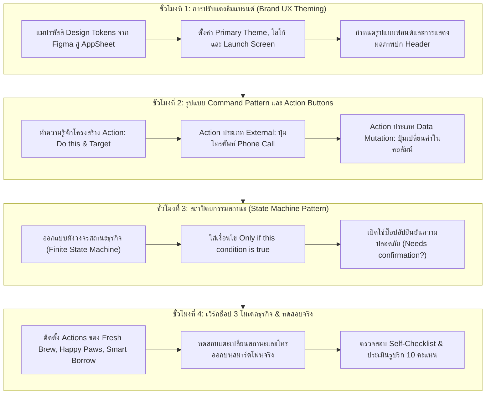
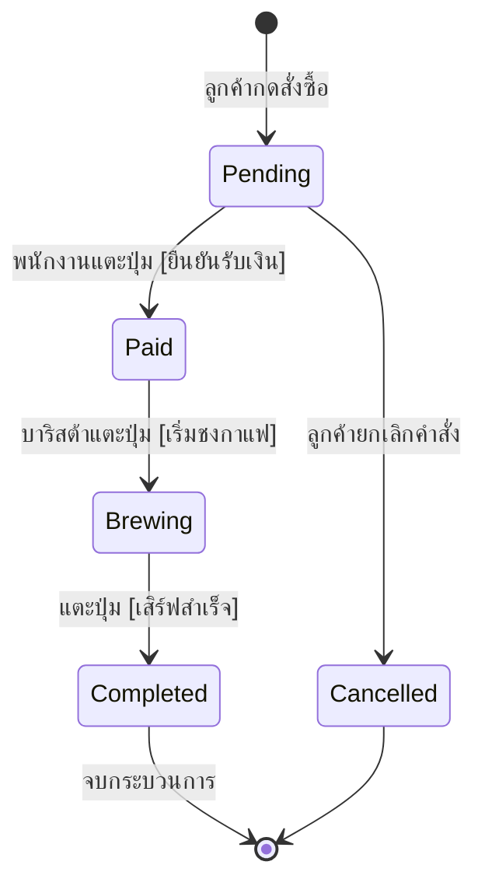

# บทที่ 9: การปรับแต่งธีมแบรนด์และสร้างปุ่มดำเนินการอัจฉริยะด้วย AppSheet
*(Brand UX Theming, State Machine & Command Action Patterns)*

---

## 🎯 จุดประสงค์การเรียนรู้ประจำบท
เมื่อศึกษาบทเรียนนี้และปฏิบัติการตามขั้นตอนเสร็จสิ้น ผู้เรียนสามารถ:
1. นำชุดรหัสสีและอัตลักษณ์องค์กรจาก **Design Tokens (Figma)** มากำหนดใน **Brand Settings** ของ AppSheet เพื่อสร้างความกลมกลืนเชิงภาพลักษณ์ (Visual Branding Consistency) ได้
2. อธิบายรูปแบบคำสั่งเชิงพฤติกรรม **Command Pattern ผ่านปุ่มดำเนินการอัจฉริยะ (Action Buttons)** ใน AppSheet ได้
3. สร้างปุ่ม Action ชนิด **`External: open a phone call`** เพื่อให้ผู้ใช้สามารถแตะปุ่มโทรหาลูกค้าหรือผู้รับบริการได้โดยตรงจากมือถือ
4. ประยุกต์ใช้สถาปัตยกรรมสถานะ **State Machine Pattern** ในการขับเคลื่อนวงจรชีวิตข้อมูล (เช่น `Pending` ➔ `Paid` ➔ `Completed`) ด้วยปุ่ม Action เพียงคลิกเดียว
5. กำหนดเงื่อนไขการแสดงผลปุ่ม **`Only if this condition is true`** เพื่อซ่อนหรือแสดงปุ่มให้สอดคล้องกับสถานะปัจจุบัน ป้องกันความผิดพลาดของผู้ใช้งาน
6. เปิดใช้งานระบบแจ้งเตือนเพื่อยืนยันคำสั่ง **Action Confirmation Prompt (`Needs confirmation? [✓]`)** เพื่อป้องกันการกดปุ่มเปลี่ยนสถานะโดยไม่ได้ตั้งใจ
7. สร้างชุด Action Buttons และทดสอบวงจรสถานะที่สมบูรณ์ตามแนวทางของ **3 รูปแบบธุรกิจ (Archetypes)**
8. ร่วมมือกันในทีม 3 คน แบ่งหน้าที่จัดการแบรนด์ เขียนเงื่อนไขพฤติกรรม และทดสอบบนสมาร์ตโฟนจริงได้อย่างมีประสิทธิภาพ

---

## 🧭 แผนผังการเรียนรู้ประจำสัปดาห์ที่ 9 (4 ชั่วโมง)



---

## 1. สถาปัตยกรรมอัตลักษณ์แบรนด์บนแอปพลิเคชันมือถือ (Visual Branding Consistency)

ในบทที่ 3 นักศึกษาได้ออกแบบ **Design Tokens** และวางชุดสีตามกฎ 60-30-10 บน Figma ไปแล้ว ในขั้นตอนนี้เราจะนำอัตลักษณ์เหล่านั้นมาติดตั้งลงใน AppSheet เพื่อให้แอปพลิเคชันที่ทำงานบนมือถือจริงมีรูปลักษณ์ระดับมืออาชีพ สอดคล้องกับแบรนด์อย่างสมบูรณ์

```
┌────────────────────────────────────────────────────────────────────────┐
│             การแมปรหัสสีจาก Figma Tokens เข้าสู่ AppSheet              │
├──────────────────────┬────────────────────────┬────────────────────────┤
│ องค์ประกอบของแบรนด์ │ รหัสสี Design Token    │ ตำแหน่งตั้งค่า AppSheet│
├──────────────────────┼────────────────────────┼────────────────────────┤
│ สีหลัก (Primary)     │ สีประจำแบรนด์ (เช่น แดง/น้ำเงิน)│ Theme Color ในเมนู Brand│
├──────────────────────┼────────────────────────┼────────────────────────┤
│ โลโก้ร้าน (App Logo) │ สัดส่วน 1:1 (สี่เหลี่ยมจัตุรัส) │ Custom Logo URL/File   │
├──────────────────────┼────────────────────────┼────────────────────────┤
│ หน้าเปิดแอป (Launch) │ ภาพ Splash Screen สวยงาม │ Launch Image           │
├──────────────────────┼────────────────────────┼────────────────────────┤
│ ธีมพื้นหลัง (Mode)   │ สว่าง (Light) หรือ มืด (Dark) │ App style: Light Mode  │
└──────────────────────┴────────────────────────┴────────────────────────┘
```

### 1.1 ขั้นตอนการตั้งค่าแบรนด์ใน AppSheet (Click-by-Click)
1. เปิดโปรเจกต์ใน AppSheet ➔ เลือกเมนู **Settings** (ไอคอนรูปฟันเฟืองทางซ้าย)
2. เลือกแท็บ **Theme & Brand**:
   - **Primary color:** เลือกรหัสสีหลักของแบรนด์ตนเอง (สามารถพิมพ์รหัส HEX เช่น `#065FD4` หรือ `#D97706`)
   - **Theme:** เลือก **`Light`** (เหมาะกับแอปธุรกิจทั่วไป อ่านง่ายในทุกสภาพแสง)
   - **App logo:** อัปโหลดไฟล์โลโก้ร้านที่บันทึกมาจาก Figma (PNG พื้นหลังโปร่งใส แนะนำขนาด 512x512 px)
   - **Launch image:** ใส่ภาพกราฟิกต้อนรับตอนเปิดแอป
   - **Show app name in header:** ติ๊ก **`ON`** เพื่อให้ชื่อร้านปรากฏเด่นชัดที่แถบด้านบน
   - **Show logo in header:** ติ๊ก **`ON`** เพื่อประดับโลโก้ขนาดกะทัดรัดที่มุมบนซ้าย

---

## 2. รูปแบบคำสั่งเชิงพฤติกรรม (Command Pattern ผ่าน Action Buttons)

### 2.1 Action คืออะไร?
ในสถาปัตยกรรมซอฟต์แวร์ **Command Pattern** คือการรวม "คำสั่งที่ผู้ใช้ต้องการทำบ่อย ๆ" ให้กลายเป็นปุ่มสำเร็จรูปที่ผู้ใช้แตะเพียงครั้งเดียวแล้วระบบดำเนินการให้ทันที โดยผู้ใช้ไม่ต้องเสียเวลากดปุ่มแก้ไข (Edit) แล้วเลื่อนหาช่องเพื่อพิมพ์เปลี่ยนข้อความด้วยตนเอง

```
┌─────────────────────────────────────────────────────────────┐
│          เปรียบเทียบการทำงานทั่วไป กับ การใช้ Action        │
├──────────────────────────────┬──────────────────────────────┤
│ ❌ การทำงานทั่วไป (ไม่มี Action)│ ✅ การใช้ Action Button      │
├──────────────────────────────┼──────────────────────────────┤
│ 1. แตะปุ่ม [Edit] เพื่อแก้บิล │ 1. มองเห็นปุ่ม [ชำระเงินแล้ว]│
│ 2. เลื่อนหาช่อง Order_Status │ 2. แตะปุ่มปุ๊บ ➔ จบเลย!      │
│ 3. ลบคำว่า Pending ทิ้ง      │    (ระบบอัปเดตสถานะทันที      │
│ 4. พิมพ์คำว่า Paid          │     และเปลี่ยนเป็นปุ่มถัดไป)  │
│ 5. แตะปุ่ม [Save] บันทึกบิล  │                              │
│ ➔ รวม 5 ขั้นตอน (เสียเวลามาก)│ ➔ รวม 1 ขั้นตอน (สะดวกรวดเร็ว)│
└──────────────────────────────┴──────────────────────────────┘
```

---

### 2.2 โครงสร้างคำสั่ง (Action Settings Matrix)
เมื่อสร้าง Action ขึ้นมาใหม่ในเมนู **Actions** เราต้องกำหนดค่าสำคัญ 4 ส่วน:

```
┌────────────────────────────────────────────────────────────────────────┐
│                  ส่วนประกอบสำคัญในการตั้งค่า Action                    │
├──────────────────────┬─────────────────────────────────────────────────┤
│ 1. For a record of   │ เลือกว่า Action นี้จะทำงานกับตารางข้อมูลใด      │
│    this table        │ เช่น ตาราง `Orders`, `Appointments`, `Borrows`  │
├──────────────────────┼─────────────────────────────────────────────────┤
│ 2. Do this           │ พฤติกรรมที่ต้องการให้ระบบทำ เช่น:               │
│                      │ • `External: open a phone call` (โทรศัพท์)      │
│                      │ • `Data: set the values of some columns in row` │
├──────────────────────┼─────────────────────────────────────────────────┤
│ 3. Prominence        │ ตำแหน่งการแสดงผลของปุ่มบนหน้าจอ:                │
│                      │ • `Display inline` (ประกบคู่กับช่องข้อมูล)      │
│                      │ • `Display prominently` (ปุ่มเด่นบนแถบด้านบน)   │
│                      │ • `Display overlay` (ปุ่มวงกลมลอยมุมขวาล่าง)    │
├──────────────────────┼─────────────────────────────────────────────────┤
│ 4. Behavior          │ เงื่อนไขการแสดงปุ่ม:                            │
│    (Condition)       │ `Only if this condition is true`                │
└──────────────────────┴─────────────────────────────────────────────────┘
```

---

## 3. สถาปัตยกรรมสถานะของข้อมูล (State Machine Pattern)

ในชีวิตจริง เอกสารธุรกิจทุกฉบับมี **"วงจรชีวิต (Lifecycle)"** เช่น ออร์เดอร์ร้านกาแฟจะวิ่งผ่านสถานะต่าง ๆ ตามลำดับ:



### 3.1 หัวใจของ State Machine: การเปลี่ยนปุ่มตามสถานะ (Dynamic Actions)
ผู้ใช้ไม่ควรเห็นปุ่ม "เสิร์ฟสำเร็จ" ในขณะที่ลูกค้ายังไม่ได้ชำระเงิน! เราจึงต้องใช้สูตร **`Only if this condition is true`** เพื่อล็อกปุ่มให้แสดงเฉพาะช่วงเวลาที่ถูกต้อง:

```
┌──────────────────────────────┬───────────────────────────────┬──────────────────────────────┐
│ ชื่อปุ่ม Action              │ คำสั่งที่ระบบทำ (Do this)      │ เงื่อนไขแสดงปุ่ม (Only if)    │
├──────────────────────────────┼───────────────────────────────┼──────────────────────────────┤
│ 1. [💰 ยืนยันรับชำระเงิน]     │ ตั้งค่า Order_Status = "Paid" │ [Order_Status] = "Pending"   │
├──────────────────────────────┼───────────────────────────────┼──────────────────────────────┤
│ 2. [☕ เริ่มชงเครื่องดื่ม]    │ ตั้งค่า Order_Status ="Brewing"│ [Order_Status] = "Paid"      │
├──────────────────────────────┼───────────────────────────────┼──────────────────────────────┤
│ 3. [✅ ส่งมอบสินค้าเรียบร้อย]│ ตั้งค่า Order_Status="Complete"│ [Order_Status] = "Brewing"   │
└──────────────────────────────┴───────────────────────────────┴──────────────────────────────┘
```

---

### 3.2 ความปลอดภัย: การเปิดใช้งานระบบยืนยัน (Action Confirmation Prompt)
เพื่อป้องกันไม่ให้พนักงานมือลั่นไปแตะปุ่มเปลี่ยนสถานะโดยไม่ตั้งใจ AppSheet มีฟังก์ชันยืนยันความปลอดภัย:
- ที่หัวข้อ **Behavior ➔ Confirmation**:
  - ติ๊กเปิด **`Needs confirmation? [✓]`**
  - ช่อง **Confirmation Message:** พิมพ์ข้อความเตือน เช่น:
    ```excel
    ="คุณได้รับเงินสดจำนวน " & TEXT([Total_Amount], "#,##0.00") & " บาท เรียบร้อยแล้วใช่หรือไม่?"
    ```

```
┌──────────────────────────────────────────────┐
│              ⚠️ ยืนยันการทำรายการ            │
├──────────────────────────────────────────────┤
│ คุณได้รับเงินสดจำนวน 215.00 บาท              │
│ เรียบร้อยแล้วใช่หรือไม่?                     │
│                                              │
│          [ ยกเลิก ]      [ ยืนยัน ]          │
└──────────────────────────────────────────────┘
```

---

## 4. เวิร์กช็อปปฏิบัติการ: สร้าง Actions ตาม 3 รูปแบบธุรกิจ (Click-by-Click)

ให้นักศึกษาแต่ละกลุ่มดำเนินการสร้างปุ่ม Action สำหรับโปรเจกต์ของตนเองตามขั้นตอนดังต่อไปนี้:

---

### ☕ รูปแบบที่ 1: Retail & Food Ordering (Fresh Brew & Bakery)

#### Action ที่ 1: ปุ่มโทรศัพท์หาลูกค้า (Call Customer)
1. ไปที่เมนู **Actions** (ทางซ้าย) ➔ แตะปุ่ม **`[+] Add Action`**
2. ตั้งชื่อ Action: `โทรหาลูกค้า`
3. สำหรับตาราง: `Orders`
4. หัวข้อ **Do this:**
   - เลือก: **`External: open a phone call`**
   - ช่อง **Phone number:** เลือกคอลัมน์ **`[Phone_Number]`**
5. หัวข้อ **Appearance (รูปลักษณ์):**
   - Action icon: พิมพ์ค้นหา `phone` ➔ เลือกไอคอนรูปโทรศัพท์
   - Display name: `"โทรหาลูกค้า"`
   - Prominence: เลือก **`Display inline`** ➔ Attach to column: เลือก **`Phone_Number`**
6. กด **`Save`** ➔ สังเกตว่าในหน้าจอมือถือ ข้างเบอร์โทรของลูกค้าจะมีไอคอนรูปหูโทรศัพท์สีสันสวยงามปรากฏขึ้น แตะแล้วจะเปิดแอปโทรศัพท์ของเครื่องทันที!

---

#### Action ที่ 2: ปุ่มยืนยันการรับเงิน (Confirm Payment)
1. แตะ **`[+] Add Action`** ➔ ตั้งชื่อ Action: `รับชำระเงินแล้ว`
2. สำหรับตาราง: `Orders`
3. หัวข้อ **Do this:**
   - เลือก: **`Data: set the values of some columns in this row`**
   - แตะ `Add column` ➔ เลือกคอลัมน์ **`Order_Status`** ➔ ใส่ค่า: `"Paid"`
4. หัวข้อ **Appearance:**
   - Action icon: ค้นหา `check_circle` หรือ `payments`
   - Display name: `"รับเงินแล้ว"`
   - Prominence: เลือก **`Display prominently`**
5. หัวข้อ **Behavior:**
   - ช่อง **Only if this condition is true:**
     ```excel
     [Order_Status] = "Pending"
     ```
   - ติ๊กถูก **`[✓] Needs confirmation?`**
   - Confirmation message: `"ยืนยันว่าลูกค้าได้ชำระเงินเรียบร้อยแล้วใช่หรือไม่?"`
6. กด **`Save`** ➔ ทดสอบแตะปุ่มบนหน้าจำลองมือถือ จะพบว่าเมื่อแตะยืนยัน สถานะจะเปลี่ยนเป็น `Paid` และปุ่มรับเงินจะหายไปทันทีตามหลัก State Machine!

---

#### Action ที่ 3: ปุ่มปิดออร์เดอร์เสร็จสิ้น (Complete Order)
1. สร้าง Action ชื่อ: `เสิร์ฟเสร็จสิ้น` สำหรับตาราง `Orders`
2. Do this: `Data: set the values of some columns in this row`
   - ตั้งค่า `Order_Status` = `"Completed"`
3. Appearance: ไอคอน `done_all`, Prominence: `Display prominently`
4. Behavior:
   - Only if this condition is true:
     ```excel
     [Order_Status] = "Paid"
     ```
5. กด **`Save`**

---

### 🐾 รูปแบบที่ 2: Service & Booking Appointments (Happy Paws Care)

#### Action ที่ 1: โทรยืนยันนัดหมายสัตว์เลี้ยง (Call Pet Owner)
- **Table:** `Appointments`
- **Do this:** `External: open a phone call` ➔ Phone number: `[Owner_Phone]`
- **Appearance:** ไอคอน `phone_in_talk`, Prominence: `Display inline` ผูกกับคอลัมน์ `Owner_Phone`

#### Action ที่ 2: เช็คอินรับสัตว์เลี้ยงเข้าร้าน (Check-in Pet)
- **Table:** `Appointments`
- **Do this:** `Data: set the values of some columns in this row`
  - ตั้งค่าคอลัมน์ `Status` = `"In-Service"`
- **Appearance:** ไอคอน `pets`, Display name: `"รับสัตว์เลี้ยงเข้ารับบริการ"`, Prominence: `Display prominently`
- **Behavior:**
  - Only if this condition is true:
    ```excel
    [Status] = "Booked"
    ```

#### Action ที่ 3: บริการเสร็จสิ้น/แจ้งรับกลับ (Ready for Pickup)
- **Table:** `Appointments`
- **Do this:** `Data: set the values of some columns in this row`
  - ตั้งค่าคอลัมน์ `Status` = `"Completed"`
- **Appearance:** ไอคอน `check_box`, Display name: `"เสร็จสิ้น/ส่งมอบสัตว์เลี้ยง"`
- **Behavior:**
  - Only if this condition is true:
    ```excel
    [Status] = "In-Service"
    ```

---

### 📦 รูปแบบที่ 3: Asset Tracking & Operations (Smart Equipment Borrow)

#### Action ที่ 1: โทรติดตามพัสดุกับผู้ยืม (Contact Borrower)
- **Table:** `Borrow_Requests`
- **Do this:** `External: open a phone call` ➔ Phone number: `[Requester_Phone]`
- **Appearance:** ไอคอน `contact_phone`, Prominence: `Display inline` ผูกกับคอลัมน์ `Requester_Phone`

#### Action ที่ 2: เจ้าหน้าที่อนุมัติและปล่อยพัสดุ (Approve & Dispatch)
- **Table:** `Borrow_Requests`
- **Do this:** `Data: set the values of some columns in this row`
  - ตั้งค่าคอลัมน์ `Status` = `"Borrowed"`
- **Appearance:** ไอคอน `outbox`, Display name: `"ส่งมอบอุปกรณ์ (ยืม)"`, Prominence: `Display prominently`
- **Behavior:**
  - Only if this condition is true:
    ```excel
    [Status] = "Pending"
    ```
  - Needs confirmation?: `[✓]` ➔ `"ตรวจสอบรายการอุปกรณ์ครบถ้วนก่อนส่งมอบ"`

#### Action ที่ 3: บันทึกรับคืนอุปกรณ์เข้าคลัง (Return & Restock)
- **Table:** `Borrow_Requests`
- **Do this:** `Data: set the values of some columns in this row`
  - ตั้งค่าคอลัมน์ `Status` = `"Returned"`
- **Appearance:** ไอคอน `move_to_inbox`, Display name: `"รับคืนอุปกรณ์เข้าคลัง"`
- **Behavior:**
  - Only if this condition is true:
    ```excel
    [Status] = "Borrowed"
    ```

---

## 5. การแบ่งบทบาทหน้าที่ของสมาชิก 3 คนในทีม (Agile Triad Collaboration)

```
┌────────────────────────────────────────────────────────────────────────┐
│                   บทบาทหน้าที่ของสมาชิกในทีม (Team Matrix)             │
├─────────────────────┬──────────────────────────────────────────────────┤
│ สมาชิกคนที่ 1       │ Brand UX & Assets Manager                        │
│ (ผู้จัดการแบรนด์)    │ - นำรหัสสีจาก Figma Tokens มาตั้งค่า Theme Color │
│                     │ - อัปโหลด App Logo และภาพ Launch Screen สวยงาม   │
│                     │ - จัดรูปแบบหน้า Header และแถบเมนูด้านล่าง        │
├─────────────────────┼──────────────────────────────────────────────────┤
│ สมาชิกคนที่ 2       │ Action & Command Logic Engineer                  │
│ (วิศวกรปุ่มคำสั่ง)  │ - สร้างปุ่มโทรศัพท์ (Phone Call Action) แบบ Inline │
│                     │ - สร้าง Action เปลี่ยนค่าในคอลัมน์สถานะ (Mutation)│
│                     │ - เลือกไอคอนและตั้งชื่อ Display Name ให้เข้าใจง่าย│
├─────────────────────┼──────────────────────────────────────────────────┤
│ สมาชิกคนที่ 3       │ State Machine & Quality Assurance Specialist     │
│ (ผู้ควบคุมสถานะและQA)│ - กำหนดสูตรเงื่อนไข Only if this condition is true│
│                     │ - เปิดใช้ระบบยืนยัน Needs confirmation? กันกดพลาด│
│                     │ - ทดสอบการเปลี่ยนผ่านสถานะบนสมาร์ตโฟนจริง        │
└─────────────────────┴──────────────────────────────────────────────────┘
```

---

## 6. ข้อผิดพลาดที่พบบ่อยและแนวทางแก้ไข (Troubleshooting & Common Pitfalls)

```
┌──────────────────────────────────────┬──────────────────────────────────────────┐
│ ปัญหาที่พบ (Error Symptoms)           │ สาเหตุและวิธีแก้ไข (Root Cause & Fix)     │
├──────────────────────────────────────┼──────────────────────────────────────────┤
│ 1. ปุ่มโทรออกกดแล้วไม่เกิดอะไรขึ้น   │ ❌ คอลัมน์ที่ผูกไม่ได้กำหนดชนิดเป็น Phone│
│                                      │ ➔ วิธีแก้: ไปที่ Data > Columns เปลี่ยน    │
│                                      │    ประเภทของช่องเบอร์โทรเป็นชนิด Phone    │
├──────────────────────────────────────┼──────────────────────────────────────────┤
│ 2. ปุ่ม Action ไม่ปรากฏบนหน้าจอ       │ ❌ เงื่อนไข Only if ไม่เป็นจริง หรือ      │
│                                      │    เลือก Prominence เป็น Do not display   │
│                                      │ ➔ วิธีแก้: ตรวจสอบสะกดค่าในสูตร เช่น      │
│                                      │    [Order_Status] = "Pending" ต้องตรงกัน   │
│                                      │    ทั้งตัวพิมพ์ใหญ่-เล็ก                   │
├──────────────────────────────────────┼──────────────────────────────────────────┤
│ 3. แตะปุ่มเปลี่ยนสถานะแล้ว ข้อมูลไม่  │ ❌ ตารางถูกตั้งค่าสิทธิ์เป็น Read-Only   │
│    เปลี่ยนแปลง                       │ ➔ วิธีแก้: ไปที่ Data > Tables ตรวจสอบว่า │
│                                      │    ตารางเปิดสิทธิ์ Updates_Only หรือ All   │
├──────────────────────────────────────┼──────────────────────────────────────────┤
│ 4. ปุ่มหลายปุ่มแสดงพร้อมกันจนสับสน    │ ❌ ลืมใส่สูตร Only if ในแต่ละปุ่ม        │
│                                      │ ➔ วิธีแก้: ใส่เงื่อนไขกำกับให้ชัดเจนว่า   │
│                                      │    ปุ่มใดแสดงในสถานะใดตามผัง State Machine│
└──────────────────────────────────────┴──────────────────────────────────────────┘
```

---

## 7. แบบตรวจสอบตนเองก่อนส่งงาน (Self-Checklist ประจำบทที่ 9)

ให้นักศึกษาตรวจสอบความเรียบร้อยของชิ้นงานให้ครบทุกข้อก่อนส่งให้อาจารย์ผู้สอนประเมิน:

- [ ] **1. การปรับแต่งแบรนด์ (Brand Theming):** กำหนดรหัสสีหลัก (Primary Color), ติดตั้ง App Logo และภาพ Launch Screen ที่สอดคล้องกับ Figma Tokens
- [ ] **2. ปุ่มโทรศัพท์ (Inline Phone Action):** สร้างปุ่มโทรออกชนิด `External: open a phone call` ที่ประกบข้างเบอร์โทรศัพท์และสามารถกดโทรออกได้จริงบนสมาร์ตโฟน
- [ ] **3. สถาปัตยกรรมสถานะ (State Machine Action):** มีปุ่มเปลี่ยนสถานะออร์เดอร์/งานบริการอย่างน้อย 2 ระดับ ที่ปรับค่าในคอลัมน์สถานะได้ถูกต้อง
- [ ] **4. เงื่อนไขการแสดงผล (Only if Condition):** ปุ่มแต่ละสถานะแสดงและซ่อนตามเงื่อนไขอย่างถูกต้อง ไม่ปรากฏซ้ำซ้อน
- [ ] **5. ระบบยืนยันความปลอดภัย (Confirmation Prompt):** มีการเปิดใช้ `Needs confirmation?` พร้อมข้อความแจ้งเตือนที่ชัดเจนก่อนเปลี่ยนสถานะสำคัญ
- [ ] **6. การทดสอบบนมือถือจริง (Live Device Verification):** สมาชิกในกลุ่มเปิดแอปพลิเคชันบนสมาร์ตโฟนจริง ทดสอบกดโทรออก และแตะเปลี่ยนสถานะได้ลื่นไหลสมบูรณ์

---

## 8. เกณฑ์การประเมินผลงาน 10 คะแนน (Rubric Assessment Matrix)

| มิติการประเมิน (Assessment Dimensions) | ระดับดีมาก (Good: 9-10 คะแนน) | ระดับผ่านเกณฑ์ (Pass: 7-8 คะแนน) | ระดับต้องปรับปรุง (Needs Work: 0-6 คะแนน) |
| :--- | :--- | :--- | :--- |
| **1. อัตลักษณ์แบรนด์และความสวยงาม (Brand UX & Visual)**<br>*(น้ำหนัก 3 คะแนน)* | ปรับแต่ง Theme Color, App Logo, และ Launch Screen สอดคล้องกับ Design Tokens สวยงามเป็นมืออาชีพ 100% | ติดตั้ง Theme Color และโลโก้แล้ว แต่สัดส่วนภาพบิดเบี้ยวหรือไม่เข้ากับชุดสี | ใช้ธีมเริ่มต้น (Default) ไม่มีการเปลี่ยนสีหรือโลโก้ของแบรนด์ |
| **2. ฟังก์ชันปุ่มและสถาปัตยกรรมสถานะ (Actions & State Machine)**<br>*(น้ำหนัก 4 คะแนน)* | สร้างปุ่มโทรออก Inline และปุ่มเปลี่ยนสถานะ State Machine ถูกต้อง มีเงื่อนไข `Only if` รัดกุม และมีระบบยืนยันความปลอดภัยสมบูรณ์ | สร้างปุ่มเปลี่ยนสถานะได้ แต่ไม่มีปุ่มโทรศัพท์ หรือเงื่อนไข `Only if` ยังแสดงปุ่มซ้ำซ้อนในบางจังหวะ | ปุ่มไม่สามารถกดเปลี่ยนสถานะได้ หรือเกิด Error เมื่อกดใช้งาน |
| **3. การทดสอบบนอุปกรณ์จริงและการทำงานเป็นทีม (Mobile Test & Teamwork)**<br>*(น้ำหนัก 3 คะแนน)* | ทดสอบบนสมาร์ตโฟนจริงได้ลื่นไหล ปุ่มกดง่าย มีการแบ่งหน้าที่ 3 คนในทีมชัดเจนและตอบคำถามได้คล่องแคล่ว | ทดสอบบนมือถือได้ แต่การจัดวางปุ่มบดบังข้อมูลสำคัญ หรือการแบ่งงานในทีมไม่ชัดเจน | ไม่สามารถสาธิตการทำงานของปุ่ม Action บนสมาร์ตโฟนได้ |

---

> 🏆 **สรุปท้ายบท:** ยอดเยี่ยมมาก! แอปพลิเคชันของนักศึกษาตอนนี้ไม่เพียงแต่มีฐานข้อมูลที่คำนวณเงินได้ แต่ยังมีรูปลักษณ์แบรนด์ที่น่าดึงดูดและมีปุ่มลัดอัจฉริยะที่ช่วยลดขั้นตอนการทำงานให้พนักงานได้อย่างมหาศาล ในบทที่ 10 เราจะนำฮาร์ดแวร์ระดับโปรของสมาร์ตโฟนมาเชื่อมต่อ ได้แก่ **การสแกน Barcode/QR Code ด้วยกล้องมือถือ** และ **การเซ็นลายมือชื่อดิจิทัล (Digital Signature)** บนหน้าจอสัมผัส!
