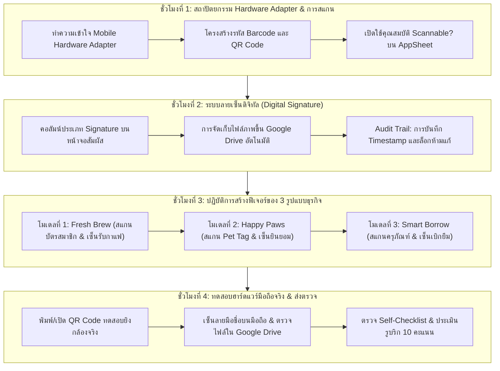
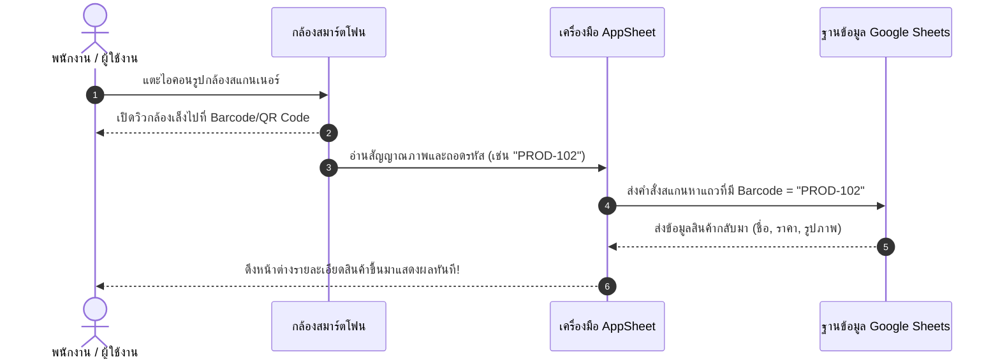

# บทที่ 10: การเชื่อมต่อฮาร์ดแวร์สแกน Barcode/QR Code และระบบลายเซ็นดิจิทัล
*(Hardware Adapter, Fast Scan-to-Lookup & Digital Signature Audit Trail Patterns)*

---

## 🎯 จุดประสงค์การเรียนรู้ประจำบท
เมื่อศึกษาบทเรียนนี้และปฏิบัติการตามขั้นตอนเสร็จสิ้น ผู้เรียนสามารถ:
1. อธิบายสถาปัตยกรรม **Hardware Adapter Pattern** ในการเปลี่ยนกล้องสมาร์ตโฟนและหน้าจอสัมผัสให้เป็นอุปกรณ์ทำงานทางธุรกิจ (Mobile POS & Signature Capture Pad) ได้
2. เปิดใช้งานคุณสมบัติ **`Scannable? [✓]`** บนคอลัมน์ข้อมูลใน AppSheet เพื่อเปิดกล้องสแกน Barcode/QR Code ได้อัตโนมัติ
3. ประยุกต์ใช้รูปแบบ **Fast Scan-to-Lookup Pattern** เพื่อค้นหาข้อมูลสินค้าหรือประวัติลูกค้าได้ในเสี้ยววินาทีโดยไม่ต้องพิมพ์ตัวอักษร
4. สร้างและกำหนดค่าคอลัมน์ประเภท **`Signature` (ลายมือชื่อดิจิทัล)** สำหรับให้ลูกค้าหรือผู้รับบริการเซ็นนิ้วมือลงบนหน้าจอสมาร์ตโฟน
5. ผูกกลไก **Audit Trail & Non-repudiation** เพื่อบันทึกภาพลายเซ็นคู่กับวันเวลา (`DateTime = NOW()`) ลงใน Google Drive โดยอัตโนมัติเพื่อใช้เป็นหลักฐานยืนยันความถูกต้อง
6. พัฒนาระบบสแกนบาร์โค้ดและเซ็นชื่อรับมอบสิ่งของตามบริบทของ **3 รูปแบบธุรกิจ (Archetypes)**
7. แก้ไขปัญหาเชิงเทคนิค เช่น การขอสิทธิ์เข้าถึงฮาร์ดแวร์กล้อง (Camera Permission) และการล็อกไม่ให้แก้ไขลายเซ็นย้อนหลัง
8. ร่วมมือกันในทีม 3 คน ทดสอบระบบสแกนและเซ็นชื่อบนสมาร์ตโฟนจริง และส่งผลงานประเมินตามเกณฑ์ 10 คะแนนได้อย่างสมบูรณ์

---

## 🧭 แผนผังการเรียนรู้ประจำสัปดาห์ที่ 10 (4 ชั่วโมง)



---

## 1. สถาปัตยกรรม Hardware Adapter บนอุปกรณ์พกพา

ในอดีต ธุรกิจที่ต้องการระบบสแกนบาร์โค้ดคลังสินค้าหรือระบบเซ็นชื่อรับพัสดุ จะต้องลงทุนจัดซื้อ **เครื่องยิงบาร์โค้ดเลเซอร์ (Handheld Scanner)** หรือ **แท็บเล็ตเฉพาะทางราคาแพง (Dedicated Signature Pad)** ซึ่งมีต้นทุนหลักหมื่นบาท

```
┌────────────────────────────────────────────────────────────────────────┐
│             การแปลงฮาร์ดแวร์มือถือด้วย Hardware Adapter Pattern        │
├──────────────────────┬────────────────────────┬────────────────────────┤
│ อุปกรณ์แบบดั้งเดิม   │ ฮาร์ดแวร์บนสมาร์ตโฟน   │ บทบาทในระบบ AppSheet   │
├──────────────────────┼────────────────────────┼────────────────────────┤
│ เครื่องยิงเลเซอร์    │ เลนส์กล้องมือถือ       │ สแกนอ่าน Barcode / QR  │
│ (Barcode Scanner)    │ (Mobile Camera)        │ แล้วแปลงเป็นข้อความทันที│
├──────────────────────┼────────────────────────┼────────────────────────┤
│ แท็บเล็ตเซ็นชื่อ     │ กระจกหน้าจอสัมผัส      │ วาดลายเซ็นด้วยนิ้วมือ  │
│ (Signature Pad)      │ (Capacitive Touch)     │ แล้วบันทึกเป็นไฟล์ PNG │
└──────────────────────┴────────────────────────┴────────────────────────┘
```

ด้วย AppSheet สถาปัตยกรรมระดับระบบปฏิบัติการ (OS-level Hardware Adapter) จะเชื่อมต่อตัวอ่านสัญญาณของกล้องและหน้าจอสัมผัสเข้าสู่โมเดลข้อมูลโดยตรง ทำให้สมาร์ตโฟนธรรมดาราคาไม่กี่พันบาท กลายเป็นสถานีทำงานดิจิทัลที่ทรงพลังได้ทันที

---

## 2. การสแกน Barcode/QR Code (Fast Scan-to-Lookup Pattern)

### 2.1 คอลัมน์ที่รองรับการสแกน
AppSheet อนุญาตให้คอลัมน์ประเภท **`Text`**, **`Ref`**, หรือรหัสสตริงใด ๆ สามารถเปิดใช้งานฮาร์ดแวร์สแกนเนอร์ได้ เพียงแค่ติ๊กช่อง:

```
[✓] Scannable? (เปิดให้ใช้กล้องสแกนค่าใส่คอลัมน์นี้หรือไม่?)
```

```
┌────────────────────────────────────────────────────────────────────────┐
│              ผลลัพธ์เมื่อเปิดคุณสมบัติ [✓] Scannable?                  │
├──────────────────────────────┬─────────────────────────────────────────┤
│ 1. ในหน้าค้นหา (Search Bar)  │ จะมีไอคอนรูป [📷 บาร์โค้ด] โผล่ขึ้นมาที่ │
│                              │ ริมขวาของช่องค้นหา แตะแล้วเปิดกล้องทันที│
├──────────────────────────────┼─────────────────────────────────────────┤
│ 2. ในหน้าฟอร์ม (Form Input)  │ ข้างช่องกรอกข้อมูลจะมีปุ่ม [📷 สแกน]     │
│                              │ เมื่อยิงติด ค่ารหัสจะถูกกรอกลงช่องทันที │
└──────────────────────────────┴─────────────────────────────────────────┘
```

---

### 2.2 วงจร Fast Scan-to-Lookup
เมื่อผู้ใช้ต้องการค้นหาสินค้าหรือตรวจสอบข้อมูลอย่างรวดเร็ว:



---

## 3. ระบบลายเซ็นดิจิทัล (Digital Signature & Audit Trail)

### 3.1 การกำหนดค่าคอลัมน์ประเภท Signature
ในชีต Google Sheets ให้เตรียมคอลัมน์สำหรับเก็บลายเซ็น เช่น `Customer_Signature` หรือ `Recipient_Signature`

เมื่อนำเข้าสู่ AppSheet:
- กำหนดชนิดข้อมูล (Type) เป็น: **`Signature`**
- AppSheet จะเปลี่ยนช่องกรอกข้อมูลธรรมดาให้กลายเป็น **ผืนผ้าใบดิจิทัล (Canvas Pad)** ที่มีปุ่ม `[Clear]` สำหรับลบเซ็นใหม่ และพื้นที่สีขาวสำหรับให้นิ้วมือจรดวาดลายเซ็นได้อย่างลื่นไหล

```
┌────────────────────────────────────────────────────────┐
│ ลายมือชื่อผู้รับสินค้า *                               │
│ ┌────────────────────────────────────────────────────┐ │
│ │                                                    │ │
│ │           ✍️  ( ใช้นิ้วเซ็นลายมือชื่อที่นี่ )      │ │
│ │                                                    │ │
│ │   สมชาย  ใจดี                                      │ │
│ │  ~~~~~~~~~~~~~~~~~                                 │ │
│ └────────────────────────────────────────────────────┘ │
│ [ 🔄 ลบเซ็นใหม่ ]                                     │
└────────────────────────────────────────────────────────┘
```

---

### 3.2 การจัดเก็บไฟล์ภาพลง Google Drive
เมื่อผู้ใช้กดบันทึก (`Save`) ฟอร์ม:
1. AppSheet จะเรนเดอร์ภาพลายเซ็นเป็นไฟล์ภาพสกุล **`.png`** ที่มีพื้นหลังโปร่งใส
2. อัปโหลดไฟล์ภาพขึ้นไปเก็บไว้ในโฟลเดอร์ของ Google Drive (เช่น โฟลเดอร์ `AppSheet_Images/Signatures/`)
3. ในเซลล์ของ Google Sheets จะบันทึกเป็นชื่อพาธไฟล์ เช่น `Orders_Images/4a8c91d2.Customer_Signature.142500.png`

---

### 3.3 การสร้าง Audit Trail ป้องกันการแก้ไขย้อนหลัง (Non-repudiation)
เพื่อความโปร่งใสในทางธุรกิจและการตรวจสอบย้อนกลับ (Audit Trail) เราต้องบันทึกวันเวลาที่เซ็นเสมอ:
- คอลัมน์ **`Signed_At`**:
  - Type: `DateTime`
  - Initial value: `=NOW()`
  - Editable?: `FALSE`
- ป้องกันไม่ให้ใครมาแอบลบลายเซ็นทิ้งในภายหลัง:
  - ที่คอลัมน์ `Signature` ➔ กำหนดช่อง **Editable?:**
    ```excel
    ISBLANK([_THIS])
    ```
    *(ความหมาย: แก้ไขได้เฉพาะตอนที่ยังเป็นช่องว่างเท่านั้น เมื่อเซ็นและบันทึกแล้วจะถูกล็อกถาวรทันที!)*

---

## 4. เวิร์กช็อปปฏิบัติการ: พัฒนาระบบตาม 3 รูปแบบธุรกิจ (Click-by-Click)

ให้นักศึกษาแต่ละกลุ่มปฏิบัติตามกรณีศึกษาของธุรกิจที่กลุ่มตนเองเลือก:

---

### ☕ รูปแบบที่ 1: Retail & Food Ordering (Fresh Brew & Bakery)

#### ภารกิจ: สแกนบัตรสมาชิก และระบบเซ็นชื่อยืนยันการรับสินค้าเดลิเวอรี่

##### ขั้นตอนที่ 1: ติดตั้งระบบสแกนค้นหาสินค้า/สแกนบาร์โค้ด
1. เปิดชีต `Products` บน Google Sheets ตรวจสอบว่ามีคอลัมน์ `Barcode` แล้ว (เช่น ใส่รหัสตัวเลข `8851234567890`)
2. ใน AppSheet ไปที่ **Data ➔ Columns** ของตาราง `Products`:
   - คอลัมน์ **`Barcode`**:
     - Type: `Text`
     - ติ๊กถูกที่ช่อง **`[✓] Scannable?`**
     - ติ๊กถูกที่ช่อง **`[✓] Search?`**
3. ไปที่ตาราง `Order_Details` ➔ คอลัมน์ `Product_ID` (ซึ่งเป็นประเภท `Ref` ชี้ไปที่ `Products`):
   - ติ๊กถูกที่ช่อง **`[✓] Scannable?`** ด้วย
   *(ผลลัพธ์: เวลาขายหน้าร้าน พนักงานกดปุ่มรูปกล้องข้างช่องเลือกสินค้า แล้วยิงสแกนบาร์โค้ดบนกล่องขนมปังเพื่อหยิบใส่บิลได้ทันที)*

##### ขั้นตอนที่ 2: ติดตั้งระบบเซ็นชื่อรับของ (Delivery Signature)
1. ในชีต `Orders` เพิ่ม 2 คอลัมน์ใหม่:
   - `Customer_Signature`
   - `Delivered_At`
2. ใน AppSheet กด **Regenerate Schema** ที่ตาราง `Orders`
3. ตั้งค่าคอลัมน์:
   - `Customer_Signature`:
     - Type: **`Signature`**
     - Show?: `[Order_Status] = "Completed"` หรือแสดงในหน้าจัดส่ง
   - `Delivered_At`:
     - Type: **`DateTime`**
     - Initial value: `=NOW()`

---

### 🐾 รูปแบบที่ 2: Service & Booking Appointments (Happy Paws Care)

#### ภารกิจ: สแกน QR Code ปลอกคอสัตว์เลี้ยง และเซ็นใบยินยอมรับบริการ

##### ขั้นตอนที่ 1: สแกนค้นหาประวัติสัตว์เลี้ยงด้วย Pet Tag
1. ในชีต `Pets` มีคอลัมน์ `Pet_QR_Code` (เช่น `PAW-9901`)
2. ใน AppSheet ตั้งค่าคอลัมน์ `Pet_QR_Code`:
   - Type: `Text` ➔ ติ๊ก **`[✓] Scannable?`** และ **`[✓] Search?`**
3. เวลาลูกค้าพาสุนัข/แมวมาถึงหน้าร้าน พนักงานแตะไอคอนกล้องที่ช่องค้นหา ยิงสแกนที่ปลอกคอ ประวัติสัตว์เลี้ยงจะเด้งขึ้นมาทันที!

##### ขั้นตอนที่ 2: เซ็นชื่อยินยอมรับบริการและรับทราบเงื่อนไข (Consent Signature)
1. ในตาราง `Appointments` เพิ่มคอลัมน์:
   - `Owner_Consent_Signature`
   - `Consent_Timestamp`
2. ตั้งค่าใน AppSheet:
   - `Owner_Consent_Signature`: Type: **`Signature`**
   - `Consent_Timestamp`: Type: **`DateTime`**, Initial value: `=NOW()`, Editable?: `FALSE`

---

### 📦 รูปแบบที่ 3: Asset Tracking & Operations (Smart Equipment Borrow)

#### ภารกิจ: สแกนบาร์โค้ดครุภัณฑ์ และเซ็นรับมอบ-คืนอุปกรณ์

##### ขั้นตอนที่ 1: สแกนบาร์โค้ด Asset Tag บนตัวเครื่อง
1. ในชีต `Equipments` มีคอลัมน์ `Asset_Barcode` (เช่น `EQUIP-CAM-001`)
2. ใน AppSheet ตั้งค่าคอลัมน์ `Asset_Barcode`:
   - Type: `Text` ➔ ติ๊ก **`[✓] Scannable?`**
3. ในตารางลูก `Borrow_Items` ➔ คอลัมน์ `Equipment_ID` (Ref):
   - ติ๊กถูก **`[✓] Scannable?`**
   *(ผลลัพธ์: ผู้เบิกเดินไปที่ชั้นวางอุปกรณ์ เปิดฟอร์มแล้วใช้กล้องยิงสแกนสติกเกอร์บาร์โค้ดบนตัวอุปกรณ์ รายการจะถูกดึงเข้าใบยืมอัตโนมัติ)*

##### ขั้นตอนที่ 2: ระบบเซ็นชื่อรับพัสดุ (Borrower Sign-off)
1. ในตาราง `Borrow_Requests` มีคอลัมน์:
   - `Borrower_Signature` (ลายเซ็นผู้ยืมตอนรับของ)
   - `Officer_Return_Signature` (ลายเซ็นเจ้าหน้าที่ตรวจรับตอนนำมาคืน)
2. ตั้งค่าใน AppSheet:
   - `Borrower_Signature`: Type: **`Signature`**, Show?: `[Status] = "Borrowed"`
   - `Officer_Return_Signature`: Type: **`Signature`**, Show?: `[Status] = "Returned"`

---

## 5. การสร้างบาร์โค้ดและ QR Code สำหรับการทดสอบ (Testing Toolkit)

เพื่อให้นักศึกษาสามารถทดสอบการสแกนผ่านหน้าจอมือถือจริงได้ทันที ให้ใช้เครื่องมือทดสอบดังนี้:

### 5.1 สูตรสร้าง QR Code อัตโนมัติบน Google Sheets
สามารถใช้สูตรดึงภาพ QR Code จาก Google Chart API มาแสดงในชีตได้ทันที:

```excel
=IMAGE("https://api.qrserver.com/v1/create-qr-code/?size=150x150&data=" & ENCODEURL(A2))
```
*(เมื่อเปลี่ยนรหัสในเซลล์ A2 ภาพ QR Code จะสร้างขึ้นมาใหม่โดยอัตโนมัติ! สามารถใช้มือถือยิงสแกนจากหน้าจอคอมพิวเตอร์ได้เลย)*

```
┌────────────────────────────────────────────────────────┐
│ วิธีการทดสอบบนสมาร์ตโฟนจริง:                          │
│ 1. เปิดไฟล์ Google Sheets บนจอคอมพิวเตอร์              │
│ 2. เปิดแอปพลิเคชัน AppSheet บนสมาร์ตโฟน                │
│ 3. แตะปุ่มกล้องสแกนเนอร์ในแอปบนมือถือ                  │
│ 4. ยกมือถือขึ้นเล็งไปที่หน้าจอคอมพิวเตอร์              │
│ ➔ ระบบจะส่งเสียง "ติ๊ด" และดึงรหัสลงในแอปทันที!        │
└────────────────────────────────────────────────────────┘
```

---

## 6. การแบ่งบทบาทหน้าที่ของสมาชิก 3 คนในทีม (Agile Triad Collaboration)

```
┌────────────────────────────────────────────────────────────────────────┐
│                   บทบาทหน้าที่ของสมาชิกในทีม (Team Matrix)             │
├─────────────────────┬──────────────────────────────────────────────────┤
│ สมาชิกคนที่ 1       │ Hardware Integration & Barcode Specialist        │
│ (วิศวกรฮาร์ดแวร์)   │ - จัดเตรียมรหัส Barcode / QR Code ใน Google Sheet │
│                     │ - เปิดใช้งานคุณสมบัติ [✓] Scannable? ในคอลัมน์   │
│                     │ - ตรวจสอบการค้นหาผ่าน Search Bar ด้วยกล้อง       │
├─────────────────────┼──────────────────────────────────────────────────┤
│ สมาชิกคนที่ 2       │ Signature & Audit Trail Engineer                 │
│ (วิศวกรลายเซ็น)     │ - สร้างคอลัมน์ประเภท Signature และตั้งค่า Canvas │
│                     │ - กำหนดคอลัมน์ DateTime บันทึก Timestamp อัตโนมัติ│
│                     │ - ใส่สูตร ISBLANK([_THIS]) ล็อกลายเซ็นห้ามแก้ไข  │
├─────────────────────┼──────────────────────────────────────────────────┤
│ สมาชิกคนที่ 3       │ Field QA & Device Validation Lead                │
│ (ผู้ทดสอบภาคสนาม)   │ - ทดสอบยิงสแกน Barcode/QR Code ทั้งในที่มืด/ที่สว่าง│
│                     │ - ทดสอบใช้นิ้วเซ็นลายมือชื่อบนอุปกรณ์จริง        │
│                     │ - ตรวจสอบว่าไฟล์ภาพ PNG อัปโหลดขึ้น Drive สำเร็จ │
└─────────────────────┴──────────────────────────────────────────────────┘
```

---

## 7. ข้อผิดพลาดที่พบบ่อยและแนวทางแก้ไข (Troubleshooting & Common Pitfalls)

```
┌──────────────────────────────────────┬──────────────────────────────────────────┐
│ ปัญหาที่พบ (Error Symptoms)           │ สาเหตุและวิธีแก้ไข (Root Cause & Fix)     │
├──────────────────────────────────────┼──────────────────────────────────────────┤
│ 1. แตะไอคอนสแกนแล้วกล้องไม่เปิด      │ ❌ ไม่ได้อนุญาตสิทธิ์เข้าถึงกล้อง (Permission)│
│    หรือหน้าจอขึ้นจอดำ                │ ➔ วิธีแก้: ไปที่การตั้งค่ามือถือ (App Settings)│
│                                      │    เลือก AppSheet / Chrome ➔ Allow Camera │
├──────────────────────────────────────┼──────────────────────────────────────────┤
│ 2. สแกนบาร์โค้ดไม่ติด หรืออ่านค่ายาก │ ❌ แสงสะท้อนจากจอคอมฯ หรือโค้ดเบลอเกินไป │
│                                      │ ➔ วิธีแก้: ขยายขนาด QR Code บนจอ หรือพิมพ์│
│                                      │    ใส่กระดาษทดสอบ และรักษาระยะห่าง 15-20 cm│
├──────────────────────────────────────┼──────────────────────────────────────────┤
│ 3. ลายเซ็นไม่ปรากฏเป็นรูปในชีต       │ 💡 พฤติกรรมปกติ: ในชีตจะเก็บเป็นชื่อไฟล์ │
│                                      │    รูปภาพจริงจะเก็บอยู่ในโฟลเดอร์ของ Drive│
│                                      │    สามารถเปิดดูภาพได้จากหน้ารายละเอียดแอป │
├──────────────────────────────────────┼──────────────────────────────────────────┤
│ 4. ลูกค้าแอบมากดลบลายเซ็นทิ้งทีหลัง  │ ❌ ลืมใส่สูตรป้องกันการแก้ไข              │
│                                      │ ➔ วิธีแก้: ในช่อง Editable? ของคอลัมน์     │
│                                      │    Signature ให้ใส่สูตร =ISBLANK([_THIS]) │
└──────────────────────────────────────┴──────────────────────────────────────────┘
```

---

## 8. แบบตรวจสอบตนเองก่อนส่งงาน (Self-Checklist ประจำบทที่ 10)

ให้นักศึกษาตรวจสอบความเรียบร้อยของชิ้นงานให้ครบทุกข้อก่อนส่งให้อาจารย์ผู้สอนประเมิน:

- [ ] **1. การสแกนบาร์โค้ด (Barcode/QR Scannable):** คอลัมน์รหัสสินค้า/รหัสพัสดุมีการเปิด `[✓] Scannable?` และปรากฏไอคอนรูปกล้อง
- [ ] **2. การค้นหาด้วยกล้อง (Scan-to-Lookup):** สามารถใช้กล้องสมาร์ตโฟนยิงสแกน Barcode/QR Code เพื่อค้นหาหรือกรอกข้อมูลได้จริง 100%
- [ ] **3. ช่องเซ็นลายมือชื่อ (Digital Signature):** มีคอลัมน์ประเภท `Signature` ที่สามารถใช้นิ้วมือวาดลายเซ็นบนหน้าจอสัมผัสได้ลื่นไหล
- [ ] **4. การจัดเก็บภาพลายเซ็น (Drive Storage):** ภาพลายเซ็นถูกแปลงเป็นไฟล์ `.png` และจัดเก็บบน Google Drive ได้ถูกต้อง
- [ ] **5. การสร้างหลักฐานยืนยัน (Audit Trail):** มีคอลัมน์เก็บวันเวลาที่เซ็น (`NOW()`) และมีการล็อกห้ามแก้ไขลายเซ็นหลังบันทึก
- [ ] **6. การทดสอบบนมือถือจริง (Live Mobile Verification):** สมาชิกในทีมทดสอบการสแกนและเซ็นชื่อบนสมาร์ตโฟนจริงได้ครบถ้วนทั้ง 3 สมาชิก

---

## 9. เกณฑ์การประเมินผลงาน 10 คะแนน (Rubric Assessment Matrix)

| มิติการประเมิน (Assessment Dimensions) | ระดับดีมาก (Good: 9-10 คะแนน) | ระดับผ่านเกณฑ์ (Pass: 7-8 คะแนน) | ระดับต้องปรับปรุง (Needs Work: 0-6 คะแนน) |
| :--- | :--- | :--- | :--- |
| **1. ฟังก์ชันการสแกน Barcode/QR Code**<br>*(น้ำหนัก 4 คะแนน)* | ตั้งค่า Scannable สมบูรณ์ ใช้กล้องสมาร์ตโฟนยิงสแกนหาข้อมูลและกรอกฟอร์มได้แม่นยำรวดเร็ว 100% มี QR Code ตัวอย่างพร้อมทดสอบ | ตั้งค่า Scannable ได้ แต่สแกนติดยาก หรือใช้ได้เฉพาะในหน้าค้นหาแต่ใช้ในฟอร์มไม่ได้ | ไม่สามารถเปิดใช้งานกล้องสแกนเนอร์ได้ หรือไม่มีฟังก์ชันสแกน |
| **2. ระบบลายเซ็นและ Audit Trail**<br>*(น้ำหนัก 4 คะแนน)* | ช่องเซ็นชื่อทำงานสมบูรณ์ บันทึกไฟล์ภาพลง Drive ได้ มี Timestamp บันทึกเวลา และมีสูตรป้องกันการแก้ไขย้อนหลังสมบูรณ์ | มีช่องเซ็นชื่อและบันทึกลายเซ็นได้ แต่ขาดการเก็บ Timestamp หรือไม่ได้ล็อกการแก้ไข | เซ็นชื่อไม่ได้ หรือไฟล์ภาพลายเซ็นเสียหายไม่บันทึกข้อมูล |
| **3. การทดสอบจริงและการประสานงานในทีม**<br>*(น้ำหนัก 2 คะแนน)* | สาธิตบนอุปกรณ์จริงได้อย่างคล่องแคล่ว อธิบายขั้นตอน Hardware Adapter ได้ถูกต้อง สมาชิก 3 คนประสานงานดีเยี่ยม | สาธิตบนอุปกรณ์ได้แต่ติดขัดเรื่องการขอสิทธิ์กล้องเล็กน้อย สมาชิกแบ่งหน้าที่ได้ | ไม่สามารถสาธิตการทำงานจริงบนสมาร์ตโฟนได้ |

---

> 🏆 **สรุปท้ายบท:** ยอดเยี่ยมอย่างยิ่ง! ในบทนี้แอปพลิเคชันของนักศึกษาได้ก้าวข้ามจากการเป็นแค่โปรแกรมบนหน้าจอ สู่การเป็นเครื่องมือทำงานที่ผสานฮาร์ดแวร์ระดับโปร สแกนของได้ และเซ็นชื่อได้จริง ในบทที่ 11 เราจะยกระดับความสามารถในการเดินทาง ด้วยการเชื่อมต่อ **ระบบดาวเทียมระบุพิกัด GPS (`LatLong`)** และ **การนำทางด้วย Google Maps แบบเลี้ยวต่อเลี้ยว (Turn-by-turn Navigation)**!
