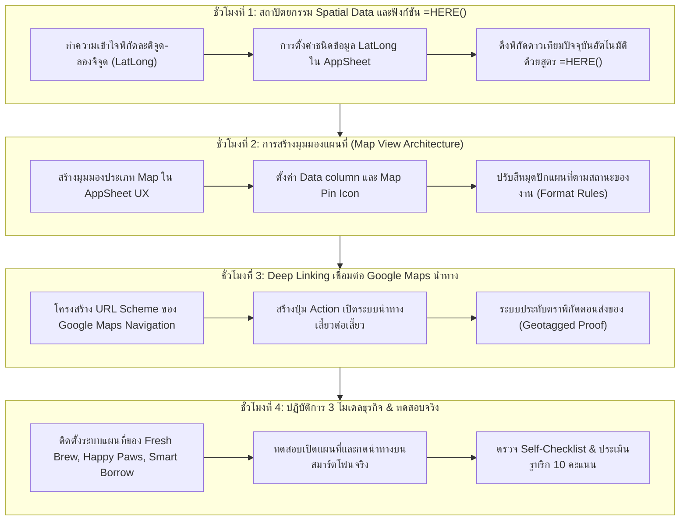
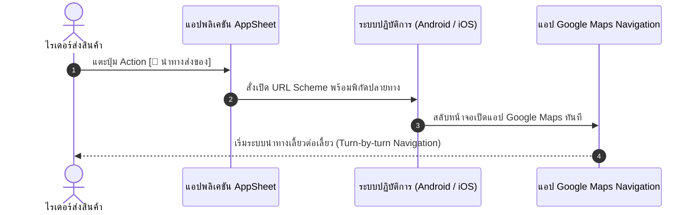

# บทที่ 11: การระบุพิกัดดาวเทียม GPS และแผนที่นำทางด้วย Google Maps
*(Spatial Data, Deep Linking Navigation & Geotagged Proof-of-Delivery Patterns)*

---

## 🎯 จุดประสงค์การเรียนรู้ประจำบท
เมื่อศึกษาบทเรียนนี้และปฏิบัติการตามขั้นตอนเสร็จสิ้น ผู้เรียนสามารถ:
1. อธิบายสถาปัตยกรรมข้อมูลเชิงพื้นที่ **Spatial Data Pattern** และความแตกต่างระหว่างข้อมูลที่อยู่ (Address) กับพิกัดละติจูด-ลองจิจูด (`LatLong`) ได้
2. ใช้งานชนิดข้อมูล **`LatLong`** และฟังก์ชัน **`=HERE()`** บน AppSheet เพื่อดึงพิกัดดาวเทียม GPS จากสมาร์ตโฟนของผู้ใช้งานแบบเรียลไทม์
3. ออกแบบและสร้างมุมมองแผนที่ **Map View** เพื่อแสดงหมุดตำแหน่งร้านค้า, ลูกค้า, หรืออุปกรณ์ พร้อมปรับแต่งไอคอนหมุดตามสถานะธุรกิจได้
4. ประยุกต์ใช้เทคนิค **Deep Linking Pattern** เพื่อสร้างปุ่ม Action ส่งต่อพิกัดไปยังแอปพลิเคชัน Google Maps เริ่มระบบนำทางเลี้ยวต่อเลี้ยว (Turn-by-turn Navigation)
5. สร้างระบบยืนยันการจัดส่งสินค้าด้วยพิกัดดาวเทียม **Geotagged Proof-of-Delivery Pattern** เพื่อป้องกันการทุจริตและใช้เป็นหลักฐานการส่งของจริง
6. พัฒนาระบบแผนที่และระบบนำทางจัดส่งที่สมบูรณ์ตามบริบทของ **3 รูปแบบธุรกิจ (Archetypes)**
7. จัดการแก้ไขปัญหาการขอสิทธิ์เข้าถึงตำแหน่ง (Location Permission) และการตรวจสอบความถูกต้องของพิกัดบนอุปกรณ์มือถือ
8. ร่วมมือกันในทีม 3 คน แบ่งหน้าที่จัดการพิกัด ออกแบบ Map View และทดสอบระบบนำทางบนถนนจริงได้อย่างถูกต้อง

---

## 🧭 แผนผังการเรียนรู้ประจำสัปดาห์ที่ 11 (4 ชั่วโมง)



---

## 1. สถาปัตยกรรมข้อมูลเชิงพื้นที่ (Spatial Data Pattern)

ในยุคของธุรกิจแบบ On-Demand (เช่น Grab, LINE MAN, Flash Express) ตำแหน่งทางภูมิศาสตร์คือหัวใจสำคัญในการส่งมอบสินค้าและบริการ

```
┌────────────────────────────────────────────────────────────────────────┐
│             เปรียบเทียบชนิดข้อมูล Address กับ LatLong                  │
├──────────────────────┬────────────────────────┬────────────────────────┤
│ คุณสมบัติ            │ ชนิดข้อมูล Address     │ ชนิดข้อมูล LatLong     │
├──────────────────────┼────────────────────────┼────────────────────────┤
│ รูปแบบข้อมูล         │ ตัวหนังสือข้อความ      │ รหัสตัวเลขคู่พิกัด     │
│                      │ (เช่น 123 ถ.สุขุมวิท)  │ (เช่น 13.7563, 100.501)│
├──────────────────────┼────────────────────────┼────────────────────────┤
│ ความแม่นยำ           │ ปานกลาง (อาจค้นหาคลาดเคลื่อน)│ แม่นยำระดับเสาบ้าน/เมตร │
├──────────────────────┼────────────────────────┼────────────────────────┤
│ ความเร็วในการแสดงผล  │ ช้า (ต้องรอระบบแปลงที่อยู่)│ เร็วทันที (ไม่ต้องแปลง) │
├──────────────────────┼────────────────────────┼────────────────────────┤
│ การดึงอัตโนมัติ      │ ทำไม่ได้               │ ใช้สูตร =HERE() ได้ทันที│
└──────────────────────┴────────────────────────┴────────────────────────┘
```

### 1.1 การดึงพิกัดปัจจุบันด้วยฟังก์ชัน `=HERE()`
เมื่อไรเดอร์เดลิเวอรี่เดินทางไปถึงจุดส่งของ หรือลูกค้ากำลังเปิดฟอร์มเพื่อสั่งอาหาร เราสามารถให้ระบบตรวจจับพิกัดดาวเทียมที่เครื่องสมาร์ตโฟนกำลังยืนอยู่ได้ทันที:

- ที่คอลัมน์ **`Location`** (หรือ `Customer_Coordinates`):
  - กำหนดชนิดข้อมูล (Type) เป็น: **`LatLong`**
  - ในช่อง **`Initial value`**:
    ```excel
    =HERE()
    ```
    *(ความหมาย: นำพิกัดละติจูดและลองจิจูดปัจจุบันของชิป GPS บนอุปกรณ์ มาบันทึกเป็นค่าเริ่มต้นในช่องนี้ทันที)*

```
┌────────────────────────────────────────────────────────┐
│ การทำงานของสูตร =HERE():                               │
│ 1. ผู้ใช้แตะปุ่มสร้างคำสั่งซื้อใหม่                    │
│ 2. AppSheet ร้องขอข้อมูลจากชิป GPS ของสมาร์ตโฟน        │
│ 3. ดาวเทียมส่งพิกัด: 13.756331, 100.501765             │
│ 4. กรอกลงในช่องพิกัดอัตโนมัติพร้อมแสดงแผนที่ขนาดย่อม    │
└────────────────────────────────────────────────────────┘
```

---

## 2. การสร้างมุมมองแผนที่ (Map View Architecture)

เมื่อเรามีคอลัมน์ชนิด `LatLong` ในตารางแล้ว AppSheet สามารถนำพิกัดเหล่านั้นมาพล็อตเป็นหมุดบนแผนที่โลกของ **Google Maps** ได้ทันที

### 2.1 ขั้นตอนการสร้าง Map View (Click-by-Click)
1. ไปที่เมนู **Views** (ทางซ้าย) ➔ แตะปุ่ม **`[+] Add View`**
2. ตั้งชื่อมุมมอง: `แผนที่จัดส่งสินค้า` (Delivery Map)
3. สำหรับตารางข้อมูล: `Orders`
4. หัวข้อ **View type:** เลือกไอคอน **`map`**
5. หัวข้อ **View Options:**
   - **Map column:** เลือกคอลัมน์พิกัด เช่น **`Customer_Location`**
   - **Secondary column:** เลือกคอลัมน์เสริม เช่น `Shop_Location` (ถ้าต้องการแสดงทั้งร้านค้าและลูกค้าพร้อมกัน)
6. สังเกตที่หน้าจอด้านขวา: แผนที่จะซูมเข้าสู่บริเวณที่มีหมุดพิกัด และแสดงหมุดสีสันสวยงามตามตำแหน่งจริง!

---

## 3. Deep Linking เชื่อมต่อแอปพลิเคชัน Google Maps

แม้ว่า AppSheet จะแสดงแผนที่ได้ดีเยี่ยม แต่สำหรับการ **"ขับขี่รถยนต์หรือมอเตอร์ไซค์นำทางจริง"** พนักงานจัดส่งจำเป็นต้องใช้ระบบนำทางระดับมืออาชีพของ **Google Maps Navigation** ซึ่งมีเสียงบอกทางเลี้ยวต่อเลี้ยวและรายงานสภาพการจราจรสด

### 3.1 สถาปัตยกรรม Deep Linking URL Scheme
เราจะสร้าง Action ที่ทำหน้าที่เปิดแอป Google Maps บนมือถือ โดยส่งพิกัดปลายทางที่ต้องการไปเป็นพารามิเตอร์:

```
โครงสร้าง URL Scheme สำหรับนำทาง Google Maps:
https://www.google.com/maps/dir/?api=1&destination= + พิกัดปลายทาง
```



---

### 3.2 ขั้นตอนการสร้าง Action นำทาง (Click-by-Click)
1. ไปที่เมนู **Actions** ➔ แตะปุ่ม **`[+] Add Action`**
2. ตั้งชื่อ Action: `นำทางด้วย Google Maps`
3. สำหรับตาราง: `Orders`
4. หัวข้อ **Do this:**
   - เลือก: **`External: go to a website`**
   - ช่อง **Target:** ใส่สูตรนิพจน์ดังนี้:
     ```excel
     ="https://www.google.com/maps/dir/?api=1&destination=" & ENCODEURL(TEXT([Customer_Location]))
     ```
     *(คำอธิบาย: นำพิกัดจากช่อง Customer_Location มาแปลงเป็นข้อความและเข้ารหัส URL ส่งให้ Google Maps)*
5. หัวข้อ **Appearance:**
   - Action icon: ค้นหา `navigation` หรือ `directions`
   - Display name: `"เริ่มนำทาง"`
   - Prominence: เลือก **`Display prominently`**
6. กด **`Save`** ➔ เมื่อแตะปุ่มนี้บนสมาร์ตโฟนจริง ระบบจะเปิดแอป Google Maps และคำนวณเส้นทางขับรถจากตำแหน่งที่ยืนอยู่ไปยังบ้านลูกค้าทันที!

---

## 4. ระบบยืนยันการจัดส่งด้วยพิกัดดาวเทียม (Geotagged Proof-of-Delivery)

เพื่อป้องกันปัญหาไรเดอร์แอบกดยืนยันส่งของทั้งที่ยังเดินทางไปไม่ถึงบ้านลูกค้า เราสร้างระบบ **Geotagged Proof-of-Delivery**:

```
┌────────────────────────────────────────────────────────┐
│            โครงสร้างการประทับตราพิกัดดาวเทียม          │
├─────────────────────┬──────────────────────────────────┤
│ 1. ตอนสั่งซื้อ      │ ลูกค้าปักหมุดบ้าน [Customer_Location]│
│                     │ พิกัด: 13.75633, 100.50176        │
├─────────────────────┼──────────────────────────────────┤
│ 2. ตอนกดปุ่มส่งมอบ  │ ไรเดอร์แตะปุ่ม [ส่งของสำเร็จ]    │
│                     │ ระบบแอบดึงพิกัดจริงตอนแตะปุ่ม:   │
│                     │ [Delivered_At_Location] = HERE() │
│                     │ พิกัด: 13.75631, 100.50178        │
├─────────────────────┼──────────────────────────────────┤
│ 3. การตรวจสอบความจริง│ ระยะห่างเพียง 2 เมตร ➔ ส่งของจริง!│
└─────────────────────┴──────────────────────────────────┘
```

- สร้าง Action ชื่อ `ส่งมอบสินค้าสำเร็จ`
- Do this: `Data: set the values of some columns in this row`
  - ตั้งค่า `Order_Status` = `"Completed"`
  - ตั้งค่า `Delivered_Location` = `=HERE()`
  - ตั้งค่า `Delivered_Time` = `=NOW()`

---

## 5. เวิร์กช็อปปฏิบัติการ: พัฒนาระบบแผนที่ของ 3 รูปแบบธุรกิจ (Click-by-Click)

ให้นักศึกษาแต่ละกลุ่มปฏิบัติตามกรณีศึกษาของธุรกิจที่กลุ่มตนเองเลือก:

---

### ☕ รูปแบบที่ 1: Retail & Food Ordering (Fresh Brew & Bakery)

#### ขั้นตอนที่ 1: เพิ่มคอลัมน์พิกัดใน Google Sheets
1. ในชีต `Orders` เพิ่มคอลัมน์:
   - `Customer_Address` (ที่อยู่แบบข้อความ เช่น "คอนโด A ห้อง 402")
   - `Delivery_Location` (พิกัดดาวเทียม LatLong)
   - `Delivered_GPS_Proof` (พิกัดดาวเทียมตอนส่งมอบจริง)
2. ใน AppSheet กด **Regenerate Schema** ตาราง `Orders`
3. ตั้งค่าคอลัมน์ `Delivery_Location`:
   - Type: **`LatLong`** ➔ Initial value: `=HERE()`
4. สร้างมุมมอง Map View ชื่อ `แผนที่ออร์เดอร์รอจัดส่ง`:
   - View type: `map` ➔ Map column: `Delivery_Location`
   - Show if: `[Order_Status] = "Paid"` หรือ `"Brewing"`
5. สร้าง Action `นำทางส่งอาหาร`:
   - Target: `="https://www.google.com/maps/dir/?api=1&destination=" & ENCODEURL(TEXT([Delivery_Location]))`

---

### 🐾 รูปแบบที่ 2: Service & Booking Appointments (Happy Paws Care)

#### ภารกิจ: ระบบรถตู้รับ-ส่งสัตว์เลี้ยง (Pet Ambulance & Shuttle Service)

1. ในชีต `Appointments` เพิ่มคอลัมน์:
   - `Pickup_Location` (พิกัดบ้านลูกค้าสำหรับไปรับสุนัข/แมว)
   - `Dropoff_Location` (พิกัดส่งสัตว์เลี้ยงกลับบ้าน)
2. ตั้งค่าใน AppSheet:
   - `Pickup_Location`: Type: **`LatLong`**
3. สร้างมุมมอง Map View ชื่อ `แผนที่เส้นทางรับส่งสัตว์เลี้ยง`:
   - View type: `map` ➔ Map column: `Pickup_Location`
4. สร้าง Action `นำทางไปรับสัตว์เลี้ยง`:
   - Do this: `External: go to a website`
   - Target: `="https://www.google.com/maps/dir/?api=1&destination=" & ENCODEURL(TEXT([Pickup_Location]))`

---

### 📦 รูปแบบที่ 3: Asset Tracking & Operations (Smart Equipment Borrow)

#### ภารกิจ: ตรวจสอบพิกัดอุปกรณ์ที่ถูกยืมไปใช้งานนอกสถานที่ (Field Equipment Tracking)

1. ในชีต `Borrow_Requests` เพิ่มคอลัมน์:
   - `Deployment_Site_Location` (พิกัดหน้างาน/ไซต์งานที่นำอุปกรณ์ไปติดตั้ง)
   - `Checkout_GPS_Location` (พิกัดจุดที่รับมอบของ)
2. ตั้งค่าใน AppSheet:
   - `Deployment_Site_Location`: Type: **`LatLong`** ➔ Initial value: `=HERE()`
3. สร้างมุมมอง Map View ชื่อ `แผนที่กระจายตัวครุภัณฑ์`:
   - แสดงหมุดตำแหน่งของอุปกรณ์ทั้งหมดที่ถูกยืมออกไปนอกบริษัท
4. สร้าง Action `นำทางไปตรวจสอบอุปกรณ์ที่ไซต์งาน`:
   - Target: `="https://www.google.com/maps/dir/?api=1&destination=" & ENCODEURL(TEXT([Deployment_Site_Location]))`

---

## 6. การแบ่งบทบาทหน้าที่ของสมาชิก 3 คนในทีม (Agile Triad Collaboration)

```
┌────────────────────────────────────────────────────────────────────────┐
│                   บทบาทหน้าที่ของสมาชิกในทีม (Team Matrix)             │
├─────────────────────┬──────────────────────────────────────────────────┤
│ สมาชิกคนที่ 1       │ Spatial Data & Coordinates Architect             │
│ (สถาปัตยกรรมพิกัด)  │ - กำหนดคอลัมน์ LatLong และใส่สูตร =HERE()        │
│                     │ - จัดการเรื่องการขอสิทธิ์ GPS (Location Access) │
│                     │ - ตรวจสอบความแม่นยำของพิกัดใน Google Sheets      │
├─────────────────────┼──────────────────────────────────────────────────┤
│ สมาชิกคนที่ 2       │ Map UX & Cartography Specialist                  │
│ (ผู้ออกแบบแผนที่)   │ - สร้างมุมมอง Map View ปรับแต่งสีและสัญลักษณ์หมุด│
│                     │ - กำหนดการจัดกลุ่มหมุด (Clustering) และการกรอง   │
│                     │ - ออกแบบ Card แสดงข้อมูลสรุปใต้หมุดปักแผนที่     │
├─────────────────────┼──────────────────────────────────────────────────┤
│ สมาชิกคนที่ 3       │ Deep Link Navigation & Field Verification Lead   │
│ (วิศวกรระบบนำทาง)   │ - เขียนสูตร URL Scheme สำหรับเรียก Google Maps   │
│                     │ - ทดสอบการแตะปุ่ม Action เพื่อเด้งเปิดแอปนำทางจริง│
│                     │ - ตรวจสอบระบบ Geotagged Proof และประเมินรูบริก   │
└─────────────────────┴──────────────────────────────────────────────────┘
```

---

## 7. ข้อผิดพลาดที่พบบ่อยและแนวทางแก้ไข (Troubleshooting & Common Pitfalls)

```
┌──────────────────────────────────────┬──────────────────────────────────────────┐
│ ปัญหาที่พบ (Error Symptoms)           │ สาเหตุและวิธีแก้ไข (Root Cause & Fix)     │
├──────────────────────────────────────┼──────────────────────────────────────────┤
│ 1. พิกัด =HERE() ขึ้นค่าว่าง หรือฟ้อง  │ ❌ เบราว์เซอร์หรือมือถือบล็อกสิทธิ์ GPS │
│    Location Permission Denied        │ ➔ วิธีแก้: แตะรูปแม่กุญแจที่แถบ URL บน     │
│                                      │    เบราว์เซอร์ เลือก Site Settings ➔ Allow │
│                                      │    Location แล้วรีเฟรชหน้าจอ              │
├──────────────────────────────────────┼──────────────────────────────────────────┤
│ 2. หมุดแผนที่ไปปักกลางทะเลแอตแลนติก   │ ❌ พิมพ์พิกัดสลับที่ หรือกรอกค่าเป็น 0,0 │
│    (เกาะ Null Island พิกัด 0,0)       │ ➔ วิธีแก้: พิกัดประเทศไทยต้องขึ้นต้นด้วย   │
│                                      │    ละติจูด 13-19 และลองจิจูด 98-105 เสมอ   │
├──────────────────────────────────────┼──────────────────────────────────────────┤
│ 3. กดปุ่มนำทางแล้วหน้าจอขาว หรือแจ้งว่า │ ❌ ลืมใส่ฟังก์ชัน ENCODEURL() ในสูตร      │
│    Invalid URL Address               │ ➔ วิธีแก้: ใส่สูตรให้รัดกุมตามแบบมาตรฐาน:  │
│                                      │    ="https://www.google.com/maps/dir/?api│
│                                      │    =1&destination=" & ENCODEURL(TEXT(...))│
├──────────────────────────────────────┼──────────────────────────────────────────┤
│ 4. แผนที่ในคอมพิวเตอร์ชี้ตำแหน่งไม่ตรง│ 💡 พฤติกรรมปกติ: คอมพิวเตอร์ตั้งโต๊ะไม่มี  │
│    กับสถานที่จริง                    │    ชิปดาวเทียม GPS จึงอ้างอิงจากเสาเน็ต IP│
│                                      │    ให้ทดสอบบนสมาร์ตโฟนจริงเพื่อความแม่นยำ │
└──────────────────────────────────────┴──────────────────────────────────────────┘
```

---

## 8. แบบตรวจสอบตนเองก่อนส่งงาน (Self-Checklist ประจำบทที่ 11)

ให้นักศึกษาตรวจสอบความเรียบร้อยของชิ้นงานให้ครบทุกข้อก่อนส่งให้อาจารย์ผู้สอนประเมิน:

- [ ] **1. คอลัมน์พิกัดดาวเทียม (LatLong Column):** กำหนดคอลัมน์ชนิด `LatLong` พร้อมสูตรเริ่มต้น `=HERE()` ดึงพิกัด GPS อัตโนมัติได้สำเร็จ
- [ ] **2. การแสดงผลมุมมองแผนที่ (Map View):** สร้างมุมมองประเภท `map` ที่แสดงหมุดตำแหน่งได้อย่างแม่นยำบนแผนที่ Google Maps
- [ ] **3. การปรับแต่งหมุด (Pin UX):** หมุดแผนที่มีการแสดงชื่อและข้อมูลสรุปที่อ่านง่ายเมื่อผู้ใช้แตะที่หมุด
- [ ] **4. ปุ่มนำทางภายนอก (Deep Linking Action):** สร้างปุ่ม Action ชนิด `External: go to a website` ที่สามารถเปิดแอป Google Maps นำทางเลี้ยวต่อเลี้ยวได้จริง
- [ ] **5. การประทับตราพิกัดจัดส่ง (Geotagged Proof):** มีกลไกบันทึกพิกัดดาวเทียมขณะทำการส่งมอบหรือรับของสำเร็จเพื่อใช้เป็นหลักฐาน
- [ ] **6. การทดสอบบนมือถือจริง (Live Mobile Verification):** ทดสอบเปิดแผนที่และกดเริ่มนำทางบนสมาร์ตโฟนจริงผ่านระบบเครือข่ายมือถือสำเร็จ 100%

---

## 9. เกณฑ์การประเมินผลงาน 10 คะแนน (Rubric Assessment Matrix)

| มิติการประเมิน (Assessment Dimensions) | ระดับดีมาก (Good: 9-10 คะแนน) | ระดับผ่านเกณฑ์ (Pass: 7-8 คะแนน) | ระดับต้องปรับปรุง (Needs Work: 0-6 คะแนน) |
| :--- | :--- | :--- | :--- |
| **1. การจัดการพิกัด Spatial Data & =HERE()**<br>*(น้ำหนัก 3 คะแนน)* | ใช้ชนิดข้อมูล `LatLong` ได้ถูกต้อง สูตร `=HERE()` ดึงพิกัดดาวเทียม GPS บนมือถือได้แม่นยำ 100% พิกัดถูกต้องในประเทศไทย | ใช้ `LatLong` ได้ แต่ยังต้องพิมพ์ตัวเลขเองในบางจุด หรือสูตร `=HERE()` ทำงานติดขัด | ใช้ชนิดข้อมูลผิดประเภท หรือไม่สามารถบันทึกพิกัดละติจูด-ลองจิจูดได้ |
| **2. การออกแบบแผนที่และปุ่มนำทาง (Map & Deep Link)**<br>*(น้ำหนัก 4 คะแนน)* | สร้าง Map View สวยงาม หมุดปักแม่นยำ ปุ่ม Deep Link เปิดแอป Google Maps นำทางเลี้ยวต่อเลี้ยวได้ลื่นไหลสมบูรณ์แบบ | มีมุมมองแผนที่และปุ่มนำทาง แต่สูตรเปิดเว็บยังติดขัดในบางอุปกรณ์ หรือหมุดแสดงผลไม่ครบ | ไม่มีมุมมองแผนที่ หรือปุ่มนำทางกดแล้วเกิด Error ใช้งานไม่ได้ |
| **3. ระบบ Geotagged Proof และการทดสอบจริง**<br>*(น้ำหนัก 3 คะแนน)* | มีระบบประทับตราพิกัดตอนส่งของ สาธิตบนสมาร์ตโฟนจริงได้อย่างคล่องแคล่ว สมาชิก 3 คนประสานงานตามบทบาทชัดเจน | มีระบบบันทึกพิกัดส่งของ แต่สาธิตการนำทางบนมือถือยังติดขัดเรื่องสิทธิ์เล็กน้อย | ไม่สามารถสาธิตการทำงานของระบบแผนที่บนสมาร์ตโฟนได้ |

---

> 🏆 **สรุปท้ายบท:** ยอดเยี่ยมมาก! แอปพลิเคชันของนักศึกษาตอนนี้มีความสามารถระดับมืออาชีพเทียบเท่าแพลตฟอร์มเดลิเวอรี่ชั้นนำ สามารถนำทางพนักงานและติดตามพิกัดได้อย่างแม่นยำ ในบทที่ 12 เราจะก้าวสู่ระดับสูงสุดของการทำงานอัตโนมัติ ด้วยการสร้าง **Automation Bots** ที่จะคอยตรวจจับเมื่อมีออร์เดอร์เข้ามา แล้ว **สร้างไฟล์ใบเสร็จรับเงิน PDF** บันทึกลง Google Drive พร้อม **ส่งอีเมลแจ้งเตือนลูกค้าอัตโนมัติ** โดยไม่ต้องมีมนุษย์คอยกดส่ง!
