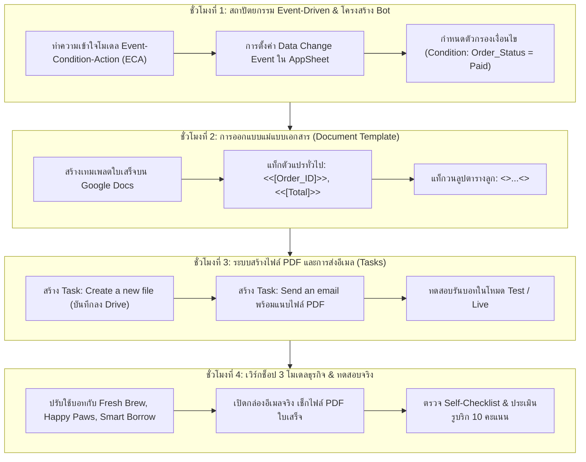

# บทที่ 12: การสร้างระบบอัตโนมัติด้วย Automation Bots และการออกใบเสร็จ PDF
*(Event-Driven Architecture, Document Template & Asynchronous Notification Patterns)*

---

## 🎯 จุดประสงค์การเรียนรู้ประจำบท
เมื่อศึกษาบทเรียนนี้และปฏิบัติการตามขั้นตอนเสร็จสิ้น ผู้เรียนสามารถ:
1. อธิบายสถาปัตยกรรมที่ขับเคลื่อนด้วยเหตุการณ์ **Event-Driven Architecture (EDA)** และรูปแบบการทำงานแบบ **ECA (Event-Condition-Action)** ใน AppSheet Automation ได้
2. สร้างและตั้งค่า **Automation Bot** เพื่อคอยเฝ้าตรวจจับการเปลี่ยนแปลงของข้อมูล (Data Change Events: Adds & Updates) บนระบบคลาวด์ได้
3. ออกแบบแม่แบบเอกสาร **Document Template บน Google Docs** โดยใช้แท็กตัวแปรคู่ `<<[Column]>>` ในการเชื่อมข้อมูลจากฐานข้อมูลสู่เอกสาร
4. ใช้งานแท็กการวนลูปรายการย่อย **`<<Start:[Related ... ]>> ... <<End>>`** เพื่อเรนเดอร์รายการสินค้าในตะกร้าลงในตารางใบเสร็จได้อย่างสมบูรณ์
5. สั่งให้ระบบ Compile เอกสารออกมาเป็นไฟล์ **PDF Receipt** บันทึกลงในโฟลเดอร์ Google Drive โดยอัตโนมัติ
6. ประยุกต์ใช้รูปแบบ **Asynchronous Notification Pattern** เพื่อส่งอีเมลยืนยันรายการพร้อมแนบไฟล์ใบเสร็จ PDF ไปยังกล่องจดหมายของลูกค้าในฉากหลัง
7. สร้างและทดสอบระบบบอทอัตโนมัติที่สอดคล้องกับ **3 รูปแบบธุรกิจ (Archetypes)**
8. ร่วมมือกันในทีม 3 คน แบ่งหน้าที่จัดการอีเวนต์ ออกแบบเทมเพลตเอกสาร และทดสอบการรับอีเมลจริง พร้อมส่งงานประเมินตามรูบริก 10 คะแนน

---

## 🧭 แผนผังการเรียนรู้ประจำสัปดาห์ที่ 12 (4 ชั่วโมง)



---

## 1. สถาปัตยกรรม Event-Driven ในระบบอัตโนมัติบนคลาวด์

ในธุรกิจระดับสากล เมื่อมีลูกค้าสั่งของและชำระเงินเข้ามา เจ้าของร้านไม่ต้องมานั่งเปิดไฟล์ Word พิมพ์ชื่อลูกค้า พิมพ์รายการสินค้า บันทึกเป็น PDF แล้วเปิดเว็บเมลแนบไฟล์ส่งให้ลูกค้าด้วยตนเอง ทุกอย่างจะเกิดขึ้นแบบอัตโนมัติบนคลาวด์ผ่าน **Event-Driven Architecture (EDA)**

```
┌────────────────────────────────────────────────────────────────────────┐
│             โครงสร้างโมเดล Event - Condition - Action (ECA)             │
├──────────────────────┬─────────────────────────────────────────────────┤
│ 1. Event (เหตุการณ์) │ ตรวจจับว่าเกิดอะไรขึ้นกับข้อมูลในระบบ:           │
│                      │ • Adds_Only (มีการเพิ่มออร์เดอร์ใหม่)           │
│                      │ • Updates_Only (มีการเปลี่ยนสถานะ เช่น เป็น Paid) │
├──────────────────────┼─────────────────────────────────────────────────┤
│ 2. Condition (เงื่อนไข)│ ตรวจสอบว่าเข้าเกณฑ์ที่ต้องทำหรือไม่:           │
│                      │ • เช่น [Order_Status] = "Paid"                  │
│                      │ ➔ ถ้าใช่ ให้รันต่อ / ถ้าไม่ใช่ ให้หยุดรอ         │
├──────────────────────┼─────────────────────────────────────────────────┤
│ 3. Action / Task     │ งานที่บอทต้องทำให้สำเร็จ:                       │
│    (ภารกิจอัตโนมัติ) │ ➔ สร้างไฟล์ PDF บันทึกเข้า Google Drive         │
│                      │ ➔ ส่งอีเมลแจ้งเตือนลูกค้าพร้อมแนบไฟล์ใบเสร็จ    │
└──────────────────────┴─────────────────────────────────────────────────┘
```

---

## 2. การออกแบบแม่แบบเอกสาร (Document Template Pattern)

AppSheet ใช้ **Google Docs** เป็นเครื่องมือเรนเดอร์เอกสาร (Document Template Engine) โดยเราสามารถจัดหน้าเอกสาร ใส่โลโก้ร้าน ตกแต่งตารางเส้นขอบ และใช้ตัวอักษรที่สวยงามได้ตามต้องการ

```
┌────────────────────────────────────────────────────────┐
│             ตัวอย่างเทมเพลตใบเสร็จบน Google Docs       │
├────────────────────────────────────────────────────────┤
│ [ โลโก้ร้าน ]              ใบเสร็จรับเงิน (RECEIPT)    │
│                            เลขที่บิล: <<[Order_ID]>>   │
│                            วันที่: <<[Order_Date]>>     │
│ ลูกค้า: <<[Customer_Name]>>                            │
│ เบอร์โทร: <<[Phone_Number]>>                           │
│ ────────────────────────────────────────────────────── │
│ รายการสินค้า          จำนวน       ราคา       รวมเงิน   │
│ ────────────────────────────────────────────────────── │
│ <<Start:[Related Order_Details]>>                      │
│ <<[Product_ID].[Product_Name]>>                        │
│                       <<[Quantity]>>  <<[Unit_Price]>> │
│                                         <<[Subtotal]>> │
│ <<End>>                                                │
│ ────────────────────────────────────────────────────── │
│ ยอดรวมทั้งสิ้น: <<[Total_Amount]>> บาท                 │
│ ลายมือชื่อผู้รับ: <<[Customer_Signature]>>             │
└────────────────────────────────────────────────────────┘
```

### 2.1 กฎเหล็กของแท็กวนลูป `<<Start>>` และ `<<End>>`
เมื่อบิลใบสั่งซื้อมีรายการสินค้าหลายแถว เราต้องใช้แท็กคู่เพื่อสั่งให้ระบบวนลูปสร้างแถวในตารางอัตโนมัติ:

1. **`<<Start:[Related Order_Details]>>`**: วางไว้ที่เซลล์แรกของแถวที่ต้องการวนลูป
2. **คอลัมน์ในตารางลูก**: เรียกใช้ผ่านชื่อคอลัมน์ได้โดยตรง เช่น `<<[Quantity]>>` หรือใช้ Dereference เช่น `<<[Product_ID].[Name]>>`
3. **`<<End>>`**: วางไว้ที่เซลล์สุดท้ายของแถววนลูป

> ⚠️ **ข้อควรระวังอันดับ 1:** หากพิมพ์แท็กสะกดผิด เช่น ลืมวงเล็บก้ามปู ลืมพิมพ์ `<<End>>` หรือเว้นวรรคผิด ระบบจะไม่สามารถสร้างไฟล์ PDF ได้และจะฟ้อง Error ในระบบบอททันที!

---

## 3. ขั้นตอนการสร้างบอทออกใบเสร็จและส่งอีเมล (Click-by-Click)

### 3.1 ขั้นตอนที่ 1: สร้าง Bot ตัวใหม่ใน AppSheet
1. ไปที่เมนู **Automation** (ไอคอนรูปสายฟ้า/หุ่นยนต์ทางซ้าย)
2. แตะปุ่ม **`[+] Add Bot`** ➔ เลือก **`Create a custom bot`**
3. ตั้งชื่อบอท: `Auto Invoice & Receipt Bot`

---

### 3.2 ขั้นตอนที่ 2: กำหนด Event (เหตุการณ์ตรวจจับ)
1. แตะที่กล่อง **Event** ด้านบน
2. Event name: `เมื่อออร์เดอร์ชำระเงินเรียบร้อย`
3. Event type: เลือก **`Data Change`**
4. Table: เลือก **`Orders`**
5. Data change type: เลือก **`Adds and Updates`**
6. ช่อง **Condition (ตัวกรอง):**
   ```excel
   AND(
     [Order_Status] = "Paid",
     ISNOTBLANK([Customer_Email])
   )
   ```
   *(ความหมาย: จะรันบอทก็ต่อเมื่อออร์เดอร์เปลี่ยนสถานะเป็น Paid และมีอีเมลลูกค้าให้ส่ง)*

---

### 3.3 ขั้นตอนที่ 3: สร้าง Task ผลิตไฟล์ PDF (Create a new file)
1. แตะปุ่ม **`Add a step`** ใต้กล่อง Event
2. เลือก **`Create a custom step`** ➔ Run a task
3. Task type: เลือก **`Create a new file`**
4. Table: `Orders`
5. หัวข้อ **Template:**
   - แตะปุ่ม **`Create`** ➔ AppSheet จะสร้างไฟล์ Google Docs แม่แบบให้โดยอัตโนมัติบน Google Drive ของเรา!
   - หรือแตะปุ่ม **`View`** เพื่อเปิดไฟล์ Docs ขึ้นมาตกแต่งข้อความและแทรกโลโก้ร้าน
6. หัวข้อ **File settings:**
   - **File Folder Path:** พิมพ์ `"Receipts"` (ระบบจะสร้างโฟลเดอร์ชื่อ Receipts ใน Drive ให้เอง)
   - **File Name Prefix:** ใส่สูตร:
     ```excel
     CONCATENATE("Receipt-", [Order_ID], "-", TEXT(TODAY(), "YYYYMMDD"))
     ```
   - **Archive?:** เลือก `Attach only` หรือ `Archive and attach` (แนะนำเลือก Archive เพื่อเก็บไฟล์ไว้ใน Drive ด้วย)

---

### 3.4 ขั้นตอนที่ 4: สร้าง Task ส่งอีเมลแจ้งเตือน (Send an email)
1. แตะ **`Add a step`** ต่อจากกล่องสร้างไฟล์
2. Task type: เลือก **`Send an email`**
3. หัวข้อ **Email Details:**
   - **To:** ใส่สูตร `[Customer_Email]`
   - **CC / BCC:** ใส่สูตรอีเมลของเจ้าของร้าน เช่น `"shop.manager@gmail.com"`
   - **Email Subject:** ใส่สูตรหัวเรื่อง:
     ```excel
     CONCATENATE("ใบเสร็จรับเงิน คำสั่งซื้อเลขที่ ", [Order_ID], " จากร้าน ", "Fresh Brew & Bakery")
     ```
   - **Email Body:** พิมพ์ข้อความต้อนรับและขอบคุณลูกค้า
   - **Attachment Content Type:** เลือก **`PDF`**
   - **Attachments:** ระบบจะผูกไฟล์ PDF ที่เพิ่งสร้างจาก Step ก่อนหน้ามาแนบใส่ในอีเมลให้อัตโนมัติ!
4. กดปุ่ม **`Save`** ด้านบนขวาเพื่อบันทึกการทำงานของบอท

---

## 4. เวิร์กช็อปปฏิบัติการ: ปรับใช้บอทกับ 3 รูปแบบธุรกิจ (Click-by-Click)

ให้นักศึกษาแต่ละกลุ่มดำเนินการปรับแต่งระบบอัตโนมัติตามโมเดลธุรกิจของตนเอง:

---

### ☕ รูปแบบที่ 1: Retail & Food Ordering (Fresh Brew & Bakery)

#### ภารกิจ: ระบบส่งใบเสร็จรับเงิน PDF ยืนยันการสั่งซื้อเครื่องดื่ม
- **Event:** เมื่อคำสั่งซื้อในตาราง `Orders` มีสถานะเป็น `"Paid"`
- **Template Google Docs:**
  - หัวเอกสาร: ชื่อร้านกาแฟ ที่อยู่ เลขประจำตัวผู้เสียภาษี
  - รายการสินค้า: วนลูป `<<Start:[Related Order_Details]>>` แสดงชื่อเมนู, ระดับความหวาน, จำนวนแก้ว, และราคา
  - ท้ายเอกสาร: ยอดรวมเงินสุทธิ และภาพลายเซ็นลูกค้ารับของ `<<[Customer_Signature]>>`
- **Email Task:** ส่งอีเมลขอบคุณพร้อมแนบไฟล์ `Receipt-ORD-XXXX.pdf` ไปยังอีเมลลูกค้า

---

### 🐾 รูปแบบที่ 2: Service & Booking Appointments (Happy Paws Care)

#### ภารกิจ: ระบบออกใบนัดหมายบริการสัตว์เลี้ยงและส่งอีเมลยืนยัน (Appointment Slip)
- **Event:** เมื่อมีการเพิ่มใบนัดหมายใหม่ในตาราง `Appointments` (Data change type: `Adds_Only`)
- **Template Google Docs:**
  - แสดงชื่อเจ้าของสัตว์เลี้ยง, ชื่อน้องหมา/แมว, พันธุ์, วันและเวลานัดหมาย
  - วนลูปรายการบริการเสริม: `<<Start:[Related Appointment_Services]>>` แสดงบริการอาบน้ำ, ตัดขน, ฉีดวัคซีน
  - แนบภาพลายเซ็นยินยอมของเจ้าของ: `<<[Owner_Consent_Signature]>>`
- **Email Task:** ส่งใบนัดหมายเข้าอีเมลเจ้าของ เพื่อใช้เป็นบัตรคิวในการนำสัตว์เลี้ยงมารับบริการหน้าร้าน

---

### 📦 รูปแบบที่ 3: Asset Tracking & Operations (Smart Equipment Borrow)

#### ภารกิจ: ระบบสร้างใบขอเบิกยืมพัสดุราชการ/บริษัท (Equipment Requisition Voucher)
- **Event:** เมื่อสถานะในตาราง `Borrow_Requests` เปลี่ยนเป็น `"Approved"`
- **Template Google Docs:**
  - แสดงเลขที่คำขอ, แผนกผู้เบิก, วันที่ยืม, วันกำหนดส่งคืน
  - วนลูปรายการครุภัณฑ์: `<<Start:[Related Borrow_Items]>>` แสดงรหัสพัสดุ, ชื่ออุปกรณ์, ซีเรียลนัมเบอร์, สภาพตอนเบิก
  - แนบลายเซ็นผู้ยืมและลายเซ็นผู้อนุมัติ
- **Email Task:** ส่งเอกสาร PDF อนุมัติการยืมไปยังอีเมลของผู้ยืมและผู้ดูแลคลังพัสดุ

---

## 5. การแบ่งบทบาทหน้าที่ของสมาชิก 3 คนในทีม (Agile Triad Collaboration)

```
┌────────────────────────────────────────────────────────────────────────┐
│                   บทบาทหน้าที่ของสมาชิกในทีม (Team Matrix)             │
├─────────────────────┬──────────────────────────────────────────────────┤
│ สมาชิกคนที่ 1       │ Event & Automation Logic Architect               │
│ (สถาปัตยกรรมบอท)    │ - สร้าง Automation Bot และกำหนด Event Type       │
│                     │ - เขียนสูตรตัวกรองเงื่อนไข Condition ให้รัดกุม    │
│                     │ - ตรวจสอบการเปิดสิทธิ์การทำงานของบอทบน AppSheet  │
├─────────────────────┼──────────────────────────────────────────────────┤
│ สมาชิกคนที่ 2       │ Document Template & Visual Layout Designer       │
│ (ผู้ออกแบบเอกสาร)   │ - ออกแบบจัดหน้าตาใบเสร็จบน Google Docs           │
│                     │ - ฝังแท็กตัวแปร <<[Column]>> และแท็กวนลูปตารางลูก│
│                     │ - จัดวางโลโก้ร้านและช่องลายเซ็นดิจิทัลให้สวยงาม  │
├─────────────────────┼──────────────────────────────────────────────────┤
│ สมาชิกคนที่ 3       │ Email Dispatch & Quality Assurance Lead          │
│ (ผู้ทดสอบการส่งอีเมล│ - ตั้งค่า Task ส่งอีเมลและผูกไฟล์แนบ PDF         │
│                     │ - ทดสอบสั่งซื้อจริงและเปิดตรวจเช็กอีเมลใน Inbox  │
│                     │ - ตรวจสอบ Self-Checklist และประเมินรูบริก 10 ข้อ │
└─────────────────────┴──────────────────────────────────────────────────┘
```

---

## 6. ข้อผิดพลาดที่พบบ่อยและแนวทางแก้ไข (Troubleshooting & Common Pitfalls)

```
┌──────────────────────────────────────┬──────────────────────────────────────────┐
│ ปัญหาที่พบ (Error Symptoms)           │ สาเหตุและวิธีแก้ไข (Root Cause & Fix)     │
├──────────────────────────────────────┼──────────────────────────────────────────┤
│ 1. บอทไม่ยอมทำงาน หรืออีเมลไม่ส่ง    │ ❌ แอปยังอยู่ในโหมดทดสอบ (Prototype Mode) │
│                                      │ ➔ วิธีแก้: ใน Prototype Mode ระบบจะส่งอีเมล│
│                                      │    เข้าเฉพาะอีเมลของผู้สร้างแอปเท่านั้น     │
│                                      │    ให้ตรวจสอบใน Inbox ของบัญชีผู้สร้างแอป │
├──────────────────────────────────────┼──────────────────────────────────────────┤
│ 2. ไฟล์ PDF เรนเดอร์ล้มเหลว หรือขึ้น  │ ❌ พิมพ์แท็กวนลูปผิด เช่น ลืมแท็ก <<End>> │
│    Template Syntax Error             │ ➔ วิธีแก้: ตรวจสอบ Google Docs ต้องมี     │
│                                      │    <<Start:[Related ...]>> และ <<End>> ครบ│
├──────────────────────────────────────┼──────────────────────────────────────────┤
│ 3. ตัวหนังสือภาษาไทยใน PDF กลายเป็น  │ ❌ ใช้ฟอนต์ใน Google Docs ที่ไม่รองรับไทย │
│    สี่เหลี่ยม หรือสระลอย             │ ➔ วิธีแก้: เลือกคลุมข้อความทั้งหมดใน Docs  │
│                                      │    แล้วเปลี่ยนฟอนต์เป็น 'Sarabun' หรือ    │
│                                      │    'Prompt' ที่รองรับภาษาไทยมาตรฐาน       │
├──────────────────────────────────────┼──────────────────────────────────────────┤
│ 4. ส่งอีเมลซ้ำหลายฉบับจากการกดอัปเดต │ ❌ ตัวกรอง Condition ไม่รัดกุม            │
│    ข้อมูลครั้งเดียว                  │ ➔ วิธีแก้: ใน Condition ให้ระบุเจาะจง เช่น│
│                                      │    [_THISROW_BEFORE].[Status] <> "Paid"  │
│                                      │    AND [_THISROW_AFTER].[Status] = "Paid" │
└──────────────────────────────────────┴──────────────────────────────────────────┘
```

---

## 7. แบบตรวจสอบตนเองก่อนส่งงาน (Self-Checklist ประจำบทที่ 12)

ให้นักศึกษาตรวจสอบความเรียบร้อยของชิ้นงานให้ครบทุกข้อก่อนส่งให้อาจารย์ผู้สอนประเมิน:

- [ ] **1. การตั้งค่า Automation Bot:** สร้างบอทที่ตรวจจับเหตุการณ์ Data Change (Adds/Updates) พร้อมเงื่อนไขกรองสถานะที่ถูกต้อง
- [ ] **2. การออกแบบแม่แบบเอกสาร (Google Docs):** มีไฟล์เทมเพลตที่จัดวางเลย์เอาต์สวยงาม ใช้ฟอนต์ภาษาไทยมาตรฐาน (เช่น Sarabun)
- [ ] **3. แท็กข้อมูลและแท็กวนลูป (Template Tags):** ใช้แท็ก `<<[Column]>>` และแท็กวนลูปรายการย่อย `<<Start>>...<<End>>` ถูกต้อง ไม่มี Syntax Error
- [ ] **4. การผลิตไฟล์ PDF อัตโนมัติ (PDF Generation):** ระบบสามารถเรนเดอร์เอกสารออกมาเป็นไฟล์ PDF และบันทึกเข้า Google Drive ได้จริง
- [ ] **5. การส่งอีเมลพร้อมแนบเอกสาร (Email with Attachment):** ระบบส่งอีเมลแจ้งเตือนไปยังผู้รับ พร้อมแนบไฟล์ PDF ใบเสร็จสำเร็จ
- [ ] **6. การทดสอบจริงบน Inbox (Live Email Verification):** สมาชิกในกลุ่มเปิดแสดงอีเมลและเปิดดูไฟล์ PDF ที่ได้รับจริงให้อาจารย์ผู้สอนตรวจสอบ

---

## 8. เกณฑ์การประเมินผลงาน 10 คะแนน (Rubric Assessment Matrix)

| มิติการประเมิน (Assessment Dimensions) | ระดับดีมาก (Good: 9-10 คะแนน) | ระดับผ่านเกณฑ์ (Pass: 7-8 คะแนน) | ระดับต้องปรับปรุง (Needs Work: 0-6 คะแนน) |
| :--- | :--- | :--- | :--- |
| **1. การทำงานของ Automation Bot & เงื่อนไข**<br>*(น้ำหนัก 3 คะแนน)* | บอทตรวจจับเหตุการณ์แม่นยำ เงื่อนไข ECA รัดกุม ทำงานอัตโนมัติทันทีที่เปลี่ยนสถานะโดยไม่มีข้อผิดพลาด | บอททำงานได้ แต่เงื่อนไขยังกว้างเกินไป หรือทำงานช้าในบางจังหวะ | บอทไม่ทำงาน หรือตั้งค่า Event ผิดพลาดจนไม่เกิดปฏิกิริยา |
| **2. ความสมบูรณ์ของเอกสาร PDF Template**<br>*(น้ำหนัก 4 คะแนน)* | เทมเพลตจัดหน้าสวยงาม ฟอนต์ไทยถูกต้อง แท็กวนลูป `<<Start>>...<<End>>` แสดงรายการสินค้าและยอดเงินถูกต้อง 100% | สร้าง PDF ได้ รายการสินค้าขึ้นครบ แต่การจัดหน้ามีข้อความเหลื่อมล้ำ หรือสระภาษาไทยลอยเล็กน้อย | ไม่สามารถเรนเดอร์ไฟล์ PDF ได้ หรือเอกสารมี Error แท็กขาดหาย |
| **3. การส่งอีเมลและการสาธิตการทำงานจริง**<br>*(น้ำหนัก 3 คะแนน)* | ส่งอีเมลพร้อมแนบไฟล์ PDF ถึงกล่องจดหมายจริง สมาชิก 3 คนสาธิตวงจรทำงานอัตโนมัติตั้งแต่หน้าร้านถึงอีเมลได้อย่างคล่องแคล่ว | ส่งอีเมลได้ แต่ไฟล์แนบไม่ไปด้วย หรือสาธิตบนเครื่องได้แต่ใช้เวลานาน | ไม่สามารถส่งอีเมลออกจากระบบได้ หรือสาธิตไม่ผ่าน |

---

> 🏆 **สรุปท้ายบท:** สุดยอดแห่งความสำเร็จ! ตอนนี้แอปพลิเคชันของนักศึกษามีฟังก์ชันระดับองค์กรที่ทำงานอัตโนมัติได้อย่างสมบูรณ์แบบแล้ว ในสัปดาห์หน้า (บทที่ 13) เราจะเข้าสู่ช่วง **Capstone Sprint 1** ซึ่งสมาชิกทั้ง 3 คนจะรวมพลังนำทุกระบบที่สร้างมาประกอบร่างเข้าด้วยกันเป็นแอปพลิเคชันเวอร์ชัน Beta (80%) เพื่อเตรียมพร้อมสู่การปล่อยใช้งานจริง!
