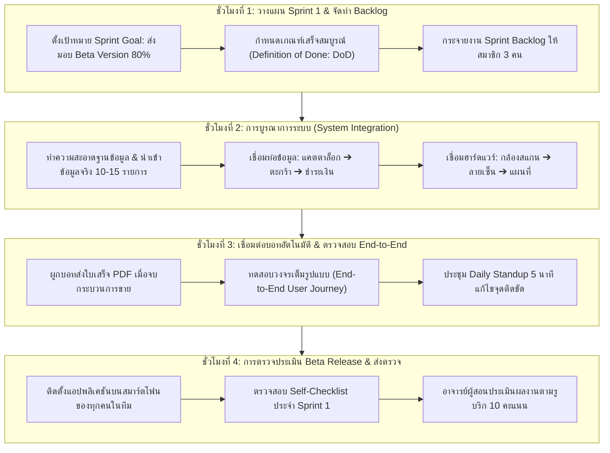
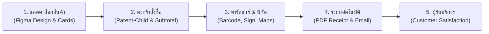

# บทที่ 13: การพัฒนาโครงงานแอปพลิเคชันธุรกิจจริง (Sprint 1: Beta Release)
*(System Integration, Agile Scrum Sprint & Minimum Viable Product Patterns)*

---

## 🎯 จุดประสงค์การเรียนรู้ประจำบท
เมื่อศึกษาบทเรียนนี้และปฏิบัติการตามขั้นตอนเสร็จสิ้น ผู้เรียนสามารถ:
1. อธิบายกระบวนการพัฒนาซอฟต์แวร์แบบ **Agile Scrum Framework** และการวางแผนงานในรอบ **Sprint 1 (Beta Development)** ได้
2. ประยุกต์ใช้สถาปัตยกรรม **System Integration Pattern** เพื่อรวบรวมโมดูลทั้งหมด (UI, Database, Relations, Actions, Hardware, Maps, Automation) เข้าเป็นระบบเดียวที่ไร้รอยต่อ
3. กำหนดเกณฑ์ความสำเร็จของงาน **Definition of Done (DoD)** และจัดทำกระดานติดตามงาน **Sprint Backlog** ร่วมกับเพื่อนร่วมทีมได้
4. คัดเลือกฟีเจอร์หลักตามหลักการ **Minimum Viable Product (MVP)** เพื่อส่งมอบคุณค่าทางธุรกิจที่ใช้งานได้จริงในระดับความสมบูรณ์ 80% (Beta Version)
5. ทำความสะอาดข้อมูลจำลอง (Mock Data Cleanup) และนำเข้าข้อมูลสินค้า/บริการธุรกิจจริงที่มีรูปภาพชัดเจนอย่างน้อย 10-15 รายการ
6. บูรณาการระบบแอปพลิเคชันให้ทำงานได้ครบวงจรตามบริบทของ **3 รูปแบบธุรกิจ (Archetypes)**
7. ดำเนินการประชุมสรุปความคืบหน้ารายวัน **Daily Standup Meeting 5 นาที** ภายในทีม 3 คนเพื่อปลดล็อกอุปสรรคการทำงาน (Blockers)
8. ทดสอบและนำเสนอแอปพลิเคชันเวอร์ชัน Beta บนสมาร์ตโฟนจริง เพื่อรับการประเมินผลงาน 10 คะแนนตามรูบริก

---

## 🧭 แผนผังการเรียนรู้ประจำสัปดาห์ที่ 13 (4 ชั่วโมง)



---

## 1. กระบวนการ Agile Scrum และการวางแผน Sprint 1

ตลอด 12 สัปดาห์ที่ผ่านมา นักศึกษาได้เรียนรู้ทักษะเชิงเทคนิคทีละโมดูลอย่างเป็นขั้นตอน แต่ในโลกการทำงานจริง ซอฟต์แวร์ระดับองค์กรไม่ได้ถูกสร้างจากบุคคลคนเดียว แต่เกิดจาก **"ทีมวิศวกรและนักวิเคราะห์ธุรกิจ"** ที่ร่วมมือกันส่งมอบงานเป็นรอบระยะสั้น ๆ เรียกว่า **Sprint**

```
┌────────────────────────────────────────────────────────────────────────┐
│                   คำศัพท์สำคัญใน Agile Scrum สำหรับ Capstone           │
├─────────────────────┬──────────────────────────────────────────────────┤
│ 1. Sprint Goal      │ เป้าหมายหลักของสัปดาห์นี้:                       │
│                     │ ➔ ส่งมอบแอปพลิเคชันเวอร์ชัน Beta (ความสมบูรณ์ 80%)│
│                     │    ที่กดทำงานตั้งแต่ต้นจนจบได้จริงโดยไม่พัง      │
├─────────────────────┼──────────────────────────────────────────────────┤
│ 2. Definition of    │ ข้อตกลงร่วมกันว่า "งานแบบไหนจึงจะเรียกว่าเสร็จ": │
│    Done (DoD)       │ • มีข้อมูลสินค้าจริงครบถ้วน                      │
│                     │ • ทดสอบสั่งซื้อแล้วคำนวณเงินถูกต้อง              │
│                     │ • สแกนติด เซ็นชื่อได้ แผนที่ขึ้น และอีเมลส่งออกจริง│
├─────────────────────┼──────────────────────────────────────────────────┤
│ 3. Daily Standup    │ การยืนประชุมสั้น ๆ 5 นาที:                      │
│                     │ 1. เมื่อวานทำอะไรสำเร็จไปแล้วบ้าง?               │
│                     │ 2. วันนี้มีแผนจะทำโมดูลไหนต่อ?                   │
│                     │ 3. มีปัญหาอะไรที่ทำให้งานติดขัด (Blocker) หรือไม่?│
└─────────────────────┴──────────────────────────────────────────────────┘
```

---

## 2. สถาปัตยกรรมบูรณาการระบบ (System Integration Pipeline)

เป้าหมายสูงสุดของ Sprint 1 คือการเชื่อมโยงระบบย่อยทั้งหมดให้กลายเป็น **"กระบวนการไหลของข้อมูลที่ต่อเนื่อง (Seamless Data Pipeline)"** ดังนี้:



```
┌────────────────────────────────────────────────────────────────────────┐
│             รายการตรวจสอบการบูรณาการระบบ (Integration Matrix)          │
├──────────────────────┬────────────────────────┬────────────────────────┤
│ จุดเชื่อมต่อ (Seam)  │ ฟังก์ชันที่เชื่อมโยง   │ ตัวชี้วัดความสำเร็จ     │
├──────────────────────┼────────────────────────┼────────────────────────┤
│ 1. หน้าร้าน ➔ ตะกร้า │ Products ➔ Order_Details│ ราคา Unit_Price ดึงเอง │
│                      │                        │ ยอด Subtotal คำนวณตรง  │
├──────────────────────┼────────────────────────┼────────────────────────┤
│ 2. ตะกร้า ➔ ยอดรวม   │ Order_Details ➔ Orders │ ยอดรวม Grand Total     │
│                      │                        │ คำนวณจากสูตร SUM()     │
├──────────────────────┼────────────────────────┼────────────────────────┤
│ 3. หน้าร้าน ➔ สแกนเนอร์│ Products Barcode Scanner│ ยิงสแกนแล้วดึงสินค้าลง │
│                      │                        │ บิลได้ทันทีโดยไม่ต้องค้น│
├──────────────────────┼────────────────────────┼────────────────────────┤
│ 4. บิล ➔ แผนที่จัดส่ง │ Delivery GPS LatLong   │ แตะปุ่มแล้วเปิดแอปนำทาง │
│                      │                        │ Google Maps ได้ถูกต้อง │
├──────────────────────┼────────────────────────┼────────────────────────┤
│ 5. จ่ายเงิน ➔ บอทอีเมล│ Order_Status = "Paid"  │ บอทรันสร้าง PDF เข้า   │
│                      │                        │ Drive และส่งอีเมลสำเร็จ│
└──────────────────────┴────────────────────────┴────────────────────────┘
```

---

## 3. การตัดแต่งฟีเจอร์ตามหลัก MVP (Minimum Viable Product)

ในการทำโปรเจกต์ นักศึกษาหลายกลุ่มมักตกหลุมพรางด้วยการ **"อยากทำฟังก์ชันเยอะเกินไป"** จนทำไม่เสร็จสักอย่าง ใน Sprint 1 เรายึดหลัก **กฎ 80/20 (Pareto Principle)**:

```
┌──────────────────────────────────────┬──────────────────────────────────────────┐
│ ✅ สิ่งที่ "ต้องมี" ใน Beta (Must-Have) │ ⏳ สิ่งที่ "เอาไว้ก่อน" ใน Sprint 2 (Later)│
├──────────────────────────────────────┼──────────────────────────────────────────┤
│ • แคตตาล็อกสินค้าพร้อมรูปภาพจริง     │ • ระบบคูปองส่วนลดซับซ้อนหลายชั้น         │
│ • ฟอร์มสั่งซื้อและคำนวณเงินรวม       │ • ระบบรายงานแดชบอร์ดสถิติกราฟขั้นสูง     │
│ • ปุ่มเปลี่ยนสถานะคำสั่งซื้อ         │ • การเชื่อมต่อตัดเงินบัตรเครดิตสด        │
│ • สแกนบาร์โค้ด และเซ็นชื่อบนหน้าจอ   │ • การตกแต่งแอนิเมชันหวือหวา              │
│ • แผนที่และปุ่มเปิด Google Maps นำทาง│                                          │
│ • บอทออกใบเสร็จ PDF และส่งอีเมล      │                                          │
└──────────────────────────────────────┴──────────────────────────────────────────┘
```

---

## 4. เวิร์กช็อปบูรณาการระบบ 3 รูปแบบธุรกิจ (Click-by-Click)

ให้นักศึกษาแต่ละกลุ่มปฏิบัติตามแนวทางของธุรกิจที่ตนเองรับผิดชอบ:

---

### ☕ รูปแบบที่ 1: Retail & Food Ordering (Fresh Brew & Bakery)

#### แผนงาน Sprint 1 (ความสมบูรณ์ 80%):
1. **ข้อมูลจริงใน Google Sheets:**
   - ชีต `Products`: ใส่สินค้าจริง 12 รายการ (กาแฟ 4, ชา 4, เบเกอรี่ 4) พร้อมระบุรหัสบาร์โค้ด และภาพสินค้าความละเอียดสูง
   - ชีต `Orders` และ `Order_Details`: ลบข้อมูลทดสอบเก่าทิ้ง ให้พร้อมรับออร์เดอร์ใหม่
2. **การบูรณาการระบบ:**
   - ทดสอบเปิดแอปบนสมาร์ตโฟน
   - แตะสั่ง "อเมริกาโน่เย็น" 2 แก้ว หวาน 0% + "ครัวซองต์ช็อกโกแลต" 1 ชิ้น
   - ยอดรวมคำนวณอัตโนมัติ: `(2 * 60) + (1 * 85) = 205 บาท`
   - ใส่ชื่อลูกค้า เบอร์โทร และดึงพิกัดที่อยู่จัดส่งด้วย `=HERE()`
   - แตะปุ่ม Action `[รับชำระเงิน]`
   - แตะปุ่ม Action `[นำทางส่งของ]` ➔ Google Maps นำทางไปถึงจุดหมาย
   - ลูกค้าเซ็นลายมือชื่อรับมอบสินค้า
   - บอททำงาน ➔ ผลิต PDF ใบเสร็จ และส่งอีเมลยืนยันถึงลูกค้า

---

### 🐾 รูปแบบที่ 2: Service & Booking Appointments (Happy Paws Care)

#### แผนงาน Sprint 1 (ความสมบูรณ์ 80%):
1. **ข้อมูลจริงใน Google Sheets:**
   - ชีต `Services`: บันทึกบริการจริง 8 รายการ (อาบน้ำตัดขนหมาเล็ก, หมาใหญ่, แมว, ฉีดวัคซีนรวม, สปาโอโซน)
   - ชีต `Pets`: บันทึกข้อมูลสัตว์เลี้ยงตัวอย่าง 5 ตัว พร้อมรหัส QR Code
2. **การบูรณาการระบบ:**
   - สแกน QR Code ปลอกคอน้องหมาเพื่อดึงประวัติ
   - เปิดฟอร์มนัดหมาย เลือกวันเวลา และเลือกแพ็กเกจบริการ 2 รายการ
   - ยอดเงินคำนวณรวมอัตโนมัติ
   - เจ้าของเซ็นยินยอมบนหน้าจอมือถือ
   - แตะปุ่มเปลี่ยนสถานะเป็น `In-Service` เมื่อเริ่มทำบริการ
   - บอทสร้างใบนัดหมาย PDF และส่งเข้าอีเมลเจ้าของสัตว์เลี้ยง

---

### 📦 รูปแบบที่ 3: Asset Tracking & Operations (Smart Equipment Borrow)

#### แผนงาน Sprint 1 (ความสมบูรณ์ 80%):
1. **ข้อมูลจริงใน Google Sheets:**
   - ชีต `Equipments`: บันทึกครุภัณฑ์จริง 15 รายการ (กล้อง Sony, ขาตั้งไฟ, ไมค์ไร้สาย, โน้ตบุ๊ก, โดรน) พร้อมภาพถ่ายจริงและรหัส Asset Barcode
2. **การบูรณาการระบบ:**
   - ผู้เบิกเปิดฟอร์มคำขอ ยิงสแกนบาร์โค้ดบนกล่องอุปกรณ์ 3 ชิ้นเข้าใบเบิก
   - ระบุพิกัดไซต์งานที่นำอุปกรณ์ไปใช้งาน
   - ผู้เบิกเซ็นลายมือชื่อดิจิทัลรับของ
   - แตะปุ่ม Action `[อนุมัติการเบิก]`
   - บอทสร้างใบเบิกพัสดุราชการ PDF พร้อมลายเซ็นและส่งอีเมลแจ้งเตือนทุกฝ่าย

---

## 5. การแบ่งบทบาทหน้าที่ของสมาชิก 3 คนในทีม (Sprint Triad Matrix)

```
┌────────────────────────────────────────────────────────────────────────┐
│                   บทบาทหน้าที่ของสมาชิกในทีม (Sprint Matrix)           │
├─────────────────────┬──────────────────────────────────────────────────┤
│ สมาชิกคนที่ 1       │ Data Architecture & Operations Lead              │
│ (หัวหน้าข้อมูล)     │ - ทำความสะอาดชีต นำเข้าข้อมูลจริง 10-15 รายการ   │
│                     │ - จัดเก็บไฟล์ภาพและตรวจสอบความถูกต้องของโฟลเดอร์ │
│                     │ - ควบคุม Definition of Done และจัดทำ Backlog     │
├─────────────────────┼──────────────────────────────────────────────────┤
│ สมาชิกคนที่ 2       │ Frontend Experience & Navigation Engineer        │
│ (วิศวกรส่วนหน้า)    │ - ปรับแต่งหน้าจอ Brand UX, ไอคอน, และภาพปก Header│
│                     │ - ตรวจสอบการจัดวางปุ่ม Action และสถานะ State     │
│                     │ - ทดสอบมุมมอง Map View และปุ่มนำทาง Google Maps  │
├─────────────────────┼──────────────────────────────────────────────────┤
│ สมาชิกคนที่ 3       │ Automation, Hardware & QA Integration Lead       │
│ (วิศวกรบูรณาการ)    │ - ทดสอบการสแกนกล้อง และการเซ็นลายมือชื่อ         │
│                     │ - ตรวจสอบความถูกต้องของบอทออกใบเสร็จ PDF และอีเมล│
│                     │ - บันทึกรายการข้อผิดพลาด (Defect Matrix)         │
└─────────────────────┴──────────────────────────────────────────────────┘
```

---

## 6. ข้อผิดพลาดที่พบบ่อยในการบูรณาการระบบ (Integration Pitfalls)

```
┌──────────────────────────────────────┬──────────────────────────────────────────┐
│ ปัญหาที่พบ (Error Symptoms)           │ สาเหตุและวิธีแก้ไข (Root Cause & Fix)     │
├──────────────────────────────────────┼──────────────────────────────────────────┤
│ 1. แอปโหลดช้ามากเมื่อเปิดบนมือถือ    │ ❌ อัปโหลดภาพสินค้าความละเอียดสูงเกินไป   │
│                                      │ ➔ วิธีแก้: ลดขนาดภาพสินค้าให้กว้างไม่เกิน │
│                                      │    1000px ก่อนอัปโหลดลง Google Drive      │
├──────────────────────────────────────┼──────────────────────────────────────────┤
│ 2. บอทไม่ทำงานเมื่อกดสั่งซื้อบนมือถือ│ ❌ บอทตรวจจับเหตุการณ์ผิดพลาด             │
│                                      │ ➔ วิธีแก้: ตรวจสอบว่าเงื่อนไขใน Bot ตรงกับ│
│                                      │    ค่าที่ปุ่ม Action แก้ไขจริงหรือไม่     │
├──────────────────────────────────────┼──────────────────────────────────────────┤
│ 3. ข้อมูลในตารางลูกไม่ยอมแสดงผล      │ ❌ ค่า Foreign Key ใน Order_ID หลุดหาย    │
│                                      │ ➔ วิธีแก้: ตรวจสอบว่าเปิด IsPartOf และไม่ │
│                                      │    ได้เผลอไปลบรหัสเชื่อมโยงใน Google Sheet│
└──────────────────────────────────────┴──────────────────────────────────────────┘
```

---

## 7. แบบตรวจสอบตนเองก่อนส่งงาน (Self-Checklist ประจำบทที่ 13)

ให้นักศึกษาตรวจสอบความเรียบร้อยของชิ้นงานให้ครบทุกข้อก่อนส่งให้อาจารย์ผู้สอนประเมิน:

- [ ] **1. ความสมบูรณ์ของฐานข้อมูลจริง (Real Master Data):** มีข้อมูลสินค้าหรือบริการจริงพร้อมรูปภาพที่สวยงามและข้อมูลครบถ้วนอย่างน้อย 10-15 รายการ
- [ ] **2. การทำงานของระบบตะกร้าและคำนวณเงิน:** สามารถสร้างบิล เพิ่มสินค้าหลายรายการ และระบบคำนวณเงิน Subtotal และ Grand Total ถูกต้อง 100%
- [ ] **3. ฮาร์ดแวร์สแกนเนอร์และลายเซ็น:** สามารถสแกนบาร์โค้ดผ่านกล้องจริง และมีช่องให้เซ็นลายมือชื่อบนหน้าจอสัมผัส
- [ ] **4. ระบบแผนที่และการนำทาง:** มีมุมมอง Map View แสดงพิกัด และมีปุ่ม Action เชื่อมโยงเปิด Google Maps นำทางได้จริง
- [ ] **5. ระบบอัตโนมัติ PDF และอีเมล:** เมื่อเปลี่ยนสถานะเป็นชำระเงินแล้ว ระบบผลิตไฟล์ PDF และส่งอีเมลยืนยันสำเร็จ
- [ ] **6. ความพร้อมระดับ Beta Release (80% Working Software):** สมาชิกในทีมทุกคนสามารถเปิดแอปบนมือถือของตนเองและสาธิตการทำงานตั้งแต่ต้นน้ำถึงปลายน้ำได้ลื่นไหล

---

## 8. เกณฑ์การประเมินผลงาน 10 คะแนน (Rubric Assessment Matrix)

| มิติการประเมิน (Assessment Dimensions) | ระดับดีมาก (Good: 9-10 คะแนน) | ระดับผ่านเกณฑ์ (Pass: 7-8 คะแนน) | ระดับต้องปรับปรุง (Needs Work: 0-6 คะแนน) |
| :--- | :--- | :--- | :--- |
| **1. การบูรณาการระบบ (System Integration)**<br>*(น้ำหนัก 4 คะแนน)* | เชื่อมต่อทุกโมดูล (UI, DB, Cart, Hardware, Maps, Bots) ไร้รอยต่อ ข้อมูลไหลจากต้นน้ำถึงปลายน้ำได้สมบูรณ์แบบ 100% | เชื่อมต่อโมดูลหลักได้ แต่ระบบอัตโนมัติหรือแผนที่ยังมีจุดสะดุดเล็กน้อย | โมดูลต่าง ๆ แยกส่วนกัน ไม่สามารถสาธิตวงจรการทำงานที่ต่อเนื่องได้ |
| **2. ความสมบูรณ์ของข้อมูลจริงและ UX (Real Data & UX)**<br>*(น้ำหนัก 3 คะแนน)* | ฐานข้อมูลมีข้อมูลจริงเกิน 10 รายการ ภาพสวยงาม ธีมสีสอดคล้องกับ Figma Tokens หน้าจอจัดวางเป็นระเบียบ | มีข้อมูลจริงครบตามเกณฑ์ แต่ภาพสินค้าบางภาพเบลอหรือไม่เท่ากัน | ยังใช้ข้อมูลทดสอบภาษาอังกฤษมั่ว ๆ หรือมีรายการสินค้าน้อยกว่า 5 รายการ |
| **3. การทำงานเป็นทีมและกระบวนการ Agile**<br>*(น้ำหนัก 3 คะแนน)* | แบ่งบทบาทหน้าที่ 3 คนชัดเจน สาธิตบนอุปกรณ์จริงได้อย่างคล่องแคล่ว มีแผน Backlog ชัดเจน | แบ่งหน้าที่ในทีมได้ แต่การสาธิตยังต้องเปิดดูคู่มือ หรือสมาชิกบางคนตอบคำถามไม่ได้ | สมาชิกคนเดียวทำทั้งหมด เพื่อนในกลุ่มไม่สามารถอธิบายการทำงานของระบบได้ |

---

> 🏆 **สรุปท้ายบท:** ขอแสดงความยินดีกับทุกทีม! ผลงานของนักศึกษาในขณะนี้ผ่านการทดสอบระดับ **Beta Release (80%)** เรียบร้อยแล้ว ในสัปดาห์หน้า (บทที่ 14) เราจะนำแอปพลิเคชันนี้ไปให้ **"ผู้ใช้งานภายนอกกลุ่มทดลองใช้จริง (User Acceptance Testing - UAT)"** เพื่อเก็บฟีดแบ็ก บันทึกรายการบั๊ก และขัดเกลาระบบสู่ความสมบูรณ์แบบ 100% Release Candidate ก่อนวัน Demo Day!
