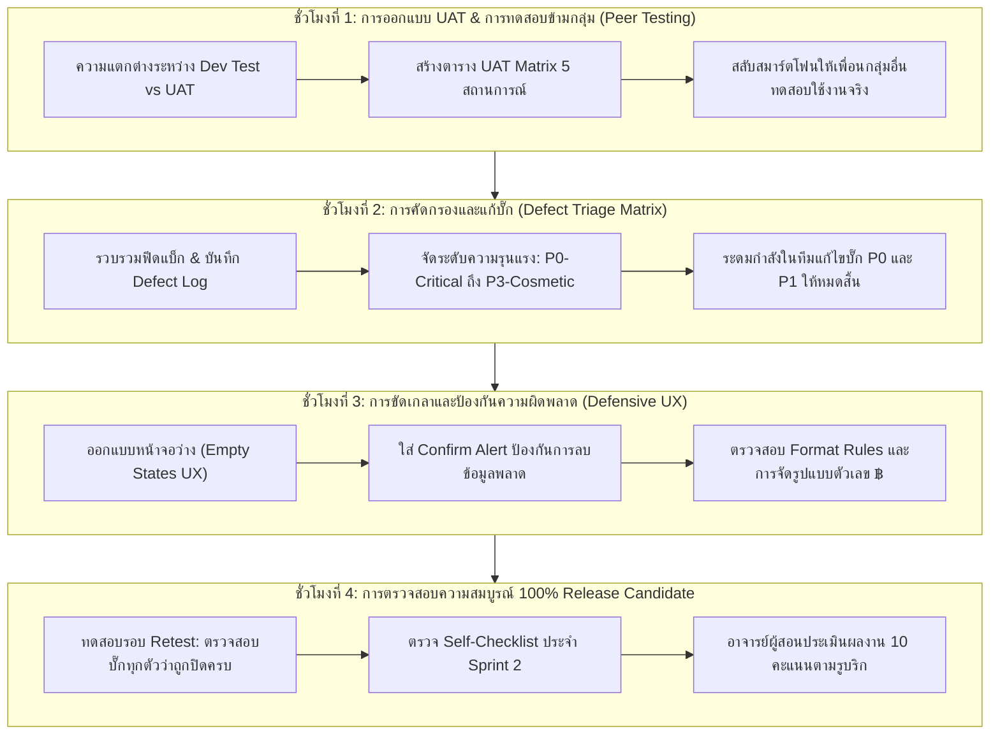
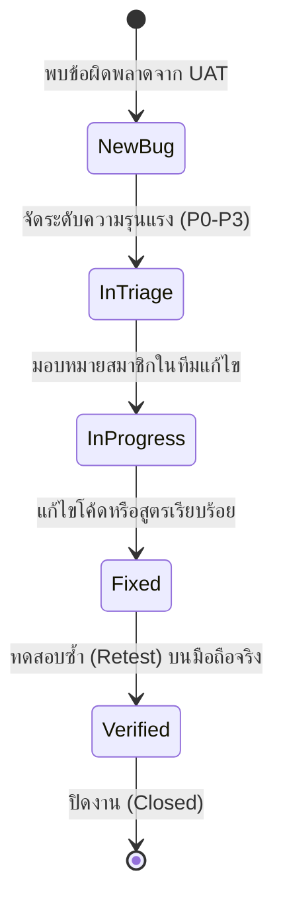

# บทที่ 14: การทดสอบระบบโดยผู้ใช้จริง การแก้บั๊ก และการขัดเกลาแอปพลิเคชัน (Sprint 2)
*(User Acceptance Testing, Defect Triage & Defensive UX Hardening Patterns)*

---

## 🎯 จุดประสงค์การเรียนรู้ประจำบท
เมื่อศึกษาบทเรียนนี้และปฏิบัติการตามขั้นตอนเสร็จสิ้น ผู้เรียนสามารถ:
1. อธิบายความสำคัญของกระบวนการ **User Acceptance Testing (UAT)** ในการทดสอบซอฟต์แวร์โดยผู้ใช้งานจริงที่ไม่ใช่ผู้พัฒนาแอปพลิเคชันได้
2. ออกแบบตารางสถานการณ์การทดสอบ **UAT Test Scenarios** อย่างน้อย 5 สถานการณ์หลักเพื่อครอบคลุมเส้นทางการใช้งานของผู้ใช้ (User Journeys)
3. ประยุกต์ใช้แบบแผน **Defect Tracking & Triage Matrix Pattern** เพื่อบันทึก จัดลำดับความรุนแรง (Severity: Critical, Major, Minor, Cosmetic) และติดตามการแก้บั๊กจนเสร็จสิ้น
4. ออกแบบหน้าจอตามหลัก **Defensive UX Hardening Pattern** เช่น การออกแบบหน้าจอว่าง (Empty States), การแจ้งเตือนยืนยันก่อนลบ (Confirm before Delete), และการป้องกันการกดปุ่มซ้ำ
5. ปิดช่องโหว่ความปลอดภัยด้วยการซ่อนปุ่มจัดการระบบจากผู้ใช้งานทั่วไป (Role-based Display Security ด้วยสูตร `USEREMAIL()`)
6. ขัดเกลาแอปพลิเคชันจากเวอร์ชัน Beta (80%) สู่ **Production Release Candidate (100% RC)** ตามบริบทของ **3 รูปแบบธุรกิจ (Archetypes)**
7. ร่วมมือกันในทีม 3 คนในการสลับเครื่องกับเพื่อนกลุ่มอื่นเพื่อทำ Peer Testing และบันทึกผลการตรวจสอบอย่างเป็นกลาง
8. ส่งตรวจความพร้อมสมบูรณ์ของแอปพลิเคชัน 100% และรับการประเมินตามเกณฑ์รูบริก 10 คะแนน

---

## 🧭 แผนผังการเรียนรู้ประจำสัปดาห์ที่ 14 (4 ชั่วโมง)



---

## 1. การทดสอบโดยผู้ใช้จริง (User Acceptance Testing - UAT)

ในวงการพัฒนาซอฟต์แวร์ ผู้พัฒนาแอป (Developers) มักมี **"จุดบอด (Developer Blind Spot)"** เพราะรู้ล่วงหน้าอยู่แล้วว่าต้องกดยังไง ไม่เผลอกดผิด และรู้ลำดับขั้นตอนในหัว แต่เมื่อนำแอปไปให้ **"ผู้ใช้จริง (Real Users / Customers)"** เล่น มักจะเกิดปัญหาที่คาดไม่ถึงเสมอ เช่น แตะปุ่มเร็วเกินไป กดช่องที่ห้ามกด หรือพิมพ์ข้อมูลประหลาด ๆ ลงในระบบ

```
┌────────────────────────────────────────────────────────────────────────┐
│                   เปรียบเทียบ Developer Testing กับ UAT                │
├─────────────────────┬──────────────────┬───────────────────────────────┤
│ มิติการทดสอบ        │ Developer Test   │ User Acceptance Testing (UAT) │
├─────────────────────┼──────────────────┼───────────────────────────────┤
│ ผู้ทำการทดสอบ       │ ตัวเราเองในกลุ่ม │ เพื่อนกลุ่มอื่น / คนภายนอก    │
├─────────────────────┼──────────────────┼───────────────────────────────┤
│ พฤติกรรมการกด       │ กดตามขั้นตอนตรงๆ │ กดลองของ, กดข้ามขั้น, กดเบิ้ล │
├─────────────────────┼──────────────────┼───────────────────────────────┤
│ จุดประสงค์          │ ดูว่าโค้ดรันผ่านไหม│ ดูว่าง่ายต่อมนุษย์จริงหรือไม่  │
└─────────────────────┴──────────────────┴───────────────────────────────┘
```

### 1.1 โครงสร้างตาราง UAT Test Scenarios
ให้นักศึกษาจัดทำตารางทดสอบสถานการณ์การใช้งานจริง 5 สถานการณ์หลัก:

```
┌────────────────────────────────────────────────────────────────────────────────────────┐
│                        ตารางทดสอบระบบจริง (UAT Test Matrix Template)                   │
├────┬─────────────────────────────┬───────────────────────────┬──────────────┬──────────┤
│ ID │ สถานการณ์การทดสอบ (Scenario)│ ผลลัพธ์ที่คาดหวัง (Expected)│ ผลจริง (Real)│ สถานะ    │
├────┼─────────────────────────────┼───────────────────────────┼──────────────┼──────────┤
│ TC1│ ค้นหาสินค้าด้วยการพิมพ์ชื่อ │ รายการกรองขึ้นมาถูกต้อง   │ ผ่าน         │ [PASS]   │
├────┼─────────────────────────────┼───────────────────────────┼──────────────┼──────────┤
│ TC2│ สแกน QR Code เพื่อเปิดประวัติ│ กล้องเปิดและเด้งข้อมูลทันที│ กล้องเปิดช้า │ [PASS]   │
├────┼─────────────────────────────┼───────────────────────────┼──────────────┼──────────┤
│ TC3│ ใส่จำนวนสินค้าเป็น -5 ชิ้น  │ มีข้อความสีแดงเตือนห้ามลบ │ บันทึกผ่าน!  │ [FAIL] ❌│
├────┼─────────────────────────────┼───────────────────────────┼──────────────┼──────────┤
│ TC4│ กดสั่งซื้อโดยไม่เลือกสินค้า │ ระบบแจ้งเตือนให้เลือกของ  │ ผ่าน         │ [PASS]   │
├────┼─────────────────────────────┼───────────────────────────┼──────────────┼──────────┤
│ TC5│ แตะปุ่มยืนยันชำระเงิน       │ มีป๊อปอัปเตือนยอดเงินรวม  │ ผ่าน         │ [PASS]   │
└────┴─────────────────────────────┴───────────────────────────┴──────────────┴──────────┘
```

---

## 2. การคัดกรองและบริหารจัดการบั๊ก (Defect Triage Matrix)

เมื่อพบข้อผิดพลาดจากการทำ UAT ห้ามแก้ไขสะเปะสะปะโดยไม่มีแบบแผน ให้ใช้ **Defect Triage Matrix** ในการจัดลำดับความสำคัญ:

```
┌────────────────────────────────────────────────────────────────────────┐
│               การจัดระดับความรุนแรงของข้อผิดพลาด (Severity Levels)     │
├──────────────┬──────────────────────────────┬──────────────────────────┤
│ ระดับความผิด │ คำอธิบายพฤติกรรม             │ แนวทางแก้ไข              │
├──────────────┼──────────────────────────────┼──────────────────────────┤
│ P0 : Blocker │ แอปค้าง เด้งหลุด ข้อมูลหาย   │ 🚨 ทุกคนต้องหยุดงานอื่น  │
│ (วิกฤตสูงสุด)│ คำนวณเงินผิด หรือบันทึกไม่ได้│    แล้วร่วมกันแก้ทันที!  │
├──────────────┼──────────────────────────────┼──────────────────────────┤
│ P1 : Major   │ ฟังก์ชันหลักเสียหาย          │ ⚠️ ต้องแก้ให้เสร็จสิ้น   │
│ (รุนแรงมาก)  │ เช่น สแกนกล้องไม่ติด         │    ก่อนปล่อย Release 100%│
├──────────────┼──────────────────────────────┼──────────────────────────┤
│ P2 : Minor   │ ฟังก์ชันรองทำงานผิดพลาด      │ 🔧 แก้ไขตามลำดับถัดมา    │
│ (ปานกลาง)    │ เช่น แจ้งเตือนข้อความไม่ชัดเจน│                          │
├──────────────┼──────────────────────────────┼──────────────────────────┤
│ P3 : Cosmetic│ ความสวยงาม ฟอนต์เอียง        │ 🎨 แก้ไขเมื่อมีเวลาเหลือ  │
│ (เล็กน้อย)   │ การจัดตำแหน่งวรรคตอน         │                          │
└──────────────┴──────────────────────────────┴──────────────────────────┘
```



---

## 3. สถาปัตยกรรมป้องกันความผิดพลาด (Defensive UX Hardening)

เพื่อยกระดับแอปจากงานนักศึกษา ให้กลายเป็น **"ซอฟต์แวร์พาณิชย์เกรดองค์กร"** เราต้องติดตั้งมาตรการ Defensive UX 3 ด้าน:

### 3.1 การจัดการหน้าจอว่าง (Empty State Pattern)
เมื่อผู้ใช้เพิ่งเปิดแอปครั้งแรก และยังไม่มีรายการสั่งซื้อ หากปล่อยให้หน้าจอเป็นพื้นที่ว่างเปล่าสีขาว ผู้ใช้จะเข้าใจผิดว่าแอปพังหรือไม่โหลด!
- ให้เปิดเมนู **UX ➔ Localize**:
  - กำหนดข้อความเมื่อไม่มีข้อมูล: `"ยังไม่มีรายการคำสั่งซื้อในขณะนี้ แตะปุ่ม [+] ด้านล่างเพื่อเริ่มเปิดบิลใหม่ได้เลย"`

```
┌───────────────────────────────────────┐
│                                       │
│                📋                     │
│         ( ยังไม่มีคำสั่งซื้อ )         │
│                                       │
│   แตะปุ่มเครื่องหมายบวก [+] ด้านล่าง   │
│       เพื่อเริ่มเปิดบิลใหม่ได้เลย     │
│                                       │
│                                 [+]   │
└───────────────────────────────────────┘
```

---

### 3.2 การยืนยันก่อนลบข้อมูลสำคัญ (Confirm Before Delete)
ป้องกันพนักงานมือลั่นไปกดโดนรูปถังขยะ `[🗑️]` ลบใบสั่งซื้อหรือลบรายการสินค้าทิ้ง:
- ไปที่ **Actions ➔ Delete (ของตาราง Orders)**:
  - หัวข้อ **Behavior**:
    - ติ๊กถูก **`[✓] Needs confirmation?`**
    - ใส่ข้อความเตือนภัยสีแดง:
      ```excel
      ="คุณแน่ใจหรือไม่ว่าต้องการลบใบสั่งซื้อเลขที่ " & [Order_ID] & " ทิ้งถาวร? การกระทำนี้ไม่สามารถย้อนกลับได้!"
      ```

---

### 3.3 การจัดรูปแบบตัวเลขและสกุลเงิน (Formatting Polish)
- ทุกคอลัมน์ที่เป็นราคาเงิน ให้ระบุ Currency Symbol เป็น **`฿`** หรือ **`THB`**
- กำหนดทศนิยม 2 ตำแหน่งให้สม่ำเสมอทั้งแอป เช่น `150.00 ฿` (ไม่ใช่บางหน้าแสดง `150` บางหน้าแสดง `150.0`)
- กำหนดสีสถานะ (Format Rules):
  - สถานะ `Pending` ➔ ตัวอักษรสีส้ม (เตือนให้รีบจัดการ)
  - สถานะ `Paid` / `Completed` ➔ ตัวอักษรสีเขียว (สำเร็จเรียบร้อย)
  - สถานะ `Cancelled` ➔ ตัวอักษรสีเทาหรือขีดฆ่า

---

## 4. เวิร์กช็อปขัดเกลาระบบ 3 รูปแบบธุรกิจสู่ Release Candidate (100% RC)

---

### ☕ รูปแบบที่ 1: Retail & Food Ordering (Fresh Brew & Bakery)
1. **การป้องกันข้อผิดพลาดในฟอร์ม:**
   - เช็กสูตร `Valid_If` ในช่อง `Quantity`: `AND([_THIS] >= 1, [_THIS] <= 20)` (ห้ามสั่งติดลบ และห้ามสั่งเกิน 20 แก้วต่อรายการ)
   - ป้องกันการลืมใส่อีเมลลูกค้าก่อนกดรับเงิน: ในปุ่ม Action รับเงิน ให้ใส่เงื่อนไข `ISNOTBLANK([Customer_Email])`
2. **การขัดเกลา UX:**
   - เพิ่มภาพถ่ายของเครื่องดื่มและขนมให้มีโทนแสงเดียวกันตามกฎ 60-30-10
   - ตรวจสอบให้แน่ใจว่าไฟล์ PDF ใบเสร็จแสดงรายการเครื่องดื่มพร้อมระดับความหวานครบถ้วน

---

### 🐾 รูปแบบที่ 2: Service & Booking Appointments (Happy Paws Care)
1. **การป้องกันข้อผิดพลาดในฟอร์ม:**
   - ป้องกันการเลือกวันนัดหมายในอดีต: `Valid_If: [_THIS] >= TODAY()`
   - ป้องกันการเลือกเวลาที่อยู่นอกเวลาทำการ: กำหนดให้เลือกได้เฉพาะ `09:00` ถึง `18:00`
2. **การขัดเกลา UX:**
   - ใส่ไอคอนสัตว์เลี้ยงน่ารัก (🐶, 🐱) แยกตามประเภทสัตว์
   - มีป๊อปอัปแจ้งเตือนเจ้าของสัตว์เลี้ยงให้นำสมุดวัคซีนมาด้วยในวันนัดหมาย

---

### 📦 รูปแบบที่ 3: Asset Tracking & Operations (Smart Equipment Borrow)
1. **การป้องกันข้อผิดพลาดในฟอร์ม:**
   - ป้องกันการเบิกอุปกรณ์ที่ถูกคนอื่นยืมไปแล้ว: ตรวจสอบสถานะอุปกรณ์ต้องเป็น `"Available"` เท่านั้น
   - บังคับให้เซ็นชื่อผู้ยืมก่อนกดบันทึก: `Required?: TRUE`
2. **การขัดเกลา UX:**
   - เพิ่มปุ่มกรองหมวดหมู่ครุภัณฑ์ (กล้อง, เสียง, แสง, คอมพิวเตอร์) ด้วย Quick Filter
   - ใส่สีเตือนอุปกรณ์ที่เลยกำหนดส่งคืน (Overdue Return) เป็นสีแดงกะพริบ

---

## 5. การแบ่งบทบาทหน้าที่ของสมาชิก 3 คนในทีม (Hardening Matrix)

```
┌────────────────────────────────────────────────────────────────────────┐
│                   บทบาทหน้าที่ของสมาชิกในทีม (Sprint 2 Matrix)         │
├─────────────────────┬──────────────────────────────────────────────────┤
│ สมาชิกคนที่ 1       │ UAT Coordinator & Quality Lead                   │
│ (หัวหน้าทดสอบระบบ)  │ - นำเครื่องไปให้เพื่อนกลุ่มอื่นทดลองใช้งาน       │
│                     │ - บันทึกตาราง UAT Matrix และจับภาพหน้าจอบั๊ก     │
│                     │ - ควบคุมกระดาน Defect Triage และจัดระดับความรุนแรง│
├─────────────────────┼──────────────────────────────────────────────────┤
│ สมาชิกคนที่ 2       │ Defensive UX & Visual Polish Designer            │
│ (นักออกแบบความปลอดภัย│ - ติดตั้งข้อความ Empty States ทั้งระบบ           │
│                     │ - ใส่ระบบยืนยัน Confirm Before Delete ทุกจุดสำคัญ│
│                     │ - จัดรูปแบบสัญลักษณ์เงิน ฿ และความสวยงามของฟอนต์ │
├─────────────────────┼──────────────────────────────────────────────────┤
│ สมาชิกคนที่ 3       │ Defect Resolution & Release Candidate Engineer   │
│ (วิศวกรแก้บั๊ก)     │ - ลงมือแก้สูตรและตรรกะใน AppSheet เพื่อปิดบั๊ก   │
│                     │ - ตรวจสอบการล็อกสิทธิ์ และความเร็วในการเปิดแอป   │
│                     │ - ตรวจสอบ Self-Checklist เตรียมปล่อยเวอร์ชัน 100%│
└─────────────────────┴──────────────────────────────────────────────────┘
```

---

## 6. แบบตรวจสอบตนเองก่อนส่งงาน (Self-Checklist ประจำบทที่ 14)

ให้นักศึกษาตรวจสอบความเรียบร้อยของชิ้นงานให้ครบทุกข้อก่อนส่งให้อาจารย์ผู้สอนประเมิน:

- [ ] **1. ตารางบันทึกการทดสอบ UAT (UAT Matrix):** มีตารางบันทึกผลการทดสอบจากผู้ใช้นอกกลุ่มอย่างน้อย 5 สถานการณ์ครบถ้วน
- [ ] **2. การปิดบั๊กตามลำดับความสำคัญ (Zero Critical Bugs):** ข้อผิดพลาดระดับ P0 (Blocker) และ P1 (Major) ได้รับการแก้ไขและทดสอบซ้ำจนปิดหมด 100%
- [ ] **3. หน้าจอว่างที่เป็นมิตร (Empty States):** มีข้อความแนะนำผู้ใช้ในหน้าจอที่ยังไม่มีข้อมูล ไม่ปล่อยให้หน้าจอด้านหลังโล่งขาว
- [ ] **4. ระบบยืนยันความปลอดภัย (Defensive Confirmation):** มีกล่องแจ้งเตือนยืนยันก่อนลบข้อมูล หรือก่อนเปลี่ยนสถานะสำคัญเสมอ
- [ ] **5. ความประณีตของข้อมูลและสกุลเงิน (Visual Polish):** ตัวเลขเงินแสดงสัญลักษณ์ ฿ พร้อมทศนิยม 2 ตำแหน่งสม่ำเสมอ และสีสถานะถูกต้อง
- [ ] **6. ความพร้อมระดับ Production Release Candidate (100% RC):** แอปพลิเคชันทำงานได้สมบูรณ์แบบ ไม่พัง ไม่ค้าง พร้อมนำเสนอในวัน Demo Day

---

## 7. เกณฑ์การประเมินผลงาน 10 คะแนน (Rubric Assessment Matrix)

| มิติการประเมิน (Assessment Dimensions) | ระดับดีมาก (Good: 9-10 คะแนน) | ระดับผ่านเกณฑ์ (Pass: 7-8 คะแนน) | ระดับต้องปรับปรุง (Needs Work: 0-6 คะแนน) |
| :--- | :--- | :--- | :--- |
| **1. คุณภาพการทดสอบ UAT และการบริหารบั๊ก**<br>*(น้ำหนัก 4 คะแนน)* | มีตาราง UAT Matrix ละเอียด มีหลักฐานการทดสอบโดยคนภายนอก บันทึก Defect Log ชัดเจน และแก้บั๊ก Critical ครบ 100% | มีตาราง UAT และแก้บั๊กสำคัญแล้ว แต่ยังมีบั๊กระดับย่อยตกค้างอยู่บ้าง | ไม่มีตาราง UAT หรือไม่ได้นำแอปไปให้ผู้อื่นทดลองใช้งานจริง |
| **2. ความประณีตตามหลัก Defensive UX**<br>*(น้ำหนัก 3 คะแนน)* | ติดตั้ง Empty States, Confirm Alerts, ป้องกันการกรอกข้อมูลผิดพลาด และจัดรูปแบบสกุลเงิน ฿ ได้สมบูรณ์แบบระดับมืออาชีพ | มีระบบยืนยันก่อนลบ แต่ยังขาดหน้า Empty State หรือจัดรูปแบบตัวเลขไม่สม่ำเสมอ | ไม่มีระบบป้องกันความผิดพลาด ผู้ใช้สามารถพิมพ์ข้อมูลติดลบหรือลบข้อมูลได้โดยไม่เตือน |
| **3. ความสมบูรณ์ของแอป 100% RC และการทำงานเป็นทีม**<br>*(น้ำหนัก 3 คะแนน)* | แอปสมบูรณ์ระดับ Release Candidate 100% ไร้ที่ติ สมาชิก 3 คนนำเสนอจุดที่ปรับปรุงแก้ไขได้อย่างชัดเจนและภาคภูมิใจ | แอปทำงานได้ 100% แต่การตอบคำถามเรื่องการแก้บั๊กยังตอบได้ไม่ครบทุกคน | แอปยังมีข้อผิดพลาดร้ายแรงที่ทำให้ระบบหยุดทำงาน |

---

> 🏆 **สรุปท้ายบท:** ยอดเยี่ยมอย่างถึงที่สุด! ขณะนี้แอปพลิเคชันธุรกิจของนักศึกษาก้าวสู่ความสมบูรณ์แบบระดับ **Production Release Candidate (100%)** ที่ผ่านการทดสอบจริงจากผู้ใช้และอุดช่องโหว่ความผิดพลาดเรียบร้อยแล้ว ในสัปดาห์หน้า (บทที่ 15 ซึ่งเป็นบทสุดท้ายของรายวิชา) เราจะเข้าสู่งาน **Demo Day** ที่ทุกกลุ่มจะได้นำเสนอแอปพลิเคชันบนเวทีจริง พร้อมแจกลิงก์และ QR Code ให้คณะกรรมการได้ทดลองเล่นบนสมาร์ตโฟนของตนเอง!
