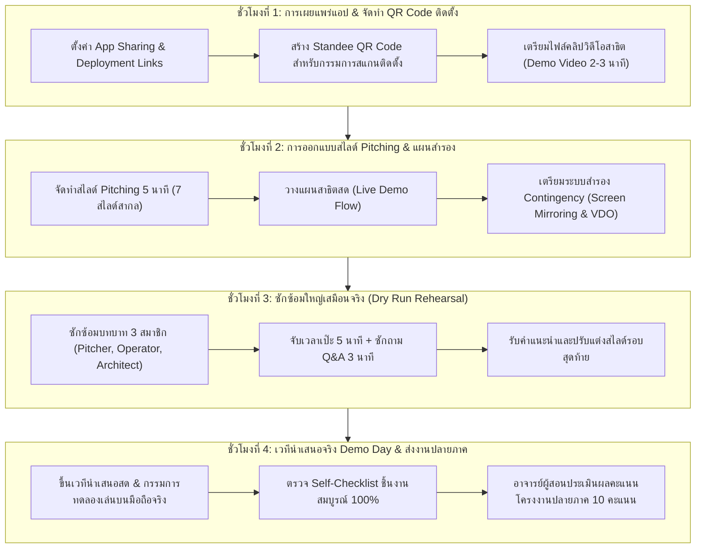

# บทที่ 15: การนำเสนอผลงานในวัน Demo Day การเผยแพร่แอป และการจัดแสดงผลงาน
*(Live Demonstration, Application Distribution & Product Showcase Pitching Patterns)*

---

## 🎯 จุดประสงค์การเรียนรู้ประจำบท
เมื่อศึกษาบทเรียนนี้และปฏิบัติการตามขั้นตอนเสร็จสิ้น ผู้เรียนสามารถ:
1. ปรับแต่งการตั้งค่าการเผยแพร่แอปพลิเคชัน **Application Distribution & Deployment Pattern** โดยสร้าง Install Link และ QR Code สำหรับให้ผู้ใช้งานติดตั้งบนหน้าจอสมาร์ตโฟน (PWA Experience) ได้
2. วางโครงสร้างการสาธิตระบบสด **Live Demonstration Pattern** ตามลำดับขั้นตอน Problem ➔ Solution ➔ Walkthrough ➔ Business Impact ได้อย่างราบรื่น
3. จัดเตรียมแผนสำรองความเสี่ยงฉุกเฉิน **Contingency Backup Plan** เพื่อป้องกันปัญหาข้อขัดข้องทางเทคนิคขณะสาธิตสดต่อหน้าคณะกรรมการ
4. ออกแบบสไลด์การนำเสนอเชิงธุรกิจดิจิทัล **Pitching Deck 5 นาที (7 สไลด์มาตรฐานสากล)** เพื่อสื่อสารคุณค่าและผลกระทบเชิงพาณิชย์ของแอปพลิเคชัน
5. ผลิตคลิปวิดีโอสาธิตการใช้งาน **Product Demo Walkthrough Video ความยาว 2-3 นาที** สำหรับจัดแสดงและเก็บเป็นผลงานดิจิทัลพอร์ตโฟลิโอ (Digital Portfolio)
6. สาธิตการทำงานจริงของแอปพลิเคชันระดับ Production 100% ครอบคลุมทั้ง **3 รูปแบบธุรกิจ (Archetypes)**
7. แบ่งบทบาทหน้าที่การนำเสนอบนเวทีของสมาชิกทั้ง 3 คน (Business Pitcher, Live Operator, Tech Architect) ได้อย่างมืออาชีพ
8. เข้ารับการประเมินผลสัมฤทธิ์ปลายภาคเรียน (Final Capstone Assessment) ตามเกณฑ์รูบริก 10 คะแนนได้อย่างยอดเยี่ยม

---

## 🧭 แผนผังการเรียนรู้ประจำสัปดาห์ที่ 15 (4 ชั่วโมง)



---

## 1. สถาปัตยกรรมเผยแพร่แอปพลิเคชัน (Application Distribution & Deployment)

การพัฒนาแอปพลิเคชันจะไม่มีประโยชน์เลยหากผู้ใช้งานเป้าหมายไม่สามารถติดตั้งหรือเปิดใช้งานบนสมาร์ตโฟนของตนเองได้ ใน AppSheet มีรูปแบบการแจกจ่ายแอปพลิเคชัน (Distribution Links) ที่ง่ายและสะดวกรวดเร็วโดยไม่ต้องรอการอนุมัติจาก App Store หรือ Play Store นานหลายสัปดาห์

```
┌────────────────────────────────────────────────────────────────────────┐
│             ประเภทของลิงก์เผยแพร่แอปพลิเคชันใน AppSheet                │
├──────────────────────┬─────────────────────────────────────────────────┤
│ 1. Browser Link      │ ลิงก์สำหรับเปิดใช้งานผ่านเว็บเบราว์เซอร์บน PC    │
│    (Desktop View)    │ เหมาะสำหรับผู้บริหารตรวจดูรายงานบนหน้าจอคอมพิวเตอร์│
├──────────────────────┼─────────────────────────────────────────────────┤
│ 2. Install Link      │ ลิงก์สำหรับเปิดบนสมาร์ตโฟน (Android / iOS)      │
│    (Mobile PWA)      │ ระบบจะแนะนำให้กด "เพิ่มลงในหน้าจอโฮม"          │
│                      │ ➔ ได้ไอคอนแอปสวยงามบนหน้าจอมือถือเหมือนแอปแท้ๆ │
└──────────────────────┴─────────────────────────────────────────────────┘
```

### 1.1 ขั้นตอนการดึงลิงก์และสร้าง QR Code ติดตั้ง (Click-by-Click)
1. ในหน้าคอนโซล AppSheet ไปที่เมนู **Manage ➔ Deploy ➔ Links**
2. คัดลอกลิงก์ในช่อง **`Install Link`**
3. นำลิงก์ไปแปลงเป็นภาพ QR Code (เช่น ผ่านเว็บ Canva หรือสูตรสร้าง QR Code ของ Google Sheets)
4. จัดทำป้าย **Standee QR Code** ขนาดกะทัดรัด พร้อมพิมพ์ข้อความ:
   ```
   📱 "สแกนที่นี่ เพื่อทดลองใช้งานแอปพลิเคชันบนสมาร์ตโฟนของท่าน"
   ```
5. ในวัน Demo Day ให้ตั้งป้าย Standee นี้ไว้ที่โต๊ะคณะกรรมการ เพื่อให้กรรมการสามารถยกมือถือขึ้นมายิงสแกนและร่วมกดเล่นไปพร้อมกับการนำเสนอได้ทันที!

---

## 2. ศิลปะการสาธิตระบบสด (Live Demonstration Pattern)

สิ่งที่สร้างความตื่นเต้นและคะแนนสูงสุดในวัน Demo Day คือการ **"สาธิตแอปพลิเคชันบนมือถือจริงแบบสด ๆ (Live Demo)"** ไม่ใช่การเปิดแคปหน้าจอภาพนิ่งมาอ่านตามสไลด์

```
┌────────────────────────────────────────────────────────────────────────┐
│               โครงสร้างการสาธิตระบบสด 5 นาที (Live Demo Flow)          │
├──────────────┬──────────────────┬──────────────────────────────────────┤
│ ช่วงเวลา     │ ผู้รับผิดชอบ     │ สิ่งที่ต้องสื่อสารและสาธิต           │
├──────────────┼──────────────────┼──────────────────────────────────────┤
│ นาทีที่ 0-1  │ Business Pitcher │ • ปัญหาเดิมของธุรกิจ (Pain Point)    │
│ (ปัญหา & ทางออก)│                │ • คุณค่าและโซลูชันของแอปพลิเคชันเรา  │
├──────────────┼──────────────────┼──────────────────────────────────────┤
│ นาทีที่ 1-3.5│ Live Operator    │ • สะท้อนจอมือถือขึ้นจอโปรเจกเตอร์ใหญ่ │
│ (สาธิตระบบสด)│ (ถือสมาร์ตโฟนจริง)│ 1. สั่งของ/จองบริการ ➔ คำนวณเงินสด   │
│              │                  │ 2. สแกน QR Code / บาร์โค้ดสินค้า     │
│              │                  │ 3. แตะปุ่มนำทาง Google Maps          │
│              │                  │ 4. เซ็นชื่อดิจิทัลรับของ             │
│              │                  │ 5. โชว์อีเมลใบเสร็จ PDF ที่เด้งเข้าทันที│
├──────────────┼──────────────────┼──────────────────────────────────────┤
│ นาทีที่ 3.5-5│ Tech Architect   │ • ไฮไลต์สถาปัตยกรรมเบื้องหลัง        │
│ (ผลกระทบ & จบ)│ & สมาชิกทุกคน   │ • ผลลัพธ์เชิงธุรกิจ (ประหยัดเวลา/เงิน)│
│              │                  │ • สรุปจบ เชิญชวนทดลองเล่น & ถาม-ตอบ │
└──────────────┴──────────────────┴──────────────────────────────────────┘
```

---

## 3. การเตรียมแผนสำรองความเสี่ยง (Contingency Backup Plan)

ในวงการไอทีมีสุภาษิตว่า *"เมื่อใดที่ต้องเดโมสดต่อหน้าคนดู ระบบมีโอกาสล่มเสมอ (Murphy's Law)"* ไม่ว่าจะเป็นเน็ตวิทยาลัยหลุด แบตเตอรี่มือถือหมด หรือโปรเจกเตอร์ดับ ทีมมืออาชีพจึงต้องเตรียม **แผนสำรอง 3 ระดับ**:

```
┌────────────────────────────────────────────────────────┐
│          ระดับแผนสำรองฉุกเฉิน (The Contingency Tiers)  │
├─────────────────┬──────────────────────────────────────┤
│ แผน A (หลัก)    │ สะท้อนหน้าจอมือถือสดขึ้นโปรเจกเตอร์  │
│                 │ (ผ่านแอป Cast / Mirroring / สายแปลง) │
├─────────────────┼──────────────────────────────────────┤
│ แผน B (สำรอง 1) │ เปิดแอปผ่าน Browser Link บนโน้ตบุ๊ก   │
│                 │ และใช้เมาส์คลิกสาธิตแทนหน้าจอมือถือ  │
├─────────────────┼──────────────────────────────────────┤
│ แผน C (สำรอง 2) │ เปิดคลิปวิดีโอ Screen Recording 2 นาที│
│                 │ ที่อัดบันทึกการใช้งานจริงไว้ล่วงหน้า │
└─────────────────┴──────────────────────────────────────┘
```

---

## 4. โครงสร้างสไลด์ Pitching 5 นาที (7 สไลด์มาตรฐานสากล)

ให้นักศึกษาจัดทำสไลด์นำเสนอด้วย Canva, PowerPoint, หรือ Google Slides โดยจำกัดเพียง **7 สไลด์** ดังนี้:

```
┌────────────────────────────────────────────────────────┐
│             สไลด์ที่ 1: หน้าปกและทีมพัฒนา              │
│  - ชื่อแอปพลิเคชัน โลโก้แบรนด์ สโลแกนโดนใจ             │
│  - รูปและชื่อสมาชิก 3 คน พร้อมระบุตำแหน่งในทีม         │
├────────────────────────────────────────────────────────┤
│             สไลด์ที่ 2: ปัญหาของธุรกิจจริง             │
│  - ปัญหาการจดบันทึกด้วยกระดาษ, ออร์เดอร์ตกหล่น         │
│  - การคำนวณเงินผิดพลาด, การไม่มีหลักฐานเซ็นรับของ      │
├────────────────────────────────────────────────────────┤
│             สไลด์ที่ 3: โซลูชันและฟังก์ชันหลัก         │
│  - ภาพ Mockup มือถือสวยงามจาก Figma                    │
│  - สรุป 4 ฟีเจอร์เด่น: แคตตาล็อก, สแกนเนอร์, GPS, บอท │
├────────────────────────────────────────────────────────┤
│             สไลด์ที่ 4: สถาปัตยกรรมเทคโนโลยี           │
│  - แผนภาพการไหลของข้อมูล (Google Sheets ➔ AppSheet ➔ Drive)│
│  - อัตลักษณ์แบรนด์ที่แปลงมาจาก Design Tokens           │
├────────────────────────────────────────────────────────┤
│             สไลด์ที่ 5: ช่วงสาธิตระบบสด (Live Demo)    │
│  - สลับสัญญาณภาพเข้าสู่หน้าจอมือถือจริง                │
├────────────────────────────────────────────────────────┤
│             สไลด์ที่ 6: ผลลัพธ์และคุณค่าทางธุรกิจ      │
│  - ลดเวลาการทำงานลง 70%, ประหยัดกระดาษ 100%           │
│  - ฟีดแบ็กความพึงพอใจจากการทดสอบ UAT ในสัปดาห์ที่ 14  │
├────────────────────────────────────────────────────────┤
│             สไลด์ที่ 7: บทสรุปและ QR Code ติดตั้ง      │
│  - QR Code ขนาดใหญ่ให้ทุกคนในห้องสแกนติดตั้งแอป       │
│  - ช่องทางติดต่อทีมพัฒนา และเปิดรับคำถาม Q&A           │
└────────────────────────────────────────────────────────┘
```

---

## 5. สถานการณ์นำเสนอของ 3 รูปแบบธุรกิจในวัน Demo Day

---

### ☕ รูปแบบที่ 1: Retail & Food Ordering (Fresh Brew & Bakery)
- **การเปิดเรื่อง:** "เคยไหมครับที่ร้านกาแฟช่วงเช้าคิวยาว ลูกค้าสั่งหวานน้อยแต่ได้หวานร้อย หรือไรเดอร์ส่งผิดบ้านเพราะมองไม่เห็นพิกัด..."
- **การสาธิตสด:**
  1. กดสั่งเมนูกาแฟพิเศษ เลือกความหวาน 25% ➔ ยอดเงิน 185 บาทคำนวณเป๊ะ
  2. สแกนบัตรสมาชิกลูกค้าดึงส่วนลด
  3. แตะปุ่ม Action ส่งของ ➔ เปิด Google Maps วิ่งนำทาง
  4. ลูกค้าเซ็นลายมือชื่อรับมอบเครื่องดื่ม
  5. กรรมการเปิดดูอีเมลใบเสร็จรับเงิน PDF ที่ระบบส่งให้ทันที

---

### 🐾 รูปแบบที่ 2: Service & Booking Appointments (Happy Paws Care)
- **การเปิดเรื่อง:** "เจ้าของสัตว์เลี้ยงมักกังวลเรื่องการส่งน้องหมาไปอาบน้ำตัดขนโดยไม่มีการบันทึกประวัติ หรือจำไม่ได้ว่าฉีดวัคซีนครั้งล่าสุดเมื่อใด..."
- **การสาธิตสด:**
  1. สแกน QR Code ปลอกคอน้องหมา ➔ ประวัติและชื่อเจ้าของเด้งขึ้นมาทันที
  2. จองแพ็กเกจสปาและวัคซีน ➔ ระบบเช็กเวลาว่างอัตโนมัติ
  3. เจ้าของเซ็นยินยอมบนหน้าจอมือถือ
  4. แตะปุ่มเปลี่ยนสถานะเป็นรับบริการเสร็จสิ้น ➔ บอทส่งใบนัดหมายรอบถัดไปเข้าอีเมล

---

### 📦 รูปแบบที่ 3: Asset Tracking & Operations (Smart Equipment Borrow)
- **การเปิดเรื่อง:** "องค์กรสูญเสียอุปกรณ์มูลค่าหลายแสนบาทในแต่ละปี เพราะใช้สมุดจดชื่อผู้ยืม พอพัสดุหายก็หาตัวคนรับผิดชอบไม่ได้..."
- **การสาธิตสด:**
  1. เปิดฟอร์มเบิก ยิงสแกนบาร์โค้ดบนกล่องกล้อง Sony และไมค์ไร้สาย 2 ชิ้น
  2. ระบุพิกัดไซต์งานถ่ายทำนอกสถานที่
  3. ผู้เบิกเซ็นชื่อรับมอบอุปกรณ์ ➔ ล็อกเวลาและพิกัด GPS อัตโนมัติ
  4. อนุมัติการเบิก ➔ ระบบสร้างใบเบิกพัสดุราชการ PDF พร้อมส่งเข้าอีเมลหัวหน้าแผนก

---

## 6. การแบ่งบทบาทหน้าที่ 3 สมาชิกบนเวทีนำเสนอ (Presentation Triad)

```
┌────────────────────────────────────────────────────────────────────────┐
│                   บทบาทหน้าที่ของสมาชิกบนเวที (Stage Matrix)           │
├─────────────────────┬──────────────────────────────────────────────────┤
│ สมาชิกคนที่ 1       │ Business Pitcher & Emcee                         │
│ (ผู้นำเสนอธุรกิจ)   │ - กล่าวทักทาย เปิดประเด็นปัญหา Pain Point         │
│                     │ - เล่าคุณค่าทางธุรกิจ และฟีดแบ็กจาก UAT          │
│                     │ - ควบคุมเวลาการพูดให้จบภายใน 5 นาทีเป๊ะ          │
├─────────────────────┼──────────────────────────────────────────────────┤
│ สมาชิกคนที่ 2       │ Live Pilot & Mobile Operator                     │
│ (ผู้ควบคุมการสาธิต) │ - ถือสมาร์ตโฟนจริงต่อสายสะท้อนหน้าจอขึ้นโปรเจกเตอร์│
│                     │ - กดใช้งานแอปพลิเคชันอย่างมั่นใจ เป็นจังหวะกับเสียงพูด│
│                     │ - โชว์การสแกนกล้อง, เซ็นชื่อ, แผนที่, และใบเสร็จ  │
├─────────────────────┼──────────────────────────────────────────────────┤
│ สมาชิกคนที่ 3       │ Technical Architect & Slide Controller           │
│ (วิศวกรโครงสร้าง)   │ - ควบคุมการเปลี่ยนสไลด์ และดูแลระบบสำรอง         │
│                     │ - อธิบายโครงสร้างข้อมูล Sheets, Relations, Bots  │
│                     │ - เป็นผู้ตอบคำถามเชิงลึกในข้อซักถามทางเทคนิค     │
└─────────────────────┴──────────────────────────────────────────────────┘
```

---

## 7. แบบตรวจสอบตนเองขั้นสุดท้าย (Self-Checklist ประจำบทที่ 15)

ให้นักศึกษาตรวจสอบความพร้อมสูงสุดของทีมก่อนขึ้นเวทีนำเสนอ:

- [ ] **1. ลิงก์และ QR Code ติดตั้ง (Install Standee):** มีป้าย QR Code ขนาดชัดเจน พร้อมให้กรรมการและผู้ชมยิงสแกนติดตั้งบนสมาร์ตโฟนได้จริง
- [ ] **2. สไลด์นำเสนอ 7 หน้า (Pitch Deck):** สไลด์จัดทำสวยงาม ฟอนต์อ่านง่าย ไม่มีตัวหนังสือยาวเป็นพืด มีภาพประกอบและสถิติชัดเจน
- [ ] **3. คลิปวิดีโอสาธิตการใช้งาน (Demo Video):** มีคลิปวิดีโอความยาว 2-3 นาที บันทึกการทำงานของแอปเก็บไว้ใน Google Drive เป็นแผนสำรอง
- [ ] **4. ความพร้อมของอุปกรณ์สาธิตสด (Live Device Readiness):** สมาร์ตโฟนชาร์จแบตเต็ม มีอินเทอร์เน็ตที่เสถียร และทดสอบสะท้อนจอสำเร็จ
- [ ] **5. การซักซ้อมบทบาท 3 คน (Rehearsal):** สมาชิกทั้ง 3 คนซักซ้อมร่วมกันอย่างน้อย 2 รอบ พูดคล่อง ไม่ติดขัด และควบคุมเวลาได้เป๊ะ 5 นาที
- [ ] **6. ความสมบูรณ์ของแอปพลิเคชัน 100% (Production Ready):** แอปพลิเคชันมีข้อมูลจริง ไม่มีบั๊กตกค้าง พร้อมส่งตรวจเป็นผลงานชิ้นเอกประจำรายวิชา

---

## 8. เกณฑ์การประเมินโครงงานปลายภาค 10 คะแนน (Final Capstone Rubric)

| มิติการประเมิน (Assessment Dimensions) | ระดับดีเยี่ยม (Exceptional: 9-10 คะแนน) | ระดับผ่านเกณฑ์ดี (Proficient: 7-8 คะแนน) | ระดับต้องปรับปรุง (Needs Work: 0-6 คะแนน) |
| :--- | :--- | :--- | :--- |
| **1. ประสิทธิภาพการสาธิตสดและแอป 100%**<br>*(น้ำหนัก 4 คะแนน)* | สาธิตบนสมาร์ตโฟนสดลื่นไหลไร้ที่ติ ระบบทำงานครบวงจร (สแกน, แผนที่, ลายเซ็น, บอท PDF) มี QR Code ให้กรรมการกดเล่นได้จริง 100% | สาธิตบนมือถือได้ แต่มีจุดสะดุดเล็กน้อย หรือต้องใช้แผนสำรองในการเปิดบางฟังก์ชัน | แอปพลิเคชันค้างขณะนำเสนอ ไม่สามารถสาธิตฟังก์ชันหลักให้กรรมการดูได้ |
| **2. ทักษะการ Pitching และการสื่อสารคุณค่าธุรกิจ**<br>*(น้ำหนัก 3 คะแนน)* | สไลด์ 7 หน้าสวยงามระดับสากล เล่าปัญหาและทางออกได้จับใจ ตอบคำถามกรรมการได้อย่างฉะฉาน ตรงประเด็น และควบคุมเวลา 5 นาทีได้เป๊ะ | สไลด์สวยงาม อธิบายได้ดี แต่อาจพูดเกินเวลาเล็กน้อย หรือตอบคำถามธุรกิจยังไม่ลึกซึ้ง | อ่านตามสไลด์ น้ำเสียงไม่น่าสนใจ สไลด์มีแต่ตัวหนังสือ หรือเวลาเกินมาก |
| **3. ความร่วมมือและการทำงานเป็นทีมบนเวที**<br>*(น้ำหนัก 3 คะแนน)* | สมาชิกทั้ง 3 คนมีบทบาทเด่นชัด ประสานงานรับส่งจังหวะการพูดและการกดมือถืออย่างเป็นธรรมชาติ ตอบคำถามช่วยกันอย่างสามัคคี | สมาชิก 3 คนแบ่งบทบาทได้ แต่จังหวะการพูดและการกดมือถือยังเหลื่อมล้ำกันบ้าง | มีสมาชิกคนเดียวพูดตลอดเวลา อีก 2 คนยืนเฉยๆ ไม่ได้มีส่วนร่วม |

---

> 🎓 **บทสรุปและสารแสดงความยินดีจากรายวิชา:**  
> ขอแสดงความยินดีอย่างสุดซึ้งกับนักศึกษาทุกคน! จากสัปดาห์ที่ 1 ที่เริ่มต้นจากการวางแนวคิดบนผืนผ้าใบว่างเปล่า ผ่านการออกแบบ UI บน Figma, การจัดระเบียบฐานข้อมูลบน Google Sheets, การเขียนสูตรคำนวณและสถาปัตยกรรมความสัมพันธ์, การเชื่อมต่อฮาร์ดแวร์กล้องและ GPS, ไปจนถึงการสร้างบอทอัตโนมัติบนคลาวด์ วันนี้พวกคุณทุกคนได้พิสูจน์แล้วว่า **"นักศึกษาธุรกิจดิจิทัลสามารถเป็นนักสร้างสรรค์นวัตกรรมซอฟต์แวร์ระดับโปรดักชันที่แก้ปัญหาให้ธุรกิจจริงได้อย่างยอดเยี่ยม"** ขอให้นำทักษะและความภาคภูมิใจนี้ไปต่อยอดสู่สายอาชีพและสร้างสรรค์สิ่งดี ๆ ให้กับสังคมดิจิทัลต่อไปในอนาคตครับ! 🎉🚀
