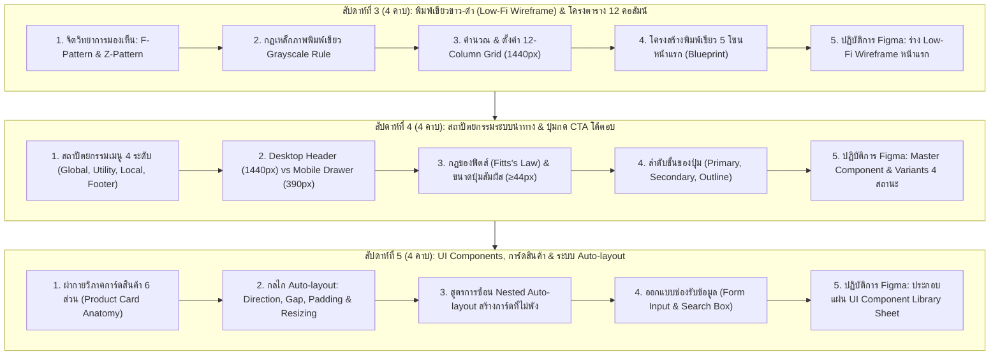

# บทที่ 2: งานออกแบบส่วนติดต่อผู้ใช้งาน (UI) และระบบนำทาง (Navigation)
*(Website User Interface Design and Navigation Architecture)*

วิชา: 31910-2026 โปรแกรมกราฟิกสำหรับการออกแบบเว็บไซต์ (ท-ป-น: 2-2-3)  
ระดับชั้น: ประกาศนียบัตรวิชาชีพชั้นสูง (ปวส.) ชั้นปีที่ 1 สาขาวิชาเทคโนโลยีธุรกิจดิจิทัล  
หน่วยการเรียนรู้: หน่วยที่ 2 (ครอบคลุมการเรียนการสอนสัปดาห์ที่ 3, 4 และ 5 รวม 12 คาบเรียน)  
อาจารย์ผู้สอน: ครูแม็ค (แผนกวิชาเทคโนโลยีธุรกิจดิจิทัล วิทยาลัยการอาชีพบ้านโป่ง)  

---

## 🎯 จุดประสงค์การเรียนรู้ประจำหน่วยที่ 2

เมื่อศึกษาเนื้อหาบทเรียนนี้และปฏิบัติการตามขั้นตอนเสร็จสิ้น ผู้เรียนสามารถ:
1. **ด้านความรู้ (Knowledge):**
   - อธิบายหลักการออกแบบส่วนติดต่อผู้ใช้งาน (User Interface: UI) และประสบการณ์ผู้ใช้ (User Experience: UX) สำหรับเว็บไซต์เชิงธุรกิจได้อย่างถูกต้อง
   - วิเคราะห์พฤติกรรมการกวาดสายตาของผู้ใช้งานตามหลัก **F-Pattern** และ **Z-Pattern** เพื่อวางตำแหน่งเนื้อหาสำคัญได้อย่างมีประสิทธิภาพ
   - อธิบายหลักการทางคณิตศาสตร์และประโยชน์ของระบบ **12-Column Responsive Grid System** บนหน้าจอความละเอียดสูงได้
   - อธิบายกฎของฟิตส์ (**Fitts's Law**) และหลักการยศาสตร์ของพื้นที่สัมผัสบนสมาร์ตโฟน (**Thumb Zone & Touch Target**) ได้
   - อธิบายกลไกการทำงานของระบบจัดช่องไฟอัตโนมัติ (**Auto-layout**) และคุณสมบัติการสลับสถานะ (**Variants**) บนโปรแกรม Figma ได้
2. **ด้านทักษะปฏิบัติการ (Skill):**
   - **สัปดาห์ที่ 3:** ตั้งค่า Frame Desktop ขนาด 1440px พร้อมเปิดใช้ระบบ 12-Column Grid และร่างพิมพ์เขียวหน้าแรกขาว-ดำ (**Low-Fidelity Wireframe**) ครบถ้วน 5 โซนหลักตามหลัก Grayscale Rule ได้
   - **สัปดาห์ที่ 4:** ออกแบบแถบเมนูนำทางทั้งระบบ **Desktop Navbar** (1440px) และ **Mobile Drawer Menu** (390px) พร้อมสร้างชุดปุ่มดำเนินการ (**Call-to-Action: CTA**) ที่มีระบบ Master Component & Variants ครบทั้ง 4 สถานะได้
   - **สัปดาห์ที่ 5:** ออกแบบการ์ดสินค้า (**Product Card**) ด้วยระบบ Nested Auto-layout ที่ยืดหยุ่นรองรับข้อความหลายบรรทัด และรวบรวมชิ้นส่วนทั้งหมดเข้าเป็นแผ่นคลังส่วนประกอบ (**UI Component Library Sheet**) ประจำแบรนด์ได้
3. **ด้านจิตพิสัยและจรรยาบรรณวิชาชีพ (Attitude):**
   - มีวินัยและความละเอียดรอบคอบในการจัดระเบียบและตั้งชื่อเลเยอร์ (**Layer Naming Convention**) เป็นภาษาอังกฤษตามมาตรฐานสากล
   - รักษาความแม่นยำในการเว้นระยะช่องไฟและขนาดองค์ประกอบตามระบบทวีคูณของแปด (**8-Point Grid System**)
   - ตระหนักถึงความสำคัญของการเข้าถึงที่เท่าเทียมของผู้ใช้งาน (**Web Accessibility: a11y**) ทั้งด้านขนาดปุ่มและคอนทราสต์ของข้อความ

---

## 🧭 แผนผังโครงสร้างการเรียนรู้ประจำหน่วย (สัปดาห์ที่ 3 - 5 | รวม 12 คาบ)



---

## บทนำ: จากกราฟิกสิ่งพิมพ์สู่สถาปัตยกรรม UI เว็บไซต์เชิงธุรกิจ

ในหน่วยที่ 1 นักศึกษาได้ผ่านการวิเคราะห์ระบบสี (Color Psychology 60-30-10), ตัวอักษรดิจิทัล (Typography), ขนาดหน้าจอแสดงผลแบบตอบสนอง (Responsive Breakpoints), และกฎหมายลิขสิทธิ์สื่อดิจิทัลมาแล้ว

เมื่อก้าวเข้าสู่ **หน่วยที่ 2** จะเป็นจุดเปลี่ยนสำคัญที่สุดของกระบวนการเรียนรู้ จากเดิมที่นักศึกษาหลายคนคุ้นเคยกับการสร้างงานกราฟิกสไตล์ **"สิ่งพิมพ์ (Print Graphic)"** เช่น โปสเตอร์ แผ่นพับ หรือป้ายไวนิลบน Photoshop/Illustrator ซึ่งเป็นงานขนาดตายตัว แผ่นเดียวจบ มีมิติเดียว แต่การก้าวเข้าสู่โลกของ **"การออกแบบส่วนติดต่อผู้ใช้งานเว็บไซต์ (Website User Interface - UI)"** นั้นมีวิธีคิดและบริบททางวิศวกรรมที่แตกต่างกันอย่างสิ้นเชิง:

```
┌─────────────────────────────────────────────────────────────────────────────────────────────┐
│                       ตารางเปรียบเทียบเชิงลึก: กราฟิกสิ่งพิมพ์ vs กราฟิก UI เว็บไซต์        │
├───────────────────────┬──────────────────────────────┬──────────────────────────────────────┤
│ มิติการพิจารณา        │ กราฟิกสิ่งพิมพ์ (Print Design)│ กราฟิก UI เว็บไซต์ (Web UI Design)  │
├───────────────────────┼──────────────────────────────┼──────────────────────────────────────┤
│ 1. พื้นที่การแสดงผล   │ ขนาดกระดาษตายตัว (A4, บิลบอร์ด)│ ยืดหยุ่นตามขนาดหน้าจอ (Desktop, Mobile)│
│ 2. ปฏิสัมพันธ์ของผู้ใช้│ รับสารทางสายตาอย่างเดียว (Static)│ คลิกได้, สัมผัสได้, เลื่อนหน้าจอได้   │
│ 3. สถานะขององค์ประกอบ │ มีสถานะเดียวหลังจากพิมพ์เสร็จ │ มีหลายสถานะ (Normal, Hover, Pressed)  │
│ 4. หน่วยวัดระยะ       │ มิลลิเมตร (mm), นิ้ว (inch), pt│ พิกเซลเชิงตรรกะ (CSS Logical Pixels) │
│ 5. โครงสร้างข้อมูล     │ จัดวางอิสระตามอารมณ์ศิลป์    │ อิงตามระบบ Grid, Hierarchy และ Auto-layout│
│ 6. เป้าหมายสูงสุด     │ ความสวยงาม สะดุดตา ชวนมอง    │ ใช้งานง่าย รวดเร็ว และสร้างยอดขายได้จริง│
└───────────────────────┴──────────────────────────────┴──────────────────────────────────────┘
```

### ทฤษฎีภาระการรู้คิด (Cognitive Load Theory) และกฎเหล็กของ Steve Krug
ในการออกแบบ UI สำหรับเว็บไซต์ธุรกิจ มีกฎทองคำข้อหนึ่งที่นักออกแบบระดับโลกยึดถือคือ **"Don't Make Me Think!" (อย่าให้ผู้ใช้ต้องคิด!)** ซึ่งเขียนโดย Steve Krug 

เมื่อลูกค้าเข้ามาที่หน้าเว็บไซต์ สมองของมนุษย์จะมีพลังงานจำกัด หากหน้าเว็บวางปุ่มสั่งซื้อไว้ในที่ที่หาไม่เจอ, ใช้ชื่อเมนูที่คลุมเครือ, หรือจัดวางเนื้อหาไร้ระเบียบ ลูกค้าจะเกิดภาวะ **Cognitive Overload (สมองล้าจากการประมวลผล)** และผลลัพธ์คือ **"ลูกค้าจะกดปิดหน้าเว็บทิ้งทันทีภายในเวลาไม่เกิน 5 วินาที"** 

หน้าที่ของนักออกแบบ UI ในบทนี้ คือการใช้โครงสร้างตาราง (Grid), ลำดับสายตา (Visual Hierarchy), และระบบนำทาง (Navigation) เพื่อชี้นำสายตาของลูกค้าให้ค้นหาสิ่งที่ต้องการและตัดสินใจซื้อสินค้าได้อย่างราบรื่นที่สุด

---

## ตอนที่ 1 (สัปดาห์ที่ 3): พิมพ์เขียวขาว-ดำ (Low-Fi Wireframe) และระบบโครงตาราง (Layout Grid)

```
┌────────────────────────────────────────────────────────────────────────────────┐
│ ข้อมูลการจัดการเรียนการสอนสัปดาห์ที่ 3:                                         │
│ • ระยะเวลา: 4 คาบเรียน (ทฤษฎีสถาปัตยกรรม 2 คาบ / ปฏิบัติการ Figma 2 คาบ)       │
│ • เครื่องมือหลัก: โปรแกรม Figma (Web Browser หรือ Desktop Application)           │
│ • ชิ้นงานส่งตรวจ: ลิงก์ไฟล์ Figma ชิ้นงานที่ 1: Low-Fi Wireframe หน้าแรก (5 คะแนน)│
└────────────────────────────────────────────────────────────────────────────────┘
```

### 1.1 ความหมายของ Wireframe และกฎเหล็ก Grayscale Rule

**Wireframe (ไวร์เฟรม)** คือ "พิมพ์เขียวเชิงสถาปัตยกรรม (Architectural Blueprint) ของหน้าจอเว็บไซต์" ที่ตัดองค์ประกอบด้านสีสัน ลวดลายตกแต่ง ฟอนต์วิจิตร และรูปภาพกราฟิกออกไปทั้งหมด คงเหลือไว้เพียงรูปทรงเรขาคณิตพื้นฐาน (กล่องสี่เหลี่ยม, วงกลม, เส้นตรง) และข้อความจำลอง เพื่อกำหนด 3 ประเด็นหลัก:
1. **Layout (การจัดวางตำแหน่ง):** การระบุว่าองค์ประกอบแต่ละส่วนจะอยู่ตำแหน่งใดบนหน้าจอ
2. **Visual Hierarchy (ลำดับความสำคัญของสายตา):** ข้อความหรือปุ่มใดควรเด่นสะดุดตาเป็นอันดับ 1, 2 และ 3
3. **Content Architecture (โครงสร้างเนื้อหา):** สัดส่วนของพื้นที่ข้อความ พื้นที่รูปภาพ และฟังก์ชันการทำงาน

```
┌───────────────────────────────────────────────────────────────────────────────┐
│                          วงจรชีวิตของการออกแบบ UI เว็บไซต์                    │
├─────────────────────┬─────────────────────────────────────────────────────────┤
│ 1. Sketch (ร่างมือ) │ วาดปากกาลงกระดาษเพื่อระดมไอเดียอย่างรวดเร็ว (5-10 นาที) │
│ 2. Wireframe (บทนี้) │ พิมพ์เขียวขาว-ดำบน Figma จัดระเบียบสัดส่วนและโครงสร้าง   │
│ 3. UI Mockup        │ ลงสีแบรนด์จริง ใส่ภาพสินค้าไดคัทสมบูรณ์ (สัปดาห์ที่ 11)   │
│ 4. Prototype        │ เชื่อมต่อจุดคลิกให้เปลี่ยนหน้าเสมือนเว็บจริง (สัปดาห์ที่ 14) │
└─────────────────────┴─────────────────────────────────────────────────────────┘
```

> [!IMPORTANT]
> **กฎเหล็กของสัปดาห์ที่ 3: Grayscale Rule (ห้ามใส่สีสันเด็ดขาด!)**
> ในการสร้าง Wireframe สัปดาห์นี้ นักศึกษาทุกคน **ห้ามใส่สีสด (ห้ามใช้สีแดง, สีเขียว, สีฟ้า, สีส้ม หรือสีประจำแบรนด์ใดๆ ทั้งสิ้น)** ให้ใช้เฉพาะเฉดสี Grayscale 4 โทนนี้เท่านั้น:
> - **สีขาว (`#FFFFFF`):** ใช้สำหรับพื้นหลังของหน้าจอ (Page Canvas)
> - **สีเทาอ่อนมาก (`#F3F4F6` ถึง `#E5E7EB`):** ใช้สำหรับกล่องพื้นที่ใส่รูปภาพ (Image Placeholder) หรือการ์ดรองรับเนื้อหา
> - **สีเทากลาง (`#9CA3AF` ถึง `#6B7280`):** ใช้สำหรับเส้นขอบ (Borders), เส้นแบ่งส่วน (Dividers), และข้อความอธิบายย่อย
> - **สีเทาเข้มถึงดำ (`#374151` ถึง `#111827`):** ใช้สำหรับหัวข้อหลัก (Headings), ไอคอนสำคัญ, และกล่องปุ่มกดหลัก

#### 3 เหตุผลทางจิตวิทยาที่ต้องบังคับใช้สีขาว-ดำในขั้น Wireframe:
1. **กำจัดอคติทางสายตา (Eliminate Visual Bias):** หากนักศึกษาใส่สีสดตั้งแต่แรก การตรวจงานจะกลายเป็นการถกเถียงเรื่องรสนิยมของสี เช่น "สีฟ้าเฉดนี้เข้มไปไหม" หรือ "ชอบสีชมพูมากกว่า" แทนที่จะตรวจสอบโครงสร้างจริงว่า "ลูกค้าหาปุ่มสั่งซื้อเจอหรือไม่"
2. **ตรวจจับจุดบกพร่องของโครงสร้างได้ทันที:** หน้าเว็บที่จัดโครงสร้างได้ดี แม้จะมีเพียงกล่องสีเทาขาว-ดำ ผู้ใช้ก็ต้องเข้าใจได้ทันทีว่าอะไรคือหัวข้อ อะไรคือรูปภาพ และอะไรคือปุ่มกด หากหน้าเว็บขาว-ดำยังอ่านไม่รู้เรื่อง การใส่สีสันลงไปจะยิ่งทำให้หน้าเว็บรกและเละเทะยิ่งขึ้น
3. **ความคล่องตัวในการแก้ไข (Rapid Iteration):** การปรับขยับกล่องสี่เหลี่ยมขาว-ดำใช้เวลาเพียง 5-10 วินาที แต่หากเป็นงานที่ลงกราฟิกสำเร็จรูปเต็มรูปแบบ การรื้อแก้เลย์เอาต์จะกินเวลาเพิ่มขึ้นเป็นชั่วโมง

---

### 1.2 สัญลักษณ์มาตรฐานสากลบนแผ่นพิมพ์เขียว Wireframe (Wireframe UI Kit)

เนื่องจากเราไม่ใส่รูปภาพจริง จึงจำเป็นต้องใช้ **สัญลักษณ์เรขาคณิตสากล** ในการสื่อสารความหมาย:

```
┌─────────────────────────────────────────────────────────────────────────────────────────┐
│                          คู่มือสัญลักษณ์เรขาคณิตสากลบน Wireframe                         │
├────────────────────────────────┬────────────────────────────────────────────────────────┤
│ 1. กล่องรูปภาพ                 │ ┌───────────────────────────┐ กล่องสี่เหลี่ยมสีเทาอ่อน   │
│    (Image Placeholder)         │ │ ╲                       ╱ │ (#F3F4F6) พร้อมมีเส้นตรง │
│                                │ │   ╲                   ╱   │ สองเส้นตัดกันเป็นกากบาท X │
│                                │ │     ╳               ╳     │ เพื่อระบุว่าเป็นพื้นที่ภาพ │
│                                │ │   ╱                   ╲   │                          │
│                                │ │ ╱                       ╲ │                          │
│                                │ └───────────────────────────┘                          │
├────────────────────────────────┼────────────────────────────────────────────────────────┤
│ 2. ข้อความหัวข้อหลัก (Heading) │ พิมพ์ข้อความจริง หรือใช้แท่งสี่เหลี่ยมผืนผ้าสีเทาเข้ม     │
│                                │ หนา 24-32px เพื่อแสดงตำแหน่งของ Title                  │
├────────────────────────────────┼────────────────────────────────────────────────────────┤
│ 3. ข้อความรายละเอียด (Body)    │ ═════════════════════════════════════════ แท่งสีเทาอ่อน │
│                                │ ═══════════════════════════════════      หนา 4-6px เรียง│
│                                │ ════════════════════════                 ซ้อนกัน 2-3 แถว│
├────────────────────────────────┼────────────────────────────────────────────────────────┤
│ 4. รูปภาพบุคคล / อวาตาร์       │ ┌─────┐ วงกลมสีเทาอ่อน พร้อมมีเส้นกากบาท X ด้านใน หรือ    │
│    (Avatar / Profile)          │ │  ╳  │ เป็นสัญลักษณ์เงาคน เพื่อแทนรูปพนักงาน/ลูกค้า    │
│                                │ └─────┘                                                │
├────────────────────────────────┼────────────────────────────────────────────────────────┤
│ 5. ปุ่มดำเนินการหลัก           │ ┌───────────────────────────┐ สี่เหลี่ยมมุมมน (Radius 8px)│
│    (Primary CTA Button)        │ │    [ สั่งซื้อสินค้า ]     │ พื้นหลังสีดำเข้ม ตัวอักษรขาว│
│                                │ └───────────────────────────┘                          │
├────────────────────────────────┼────────────────────────────────────────────────────────┤
│ 6. ช่องกรอกข้อมูล (Input Box)  │ ┌───────────────────────────┐ สี่เหลี่ยมสีขาว ขอบเทากลาง │
│                                │ │ 🔍 พิมพ์คำค้นหาที่นี่...   │ มีข้อความ Placeholder จางๆ│
│                                │ └───────────────────────────┘                          │
└────────────────────────────────┴────────────────────────────────────────────────────────┘
```

---

### 1.3 จิตวิทยาพฤติกรรมการกวาดสายตา: F-Pattern vs Z-Pattern

การจัดวางองค์ประกอบบนหน้าจอเว็บไซต์ไม่ใช่เรื่องของศิลปะตามใจชอบ แต่เป็น **วิทยาศาสตร์เชิงพฤติกรรม (Behavioral Science)** ที่อิงจากผลการวิจัยการตรวจจับสายตามนุษย์ (Eye-tracking Studies):

```
[รูปแบบที่ 1: F-Shape Pattern สำหรับหน้าแสดงเนื้อหา]   [รูปแบบที่ 2: Z-Pattern สำหรับหน้าแรกและ Landing Page]

จุดเริ่มต้น [1] ════════════════════════════► [2]    จุดเริ่มต้น [1] ════════════════════════════► [2]
             │   (สแกนแถวบนสุด: โลโก้ และเมนู)                    │   (สแกนแนวนอน: โลโก้ -> ติดต่อเรา)
             │                                                    │
             ▼ (ทอดสายตาลงมาแนวตั้งด้านซ้าย)                       ╲  (กวาดสายตาทแยงมุมผ่านเนื้อหา)
            [3] ════════════════► [4]                              ╲
             │   (สแกนแถวที่สอง: พาดหัวเด่น H1)                     ▼
             │                                                    [3] ════════════════════════════► [4]
             ▼ (กวาดสายตาลงมาเรื่อยๆ)                                  (สแกนแนวนอนล่าง: ข้อเสนอ -> ปุ่มซื้อ CTA)
            [5] ══════►
```

#### 1) F-Shape Pattern (พฤติกรรมตัวเอฟ):
- **ลักษณะพฤติกรรม:** ผู้ใช้งานจะเริ่มต้นอ่านจากซ้ายไปขวาที่แถวบนสุด จากนั้นสายตาจะตกลงมาด้านล่างตามขอบซ้าย แล้วกวาดอ่านไปทางขวาอีกครั้งในระยะทางที่สั้นลง และสุดท้ายจะกวาดสายตาลงมาตรงๆ ทางขอบซ้ายเป็นแนวดิ่ง
- **การนำไปประยุกต์ใช้:** เหมาะสำหรับ **หน้าแสดงบทความ, หน้ารายละเอียดข้อกำหนด, และหน้ารายการผลการค้นหาสินค้า**
- **กลยุทธ์การจัด UI:** ให้วางคำสำคัญ (Keywords) ไว้ที่ 2-3 คำแรกของบรรทัดทางฝั่งซ้ายเสมอ เพราะผู้ใช้จะไม่อ่านข้อความยาวไปจนสุดขอบขวา

#### 2) Z-Pattern (พฤติกรรมตัวแซด):
- **ลักษณะพฤติกรรม:** สายตาจะเริ่มต้นที่มุมซ้ายบน กวาดไปยังมุมขวาบน จากนั้นตัดทแยงมุมลงมายังมุมซ้ายล่าง และกวาดในแนวนอนไปจบลงที่มุมขวาล่าง เกิดเป็นรูปตัวอักษร Z
- **การนำไปประยุกต์ใช้:** เหมาะอย่างยิ่งสำหรับ **หน้าแรกของเว็บไซต์ธุรกิจ (Homepage Hero Section)** และหน้าแคมเปญโฆษณา (Landing Page)
- **การวางจุดยุทธศาสตร์ 4 มุม:**
  - **จุดที่ 1 (มุมซ้ายบน):** โลโก้แบรนด์ร้านค้า (สร้างการจดจำตัวตนของแบรนด์ทันที)
  - **จุดที่ 2 (มุมขวาบน):** ปุ่มเข้าสู่ระบบ หรือปุ่มติดต่อสอบถาม / ตะกร้าสินค้า
  - **จุดที่ 3 (มุมซ้ายล่าง):** พาดหัวหลัก (H1 Value Proposition) บอกชัดเจนว่าร้านนี้ขายอะไร และดียังไง
  - **จุดที่ 4 (มุมขวาล่าง):** **ปุ่ม Call-to-Action หลัก (เช่น "สั่งซื้อเลย", "สมัครสมาชิก")** ซึ่งเป็นจุดสิ้นสุดที่สายตาหยุดพัก ทำให้เกิดอัตราการคลิกสูงสุด (Highest Conversion Rate)

---

### 1.4 ระบบโครงตาราง 12 คอลัมน์ (The 12-Column Responsive Grid System)

ในการออกแบบเว็บไซต์ระดับสากล ไม่มีการวางวัตถุแบบลอยไปลอยมาตามสายตา แต่ทุกองค์ประกอบต้องยึดเหนี่ยวอยู่บน **ระบบโครงตาราง 12 คอลัมน์ (12-Column Grid)**

#### ทำไมต้องเลข 12 ทางคณิตศาสตร์?
เลข 12 มีตัวหารที่ลงตัวมากที่สุดในบรรดาตัวเลขขนาดกะทัดรัด ($12 \div 1, 2, 3, 4, 6$) ทำให้นักออกแบบสามารถแบ่งสัดส่วนหน้าจอได้หลากหลายรูปแบบโดยไม่มีเศษพิกเซลตกค้าง:
- **แบบ 1 บล็อกเต็มจอ:** ใช้พื้นที่เต็มทั้ง 12 คอลัมน์ ($12 \times 1$) เช่น แบนเนอร์โปรโมชันขนาดใหญ่
- **แบบ 2 ฝั่งเท่ากัน:** ใช้ฝั่งละ 6 คอลัมน์ ($6 + 6$) เช่น ข้อความโปรโมตร้านครึ่งซ้าย รูปถ่ายสินค้าครึ่งขวา
- **แบบ 3 บล็อกเท่ากัน:** ใช้บล็อกละ 4 คอลัมน์ ($4 + 4 + 4$) เช่น การแสดงจุดเด่น 3 ข้อของบริการ
- **แบบ 4 บล็อกเท่ากัน:** ใช้บล็อกละ 3 คอลัมน์ ($3 + 3 + 3 + 3$) เช่น การแสดงการ์ดสินค้า 4 ชิ้นต่อแถว
- **แบบอัตราส่วนทองคำ (Content + Sidebar):** แบ่งเป็น 8 คอลัมน์สำหรับเนื้อหาหลัก และ 4 คอลัมน์สำหรับเมนูตัวกรองด้านข้าง ($8 + 4$)

```
┌───────────────────────────────────────────────────────────────────────────────────────────────────────────┐
│                             โครงสร้างการคำนวณทางคณิตศาสตร์: 12-Column Desktop Grid                         │
├───────────────┬───┬───┬───┬───┬───┬───┬───┬───┬───┬────┬────┬────┬───────────────────────────────────────┤
│ Margin ซ้าย   │C 1│C 2│C 3│C 4│C 5│C 6│C 7│C 8│C 9│C 10│C 11│C 12│ Margin ขวา                          │
│     80px      │   │   │   │   │   │   │   │   │   │    │    │    │     80px                              │
│               └───┴───┴───┴───┴───┴───┴───┴───┴───┴────┴────┴────┘                                       │
│               ◄────────────────── Content Container กว้างรวม 1280px ──────────────────►                  │
│               (ช่องไฟระหว่างแต่ละคอลัมน์เรียกว่า Gutter มีขนาดคงที่ 24px จำนวน 11 ช่อง)                   │
└───────────────────────────────────────────────────────────────────────────────────────────────────────────┘
```

#### สูตรการคำนวณขนาดบนหน้าจอ Desktop 1440px:
$$\text{ความกว้างหน้าจอทั้งหมด} = 1440\text{ px}$$
$$\text{Margin ซ้ายและขวา} = 80\text{ px} \times 2 = 160\text{ px}$$
$$\text{พื้นที่ปลอดภัยสำหรับวางเนื้อหา (Content Container)} = 1440 - 160 = 1280\text{ px}$$
$$\text{ระยะห่างระหว่างคอลัมน์ (Gutter)} = 24\text{ px (มีทั้งหมด 11 ช่อง = } 264\text{ px)}$$
$$\text{ความกว้างของแต่ละคอลัมน์ (Column Width)} = \frac{1280 - 264}{12} = 84.66\text{ px (ระบบคำนวณให้อัตโนมัติ)}$$

---

### 1.5 โครงสร้างพิมพ์เขียว 5 โซนหลักของหน้าแรก (Homepage Blueprint)

ในการออกแบบ Low-Fi Wireframe สัปดาห์ที่ 3 นักศึกษาต้องจัดวางโครงสร้างหน้าแรกให้ครบถ้วนทั้ง 5 โซนหลัก เพื่อจำลองประสบการณ์ของร้านค้าดิจิทัลจริง:

```
┌─────────────────────────────────────────────────────────────────────────────────────────────────────────┐
│ โซนที่ 1: Header & Navigation Bar (สูงคงที่ 72 - 80px)                                                  │
│ [ [LOGO ธุรกิจ]    หน้าแรก    สินค้าทั้งหมด    บริการของเรา    โปรโมชัน    เกี่ยวกับเรา ] [🔍] [🛒] [เข้าสู่ระบบ] │
├─────────────────────────────────────────────────────────────────────────────────────────────────────────┤
│ โซนที่ 2: Hero Section (จุดดึงดูดสายตาหลัก สูง 520 - 600px)                                             │
│ ┌─────────────────────────────────────────────────────┬───────────────────────────────────────────────┐ │
│ │ พาดหัวหลักตัวใหญ่ชัดเจน (H1: ขนาด 40-48px Bold)     │ ┌───────────────────────────────────────────┐ │ │
│ │ บอกจุดขายและคุณค่าของร้านใน 2 บรรทัด                │ │ ╲                                       ╱ │ │ │
│ │ ข้อความรองกระชับ ได้ใจความ (Body: 16-18px)          │ │   ╲          กล่องรูปภาพเด่น            ╱   │ │ │
│ │                                                     │ │     ╳        (Image Placeholder)      ╳     │ │ │
│ │ ┌───────────────────┐   ┌───────────────────────┐   │ │   ╱          สัดส่วน 16:9 หรือ 4:3    ╱     │ │ │
│ │ │ [ปุ่มสั่งซื้อหลัก] │   │ [ปุ่มดูรายละเอียด]    │   │ │ ╱                                       ╲ │ │ │
│ │ └───────────────────┘   └───────────────────────┘   │ └───────────────────────────────────────────┘ │ │
│ └─────────────────────────────────────────────────────┴───────────────────────────────────────────────┘ │
├─────────────────────────────────────────────────────────────────────────────────────────────────────────┤
│ โซนที่ 3: Featured Products Grid (หมวดหมู่สินค้าเด่น แบ่ง 4 คอลัมน์ บล็อกละ 3 คอลัมน์)                  │
│ หัวข้อหมวดสินค้า (H2: 28-32px) พร้อมคำโปรยสั้นๆ                                                         │
│ ┌──────────────────┐ ┌──────────────────┐ ┌──────────────────┐ ┌──────────────────┐                     │
│ │ [ ภาพสินค้า 1:1 ]│ │ [ ภาพสินค้า 1:1 ]│ │ [ ภาพสินค้า 1:1 ]│ │ [ ภาพสินค้า 1:1 ]│                     │
│ │ เสื้อผ้าแฟชั่น   │ │ เสื้อผ้าแฟชั่น   │ │ เสื้อผ้าแฟชั่น   │ │ เสื้อผ้าแฟชั่น   │                     │
│ │ ชื่อสินค้ารายการ1│ │ ชื่อสินค้ารายการ2│ │ ชื่อสินค้ารายการ3│ │ ชื่อสินค้ารายการ4│                     │
│ │ ฿ 390.00         │ │ ฿ 590.00         │ │ ฿ 250.00         │ │ ฿ 420.00         │                     │
│ │ [ ใส่ตะกร้า ]    │ │ [ ใส่ตะกร้า ]    │ │ [ ใส่ตะกร้า ]    │ │ [ ใส่ตะกร้า ]    │                     │
│ └──────────────────┘ └──────────────────┘ └──────────────────┘ └──────────────────┘                     │
├─────────────────────────────────────────────────────────────────────────────────────────────────────────┤
│ โซนที่ 4: Value Proposition & Trust Badges (จุดเด่นบริการ 4 จุด แบ่งบล็อกละ 3 คอลัมน์)                 │
│ ┌──────────────────────┬──────────────────────┬──────────────────────┬────────────────────────────────┐ │
│ │ [🚚] บริการจัดส่งฟรี │ │ [⭐] คุณภาพมาตรฐาน │ │ [🛡️] รับประกันสินค้า│ │ [💬] ดูแลลูกค้า 24 ชม.       │ │
│ │ เมื่อสั่งซื้อครบ 500 │ │ ลูกค้ารีวิว 5 ดาว  │ │ คืนเงินได้ภายใน 7วัน│ │ มีทีมงานคอยตอบข้อความตลอด     │ │
│ └──────────────────────┴──────────────────────┴──────────────────────┴────────────────────────────────┘ │
├─────────────────────────────────────────────────────────────────────────────────────────────────────────┤
│ โซนที่ 5: Footer & Site Architecture (ส่วนท้ายเว็บไซต์ สูง 300 - 360px)                                  │
│ ┌──────────────────┬──────────────────┬──────────────────────┬────────────────────────────────────────┐ │
│ │ [LOGO ร้านค้า]   │ แผนผังเว็บไซต์   │ บริการช่วยเหลือ      │ ช่องทางการติดต่อ                       │ │
│ │ สโลแกนร้านค้าสั้นๆ│ - หน้าแรก        │ - คำถามที่พบบ่อย (FAQ)│ ที่อยู่สำนักงาน/ร้านค้า                │ │
│ │ ไอคอนโซเชียลมีเดีย│ - สินค้าทั้งหมด  │ - นโยบายการคืนสินค้า │ เบอร์โทรศัพท์, อีเมล                   │ │
│ │ [F] [L] [I] [T]  │ - โปรโมชันพิเศษ  │ - ติดตามสถานะพัสดุ   │ LINE Official Account                  │ │
│ └──────────────────┴──────────────────┴──────────────────────┴────────────────────────────────────────┘ │
│ © 2026 ชื่อธุรกิจดิจิทัล. All rights reserved. นโยบายความเป็นส่วนตัว | ข้อกำหนดการให้บริการ             │
└─────────────────────────────────────────────────────────────────────────────────────────────────────────┘
```

---

### 1.6 คู่มือปฏิบัติการทีละคลิกบน Figma (สัปดาห์ที่ 3)

ให้นักศึกษาเปิดโปรแกรม Figma แล้วปฏิบัติตามขั้นตอนอย่างเคร่งครัด:

```
[ตารางคีย์ลัดจำเป็นสำหรับการวาด Wireframe]
• V = Move Tool (เลือก/ย้ายวัตถุ)
• F = Frame Tool (สร้างหน้าจอ)
• R = Rectangle (สร้างกล่องสี่เหลี่ยม)
• L = Line Tool (สร้างเส้นกากบาท)
• T = Text Tool (พิมพ์ข้อความ)
• Alt + ลากเมาส์ = ก๊อปปี้วัตถุเดิมออกมาทันที
• Ctrl + D = ทำซ้ำคำสั่งล่าสุด (Duplicate with same offset)
• Shift ค้างขณะลาก = บังคับสัดส่วนจัตุรัส 1:1 หรือเส้นตรงแนวนอนเป๊ะ
```

1. **สร้าง Desktop Frame:**
   - กดปุ่ม **`F`** บนคีย์บอร์ด -> มองที่แผงขวามือ คลิกแท็บ **Desktop** -> เลือก **Desktop (1440 x 1024)**
   - ดับเบิลคลิกที่ชื่อ Frame ซ้ายบน เปลี่ยนชื่อเป็น `Homepage_Wireframe`
2. **เปิดใช้งาน 12-Column Grid:**
   - คลิกที่ชื่อ Frame ให้เกิดเส้นกรอบสีน้ำเงิน
   - แถบขวามือมองหาหัวข้อ **Layout Grid** กดเครื่องหมายบวก **`+`**
   - คลิกที่ไอคอนตาราง 9 ช่องสีแดง เปลี่ยนจาก *Grid* เป็น **Columns**
   - กำหนดค่า 4 ช่อง:
     - `Count = 12`
     - `Type = Stretch`
     - `Margin = 80`
     - `Gutter = 24`
3. **วาดโซนที่ 1 (Header Navbar):**
   - กด **`R`** ลากกล่องสี่เหลี่ยมยาวเต็มความกว้าง 1440px กำหนดความสูง $H = 80\text{px}$ ปรับสี Fill เป็น `#FFFFFF` ขอบล่าง Stroke `#E5E7EB`
   - พิมพ์ข้อความ `[LOGO]` วางชิดแนวคอลัมน์ที่ 1 (ห่างจากขอบซ้าย 80px)
   - พิมพ์เมนูลิงก์ 4-5 คำ วางชิดตรงกลาง และพิมพ์ไอคอนค้นหา/ตะกร้าวางชิดแนวคอลัมน์ที่ 12
4. **วาดโซนที่ 2 (Hero Section):**
   - ฝั่งซ้าย (กินพื้นที่คอลัมน์ 1 ถึง 6): กด **`T`** พิมพ์หัวข้อ H1 ขนาด 44px ตัวหนา สี `#111827`, พิมพ์เนื้อหาย่อ 2 บรรทัดขนาด 16px สี `#4B5563`, กด **`R`** วาดปุ่มสั่งซื้อขนาด $W: 180\text{px}, H: 48\text{px}$ สีดำ
   - ฝั่งขวา (กินพื้นที่คอลัมน์ 7 ถึง 12): กด **`R`** วาดกล่องรูปภาพขนาดประมาณ $W: 580\text{px}, H: 380\text{px}$ สี `#F3F4F6` แล้วกด **`L`** ลากเส้นกากบาทตัดกันด้านใน
5. **วาดโซนที่ 3 (Product Grid 4 คอลัมน์):**
   - สังเกตว่า 12 คอลัมน์ แบ่ง 4 ชิ้น = ชิ้นละ 3 คอลัมน์
   - ลากการ์ดสินค้าชิ้นที่ 1 ให้กว้างครอบคลุมคอลัมน์ที่ 1, 2, 3 (ความกว้างจะเท่ากับประมาณ 280-302px)
   - วาดกล่องภาพสี่เหลี่ยมจัตุรัสด้านบน ใส่ชื่อสินค้า ราคา และปุ่มใส่ตะกร้า
   - เลือกชิ้นส่วนการ์ดทั้งหมด กด `Ctrl + G` ตั้งชื่อเป็น `Product_Card_1`
   - กด `Alt` ค้างไว้แล้วคลิกลากไปวางครอบคลุมคอลัมน์ที่ 4-6, 7-9, 10-12 จนครบ 4 ชิ้น
6. **วาดโซนที่ 4 และ 5 (Trust Badges & Footer):**
   - ดำเนินการจัดวางกล่องบริการ 4 จุด และแผง Footer ขาว-ดำตามสัดส่วน
7. **จัดระเบียบเลเยอร์ (Layer Hygiene):**
   - ตรวจสอบพาเนล Layers ด้านซ้ายมือ ต้องเปลี่ยนชื่อเป็นภาษาอังกฤษทั้งหมด เช่น `Header`, `Hero_Section`, `Products_Section`, `Features_Section`, `Footer` ห้ามมีชื่อ `Rectangle 43` หรือ `Frame 12` ตกค้าง

---

## ตอนที่ 2 (สัปดาห์ที่ 4): สถาปัตยกรรมระบบนำทาง (Navigation) และปุ่มดำเนินการ (CTA)

```
┌────────────────────────────────────────────────────────────────────────────────┐
│ ข้อมูลการจัดการเรียนการสอนสัปดาห์ที่ 4:                                         │
│ • ระยะเวลา: 4 คาบเรียน (ทฤษฎีสถาปัตยกรรม 2 คาบ / ปฏิบัติการ Figma 2 คาบ)       │
│ • เครื่องมือหลัก: Figma Components, Variants, Touch Target System               │
│ • ชิ้นงานส่งตรวจ: ลิงก์ไฟล์ Figma ชิ้นงานที่ 2: Navigation & Buttons (5 คะแนน)   │
└────────────────────────────────────────────────────────────────────────────────┘
```

### 2.1 สถาปัตยกรรมระบบนำทาง 4 ระดับ (Information Architecture)

ระบบนำทาง (Navigation) เปรียบเสมือน **"ป้ายบอกทางและสารบัญของเว็บไซต์"** หากระบบนำทางล้มเหลว ลูกค้าจะไม่สามารถเข้าถึงหน้าสินค้าที่ต้องการ และจะออกจากเว็บไซต์ไปซื้อที่อื่นทันที

```
┌─────────────────────────────────────────────────────────────────────────────────────────────────┐
│                        สถาปัตยกรรม 4 ลำดับชั้นของระบบนำทางเว็บไซต์ (Navigation Hierarchy)        │
├─────────────────────┬───────────────────────────────────────────────────────────────────────────┤
│ 1. Global Nav       │ แถบเมนูหลักบนสุดที่ปรากฏเหมือนกันทุกหน้า (หน้าแรก, สินค้า, บริการ, ติดต่อเรา) │
├─────────────────────┼───────────────────────────────────────────────────────────────────────────┤
│ 2. Utility Nav      │ ฟังก์ชันช่วยเหลือเฉพาะบุคคล (ช่องค้นหา, ตะกร้าสินค้า, โปรไฟล์สมาชิก, เปลี่ยนภาษา)│
├─────────────────────┼───────────────────────────────────────────────────────────────────────────┤
│ 3. Local / Sub Nav  │ เมนูเจาะจงเฉพาะหมวดหมู่ย่อย เช่น เข้าหมวดเสื้อผ้า -> เสื้อยืด, กางเกง, กระโปรง │
├─────────────────────┼───────────────────────────────────────────────────────────────────────────┤
│ 4. Contextual Nav   │ ลิงก์ภายในเนื้อหา เช่น Breadcrumbs (หน้าแรก > แฟชั่น > เสื้อเชิ้ต), ลิงก์ใน Footer │
└─────────────────────┴───────────────────────────────────────────────────────────────────────────┘
```

---

### 2.2 เปรียบเทียบ Desktop Header vs Mobile Drawer Hamburger Menu

ขนาดหน้าจอที่แตกต่างกันระหว่างจอคอมพิวเตอร์และจอมือถือ ส่งผลต่อพฤติกรรมการแสดงผลระบบนำทางโดยตรง:

```
┌─────────────────────────────────────────────────────────────────────────────────────────────────────────┐
│ [แบบที่ 1: Desktop Navbar ความกว้างเต็มหน้าจอ 1440px | ความสูงคงที่ 72 - 80px]                          │
│ ┌───────────────┬──────────────────────────────────────────────────────┬──────────────────────────────┐ │
│ │ [LOGO แบรนด์] │ หน้าแรก     สินค้าทั้งหมด     บริการ     โปรโมชัน    │ [🔍 ค้นหา]  [🛒 (3)]  [เข้าสู่ระบบ]│ │
│ └───────────────┴──────────────────────────────────────────────────────┴──────────────────────────────┘ │
│ (แสดงเมนูได้ครบถ้วนในแถวแนวนอนเดียว ผู้ใช้เข้าถึงได้ใน 1 คลิก ไม่ต้องซ่อนอะไร)                           │
├─────────────────────────────────────────────────────────────────────────────────────────────────────────┤
│ [แบบที่ 2: Mobile Header & Drawer เมนูลิ้นชักบนจอมือถือ ความกว้าง 390px]                               │
│                                                                                                         │
│ หน้าจอปกติ (Header สูง 56-64px):               เมื่อผู้ใช้แตะปุ่ม Hamburger (☰):                         │
│ ┌─────────────────────────────────────────┐   ┌─────────────────────────────────────────┐               │
│ │ [LOGO]                         [🛒] [☰] │   │ [LOGO]                               [✕]│               │
│ ├─────────────────────────────────────────┤   ├─────────────────────────────────────────┤               │
│ │                                         │   │ 🏠 หน้าแรก                           › │               │
│ │ พื้นที่แสดงแบนเนอร์หรือเนื้อหาหลัก...   │   │ 🛍️ สินค้าทั้งหมด                     › │               │
│ │                                         │   │ 🔥 สินค้าลดราคาพิเศษ                 › │               │
│ │                                         │   │ 🏢 เกี่ยวกับเรา                      › │               │
│ │                                         │   │ 📞 ติดต่อทีมงาน                      › │               │
│ │                                         │   ├─────────────────────────────────────────┤               │
│ │                                         │   │ [ เข้าสู่ระบบสมาชิก ]                   │               │
│ └─────────────────────────────────────────┘   └─────────────────────────────────────────┘               │
└─────────────────────────────────────────────────────────────────────────────────────────────────────────┘
```

#### ข้อกำหนดทางเทคนิคของการออกแบบ Mobile Drawer Menu:
1. **ความสูงของแถบ Header:** ต้องอยู่ระหว่าง **56px ถึง 64px** (ไม่เกินนี้ เพื่อไม่ให้กินพื้นที่อ่านเนื้อหา)
2. **ปุ่ม Hamburger (☰):** ประกอบด้วยเส้นตรงหนา 2px จำนวน 3 เส้น เว้นระยะห่างกัน 4-5px โดยมีกรอบพื้นที่สัมผัสรอบตัวไม่ต่ำกว่า $44 \times 44\text{px}$
3. **แผ่น Drawer Panel เมื่อเปิดออก:** ควรกินพื้นที่ความกว้าง **80% ถึง 100%** ของหน้าจอ พร้อมมีปุ่มกากบาท `✕` ที่มุมขวาบนอย่างเด่นชัดเสมอ
4. **ระยะห่างระหว่างรายการเมนู:** แต่ละแถวเมนูต้องมีความสูงไม่ต่ำกว่า **48px** เพื่อให้นิ้วหัวแม่มือแตะเลือกได้แม่นยำ ไม่แตะโดนเมนูข้างเคียง

---

### 2.3 กฎของฟิตส์ (Fitts's Law) และสรีรวิทยาของนิ้วหัวแม่มือ (The Thumb Zone)

**กฎของฟิตส์ (Fitts's Law):** เป็นหลักการทางสรีรวิทยาและวิศวกรรมมนุษยปัจจัยที่ระบุว่า:
$$\text{ระยะเวลาในการกดเป้าหมาย} = a + b \cdot \log_2\left(\frac{2D}{W}\right)$$
*(โดยที่ $D$ คือระยะทางที่นิ้วต้องเอื้อม และ $W$ คือขนาดความกว้าง-ยาวของปุ่มเป้าหมาย)*

**สรุปเป็นภาษาง่ายๆ คือ:** *"ยิ่งปุ่มมีขนาดเล็กและอยู่ไกลจากนิ้วโป้ง ผู้ใช้จะยิ่งใช้เวลานานในการกด และมีโอกาสกดพลาด (Mis-click) สูงมาก"*

```
┌─────────────────────────────────────────────────────────────────────────┐
│                 แผนผังโซนการใช้งานของนิ้วหัวแม่มือ (The Thumb Zone)       │
├─────────────────────────────────────────────────────────────────────────┤
│ ┌─────────────────────────────────────────┐                             │
│ │              [ Hard to Reach ]          │ ❌ โซนเอื้อมยากมาก            │
│ │          (ต้องเอื้อมสุดนิ้วหรือใช้ 2 มือ)│    (เหมาะวางเฉพาะปุ่มตั้งค่า) │
│ ├─────────────────────────────────────────┤                             │
│ │                                         │                             │
│ │              [ Stretch Zone ]           │ ⚠️ โซนเอื้อมปานกลาง          │
│ │              (พอเอื้อมถึงได้)           │    (วางเนื้อหาทั่วไป)        │
│ │                                         │                             │
│ ├─────────────────────────────────────────┤                             │
│ │                                         │                             │
│ │              [ Natural Zone ]           │ ✅ โซนธรรมชาติของนิ้วโป้ง    │
│ │       (แตะถึงได้สบายที่สุด 100%)        │    **ต้องวางปุ่มสำคัญที่นี่**│
│ │                                         │                             │
│ └─────────────────────────────────────────┘                             │
└─────────────────────────────────────────────────────────────────────────┘
```

#### เกณฑ์มาตรฐานขนาดพื้นที่สัมผัสต่ำสุด (Minimum Touch Target Size):
- **มาตรฐาน Apple Human Interface Guidelines (HIG):** กำหนดขนาดต่ำสุดที่ **44 x 44 px**
- **มาตรฐาน Google Material Design / W3C WCAG 2.1:** กำหนดขนาดต่ำสุดที่ **48 x 48 px**

> [!CAUTION]
> ข้อผิดพลาดที่นักศึกษาทำบ่อยที่สุดคือ การสร้างปุ่มบนหน้าจอมือถือสูงเพียง 24px หรือ 30px ซึ่งบนหน้าจอคอมพิวเตอร์ใช้เมาส์คลิกโดนได้ง่าย แต่เมื่อนำไปเปิดบนสมาร์ตโฟนจริง นิ้วมือของมนุษย์มีความกว้างเฉลี่ย 10-12 มิลลิเมตร จะกดไม่โดนหรือกดย้ำจนหงุดหงิด

---

### 2.4 จิตวิทยาการออกแบบปุ่มดำเนินการ (Call-to-Action: CTA)

ปุ่ม Call-to-Action (CTA) คือ **"ประตูสู่รายได้ของเว็บไซต์"** หากปราศจากปุ่ม CTA เว็บไซต์นั้นจะมีเพียงคนเข้ามาดูแต่ไม่เกิดยอดขาย

```
┌─────────────────────────────────────────────────────────────────────────────────────────────────┐
│                                 ลำดับชั้นของปุ่มกด (Button Hierarchy)                           │
├─────────────────────┬─────────────────────────────────────┬─────────────────────────────────────┤
│ ประเภทปุ่ม          │ ลักษณะการออกแบบ                     │ สถานการณ์ที่ต้องใช้                 │
├─────────────────────┼─────────────────────────────────────┼─────────────────────────────────────┤
│ 1. Primary Button   │ พื้นหลังสีทึบ เข้ม เด่นที่สุด       │ เป้าหมายสูงสุดของหน้า เช่น "สั่งซื้อ"│
│    (ปุ่มหลัก)       │ มีได้เพียง 1 ปุ่มต่อ 1 หน้าจอแรก    │ "ชำระเงิน", "สมัครสมาชิกฟรี"        │
├─────────────────────┼─────────────────────────────────────┼─────────────────────────────────────┤
│ 2. Secondary Button │ สีพื้นจาง สีเทาอ่อน หรือปุ่มคอนทราสต์รอง│ ทางเลือกระดับรอง เช่น "ดูรายละเอียด", │
│    (ปุ่มรอง)        │ วางคู่กับ Primary Button            │ "ใส่ตะกร้าไว้ก่อน", "ดาวน์โหลดโบรชัวร์"│
├─────────────────────┼─────────────────────────────────────┼─────────────────────────────────────┤
│ 3. Outline / Ghost  │ ไม่มีสีพื้น มีเฉพาะเส้นขอบบาง 1-2px  │ ทางเลือกเสริม เช่น "ติดต่อสอบถาม",   │
│    (ปุ่มกรอบเส้น)   │ โปร่งใส กลมกลืนกับพื้นหลัง          │ "ยกเลิก", "อ่านข้อตกลงและเงื่อนไข"  │
└─────────────────────┴─────────────────────────────────────┴─────────────────────────────────────┘
```

#### กฎการเขียนข้อความบนปุ่ม (Action-Oriented Copywriting):
- ❌ **คำที่ไม่ควรใช้ (Passive Words):** "คลิกที่นี่", "ตกลง", "ส่ง", "ข้อมูลเพิ่มเติม" (คลุมเครือ ไม่บอกผลลัพธ์)
- ✅ **คำที่ควรใช้ (Active Action Verbs):** "สั่งซื้อสินค้าทันที", "รับสิทธิ์ทดลองใช้ฟรี 14 วัน", "จองคิวรับบริการ", "ดาวน์โหลดแคตตาล็อก"

---

### 2.5 การสร้าง Figma Master Component และ Variants 4 สถานะ

ในการทำงานจริงระดับองค์กร นักออกแบบจะไม่วาดปุ่มใหม่ทีละอัน แต่จะสร้าง **Master Component** เพียงชิ้นเดียว แล้วกำหนดคุณสมบัติ **Variants** เพื่อจำลองสถานะการโต้ตอบของผู้ใช้:

```
┌─────────────────────────────────────────────────────────────────────────────────────────┐
│                       4 สถานะสำคัญของปุ่มกด (Interactive Button States)                 │
├───────────────┬──────────────────────────────────────────┬──────────────────────────────┤
│ สถานะ (State) │ พฤติกรรมของผู้ใช้                        │ การแสดงผลสไตล์บน Figma       │
├───────────────┼──────────────────────────────────────────┼──────────────────────────────┤
│ 1. Default    │ สถานะปกติขณะที่ผู้ใช้ยังไม่ได้แตะต้อง    │ สีทึบตามโทนหลัก ขนาดปกติ 100%│
│ 2. Hover      │ เมื่อผู้ใช้นำเคอร์เซอร์เมาส์ไปชี้ค้างไว้ │ ปรับความสว่างขึ้น 10% หรือใส่เงา│
│ 3. Pressed    │ จังหวะที่ผู้ใช้คลิกเมาส์หรือกดนิ้วลงไป   │ สีเข้มขึ้น หรือย่อขนาดลงเป็น 98%│
│ 4. Disabled   │ ปุ่มไม่พร้อมให้กด (เช่น ยังกรอกฟอร์มไม่ครบ)│ สีเทาจาง ทึบแสงเพียง 40% กดไม่ได้│
└───────────────┴──────────────────────────────────────────┴──────────────────────────────┘
```

#### คู่มือปฏิบัติการสร้างปุ่ม Component และ Variants บน Figma (สัปดาห์ที่ 4):
1. **พิมพ์ข้อความและเปิดใช้ Auto-layout:**
   - กด **`T`** พิมพ์ข้อความว่า `สั่งซื้อสินค้า` (ฟอนต์ Prompt หรือ Sarabun ขนาด 16px หนา Medium)
   - คลิกที่ข้อความ กดคีย์ลัด **`Shift + A`** เพื่อห่อหุ้มด้วย Auto-layout ทันที
   - แถบขวามือกำหนดระยะช่องไฟ:
     - `Horizontal Padding (ซ้าย-ขวา) = 24px`
     - `Vertical Padding (บน-ล่าง) = 14px` (จะได้ปุ่มความสูงรวมประมาณ 48px ซึ่งตรงตามเกณฑ์ Touch Target พอดี)
     - `Corner Radius (มุมมน) = 8px`
     - ปรับสี Fill เป็นสีดำ `#111827` และสีข้อความเป็นสีขาว `#FFFFFF`
2. **แปลงเป็น Master Component:**
   - คลิกที่กรอบปุ่ม กดคีย์ลัด **`Ctrl + Alt + K`** (กรอบจะเปลี่ยนเป็นสีม่วงพร้อมไอคอนข้าวหลามตัด 4 เม็ด)
   - เปลี่ยนชื่อ Component ในพาเนลเลเยอร์เป็น `Button/Primary`
3. **สร้าง Variants ครบ 4 สถานะ:**
   - มองแถบขวามือ คลิกหัวข้อ **Component** -> กดปุ่ม `+` เลือก **Add Variant**
   - ดับเบิลคลิกเปลี่ยนชื่อ Property 1 เป็น `State`
   - คลิกโคลนปุ่มเพิ่มอีก 3 ชิ้น แล้วสลับค่า `State` ดังนี้:
     - ตัวที่ 1 (`State = Default`): พื้นหลัง `#111827`, ตัวอักษร `#FFFFFF`
     - ตัวที่ 2 (`State = Hover`): พื้นหลัง `#374151` (เทาเข้มขึ้น), ใส่เงา Effects Drop Shadow บางๆ
     - ตัวที่ 3 (`State = Pressed`): พื้นหลัง `#000000` (ดำสนิท)
     - ตัวที่ 4 (`State = Disabled`): พื้นหลัง `#E5E7EB`, ตัวอักษร `#9CA3AF`, ปิดรับการคลิก
4. **ทดสอบใช้งาน (Instance Test):**
   - ลากปุ่มจากแท็บ **Assets** ด้านซ้ายมือมาวางบน Canvas
   - สังเกตแถบขวามือ จะมีดรอปดาวน์ให้คลิกสลับสถานะ `Default`, `Hover`, `Pressed`, `Disabled` ได้อย่างอิสระทันทีโดยไม่ต้องวาดใหม่

---

## ตอนที่ 3 (สัปดาห์ที่ 5): ส่วนติดต่อผู้ใช้งาน (UI Components) และการ์ดสินค้าด้วย Auto-layout

```
┌────────────────────────────────────────────────────────────────────────────────┐
│ ข้อมูลการจัดการเรียนการสอนสัปดาห์ที่ 5:                                         │
│ • ระยะเวลา: 4 คาบเรียน (ทฤษฎีกลไก 2 คาบ / ปฏิบัติการ Figma 2 คาบ)              │
│ • เครื่องมือหลัก: Figma Auto-layout, Resizing Engine, Component Library Sheet    │
│ • ชิ้นงานส่งตรวจ: ลิงก์ไฟล์ Figma ชิ้นงานที่ 3: UI Component Kit (5 คะแนน)       │
└────────────────────────────────────────────────────────────────────────────────┘
```

### 3.1 ผ่ากายวิภาคการ์ดสินค้า 6 องค์ประกอบ (Product Card Anatomy)

การ์ดสินค้า (Product Card) คือหน่วยย่อยของ UI ที่ซับซ้อนและพบบ่อยที่สุดในเว็บไซต์พาณิชย์อิเล็กทรอนิกส์ การออกแบบการ์ดที่ดีต้องแสดงข้อมูลครบถ้วน ชัดเจน และมีโครงสร้างรองรับข้อมูลที่มีความยาวไม่เท่ากัน:

```
┌──────────────────────────────────────────────────────────────────────────────────┐
│                   กายวิภาค 6 องค์ประกอบของการ์ดสินค้า (Product Card Anatomy)      │
├──────────────────────────────────────────────────────────────────────────────────┤
│ ┌──────────────────────────────────────────────────────────────┐                 │
│ │ [🔥 ลด 25%]                                      [ ♡ ถูกใจ ] │ 1. Image Box    │
│ │                                                              │    & Badges     │
│ │                      รูปภาพสินค้าไดคัท                       │    (สัดส่วน 1:1 │
│ │                                                              │     หรือ 4:3)   │
│ │                                                              │                 │
│ └──────────────────────────────────────────────────────────────┘                 │
│                                                                                  │
│ เสื้อผ้าแฟชั่นบุรุษ                                                2. Category   │
│ เสื้อเชิ้ตแขนยาว ผ้า Oxford ทรง Slim-Fit ระบายอากาศดีเยี่ยม        3. Title      │
│ ⭐ 4.9 (142 รีวิว) • ขายแล้ว 1.5k ชิ้น                             4. Social Proof│
│                                                                                  │
│ ฿ 490.00   <strike>฿ 650.00</strike>               [ + ใส่ตะกร้า ]  5. Price      │
│                                                                   & 6. CTA Action│
└──────────────────────────────────────────────────────────────────────────────────┘
```

#### รายละเอียดเชิงลึกของทั้ง 6 ส่วน:
1. **Image Box & Badges (กล่องรูปภาพและป้ายกำกับลอย):**
   - สัดส่วนภาพมาตรฐาน: **1:1 (จัตุรัส เช่น 280 x 280 px)** หรือ **4:3** มุมมน $8\text{px}$
   - ป้ายลดราคา (Discount Badge): ติดไว้มุมซ้ายบน ใช้สีสดใสเด่นชัด เช่น `-25%`
   - ปุ่ม Wishlist (บันทึกสิ่งที่ชอบ): วางชิดมุมขวาบน ขนาดกรอบแตะไม่ต่ำกว่า $36 \times 36\text{px}$
2. **Category Tag (หมวดหมู่สินค้า):** ฟอนต์ขนาดเล็ก `12px` สีเทากลาง `#6B7280` ช่วยให้ลูกค้ารู้หมวดสินค้า
3. **Product Title (ชื่อสินค้า):** ฟอนต์ขนาด `16px` หรือ `18px` ตัวหนา Semi-bold สี `#111827` ต้องล็อกความสูงไว้สำหรับรองรับ **2 บรรทัด** เสมอ หากชื่อยาวกว่านั้นให้ตัดทอนด้วยเครื่องหมายจุดไข่ปลา (...)
4. **Social Proof & Rating (คะแนนรีวิวและยอดขาย):** สัญลักษณ์รูปดาวสีเหลืองทองตามด้วยตัวเลขเรตติ้ง (เช่น `⭐ 4.9`) และจำนวนผู้รีวิวในวงเล็บ `(142)` เพื่อสร้างความมั่นใจก่อนกดซื้อ
5. **Price Block (ส่วนแสดงราคา):**
   - ราคาขายจริงปัจจุบัน: ตัวเลขขนาดใหญ่เด่นชัด `20px - 22px` ตัวหนา Bold สีดำหรือสีแบรนด์
   - ราคาเดิมก่อนลด: ตัวเลขขนาด `14px` สีเทา ขีดเส้นฆ่าทับ (Strikethrough)
6. **Action CTA (ปุ่มสั่งซื้อรวดเร็ว):** ปุ่มไอคอนรูปรถเข็นหรือปุ่มข้อความสั้น `+ ใส่ตะกร้า` เพื่อให้สั่งซื้อได้ทันทีโดยไม่ต้องกดเข้าไปดูหน้ารายละเอียด

---

### 3.2 กฎเหล็กและกลไกของ Figma Auto-layout (`Shift + A`)

**Auto-layout** คือเครื่องมือจำลองกลไก **CSS Flexbox** ของนักเขียนโค้ดเข้ามาไว้ในกระบวนการออกแบบ 

#### ความหายนะหากไม่ใช้ Auto-layout:
เมื่อนักศึกษาเปลี่ยนชื่อสินค้าจากคำสั้นๆ เช่น *"เสื้อยืด"* กลายเป็นชื่อยาว 3 บรรทัด *"เสื้อเชิ้ตแขนยาวผ้าลินินนำเข้าจากฝรั่งเศส ตัดเย็บประณีต"* ตัวหนังสือจะล้นลงมาทับราคา ทับดาว และทับปุ่มใส่ตะกร้าทันที นักศึกษาต้องเสียเวลานั่งจับเลื่อนตำแหน่งองค์ประกอบทีละชิ้นใหม่ทั้งหน้า

#### เมื่อเปิดใช้ Auto-layout:
การ์ดจะทำหน้าที่เสมือนมีกระดูกสันหลังที่ยืดหดได้อัตโนมัติ เมื่อชื่อสินค้ายาวขึ้น ตัวการ์ดจะดันองค์ประกอบด้านล่างลงมาอย่างแม่นยำ โดยระยะช่องไฟ (Padding และ Gap) ทุกจุดยังคงถูกต้อง 100% ตามหลัก 8-Point Grid

```
┌─────────────────────────────────────────────────────────────────────────────────────────┐
│                           4 คำศัพท์หัวใจสำคัญในการคุม Auto-layout                       │
├─────────────────────┬───────────────────────────────────────────────────────────────────┤
│ 1. Direction        │ ทิศทางการจัดวาง: แนวตั้ง (Vertical - ดิ่ง) หรือ แนวนอน (Horizontal)│
├─────────────────────┼───────────────────────────────────────────────────────────────────┤
│ 2. Gap (Spacing)    │ ระยะห่างระหว่างองค์ประกอบลูกแต่ละชิ้น (เช่น ช่องว่างระหว่างชื่อกับราคา)│
├─────────────────────┼───────────────────────────────────────────────────────────────────┤
│ 3. Padding          │ ระยะเว้นขอบว่างจากด้านในกรอบ (Top, Bottom, Left, Right)           │
├─────────────────────┼───────────────────────────────────────────────────────────────────┤
│ 4. Alignment        │ การจัดชิดขอบ: ชิดซ้าย (Left), กึ่งกลาง (Center), ชิดขวา (Right)    │
└─────────────────────┴───────────────────────────────────────────────────────────────────┘
```

#### พฤติกรรมการกำหนดขนาดวัตถุ (Resizing Engine):
- **Fixed Width / Height:** กำหนดขนาดตายตัว เช่น กล่องรูปภาพกว้าง 280px สูง 280px ตลอดไป
- **Hug Contents:** หดขยายกรอบให้ "โอบรัดพอดี" กับวัตถุภายใน เช่น กรอบปุ่มที่ขยายยาวขึ้นตามคำที่พิมพ์
- **Fill Container:** สั่งให้วัตถุยืดขยายจน "เต็มความกว้างของกรอบแม่" เช่น บรรทัดชื่อสินค้าที่สั่งให้ยืดเต็มความกว้างของการ์ด

---

### 3.3 สูตรการซ้อน Nested Auto-layout เพื่อสร้างการ์ดสินค้าสมบูรณ์แบบ

การสร้างคอมโพเนนต์ระดับมืออาชีพ ต้องใช้เทคนิค **"การซ้อนกรอบ Auto-layout ซ้อนกันหลายชั้น (Nested Auto-layout)"**:

```
[แผนผังการซ้อนเลเยอร์ Auto-layout ของ Product Card]

Card_Container (Vertical Auto-layout, Width: Fixed 280px, Height: Hug, Padding: 0px, Radius: 12px)
├── 1. Image_Wrapper (Fixed: 280 x 280px)
│   ├── Product_Image (Fill)
│   └── Badge_Discount (Absolute Position ซ้ายบน)
└── 2. Content_Wrapper (Vertical Auto-layout, Fill Container, Padding: 16px, Gap: 8px)
    ├── Category_Text (Fill Container, 12px)
    ├── Title_Text (Fill Container, 16px Bold)
    ├── Rating_Row (Horizontal Auto-layout, Gap: 6px)
    │   ├── Star_Icon
    │   └── Rating_Text (14px)
    └── Price_and_Action_Row (Horizontal Auto-layout, Fill Container, Space Between)
        ├── Price_Group (Horizontal Auto-layout, Gap: 8px, Align Center)
        │   ├── Special_Price (20px Bold)
        │   └── Original_Price (14px Strikethrough)
        └── Button_Add_Cart (Hug Contents, Height: 36px)
```

#### ขั้นตอนการปฏิบัติการทีละขั้น (Step-by-Step):
1. **สร้างแถวราคาและปุ่ม (Price & Action Row):**
   - พิมพ์ราคาพิเศษ `฿ 490` และราคาเดิม `฿ 650` กดเลือกทั้งคู่ กด `Shift + A` (Direction = Horizontal, Gap = 8px)
   - นำปุ่ม `+ ใส่ตะกร้า` มาวางข้างๆ กลุ่มราคา เลือกทั้งสองกลุ่ม กด `Shift + A` อีกครั้ง
   - ที่แผงขวามือเปลี่ยน Alignment แนวนอนเป็น **Space between** เพื่อให้ราคาชิดซ้ายและปุ่มดีดไปชิดขวาสุด
2. **สร้างกลุ่มข้อความทั้งหมด (Content Wrapper):**
   - รวม `Category_Text`, `Title_Text`, `Rating_Row`, และ `Price_and_Action_Row` เข้าด้วยกัน
   - กด **`Shift + A`** ตั้งค่า `Direction = Vertical`, `Gap = 8px`, กำหนด `Padding รอบทิศ = 16px`
   - **จุดสำคัญที่สุด:** คลิกที่ข้อความชื่อสินค้า เปลี่ยนขนาดความกว้างแนวนอนจาก Fixed ให้เป็น **Fill Container** (เพื่อให้ข้อความตัดบรรทัดอัตโนมัติเมื่อชนขอบการ์ด)
3. **ประกอบเข้ากับกล่องรูปภาพ (Card Container):**
   - สร้างกล่องสี่เหลี่ยมรูปภาพขนาด 280 x 280 px
   - เลือกกล่องรูปภาพและกลุ่ม Content Wrapper กด **`Shift + A`** รวมกันเป็นชั้นนอกสุด
   - ปรับ `Gap = 0px`, `Fill = #FFFFFF`, ใส่ `Stroke = #E5E7EB`, และปรับมุมมน `Corner Radius = 12px`
   - เมื่อทดสอบพิมพ์ชื่อสินค้าเพิ่มเป็น 2 หรือ 3 บรรทัด ตัวการ์ดจะขยายความสูงลงมาเองอย่างสวยงาม 100%

---

### 3.4 การจัดทำแผ่นคลังส่วนประกอบ (UI Component Library Sheet)

ในสัปดาห์ที่ 5 นักศึกษาจะต้องนำชิ้นส่วนทั้งหมดที่ออกแบบไว้ มาจัดระเบียบรวมกันบน Frame ขนาดใหญ่ เพื่อสร้างเป็น **UI Design System Kit ประจำแบรนด์ธุรกิจ** ของตนเอง:

```
┌─────────────────────────────────────────────────────────────────────────────────────────────────────────┐
│                      แผ่นคลังชิ้นส่วน UI Component Library ประจำแบรนด์ธุรกิจ                             │
├──────────────────────────┬────────────────────────────┬─────────────────────────────────────────────────┤
│ 1. ระบบตัวอักษร          │ 2. ชุดปุ่มกด (Buttons)     │ 3. ช่องกรอกข้อมูล (Inputs)                      │
│ (Typography Scale)       │ - Primary Button (4 สภาพ)  │ - ช่องพิมพ์ค้นหา (Search Box พร้อมไอคอน 🔍)      │
│ - H1: Prompt 40px Bold   │ - Secondary Button (4 สภาพ)│ - ช่องกรอกข้อความทั่วไป (Text Field + Label)    │
│ - H2: Prompt 28px Semi   │ - Outline Button (4 สภาพ)  │ - กล่องติ๊กเลือก (Checkbox: Checked/Unchecked)  │
│ - Body: Sarabun 16px Reg │                            │                                                 │
├──────────────────────────┼────────────────────────────┼─────────────────────────────────────────────────┤
│ 4. แถบนำทาง (Navigation) │ 5. การ์ดสินค้า             │ 6. ป้ายและไอคอน (Badges & Tags)                 │
│ - Desktop Navbar 1440px  │ - Product Card (Auto-layout)│ - ป้ายส่วนลด [ -25% ]                           │
│ - Mobile Header 390px    │ - Product Card Horizontal  │ - ป้ายหมวดหมู่ [ แฟชั่น ]                       │
│ - Drawer Menu Panel 390px│ - Rating Star Component    │ - ป้ายสถานะ [ พร้อมส่ง ]                        │
└──────────────────────────┴────────────────────────────┴─────────────────────────────────────────────────┘
```

> [!TIP]
> **ระบบการตั้งชื่อเลเยอร์ด้วยเครื่องหมาย Slash Naming:**
> เพื่อให้ Figma จัดหมวดหมู่ Asset ลงในโฟลเดอร์ให้อัตโนมัติ ควรตั้งชื่อคอมโพเนนต์ด้วยรูปแบบ:
> `หมวดหมู่ / ชนิดย่อย / สถานะ`
> ตัวอย่างเช่น:
> - `Button / Primary / Default`
> - `Button / Primary / Hover`
> - `Card / Product / GridView`
> - `Input / Search / Focus`

---

## ตอนที่ 4: ใบงานปฏิบัติการประจำหน่วยที่ 2 (Workshops & Submissions)

```
┌────────────────────────────────────────────────────────────────────────────────┐
│ สรุปภารกิจการส่งงานและคะแนนเก็บประจำหน่วยที่ 2 (รวม 15 คะแนน):                  │
│ • ชิ้นงานที่ 1 (สัปดาห์ที่ 3): Low-Fi Wireframe หน้าแรกธุรกิจขาว-ดำ [5 คะแนน]   │
│ • ชิ้นงานที่ 2 (สัปดาห์ที่ 4): Navigation & Buttons Interactive Kit [5 คะแนน]   │
│ • ชิ้นงานที่ 3 (สัปดาห์ที่ 5): UI Component Kit & Product Card Auto-layout [5 ค.]│
└────────────────────────────────────────────────────────────────────────────────┘
```

### 📋 ใบงานที่ 2.1 (สัปดาห์ที่ 3): ร่างพิมพ์เขียวหน้าแรกเว็บไซต์ธุรกิจ (Low-Fi Wireframe)
- **คะแนนเต็ม:** 5 คะแนน
- **กำหนดส่ง:** ท้ายคาบเรียนสัปดาห์ที่ 3
- **โจทย์ภารกิจ:**
  1. ให้นักศึกษาเลือก 1 ประเภทธุรกิจจริงที่ตนเองสนใจ (เช่น ร้านคาเฟ่กาแฟพิเศษ, แบรนด์แฟชั่นเสื้อผ้า, ร้านจำหน่ายอุปกรณ์ไอที, คลินิกทันตกรรม)
  2. สร้าง Frame ขนาด Desktop **1440 x 1024 px** บน Figma (สามารถยืดความสูงของ Frame ลงมาได้ตามปริมาณเนื้อหา)
  3. ตั้งค่า **Layout Grid 12 คอลัมน์** (`Count: 12`, `Type: Stretch`, `Margin: 80px`, `Gutter: 24px`)
  4. วาดโครงสร้างหน้าแรกให้ครบถ้วนทั้ง **5 โซนหลัก** (Header Navbar, Hero Section ตามหลัก Z-Pattern, Featured Product Grid 4 ชิ้น, Trust Badges 4 จุด, และ Footer)
  5. **ปฏิบัติตาม Grayscale Rule 100%:** ใช้เฉพาะเฉดสีขาว-เทา-ดำ ห้ามมีสีสดใดๆ หลุดเข้ามาเด็ดขาด

---

### 📋 ใบงานที่ 2.2 (สัปดาห์ที่ 4): สถาปัตยกรรมระบบนำทางและปุ่มดำเนินการ Variants
- **คะแนนเต็ม:** 5 คะแนน
- **กำหนดส่ง:** ท้ายคาบเรียนสัปดาห์ที่ 4
- **โจทย์ภารกิจ:**
  1. ออกแบบแถบเมนูนำทางหลักบนหน้าจอคอมพิวเตอร์ (**Desktop Navbar กว้าง 1440px สูง 72-80px**) ประกอบด้วย โลโก้, ลิงก์เมนูหลัก 4-5 หัวข้อ, ช่องค้นหา, ไอคอนตะกร้า และปุ่มเข้าสู่ระบบ
  2. ออกแบบระบบนำทางบนจอมือถือ (**Mobile Viewport กว้าง 390px**) ประกอบด้วย Header ด้านบนสูง 56-64px พร้อมปุ่มแฮมเบอร์เกอร์ (☰) และสร้างหน้าต่างแผ่นเมนูลิ้นชัก (**Drawer Menu Panel**) เมื่อกดเปิดออก
  3. ตรวจสอบพื้นที่สัมผัส (**Touch Target**) บนมือถือทุกจุด ต้องไม่เล็กกว่า **44 x 44 px**
  4. สร้างปุ่มดำเนินการหลัก (**Primary CTA**) แปลงเป็น Master Component และสร้าง **Variants ครบทั้ง 4 สถานะ** (`Default`, `Hover`, `Pressed`, `Disabled`)

---

### 📋 ใบงานที่ 2.3 (สัปดาห์ที่ 5): การ์ดสินค้า Auto-layout และแผ่นรวม UI Component Kit
- **คะแนนเต็ม:** 5 คะแนน
- **กำหนดส่ง:** ท้ายคาบเรียนสัปดาห์ที่ 5
- **โจทย์ภารกิจ:**
  1. ออกแบบการ์ดสินค้า (**Product Card**) ที่มีองค์ประกอบครบทั้ง 6 ส่วน (รูปภาพ, ป้ายลดราคา, หมวดหมู่, ชื่อสินค้า, ดาวรีวิว, ราคา และปุ่มใส่ตะกร้า)
  2. การ์ดสินค้าต้องสร้างขึ้นด้วยระบบ **Nested Auto-layout (`Shift + A`)** 100% โดยเมื่อทดสอบพิมพ์ชื่อสินค้ายาวเป็น 2 หรือ 3 บรรทัด ตัวการ์ดต้องยืดขยายลงมาอย่างสมบูรณ์ กล่องราคาและปุ่มไม่ทับซ้อน
  3. ออกแบบช่องกรอกข้อมูลค้นหา (**Search Bar Input Box**) ที่มีไอคอนแว่นขยายและข้อความแนะนำ
  4. นำชิ้นส่วนทั้งหมดมารวบรวมจัดระเบียบบน Frame ขนาดใหญ่เป็น **UI Component Library Sheet ประจำแบรนด์** พร้อมจัดระเบียบชื่อเลเยอร์ด้วยระบบ Slash Naming เป็นภาษาอังกฤษ

---

## แบบตรวจสอบตนเองก่อนส่งงาน (Student Self-Checklist)

ก่อนส่งลิงก์ตรวจงานบนระบบส่งงาน ให้นักศึกษาตรวจสอบความเรียบร้อยในไฟล์ Figma ตามรายการนี้:

- [ ] **การแชร์ไฟล์:** คลิกปุ่ม `Share` มุมขวาบน -> ปรับการเข้าถึงเป็น `Anyone with the link can view`
- [ ] **การตั้งชื่อไฟล์งาน:** ตั้งชื่อไฟล์ตามรูปแบบ: `[รหัสประจำตัวนักศึกษา]_[ชื่อธุรกิจ]_Unit2`
- [ ] **ตรวจสอบสัปดาห์ที่ 3 (Wireframe):**
  - [ ] หน้าจอ Desktop กว้าง 1440px และมี Layout Grid 12 คอลัมน์ (Margin 80, Gutter 24)
  - [ ] วางเค้าโครงครบ 5 โซนตามหลัก F/Z-Pattern
  - [ ] คุมโทน Grayscale 100% ไม่มีสีสด
- [ ] **ตรวจสอบสัปดาห์ที่ 4 (Navigation & Buttons):**
  - [ ] มีแถบ Desktop Navbar (1440px)
  - [ ] มีแถบ Mobile Header (390px) และ Drawer Menu Panel
  - [ ] พื้นที่สัมผัส Touch Target บนมือถือไม่เล็กกว่า 44 x 44 px
  - [ ] ปุ่ม Primary CTA เป็น Component ที่มี Variants ครบ 4 สถานะ (`Default`, `Hover`, `Pressed`, `Disabled`)
- [ ] **ตรวจสอบสัปดาห์ที่ 5 (UI Component Kit):**
  - [ ] การ์ดสินค้าใช้ Auto-layout ซ้อนกันถูกต้อง (ทดสอบแก้ข้อความยาวแล้วการ์ดยืดได้ ไม่พัง)
  - [ ] มี Search Bar Input และป้ายกำกับต่างๆ ครบถ้วน
  - [ ] เลเยอร์ทุกชิ้นในแผงซ้ายมือตั้งชื่อภาษาอังกฤษเป็นระเบียบ ไม่มีชื่อ Rectangle หรือ Frame ตัวเลขค้างอยู่
