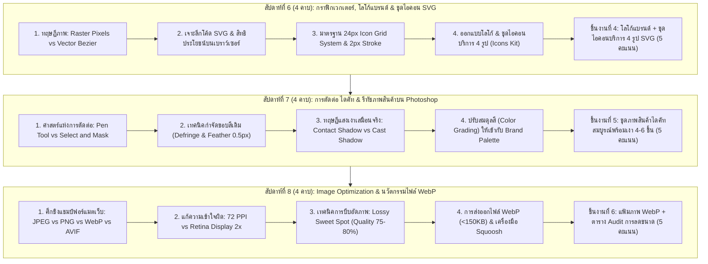

# บทที่ 3: การสร้างและตกแต่งกราฟิกสำหรับเว็บไซต์
*(Website Graphic Assets Production, Vector Icons, Image Retouching & WebP Optimization)*

วิชา: 31910-2026 โปรแกรมกราฟิกสำหรับการออกแบบเว็บไซต์ (ท-ป-น: 2-2-3)  
ระดับชั้น: ประกาศนียบัตรวิชาชีพชั้นสูง (ปวส.) ชั้นปีที่ 1 สาขาวิชาเทคโนโลยีธุรกิจดิจิทัล  
หน่วยการเรียนรู้: หน่วยที่ 3 (ครอบคลุมการเรียนการสอนสัปดาห์ที่ 6, 7 และ 8 รวม 12 คาบเรียน)  
อาจารย์ผู้สอน: ครูแม็ค (แผนกวิชาเทคโนโลยีธุรกิจดิจิทัล วิทยาลัยการอาชีพบ้านโป่ง)  

---

## 🎯 จุดประสงค์การเรียนรู้ประจำหน่วยที่ 3

เมื่อศึกษาเนื้อหาบทเรียนนี้และปฏิบัติการตามขั้นตอนเสร็จสิ้น ผู้เรียนสามารถ:
1. **ด้านความรู้ (Knowledge):**
   - อธิบายความแตกต่างระหว่างภาพแบบ **Raster (Bitmap)** และ **Vector Graphic** รวมถึงโครงสร้างโค้ดเชิงตรรกะของไฟล์ **SVG (Scalable Vector Graphics)** ได้อย่างถูกต้อง
   - อธิบายหลักการยศาสตร์และมาตรฐานการสร้างชุดไอคอนบนโครงตาราง **24px Icon Grid** และการควบคุมความหนาเส้น (**Stroke Weight**) ได้
   - อธิบายหลักทฤษฎีแสงเงาการตกแต่งภาพเชิงพาณิชย์ ได้แก่ เงาสัมผัสพื้น (**Contact Shadow**) และเงาทอดยาว (**Cast Shadow**) ได้อย่างสมจริง
   - เปรียบเทียบคุณสมบัติ ความคุ้มค่า และการกินแบนด์วิดท์ของฟอร์แมตไฟล์ภาพดิจิทัล (JPEG, PNG, WebP, AVIF, SVG) ได้
   - อธิบายความสัมพันธ์ระหว่างขนาดไฟล์ภาพ (File Size) กับค่าดัชนีความเร็วของเว็บไซต์ (**Core Web Vitals: LCP**) และผลกระทบต่อ SEO ได้
2. **ด้านทักษะปฏิบัติการ (Skill):**
   - **สัปดาห์ที่ 6:** ออกแบบโลโก้ร้านค้าและวาดชุดไอคอนเวกเตอร์บริการ 4 แบบ (จัดส่งฟรี, รับประกัน, ชำระเงินปลอดภัย, บริการ 24 ชม.) บนโครงตาราง 24px และส่งออกเป็นโค้ด SVG ที่สะอาดได้
   - **สัปดาห์ที่ 7:** ใช้เครื่องมือ Pen Tool และคำสั่ง Select and Mask ใน Adobe Photoshop ทำการตัดต่อ (ไดคัท) พื้นหลังสินค้า 4-6 รายการ พร้อมปรับแต่งสีและสร้างเงาเสมือนจริง แล้วนำไปประกอบลงในการ์ดสินค้าบน Figma ได้
   - **สัปดาห์ที่ 8:** ปรับขนาดมิติพิกเซลและความละเอียด 72 PPI ของภาพสินค้า บีบอัดเป็นฟอร์แมต **WebP** ให้มีขนาดไฟล์ต่ำกว่า **150 KB** โดยสายตามนุษย์ยังมองเห็นความคมชัด พร้อมจัดทำตารางบันทึกการลดขนาดไฟล์ (**File Size Audit Table**) ได้อย่างสมบูรณ์
3. **ด้านจิตพิสัยและจรรยาบรรณวิชาชีพ (Attitude):**
   - มีความประณีต อดทน และละเอียดรอบคอบในการควบคุมเส้นทางเดินของ Pen Tool เพื่อเก็บขอบชิ้นงานไม่ให้มีรอยแหว่งหรือขอบขาวหลุดลอย
   - มีจิตสำนึกในการเคารพกฎหมายลิขสิทธิ์รูปภาพและทรัพย์สินทางปัญญาในการนำภาพถ่ายสินค้ามาใช้งาน
   - คำนึงถึงผู้ใช้งานปลายทางที่มีอินเทอร์เน็ตความเร็วจำกัด ด้วยการบีบอัดไฟล์ภาพให้เล็กที่สุดก่อนนำขึ้นเว็บไซต์

---

## 🧭 แผนผังโครงสร้างการเรียนรู้ประจำหน่วย (สัปดาห์ที่ 6 - 8 | รวม 12 คาบ)



---

## บทนำ: สินทรัพย์กราฟิก (Graphic Assets) กับความเร็วของเว็บไซต์ (Web Performance)

ในหน่วยที่ 2 นักศึกษาได้สร้างโครงสร้างและพิมพ์เขียวหน้าแรกเว็บไซต์ (Wireframe) พร้อมระบบนำทางและการ์ดสินค้าบน Figma กันไปแล้ว แต่กล่องรูปภาพทั้งหมดยังคงเป็นเพียง "กล่องสี่เหลี่ยมสีเทาที่มีกากบาท X" 

เมื่อก้าวเข้าสู่ **หน่วยที่ 3** เราจะเริ่มต้นผลิต **"สินทรัพย์กราฟิกของจริง (Production Graphic Assets)"** เพื่อนำมาประกอบลงในหน้าเว็บ แต่ก่อนจะลงมือวาด มีความจริงทางธุรกิจข้อหนึ่งที่นักศึกษาเทคโนโลยีธุรกิจดิจิทัลทุกคนต้องตระหนัก:

```
┌─────────────────────────────────────────────────────────────────────────────────────────────┐
│                          สถิติวิจัยพฤติกรรมผู้บริโภคบนเว็บไซต์ (Google & Akamai)             │
├─────────────────────────────────────────────────────────────────────────────────────────────┤
│ 1. ความอดทนของลูกค้า: หากหน้าเว็บโหลดช้าเกิน "3 วินาที" ลูกค้ากว่า 40% จะกดปิดหนีทันที     │
│ 2. ผลกระทบต่อยอดขาย: ทุกๆ 1 วินาทีที่เว็บโหลดช้าลง ยอดขายออนไลน์จะลดลงเฉลี่ย 7%             │
│ 3. ตัวการที่ทำให้เว็บโหลดช้า: กว่า 65% - 70% ของปริมาณข้อมูลทั้งหมดที่เว็บต้องดาวน์โหลด      │
│    มาจาก "ไฟล์รูปภาพและกราฟิกที่ไม่ได้ผ่านการบีบอัดอย่างถูกวิธี"                            │
└─────────────────────────────────────────────────────────────────────────────────────────────┘
```

**หน้าที่ของนักออกแบบกราฟิกสำหรับเว็บไซต์ยุคใหม่:**  
ไม่ใช่แค่การทำภาพให้ "สวยคมชัด" เพียงอย่างเดียว แต่ต้องมีความรู้เชิงวิศวกรรมในการทำให้ไฟล์ **"มีน้ำหนักเบาที่สุด กินแบนด์วิดท์น้อยที่สุด โหลดได้เร็วที่สุดในระดับเสี้ยววินาที"** เพื่อให้เว็บไซต์ติดอันดับ Google SEO และปิดการขายได้อย่างมีประสิทธิภาพ

---

## ตอนที่ 1 (สัปดาห์ที่ 6): งานกราฟิกเวกเตอร์ โลโก้ และชุดไอคอนบริการ (Vector Logo & SVG Icons)

```
┌────────────────────────────────────────────────────────────────────────────────┐
│ ข้อมูลการจัดการเรียนการสอนสัปดาห์ที่ 6:                                         │
│ • ระยะเวลา: 4 คาบเรียน (ทฤษฎีเวกเตอร์ 2 คาบ / ปฏิบัติการวาดไอคอน 2 คาบ)         │
│ • เครื่องมือหลัก: โปรแกรม Figma หรือ Adobe Illustrator                          │
│ • ชิ้นงานส่งตรวจ: ลิงก์ไฟล์งานชิ้นที่ 4: โลโก้แบรนด์ + ชุดไอคอนบริการ 4 ชิ้น (SVG) (5 คะแนน)│
└────────────────────────────────────────────────────────────────────────────────┘
```

### 1.1 มหากาพย์ภาพราสเตอร์ (Raster Pixels) ปะทะ ภาพเวกเตอร์ (Vector Bezier)

โลกของกราฟิกดิจิทัลถูกแบ่งออกเป็น 2 อารยธรรมใหญ่ที่มีกลไกการสร้างภาพแตกต่างกันอย่างสิ้นเชิง:

```
┌─────────────────────────────────────────────────────────────────────────────────────────────┐
│                       ตารางเปรียบเทียบเชิงลึก: Raster (Bitmap) vs Vector                    │
├───────────────────────┬──────────────────────────────┬──────────────────────────────────────┤
│ ประเด็นการเปรียบเทียบ │ ภาพราสเตอร์ / บิตแมป (Raster)│ ภาพเวกเตอร์ (Vector Graphics)        │
├───────────────────────┼──────────────────────────────┼──────────────────────────────────────┤
│ 1. หน่วยโครงสร้างภาพ  │ เม็ดสีตารางพิกเซล (Grid Pixels)│ สูตรสมการคณิตศาสตร์เส้นโค้ง (Bezier) │
│ 2. เมื่อซูมขยายภาพ    │ ภาพแตกเป็นเม็ดฟันปลา (Pixelated)│ คมกริบ 100% ทุกระดับการซูมและทุกจอภาพ│
│ 3. ความเหมาะสมในการใช้งาน│ ภาพถ่ายบุคคล, ภาพวิว, สินค้าจริง│ โลโก้, สัญลักษณ์, ไอคอน, ฟอนต์ตัวอักษร│
│ 4. นามสกุลไฟล์ยอดนิยม │ .jpg, .png, .webp, .gif      │ .svg, .ai, .eps                      │
│ 5. ขนาดไฟล์ตามขนาดหน้าจอ│ ยิ่งภาพกว้าง ขนาดไฟล์ยิ่งใหญ่│ ขนาดไฟล์คงที่ ไม่ว่าจะแสดงผลเล็กหรือใหญ่│
└───────────────────────┴──────────────────────────────┴──────────────────────────────────────┘
```

#### สูตรสมการเส้นโค้งเบซิเยร์ (Bézier Curve Mathematics):
คอมพิวเตอร์ไม่ได้จำว่าเส้นโค้งมีสีกี่เม็ด แต่จำ "พิกัดจุดเริ่มต้น ($P_0$), จุดควบคุมทิศทาง ($P_1$), และจุดสิ้นสุด ($P_2$)" ผ่านสมการพหุนาม:
$$B(t) = (1 - t)^2 P_0 + 2(1 - t)t P_1 + t^2 P_2 \quad (0 \le t \le 1)$$
นั่นคือเหตุผลที่ไฟล์เวกเตอร์มีขนาดเล็กมากเพียงไม่กี่กิโลไบต์ (KB) เพราะเก็บเฉพาะข้อมูลตัวเลขพิกัด ไม่ได้เก็บเม็ดสีนับล้านเม็ดเหมือนภาพถ่าย

---

### 1.2 เจาะลึกไฟล์ SVG (Scalable Vector Graphics) ทำไมเว็บยุคใหม่ถึงขาดไม่ได้?

**SVG** ไม่ใช่แค่ไฟล์รูปภาพธรรมดา แต่เป็น **"โค้ดข้อความภาษา XML (eXtensible Markup Language)"** ที่เว็บเบราว์เซอร์สามารถอ่าน เข้าใจ และประมวลผลเป็นภาพได้โดยตรง:

```xml
<!-- ตัวอย่างโค้ด SVG ไอคอนรถส่งของ ที่เบราว์เซอร์อ่านจริง -->
<svg xmlns="http://www.w3.org/2000/svg" width="24" height="24" viewBox="0 0 24 24" fill="none" stroke="#111827" stroke-width="2">
  <rect x="1" y="3" width="15" height="13" rx="2" />
  <polygon points="16 8 20 8 23 11 23 16 16 16 16 8" />
  <circle cx="5.5" cy="18.5" r="2.5" />
  <circle cx="18.5" cy="18.5" r="2.5" />
</svg>
```

#### 4 ประโยชน์มหาศาลของไฟล์ SVG บนเว็บไซต์:
1. **ความคมชัดระดับอินฟินิตี้ (Resolution Independence):** ไม่ว่าจะเปิดบนจอมือถือราคาประหยัด หรือจอคอมพิวเตอร์ระดับ 5K Retina Display ภาพไอคอนจะคมกริบเสมอ ไม่มีวันแตกเบลอ
2. **ขนาดไฟล์เล็กอย่างน่าอัศจรรย์:** ไอคอน 1 ตัว มีขนาดโค้ดเพียง **500 ไบต์ ถึง 1.5 KB** เท่านั้น (เล็กกว่าไฟล์ภาพ PNG ถึง 10-20 เท่า)
3. **ควบคุมสีสันได้ผ่าน CSS:** นักพัฒนาเว็บสามารถสั่งเปลี่ยนสีไอคอนเมื่อเมาส์ชี้ได้ทันที เช่น `svg:hover { stroke: #7C3AED; }` โดยไม่ต้องวาดรูปภาพขึ้นมาใหม่อีกใบ
4. **ความเร็วในการโหลด:** เบราว์เซอร์สามารถประมวลผลโค้ด SVG ร่วมกับ HTML ได้ทันทีโดยไม่ต้องส่งคำขอไปดึงภาพจากเซิร์ฟเวอร์ (Zero HTTP Request Overhead เมื่อฝังเป็น Inline SVG)

---

### 1.3 ระบบโครงตารางไอคอนมาตรฐาน (The 24px Icon Grid System)

ในการออกแบบชุดไอคอน (Icon Set) หากวาดอย่างสะเปะสะปะโดยไม่มีกรอบควบคุม ไอคอนแต่ละตัวจะมีขนาดไม่เท่ากัน เส้นหนาบางไม่สม่ำเสมอ ส่งผลให้หน้าเว็บดูมือสมัครเล่นทันที

ในอุตสาหกรรมระดับโลก (เช่น Google Material Symbols, Lucide Icons, Feather Icons) ได้กำหนดมาตรฐานกลางไว้คือ **ระบบตาราง 24 x 24 พิกเซล**:

```
┌──────────────────────────────────────────────────────────┐
│              โครงสร้างตารางไอคอนมาตรฐาน (24px Icon Grid)  │
├──────────────────────────────────────────────────────────┤
│ ┌──────────────────────────────────────────────────────┐ │ ◄── กรอบ Canvas นอกสุด: 24 x 24 px
│ │   Margin ปลอดภัย (Padding) = 2px รอบทิศ              │ │
│ │  ┌────────────────────────────────────────────────┐  │ │
│ │  │ ╲                                            ╱ │  │ │
│ │  │   ┌────────────────────────────────────────┐   │  │ │ ◄── พื้นที่วาดเนื้อหาหลัก (Live Area)
│ │  │   │                                        │   │  │ │     ขนาด 20 x 20 px
│ │  │   │       [ พื้นที่วาดรูปทรงไอคอน ]         │   │  │ │
│ │  │   │                                        │   │  │ │
│ │  │   └────────────────────────────────────────┘   │  │ │
│ │  │ ╱                                            ╲ │  │ │
│ │  └────────────────────────────────────────────────┘  │ │
│ └──────────────────────────────────────────────────────┘ │
│ ความหนาของเส้น (Stroke Weight): บังคับใช้คงที่ 2px ทุกตัว  │
└──────────────────────────────────────────────────────────┘
```

#### กฎเหล็ก 4 ข้อในการสร้างชุดไอคอนเวกเตอร์:
1. **ขนาดเฟรมตายตัว:** ตั้งขนาด Frame เป็น **$24 \times 24\text{px}$** เสมอ
2. **ขอบเขตปลอดภัย (Padding 2px):** เนื้อหาของไอคอนต้องอยู่ภายในพื้นที่ **$20 \times 20\text{px}$** ห้ามวาดชนขอบ 24px สนิท เพื่อป้องกันไม่ให้ขอบของเส้นถูกตัดแหว่ง
3. **ความหนาเส้นสม่ำเสมอ (Consistent Stroke Weight):** ไอคอนทุกตัวในแบรนด์ต้องใช้ความหนาเส้นเท่ากันทั้งหมด โดยแนะนำที่ **`2px`** (หรือ `1.5px` สำหรับสไตล์มินิมอล)
4. **จุดมุมและปลายเส้นมน (Rounded Caps & Joins):** ตั้งค่า `Stroke Cap = Round` และ `Stroke Join = Round` เพื่อให้เส้นโค้งมน นุ่มนวล สบายตา

---

### 1.4 ปฏิบัติการออกแบบชุดไอคอนบริการ 4 รูป (Service Trust Icons)

ในสัปดาห์ที่ 6 ให้นักศึกษาออกแบบไอคอนประจำหมวด Trust Badges (โซนที่ 4 ของหน้าแรก) จำนวน 4 รูป:

```
┌───────────────────────┬───────────────────────┬───────────────────────┬───────────────────────┐
│ 1. ไอคอนจัดส่งสินค้า  │ 2. ไอคอนการันตีสินค้า │ 3. ไอคอนชำระเงิน      │ 4. ไอคอนบริการลูกค้า   │
│    (Fast Delivery)    │    (Authentic Trust)  │    (Secure Payment)   │    (24/7 Support)     │
├───────────────────────┼───────────────────────┼───────────────────────┼───────────────────────┤
│        ┌─────┐        │         ╱╲            │     ┌───────────┐     │        ┌─────┐        │
│    ┌───┘     │        │        ╱  ╲           │     │  ••••     │     │       │ 💬 24│        │
│    │  [🚚]   ├──┐     │       │ 🛡️ │          │     ├───────────┤     │        └──┬──┘        │
│    └───O─────O──┘     │        ╲  ╱           │     │     💳    │     │           ▼           │
│                       │         ▼             │     └───────────┘     │                       │
│ รถส่งของ / กล่องพัสดุ │ ตราโล่ / ดาวการันตี   │ บัตรเครดิต / กุญแจ    │ หูฟัง / บับเบิ้ลข้อความ│
└───────────────────────┴───────────────────────┴───────────────────────┴───────────────────────┘
```

#### ขั้นตอนการวาดบน Figma ทีละสเต็ป:
1. กด **`F`** ลาก Frame สี่เหลี่ยมจัตุรัสขนาด $24 \times 24\text{px}$
2. คลิกขยายซูมเข้าไปใกล้ๆ (กดปุ่ม `Shift + 2` เพื่อขยายวัตถุที่เลือกให้เต็มจอ)
3. กด **`O`** หรือ **`R`** วาดรูปทรงพื้นฐาน แล้วกดปุ่ม **`Enter`** เพื่อเข้าสู่โหมดแก้ไขจุดเวกเตอร์ (Vector Edit Mode) ดัดแปลงส่วนปลายเส้น
4. รวมรูปทรงด้วยคำสั่ง **Boolean Groups** (ด้านบนกลางจอ):
   - **Union:** รวม 2 รูปทรงเข้าเป็นชิ้นเดียวกัน
   - **Subtract:** ตัดส่วนที่ทับซ้อนออก
5. **แปลงเส้นเป็นรูปร่างปิด (Outline Stroke):** ก่อนส่งออก ให้คลิกขวาที่เส้น เลือก **Outline Stroke (`Ctrl + Shift + O`)** เพื่อให้เส้นกลายเป็น Fill ป้องกันปัญหาความหนาเส้นเพี้ยนเมื่อย่อ-ขยาย
6. **ส่งออกเป็นไฟล์ SVG:**
   - ที่แผงขวาล่างสุด หัวข้อ **Export** เปลี่ยนฟอร์แมตจาก PNG เป็น **SVG**
   - คลิกที่ปุ่มจุดสามจุด `...` ติ๊กเลือก **"Include 'id' attribute"** และเอาเครื่องหมายถูกออกจาก *"Show in exports"*
   - กดปุ่ม **Export [ชื่อไอคอน].svg**

---

## ตอนที่ 2 (สัปดาห์ที่ 7): การตัดต่อ ไดคัท และตกแต่งภาพสินค้าสำหรับเว็บ (Photoshop Retouching)

```
┌────────────────────────────────────────────────────────────────────────────────┐
│ ข้อมูลการจัดการเรียนการสอนสัปดาห์ที่ 7:                                         │
│ • ระยะเวลา: 4 คาบเรียน (ทฤษฎีแสงเงา 2 คาบ / ปฏิบัติการไดคัท Photoshop 2 คาบ)   │
│ • เครื่องมือหลัก: โปรแกรม Adobe Photoshop (Pen Tool, Select and Mask, Curves)   │
│ • ชิ้นงานส่งตรวจ: ลิงก์ไฟล์งานชิ้นที่ 5: แฟ้มภาพสินค้าไดคัทสมบูรณ์พร้อมเงา 4-6 ชิ้น (5 คะแนน)│
└────────────────────────────────────────────────────────────────────────────────┘
```

### 2.1 ศาสตร์แห่งการตัดต่อวัตถุ (Deep Etching & Background Removal)

**การไดคัท (Die-cut หรือ Deep Etching)** คือ "กระบวนการแยกวัตถุสินค้าออกจากฉากหลังเดิม" เพื่อนำวัตถุชิ้นนั้นไปวางลงบนพื้นหลังใหม่ที่ต้องการ หรือทำเป็นภาพโปร่งใส (Transparent Background) เพื่อนำไปประกอบลงในการ์ดสินค้าบน Figma

```
┌─────────────────────────────────────────────────────────────────────────────────────────────┐
│                          การเลือกใช้เครื่องมือตัดต่อให้ถูกประเภทของวัตถุ                     │
├─────────────────────┬─────────────────────────────────────┬─────────────────────────────────┤
│ เครื่องมือบน Photoshop│ ลักษณะพื้นผิวของสินค้า              │ ประสิทธิภาพและผลลัพธ์            │
├─────────────────────┼─────────────────────────────────────┼─────────────────────────────────┤
│ 1. Pen Tool (คีย์ P)│ วัตถุขอบเรียบ แข็ง ชัดเจน           │ คมกริบ แม่นยำที่สุด 100%        │
│    (แนะนำอันดับ 1)  │ เช่น ขวดน้ำหอม, โทรศัพท์, กระเป๋า, กล่อง│ (มาตรฐานสูงสุดของมืออาชีพ)      │
├─────────────────────┼─────────────────────────────────────┼─────────────────────────────────┤
│ 2. Select Subject   │ วัตถุทั่วไปที่มีคอนทราสต์ตัดกับพื้นหลัง│ รวดเร็วมาก แต่ขอบอาจมีรอยหยัก   │
│    (AI Auto-Select) │ ใช้เป็นขั้นเริ่มต้นก่อนเก็บงาน       │ ต้องนำมาแต่งขอบเพิ่มด้วย Pen Tool│
├─────────────────────┼─────────────────────────────────────┼─────────────────────────────────┤
│ 3. Select and Mask  │ วัตถุขอบนุ่ม ฟุ้ง โปร่งแสง          │ จัดการเส้นผมและขนสัตว์ได้ดีเยี่ยม│
│    (Refine Edge)    │ เช่น เสื้อขนสัตว์, ช่อดอกไม้, เส้นผม│ เนียนตา ขอบไม่ดูแข็งกระด้าง     │
└─────────────────────┴─────────────────────────────────────┴─────────────────────────────────┘
```

---

### 2.2 เคล็ดลับการใช้ Pen Tool ไม่ให้เห็นขอบสีเดิม (Defringe & Inset Path)

ข้อผิดพลาดที่ร้ายแรงที่สุดของนักศึกษาคือ เมื่อไดคัทสินค้าจากพื้นหลังเดิม (เช่น ถ่ายบนผ้าปูสีน้ำเงิน) แล้วนำมาวางบนการ์ดเว็บสีขาว จะเห็น **"ขอบสีน้ำเงินเปื้อนเรื่อๆ ล้อมรอบตัวสินค้า (Color Fringe / Halo Effect)"** ทำให้งานดูสกปรกและราคาถูก

```
┌─────────────────────────────────────────────────────────────────────────┐
│                    เทคนิคการเดินเส้น Pen Tool ระดับช่างภาพโฆษณา          │
├─────────────────────────────────────────────────────────────────────────┤
│                   ขอบจริงของวัตถุ                                       │
│                   │                                                     │
│        [ฉากหลัง]  ▼     [เนื้อสินค้าแท้จริง]                            │
│        ▓▓▓▓▓▓▓▓▓▓│██████████████████                                    │
│        ▓▓▓▓▓▓▓▓▓▓│██████████████████                                    │
│                  ▲                                                      │
│                  └─── เส้น Pen Tool ให้เดิน "กินเนื้อในลึกเข้ามา 1-2px" │
│                       เพื่อเฉือนขอบสีของฉากหลังเดิมทิ้งไปอย่างเด็ดขาด   │
└─────────────────────────────────────────────────────────────────────────┘
```

#### สูตรตั้งค่าการตัดขอบ (Selection Properties):
1. เมื่อวาด Path ด้วย Pen Tool บรรจบจุดเริ่มต้นแล้ว ให้กดปุ่ม **`Ctrl + Enter`** เพื่อแปลง Path เป็นเส้นประ Selection
2. ไปที่เมนู **Select** $\rightarrow$ **Modify** $\rightarrow$ **Feather (`Shift + F6`)**
3. ป้อนค่า Feather Radius = **`0.3` ถึง `0.5 px`** (ห้ามใส่ 0px เพราะขอบจะคมแข็งเหมือนเอากรรไกรตัดกระดาษ และห้ามใส่เกิน 1px เพราะขอบจะเบลอหลุดโฟกัส)
4. กดปุ่ม **Add Layer Mask** (ไอคอนสี่เหลี่ยมมีวงกลมตรงกลางที่แผง Layers) เพื่อซ่อนฉากหลัง โดยไม่ทำลายพิกเซลเดิม (Non-Destructive Workflow)

---

### 2.3 ทฤษฎีแสงเงาเสมือนจริงสำหรับสินค้าบนเว็บ (Commercial Shadow Crafting)

หากเรานำภาพสินค้าที่ไดคัทแล้วมาวางลงบนพื้นหลังสีขาวเฉยๆ สินค้าจะดู **"ลอยอย่างไร้น้ำหนัก เหมือนภาพตัดแปะราคาถูก"** 

นักออกแบบมืออาชีพต้องสร้างเงาเสมือนจริงขึ้นมา 2 ชั้นเสมอ:

```
┌─────────────────────────────────────────────────────────────────────────┐
│                      กายวิภาค 2 ชั้นของเงาสินค้าเสมือนจริง               │
├─────────────────────────────────────────────────────────────────────────┤
│                                                                         │
│                   ┌───────────────────────────┐                         │
│                   │                           │                         │
│                   │        ตัวสินค้าจริง       │                         │
│                   │      (ขวด / กล่อง / แก้ว) │                         │
│                   │                           │                         │
│                   └─────────────┬─────────────┘                         │
│ ════════════════════════════════╪══════════════════════════════════════ │ ◄── พื้นระนาบ
│              ░░░░░░░░░░░░░░░░░░░▓▓▓▓▓░░░░░░░░░░░░░░░                    │
│             ◄───────────────────┼──────────────────►                    │
│                                 │                                       │
│ 1. Contact Shadow (เงาสัมผัส):   │                                       │
│    แถบเงาดำเข้มชิดใต้ฐานวัตถุ ──┘                                       │
│    (Opacity 80-90%, เบลอน้อยมาก 2-3px บ่งบอกว่าวัตถุวางติดพื้นจริง)     │
│                                                                         │
│ 2. Cast Shadow (เงาทอดตัว):                                             │
│    แถบเงากว้างแผ่กระจายตามทิศทางแสงธรรมชาติ                             │
│    (Opacity 20-30%, Gaussian Blur 15-25px นุ่มนวล ค่อยๆ จางหายไป)       │
└─────────────────────────────────────────────────────────────────────────┘
```

#### ขั้นตอนการสร้างเงาสินค้าบน Photoshop (ทีละขั้น):
1. **สร้างเงาชั้นที่ 1 (Contact Shadow):**
   - สร้าง Layer ว่างใหม่ไว้ "ใต้เลเยอร์สินค้า" ตั้งชื่อว่า `Contact_Shadow`
   - เลือกแปรงพู่กัน Brush Tool (คีย์ B) หัวนุ่ม (Hardness 0%) สีดำสนิท
   - บีบหัวแปรงให้แบนลงในพาเนล Brush Settings ปรับความกว้างให้พอดีกับฐานของสินค้า
   - คลิกแตะเบาๆ 1-2 ครั้งตรงจุดที่ก้นสินค้าสัมผัสพื้น ปรับค่า Layer Opacity ประมาณ `70% - 85%`
2. **สร้างเงาชั้นที่ 2 (Cast Shadow):**
   - สร้าง Layer ว่างใหม่อีกชั้นไว้ใต้ Contact Shadow ตั้งชื่อว่า `Cast_Shadow`
   - ใช้เครื่องมือ Marquee Tool วาดวงรีแนวนอนใต้ตัวสินค้า
   - เทสีดำลงในวงรี กด `Ctrl + D` ยกเลิกเส้นประ
   - ไปที่เมนู **Filter** $\rightarrow$ **Blur** $\rightarrow$ **Gaussian Blur** ปรับค่ารัศมีความเบลอประมาณ `15px ถึง 25px`
   - ปรับ Layer Opacity ลงเหลือเพียง `20% ถึง 30%` จะได้เงาทอดตัวที่นุ่มนวลและดูเป็นธรรมชาติที่สุด

---

### 2.4 การเกรดสีและปรับแสง (Color Grading & Curves)

ก่อนนำภาพสินค้าไปใช้ ต้องปรับแต่งโทนภาพให้กลมกลืนกับ Mood & Tone และ Palette สีประจำแบรนด์ที่กำหนดไว้ในหน่วยที่ 1:
- **ปรับความสว่างและคอนทราสต์ด้วย Curves (`Ctrl + M`):** ดึงเส้นกราฟเป็นรูปตัว S เล็กน้อย (S-Curve) เพื่อเพิ่มมิติความลึก จุดไฮไลต์สว่างคมชัด และเงามีน้ำหนัก
- **ปรับความสดของสี (Vibrance & Saturation):** แนะนำให้ปรับเฉพาะค่า **Vibrance (+10 ถึง +15)** ซึ่งจะเพิ่มความอิ่มตัวของสีที่ยังซีดอยู่โดยไม่ทำให้สีผิวหรือสีหลักเพี้ยนจัดจ้านจนแสบตา

---

## ตอนที่ 3 (สัปดาห์ที่ 8): การเพิ่มประสิทธิภาพรูปภาพสำหรับเว็บ (Image Optimization & WebP)

```
┌────────────────────────────────────────────────────────────────────────────────┐
│ ข้อมูลการจัดการเรียนการสอนสัปดาห์ที่ 8:                                         │
│ • ระยะเวลา: 4 คาบเรียน (ทฤษฎีการบีบอัด 2 คาบ / ปฏิบัติการ Optimization 2 คาบ) │
│ • เครื่องมือหลัก: Photoshop Export As, Google Squoosh (squoosh.app)             │
│ • ชิ้นงานส่งตรวจ: ลิงก์ไฟล์งานชิ้นที่ 6: แฟ้มภาพ WebP + ตาราง Audit การลดขนาด (5 คะแนน)│
└────────────────────────────────────────────────────────────────────────────────┘
```

### 3.1 ศึกชิงแชมป์ฟอร์แมตไฟล์ภาพบนเว็บ (JPEG vs PNG vs WebP vs AVIF)

การเลือกใช้นามสกุลไฟล์ภาพผิดประเภท คือสาเหตุอันดับหนึ่งที่ทำให้เว็บไซต์โหลดช้าจนลูกค้าหนี:

```
┌─────────────────────────────────────────────────────────────────────────────────────────────────────────┐
│                       ตารางเปรียบเทียบฟอร์แมตไฟล์ภาพดิจิทัลสำหรับเว็บไซต์                               │
├─────────────┬─────────────────┬──────────────────┬─────────────────┬────────────────────────────────────┤
│ ฟอร์แมตไฟล์ │ พื้นหลังโปร่งใส │ ระดับการบีบอัด   │ การรองรับเบราว์เซอร์│ สถานการณ์การใช้งานที่ถูกต้อง      │
│             │ (Transparency)  │ (Compression)    │ (Browser Support)│                                    │
├─────────────┼─────────────────┼──────────────────┼─────────────────┼────────────────────────────────────┤
│ 1. JPEG     │ ❌ ไม่รองรับ    │ ปานกลาง (Lossy)  │ 100% (ทุกอุปกรณ์)│ ภาพถ่ายวิวทิวทัศน์ทั่วไป (ยุคเก่า) │
│             │ (พื้นหลังทึบขาว)│                  │                 │                                    │
├─────────────┼─────────────────┼──────────────────┼─────────────────┼────────────────────────────────────┤
│ 2. PNG      │ ✅ รองรับ       │ ต่ำ (Lossless)   │ 100% (ทุกอุปกรณ์)│ ภาพไดคัทที่ต้องการความคมชัดสูงสุด  │
│             │ (โปร่งใสเนียน)  │ ไฟล์มักมีขนาดใหญ่│                 │ (แต่ไฟล์หนักมาก ไม่เหมาะกับเว็บช้า)│
├─────────────┼─────────────────┼──────────────────┼─────────────────┼────────────────────────────────────┤
│ 3. WebP     │ ✅ รองรับ       │ สูงมาก           │ 97%+            │ **มาตรฐานสูงสุดของเว็บยุคปัจจุบัน**│
│    (พระเอก) │ (โปร่งใสสมบูรณ์)│ เล็กกว่า JPEG 30%│ (Chrome, Safari,│ **ใช้กับภาพสินค้าและแบนเนอร์ได้ดี** │
│             │                 │ เล็กกว่า PNG 80% │ Edge, Firefox)  │                                    │
├─────────────┼─────────────────┼──────────────────┼─────────────────┼────────────────────────────────────┤
│ 4. SVG      │ ✅ รองรับ       │ สูงที่สุด        │ 100%            │ **ใช้เฉพาะไอคอน โลโก้ ลายเส้นกราฟิก**│
│             │ (โปร่งใสในตัว)  │ เก็บเป็นโค้ด XML │ (ทุกเบราว์เซอร์)│ (ห้ามใช้กับภาพถ่ายสินค้าเด็ดขาด)    │
└─────────────┴─────────────────┴──────────────────┴─────────────────┴────────────────────────────────────┘
```

#### ทำไม WebP (พัฒนาโดย Google) จึงชนะขาดลอย?
WebP ใช้อัลกอริทึมการบีบอัดขั้นสูงที่เรียกว่า **Predictive Coding (การทำนายค่าพิกเซลข้างเคียง)** ทำให้สามารถลดขนาดไฟล์ลงได้มหาศาล โดยที่ตามนุษย์มองไม่เห็นความแตกต่างของเม็ดสี และยังรองรับทั้งความโปร่งใส (Alpha Transparency) เหมือน PNG แต่ขนาดไฟล์เบาเทียบเท่าหรือเบากว่า JPEG

---

### 3.2 ความเข้าใจผิดเรื่อง Resolution: 72 PPI vs หน้าจอ Retina 2x

มีนักศึกษาจำนวนมากสับสนระหว่าง "PPI ในงานสิ่งพิมพ์" กับ "ขนาดพิกเซลบนหน้าจอเว็บ":
- **ความจริงข้อที่ 1:** สำหรับเว็บเบราว์เซอร์ ค่าตัวเลข **72 PPI หรือ 300 PPI ไม่มีผลต่อขนาดไฟล์หรือความคมชัดบนหน้าจอแม้แต่น้อย!** สิ่งเดียวที่กำหนดขนาดและความคมชัดคือ **มิติความกว้างคูณความสูง (Pixel Dimensions: Width x Height in Pixels)**
- **ความจริงข้อที่ 2: มาตรฐานจอเรตินา (Retina Display 2x):**
  สมาร์ตโฟนและแล็ปท็อปยุคใหม่มีความหนาแน่นพิกเซลสูงกว่าปกติ 2 เท่า ($2\times$) หากการ์ดสินค้าบนหน้าเว็บแสดงผลที่ขนาด $280 \times 280\text{px}$ แต่เราเตรียมภาพขนาด $280 \times 280\text{px}$ มาแสดง ภาพบนจอมือถือจะดูเบลอแตกเล็กน้อย

#### กฎทองของการเตรียมขนาดภาพสินค้า (2x Asset Rule):
$$\text{ขนาดการแสดงผลบนเว็บ (CSS Display Size)} = 280 \times 280\text{ px}$$
$$\text{ขนาดไฟล์ภาพจริงที่ต้อง Export (Export Size 2x)} = 280 \times 2 = \mathbf{560 \times 560\text{ px}}$$
เมื่อนำภาพ $560 \times 560\text{px}$ ไปบีบอัดเป็น WebP ไฟล์จะหนักเพียง **60 - 90 KB** ซึ่งทั้งคมกริบระดับจอ Retina และโหลดได้รวดเร็วเหลือเชื่อ

---

### 3.3 เทคนิคการบีบอัดระดับเซียน (Finding the Sweet Spot)

การบีบอัดภาพมี 2 รูปแบบ:
1. **Lossless (ไม่สูญเสียข้อมูล):** รักษาทุกเม็ดสีไว้ 100% ขนาดไฟล์ลดลงได้เพียง 10-20%
2. **Lossy (ตัดทอนข้อมูลที่ตามนุษย์มองไม่เห็น):** ตัดทอนเฉดสีที่ใกล้เคียงกันทิ้งไป ขนาดไฟล์ลดลงได้ถึง **70-85%**

```
┌─────────────────────────────────────────────────────────────────────────┐
│               การค้นหาจุดสมดุลความคุ้มค่า (The Compression Sweet Spot)  │
├─────────────────────────────────────────────────────────────────────────┤
│ Quality 100%: ขนาดไฟล์ 1,200 KB (เปลืองเน็ต โหลดช้ามาก) ❌               │
│ Quality 90%:  ขนาดไฟล์   450 KB (ยังใหญ่เกินไป) ❌                      │
│                                                                         │
│ ⭐ Quality 75% - 82%: ขนาดไฟล์ 85 KB (สายตามนุษย์แยกไม่ออก แต่ไฟล์ลดลง 90%) ✅│
│                                                                         │
│ Quality 50%:  ขนาดไฟล์   35 KB (ภาพเริ่มเป็นปื้น แตกเป็นบล็อกเหลี่ยม) ❌ │
└─────────────────────────────────────────────────────────────────────────┘
```

> [!IMPORTANT]
> **เกณฑ์เพดานน้ำหนักไฟล์ภาพสำหรับเว็บไซต์ธุรกิจ:**
> - **ภาพไอคอนเวกเตอร์ (SVG):** ต้องมีขนาดต่ำกว่า **`5 KB`** ต่อชิ้น
> - **ภาพถ่ายสินค้าบนการ์ด (WebP):** ต้องมีขนาดต่ำกว่า **`150 KB`** ต่อชิ้น (เป้าหมายที่ดีเยี่ยมคือ 60-90 KB)
> - **ภาพแบนเนอร์ใหญ่หน้าแรก Hero Image (WebP):** ต้องมีขนาดต่ำกว่า **`300 KB`**

---

### 3.4 ขั้นตอนการส่งออกและบีบอัดภาพสินค้าเป็น WebP ด้วย Squoosh.app

นอกจากการ Export จาก Photoshop แล้ว เครื่องมือที่แนะนำที่สุดในวงการคือ **Squoosh (แอปพลิเคชันบีบอัดภาพบนเว็บของ Google)**:

1. เปิดเบราว์เซอร์ไปที่เว็บไซต์ [squoosh.app](https://squoosh.app)
2. ลากไฟล์ภาพสินค้าไดคัทที่บันทึกจาก Photoshop (ไฟล์ PNG ขนาดใหญ่ 2-5 MB) มาวางลงในหน้าต่าง
3. สังเกตแผงควบคุมด้านขวามือ:
   - **Resize:** หากภาพถ่ายต้นฉบับกว้าง 3,000px ให้ติ๊กเปิด Resize แล้วเปลี่ยน Width เป็น **`560px`** (หรือ 800px ตามขนาดการใช้งานจริง)
   - **Compress:** เปลี่ยนฟอร์แมตจาก MozJPEG เป็น **`WebP`**
   - **Effort:** ปรับเป็นระดับ **`6`** (สั่งให้อัลกอริทึมบีบอัดละเอียดสูงสุด)
   - **Quality:** เลื่อนสไลเดอร์มาที่ **`75% ถึง 80%`**
4. ลากเส้นแบ่งเปรียบเทียบกลางจอไปมาเพื่อตรวจดูความคมชัด จะพบว่าภาพแทบไม่ต่างจากต้นฉบับเลย แต่ขนาดไฟล์ลดลงจาก **3.4 MB เหลือเพียง 72 KB (ลดลงกว่า 97%)**
5. คลิกปุ่ม **Download** สีฟ้าที่มุมขวาล่างเพื่อนำภาพไปใช้งาน

---

## ตอนที่ 4: ใบงานปฏิบัติการประจำหน่วยที่ 3 (Workshops & Tasks)

```
┌────────────────────────────────────────────────────────────────────────────────┐
│ สรุปภารกิจการส่งงานและคะแนนเก็บประจำหน่วยที่ 3 (รวม 15 คะแนน):                  │
│ • ชิ้นงานที่ 4 (สัปดาห์ที่ 6): โลโก้แบรนด์ + ชุดไอคอนบริการ 4 รูป SVG [5 คะแนน] │
│ • ชิ้นงานที่ 5 (สัปดาห์ที่ 7): ชุดภาพสินค้าไดคัทสมบูรณ์พร้อมเงา 4-6 ชิ้น [5 คะแนน]│
│ • ชิ้นงานที่ 6 (สัปดาห์ที่ 8): แฟ้มภาพ WebP + ตาราง Audit การลดขนาด [5 คะแนน] │
└────────────────────────────────────────────────────────────────────────────────┘
```

### 📋 ใบงานที่ 3.1 (สัปดาห์ที่ 6): ออกแบบโลโก้เวกเตอร์และชุดไอคอนบริการ SVG
- **คะแนนเต็ม:** 5 คะแนน
- **กำหนดส่ง:** ท้ายคาบเรียนสัปดาห์ที่ 6
- **โจทย์ภารกิจ:**
  1. ออกแบบ **โลโก้ประจำร้านค้า** ธุรกิจดิจิทัลของกลุ่มตนเองในรูปแบบ Vector ชนิดข้อความผสานสัญลักษณ์ (Combination Mark)
  2. สร้างชุดไอคอนบริการประจำโซน Trust Badges จำนวน **4 รูป** (จัดส่งด่วน, รับประกันสินค้า, ชำระเงินปลอดภัย, บริการ 24 ชม.)
  3. ไอคอนทุกชิ้นต้องวาดขึ้นบนโครงตาราง **24 x 24 px Grid** โดยมีระยะเว้นขอบ (Padding) 2px และใช้ความหนาเส้น **2px Stroke** สม่ำเสมอกันทุกชิ้น
  4. ทำการแปลงเส้นเป็นรูปร่างปิด (Outline Stroke) และส่งออก (Export) เป็นไฟล์ **SVG** ที่ถูกต้องตามมาตรฐาน

---

### 📋 ใบงานที่ 3.2 (สัปดาห์ที่ 7): การตัดต่อ ไดคัท และรีทัชภาพสินค้าลงการ์ด
- **คะแนนเต็ม:** 5 คะแนน
- **กำหนดส่ง:** ท้ายคาบเรียนสัปดาห์ที่ 7
- **โจทย์ภารกิจ:**
  1. คัดเลือกภาพถ่ายสินค้าจริงของร้านค้าตนเองจำนวน **4 ถึง 6 ชิ้นงาน** (ภาพความละเอียดสูง)
  2. ทำการไดคัทแยกสินค้าออกจากฉากหลังเดิมด้วยโปรแกรม **Adobe Photoshop** โดยใช้เทคนิค Pen Tool ร่วมกับ Layer Mask โดยขอบของสินค้าต้องสะอาด ไม่มีขอบสีเดิมเปื้อน (Defringe & Inset 1px)
  3. สร้างเงาเสมือนจริงใต้สินค้าครบทั้ง 2 ชั้น (**Contact Shadow** ดำเข้มใต้ฐาน และ **Cast Shadow** ฟุ้งนุ่มนวลทอดตัว)
  4. ปรับสมดุลแสงสีด้วย Curves และ Vibrance ให้เข้ากับจานสี (Color Palette) ของแบรนด์ แล้วนำภาพไปวางเสียบแทนกล่องสี่เหลี่ยมสีเทาบนการ์ดสินค้าใน Figma

---

### 📋 ใบงานที่ 3.3 (สัปดาห์ที่ 8): การเพิ่มประสิทธิภาพภาพ WebP และทำตาราง File Size Audit
- **คะแนนเต็ม:** 5 คะแนน
- **กำหนดส่ง:** ท้ายคาบเรียนสัปดาห์ที่ 8
- **โจทย์ภารกิจ:**
  1. นำภาพสินค้าไดคัททั้งหมดจากสัปดาห์ที่ 7 มาทำการ Optimize ด้วยโปรแกรม Photoshop หรือ Squoosh.app
  2. ปรับขนาดภาพตามเกณฑ์ Retina 2x (ขนาดกว้าง-ยาวไม่เกิน $800 \times 800\text{px}$) และแปลงเป็นฟอร์แมต **WebP (Quality 75-80%)**
  3. ควบคุมขนาดไฟล์ของสินค้าทุกชิ้นให้อยู่ในเกณฑ์มาตรฐาน: **ต่ำกว่า 150 KB ต่อภาพ**
  4. จัดทำ **ตารางบันทึกการลดขนาดไฟล์ (File Size Reduction Audit Table)** ลงในไฟล์งาน Figma ตามแบบฟอร์มด้านล่างนี้:

```
┌─────────────────────────────────────────────────────────────────────────────────────────────┐
│                 ตารางบันทึกการตรวจสอบขนาดไฟล์ภาพ (File Size Reduction Audit Table)          │
├───────────────┬─────────────────┬──────────────────┬─────────────────┬──────────────────────┤
│ ลำดับที่ /    │ ขนาดไฟล์เดิม    │ ขนาดไฟล์ใหม่     │ เปอร์เซ็นต์การ  │ สถานะการตรวจสอบ      │
│ รายการสินค้า  │ (Original PNG)  │ (Optimized WebP) │ ลดขนาดลง (%)    │ (เกณฑ์: < 150 KB)    │
├───────────────┼─────────────────┼──────────────────┼─────────────────┼──────────────────────┤
│ 1. สินค้าชิ้นที่ 1│ 3,450 KB        │ 78 KB            │ ลดลง 97.7%      │ ✅ ผ่านเกณฑ์มาตรฐาน │
│ 2. สินค้าชิ้นที่ 2│ 2,890 KB        │ 85 KB            │ ลดลง 97.0%      │ ✅ ผ่านเกณฑ์มาตรฐาน │
│ 3. สินค้าชิ้นที่ 3│ 4,120 KB        │ 92 KB            │ ลดลง 97.7%      │ ✅ ผ่านเกณฑ์มาตรฐาน │
│ 4. สินค้าชิ้นที่ 4│ 3,100 KB        │ 69 KB            │ ลดลง 97.7%      │ ✅ ผ่านเกณฑ์มาตรฐาน │
│ 5. ภาพ Hero แบนเนอร์│ 8,200 KB      │ 240 KB           │ ลดลง 97.0%      │ ✅ ผ่านเกณฑ์มาตรฐาน │
└───────────────┴─────────────────┴──────────────────┴─────────────────┴──────────────────────┘
```

---

## แบบตรวจสอบตนเองก่อนส่งงาน (Student Self-Checklist)

ก่อนส่งลิงก์ตรวจงานบนระบบส่งงาน ให้นักศึกษาตรวจสอบความเรียบร้อยของสินทรัพย์กราฟิกทั้งหมดตามรายการนี้:

- [ ] **การตรวจสอบสัปดาห์ที่ 6 (Vector Logo & SVG Icons):**
  - [ ] โลโก้แบรนด์เป็นเวกเตอร์ 100% สามารถซูมขยายได้โดยไม่แตก
  - [ ] ไอคอนบริการทั้ง 4 ตัว วาดบนตาราง $24 \times 24\text{px}$ โดยมีระยะขอบปลอดภัย $2\text{px}$
  - [ ] ไอคอนทุกตัวมีความหนาของเส้น (Stroke Weight) สม่ำเสมอกันเท่ากันทุกชิ้น
  - [ ] ส่งออกเป็นไฟล์ `.svg` ที่เปิดดูในเบราว์เซอร์แล้วคมชัด ปราศจากขยะเลเยอร์
- [ ] **การตรวจสอบสัปดาห์ที่ 7 (Retouching & Die-cut):**
  - [ ] ภาพสินค้าทั้ง 4-6 ชิ้น ตัดขอบเนียนเรียบ ไม่มีรอยแหว่งและไม่มีขอบสีเดิมติดมา
  - [ ] มีการสร้างเงาเสมือนจริง 2 ชั้น (Contact Shadow ติดฐาน และ Cast Shadow ฟุ้งนุ่ม)
  - [ ] สินค้าไม่ดูลอยหลอกตา และโทนสีเข้ากันได้ดีกับสีประจำแบรนด์ร้านค้า
  - [ ] นำภาพสินค้าไดคัทจริงไปใส่ลงในการ์ดสินค้าบน Figma ได้อย่างสมบูรณ์
- [ ] **การตรวจสอบสัปดาห์ที่ 8 (WebP Optimization & Audit):**
  - [ ] ภาพสินค้าทุกไฟล์ถูกแปลงเป็นนามสกุล `.webp` เรียบร้อยแล้ว
  - [ ] ตรวจเช็กขนาดไฟล์ภาพสินค้าทุกชิ้น **มีขนาดต่ำกว่า 150 KB** (ไม่มีไฟล์หลุดเกินเกณฑ์)
  - [ ] ภาพแบนเนอร์ใหญ่หน้าแรกมีขนาดต่ำกว่า 300 KB
  - [ ] มีตารางบันทึก File Size Audit เปรียบเทียบขนาดก่อนและหลังการบีบอัดครบถ้วน
