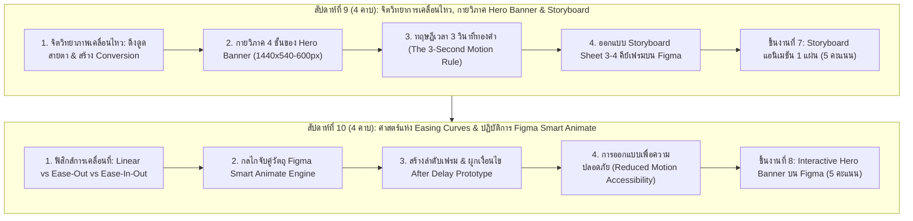

# บทที่ 4: ภาพเคลื่อนไหวและแบนเนอร์โฆษณาสำหรับเว็บไซต์
*(Web Animation Principles, Storyboard Architecture & Interactive Hero Banner)*

วิชา: 31910-2026 โปรแกรมกราฟิกสำหรับการออกแบบเว็บไซต์ (ท-ป-น: 2-2-3)  
ระดับชั้น: ประกาศนียบัตรวิชาชีพชั้นสูง (ปวส.) ชั้นปีที่ 1 สาขาวิชาเทคโนโลยีธุรกิจดิจิทัล  
หน่วยการเรียนรู้: หน่วยที่ 4 (ครอบคลุมการเรียนการสอนสัปดาห์ที่ 9 และ 10 รวม 8 คาบเรียน)  
อาจารย์ผู้สอน: ครูแม็ค (แผนกวิชาเทคโนโลยีธุรกิจดิจิทัล วิทยาลัยการอาชีพบ้านโป่ง)  

---

## 🎯 จุดประสงค์การเรียนรู้ประจำหน่วยที่ 4

เมื่อศึกษาเนื้อหาบทเรียนนี้และปฏิบัติการตามขั้นตอนเสร็จสิ้น ผู้เรียนสามารถ:
1. **ด้านความรู้ (Knowledge):**
   - อธิบายบทบาท ประโยชน์ และจิตวิทยาการมองเห็นของภาพเคลื่อนไหวบนเว็บไซต์ (Web Motion & Cognitive Psychology) ได้อย่างถูกต้อง
   - ประยุกต์ใช้หลักการเคลื่อนไหวพื้นฐาน (Animation Principles) ได้แก่ จังหวะเวลา (**Timing**), เส้นโค้งการเคลื่อนที่ (**Easing Curves**), และการเน้นสายตา (**Staging & Focal Points**) บน UI ได้
   - อธิบายกลไกทางวิศวกรรมของโปรแกรม Figma ในการตรวจจับความเปลี่ยนแปลงของวัตถุด้วยคุณสมบัติ **Smart Animate** (การจับคู่วัตถุผ่าน Layer Name, Position, Scale, Opacity, Rotation) ได้
   - ตระหนักถึงมาตรฐานการเข้าถึงสำหรับผู้ใช้งานที่มีภาวะไวต่อการมองเห็น (**Reduced Motion & Web Accessibility: WCAG 2.3.3**)
2. **ด้านทักษะปฏิบัติการ (Skill):**
   - **สัปดาห์ที่ 9:** ออกแบบโครงสร้างภาพแบนเนอร์โฆษณาหลัก (**Hero Banner**) ขนาด Desktop $1440 \times 540-600\text{px}$ และเขียนบทภาพจำลอง (**Storyboard Sheet**) จำนวน 3-4 ช่วงคีย์เฟรม พร้อมระบุระยะเวลา (Timing) และคำอธิบายการเคลื่อนไหวได้ครบถ้วน
   - **สัปดาห์ที่ 10:** ใช้เครื่องมือ Figma Smart Animate สร้างชิ้นงานแบนเนอร์โฆษณาภาพเคลื่อนไหวเชิงโต้ตอบ (**Interactive Hero Banner**) ที่มีการเคลื่อนไหวของสินค้า ข้อความ และปุ่ม CTA อย่างนุ่มนวล เป็นธรรมชาติ และแสดงผลจำลองการทำงานบนโหมด Prototype ได้อย่างสมบูรณ์
3. **ด้านจิตพิสัยและจรรยาบรรณวิชาชีพ (Attitude):**
   - มีความละเอียดรอบคอบในการตั้งชื่อเลเยอร์ให้ตรงกันทุกเฟรม เพื่อป้องกันปัญหาแอนิเมชันแตกหรือกระตุก (Glitch)
   - ควบคุมระยะเวลาของแอนิเมชันไม่ให้ช้าเกินไปจนสร้างความรำคาญหรือขัดขวางการเข้าถึงข้อมูลของผู้ใช้งาน

---

## 🧭 แผนผังโครงสร้างการเรียนรู้ประจำหน่วย (สัปดาห์ที่ 9 - 10 | รวม 8 คาบ)



---

## บทนำ: พลังของภาพเคลื่อนไหวบนเว็บไซต์ (The Power of Web Motion)

ในหน่วยที่ 2 และ 3 นักศึกษาได้เตรียมโครงสร้างหน้าเว็บ (Wireframe) และผลิตสินทรัพย์กราฟิกจริง (โลโก้เวกเตอร์, ไอคอน SVG, และภาพสินค้าไดคัทสมบูรณ์) ไว้เรียบร้อยแล้ว

แต่ในโลกธุรกิจดิจิทัลที่มีการแข่งขันสูง หน้าเว็บไซต์ที่มีเพียง **"ภาพนิ่งธรรมดา (Static Web)"** มักจะถูกผู้ใช้เลื่อนผ่านไปอย่างรวดเร็ว (Scroll Blindness) โดยไม่หยุดอ่าน 

การนำ **ภาพเคลื่อนไหวบนเว็บไซต์ (Web Motion & Micro-interactions)** เข้ามาเสริมในจุดยุทธศาสตร์ที่สำคัญที่สุดของหน้าแรก นั่นคือ **"Hero Banner (แบนเนอร์โฆษณาด้านบนสุด)"** จะช่วยสร้างความได้เปรียบทางธุรกิจอย่างมหาศาล:

```
┌─────────────────────────────────────────────────────────────────────────────────────────────┐
│                          สถิติวิจัยผลกระทบของ Web Animation ต่อธุรกิจดิจิทัล                │
├─────────────────────────────────────────────────────────────────────────────────────────────┤
│ 1. ดึงดูดสายตาได้ไวกว่า: มนุษย์ถูกวิวัฒนาการมาให้ตรวจจับ "วัตถุที่กำลังเคลื่อนไหว"          │
│    ได้ไวกว่าภาพนิ่งถึง 3 เท่า ช่วยหยุดนิ้วของผู้ใช้ไม่ให้รีบเลื่อนผ่าน                      │
│ 2. เพิ่มยอดคลิก (CTR): แบนเนอร์ที่มีภาพเคลื่อนไหวอย่างมีชั้นเชิง สามารถเพิ่มอัตราการคลิก    │
│    ปุ่มสั่งซื้อ (Call-to-Action) ได้สูงกว่าภาพนิ่งเฉลี่ย 30% - 50%                          │
│ 3. เสริมภาพลักษณ์แบรนด์: เว็บไซต์ที่มี Motion นุ่มนวลจะให้ความรู้สึก "ทันสมัย พรีเมียม      │
│    และน่าเชื่อถือในระดับสากล" มากกว่าเว็บทั่วไป                                             │
└─────────────────────────────────────────────────────────────────────────────────────────────┘
```

> [!IMPORTANT]
> **กฎทองคำของ Web Animation: "Purposeful, Not Decorative" (มีเป้าหมาย ไม่ใช่แค่ประดับสวยงาม)**
> แอนิเมชันที่ดีบนเว็บไซต์ธุรกิจต้องไม่ใช่การขยับมั่วซั่วจนลายตา แต่ต้องทำหน้าที่ **"ชี้นำสายตาของลูกค้า (Guide Focus) ให้มองเห็นคุณค่าของสินค้า และนำทางไปสู่การกดปุ่มสั่งซื้อ"** เท่านั้น

---

## ตอนที่ 1 (สัปดาห์ที่ 9): การออกแบบ Storyboard และโครงสร้าง Hero Banner

```
┌────────────────────────────────────────────────────────────────────────────────┐
│ ข้อมูลการจัดการเรียนการสอนสัปดาห์ที่ 9:                                         │
│ • ระยะเวลา: 4 คาบเรียน (ทฤษฎีแอนิเมชัน 2 คาบ / ปฏิบัติการ Storyboard 2 คาบ)    │
│ • เครื่องมือหลัก: โปรแกรม Figma (Frame Design & Layout Architecture)             │
│ • ชิ้นงานส่งตรวจ: ลิงก์ไฟล์งานชิ้นที่ 7: Storyboard แอนิเมชัน 1 แผ่น (5 คะแนน)   │
└────────────────────────────────────────────────────────────────────────────────┘
```

### 1.1 กายวิภาค 4 ชั้นของ Hero Banner (Hero Banner Layer Architecture)

ก่อนจะสร้างภาพเคลื่อนไหว เราต้องเข้าใจโครงสร้างการจัดวางเลเยอร์ของ Hero Banner ขนาดมาตรฐานหน้าจอ Desktop ($1440 \times 540-600\text{px}$) เสียก่อน โดยแบ่งออกเป็น 4 ชั้นหลัก:

```
┌─────────────────────────────────────────────────────────────────────────────────────────────────┐
│                    โครงสร้าง 4 เลเยอร์ของแบนเนอร์หลักหน้าแรก (Hero Banner)                     │
├─────────────────────────────────────────────────────────────────────────────────────────────────┤
│                                                                                                 │
│  [ ชั้นที่ 4: Action Layer ]                                                                    │
│  ปุ่มกดดำเนินการหลัก (Primary CTA Button) ───────┐                                              │
│                                                  │                                              │
│  [ ชั้นที่ 3: Text & Value Layer ]                │        [ ชั้นที่ 2: Visual Asset Layer ]     │
│  พาดหัว H1 ตัวใหญ่ คมชัด ─────────────────────────┼───────► รูปสินค้าไดคัทโปร่งใสจากบทที่ 3     │
│  ข้อความโปรโมชัน / ส่วนลด ───────────────────────┤        (วางบนจุดตัดสายตาฝั่งขวา)             │
│                                                  │                                              │
│  ┌───────────────────────────────────────────────┴────┐   ┌───────────────────────────────────┐ │
│  │ คอลเลกชันใหม่ล่าสุด ต้อนรับฤดูกาล                   │   │ ╲                               ╱ │ │
│  │ สัมผัสความนุ่มสบายที่ออกแบบมาเพื่อคุณ              │   │   ╲       รูปสินค้าไดคัท        ╱   │ │
│  │                                                    │   │     ╳     พร้อมเงาสัมผัส        ╳   │ │
│  │ ┌──────────────────────┐                           │   │   ╱       เสมือนจริง 2 ชั้น     ╱   │ │
│  │ │ [ สั่งซื้อสินค้าเลย ]│                           │   │ ╱                               ╲ │ │
│  │ └──────────────────────┘                           │   └───────────────────────────────────┘ │
│  └────────────────────────────────────────────────────┘                                         │
│                                                                                                 │
│  [ ชั้นที่ 1: Background & Atmosphere Layer ]                                                   │
│  พื้นหลังสีโทนแบรนด์ (60-30-10) / แสงไฟ Gradient / รูปทรงเรขาคณิตโปร่งแสงตกแต่งบางเบา           │
└─────────────────────────────────────────────────────────────────────────────────────────────────┘
```

#### รายละเอียดของทั้ง 4 เลเยอร์:
1. **Layer 1: Background Layer (ชั้นพื้นหลัง):** สีพื้นหลังที่คุมโทนแบรนด์ (มักใช้สีโทนอ่อน 60% ในธีมสว่าง หรือสีเข้มลึกล้ำในธีมหรูหรา) แนะนำให้ใส่แสงเรื่อๆ (Radial Gradient) เพื่อขับเน้นให้จุดที่วางสินค้าสว่างเด่นขึ้น
2. **Layer 2: Visual Asset Layer (ชั้นวัตถุสินค้า):** รูปถ่ายสินค้าไดคัทจากหน่วยที่ 3 ที่ลบพื้นหลังแล้วและมีเงาสัมผัสเสมือนจริง (Contact & Cast Shadow) จัดวางในตำแหน่ง 6 คอลัมน์ฝั่งขวา (หรือตรงกลางหน้าจอ)
3. **Layer 3: Text Layer (ชั้นข้อความและพาดหัว):** 
   - ข้อความเกริ่นหัว (Kicker / Tagline): ตัวอักษรขนาดเล็ก 14-16px ตัวพิมพ์ใหญ่หรือมีไอคอนประกอบ
   - พาดหัวหลัก (H1 Hero Title): ตัวอักษรขนาดใหญ่ $44\text{px} - 56\text{px}$ ตัวหนา คอนทราสต์สูง
   - คำโปรยสิทธิประโยชน์ (Sub-headline): ข้อความ 2 บรรทัดขนาด 16-18px สีเทากลาง
4. **Layer 4: Action Layer (ชั้นปุ่มดำเนินการ):** ปุ่ม Call-to-Action สีเด่นสด 10% พร้อมป้ายข้อเสนอพิเศษ เช่น *"ลดทันที 20% เฉพาะสัปดาห์นี้"*

---

### 1.2 กฎ 3 วินาทีทองคำของการเคลื่อนไหว (The 3-Second Motion Rule)

เมื่อผู้ใช้เปิดหน้าเว็บไซต์ขึ้นมา แอนิเมชันของ Hero Banner ควรเล่นจบกระบวนการเปิดตัวภายใน **2.5 ถึง 3 วินาที** ไม่ควรลากยาวเป็น 10 วินาทีเหมือนภาพยนตร์ เพราะผู้ใช้จะเลื่อนหนีไปเสียก่อน

ลำดับสายตาต้องถูกชี้นำอย่างเป็นธรรมชาติด้วยเทคนิค **Staggering (การหน่วงเวลาเหลื่อมกัน)**:

```
┌─────────────────────────────────────────────────────────────────────────────────────────────────┐
│                     เส้นเวลาการเคลื่อนไหวแบบหน่วงเวลา (Staggered Animation Timeline)            │
├─────────────┬───────────────────────────────────────────────────────────────────────────────────┤
│ วินาทีที่ 0.0│ เริ่มต้น: หน้าเว็บเปิดขึ้นมา ฉากหลังพร้อม แสงเรื่อปรากฏ (Fade In)                 │
├─────────────┼───────────────────────────────────────────────────────────────────────────────────┤
│ วินาทีที่ 0.3│ สินค้าเคลื่อนที่: ภาพสินค้าลอยขึ้นมาจากด้านล่างพร้อมความนุ่มนวล (Slide & Fade In)│
├─────────────┼───────────────────────────────────────────────────────────────────────────────────┤
│ วินาทีที่ 0.6│ ข้อความพาดหัวเปิดตัว: ตัวอักษร H1 เลื่อนเข้ามาให้อ่านชัดเจน                       │
├─────────────┼───────────────────────────────────────────────────────────────────────────────────┤
│ วินาทีที่ 1.0│ ปุ่มกดปิดการขาย: ปุ่มสั่งซื้อ CTA ดีดตัวขึ้นมา (Pop/Scale) ดึงดูดให้คลิก          │
├─────────────┼───────────────────────────────────────────────────────────────────────────────────┤
│ วินาทีที่ 1.5│ สถานะค้างสมบูรณ์ (Idle State): ภาพสินค้าลอยขึ้น-ลงอย่างแผ่วเบา (Subtle Float Loop)│
└─────────────┴───────────────────────────────────────────────────────────────────────────────────┘
```

---

### 1.3 การเขียนบทภาพจำลอง (Storyboard Sheet Architecture)

**Storyboard (สตอรี่บอร์ด)** คือ "พิมพ์เขียวการเคลื่อนไหวที่อธิบายว่า เกิดอะไรขึ้น ในช่วงเวลาใด และเคลื่อนที่อย่างไร" ก่อนที่นักออกแบบจะลงมือเชื่อมต่อ Prototype จริง

ในสัปดาห์ที่ 9 นักศึกษาต้องออกแบบ Storyboard แอนิเมชันสำหรับ Hero Banner จำนวน **4 คีย์เฟรมหลัก**:

```
┌─────────────────────────────────────────────────────────────────────────────────────────────────────────┐
│                           แผ่นบทภาพจำลองแอนิเมชัน (Hero Banner Storyboard Sheet)                        │
├───────────────────┬───────────────────┬──────────────────────────┬──────────────────────────────────────┤
│ Keyframe 1: Start │ Keyframe 2: Hero  │ Keyframe 3: Text & CTA   │ Keyframe 4: Final & Loop             │
│ (เวลา: 0.0 วินาที)│ (เวลา: 0.4 วินาที)│ (เวลา: 0.8 วินาที)       │ (เวลา: 1.5 วินาที ขึ้นไป)            │
├───────────────────┼───────────────────┼──────────────────────────┼──────────────────────────────────────┤
│ ┌───────────────┐ │ ┌───────────────┐ │ ┌──────────────────────┐ │ ┌──────────────────────────────────┐ │
│ │               │ │ │               │ │ │ พาดหัวสินค้าเด่น     │ │ │ พาดหัวสินค้าเด่น                 │ │
│ │  (ว่างเปล่า)  │ │ │       ┌─────┐ │ │ คำอธิบาย 2 บรรทัด      │ │ คำอธิบาย 2 บรรทัด                  │ │
│ │  ฉากหลังสว่าง │ │ │       │ 👟  │ │ │                        │ │                                    │ │
│ │  แสงเรื่อจางๆ │ │ │       └─────┘ │ │ ┌──────────┐ ┌───────┐ │ │ ┌──────────┐ ┌───────┐ (ลอยเบาๆ)   │ │
│ │               │ │ │  (ลอยขึ้นจากล่าง)│ │ │ [ปุ่มซื้อ]│ │ 👟   │ │ │ │ [ปุ่มซื้อ]│ │ 👟 ⬍│ ±8px      │ │
│ └───────────────┘ │ └───────────────┘ │ └──────────┴─┴───────┘─┘ │ └──────────┴─┴───────┘────────────┘ │
├───────────────────┼───────────────────┼──────────────────────────┼──────────────────────────────────────┤
│ • Background Fade │ • สินค้าเลื่อนจาก │ • พาดหัว H1 Fade In เข้า │ • ทุกองค์ประกอบแสดงผลครบถ้วน         │
│ • สินค้า Opacity 0│   ล่างขึ้นพิกัดจริง│ • ปุ่ม CTA ขยายตัวเด่นชัด│ • สินค้าทำท่า Floating Loop ขยับ     │
│ • ข้อความซ่อนอยู่ │ • ใส่เงา Contact  │ • พร้อมรับการคลิกจากลูกค้า│   ขึ้น-ลง ช้าๆ 2 วินาทีอย่างนุ่มนวล  │
└───────────────────┴───────────────────┴──────────────────────────┴──────────────────────────────────────┘
```

---

### 1.4 คู่มือปฏิบัติการเขียน Storyboard บน Figma (สัปดาห์ที่ 9)

1. **สร้างกระดานทำงาน:** กด **`F`** สร้าง Frame ใหญ่ขนาด $1600 \times 1200\text{px}$ ตั้งชื่อว่า `Storyboard_Presentation`
2. **สร้างเฟรมย่อย 4 ช่อง:**
   - ภายในกระดาน ให้สร้าง Frame สัดส่วน $16:9$ (ขนาด $640 \times 360\text{px}$) จำนวน 4 กรอบเรียงกันในแนวนอน
   - ตั้งชื่อกรอบเรียงตามลำดับ: `Frame_01_Init`, `Frame_02_HeroReveal`, `Frame_03_ContentIn`, `Frame_04_IdleLoop`
3. **จัดวางองค์ประกอบตามแต่ละช่วงเวลา:**
   - **Frame 01 (Initial State):** ใส่เฉพาะพื้นหลัง สินค้าถูกปรับค่า `Opacity = 0%` และถูกเลื่อนลงไปต่ำกว่ากรอบจริง $50\text{px}$ ข้อความถูกปรับ `Opacity = 0%`
   - **Frame 02 (Hero Object Reveal):** ดึงสินค้าขึ้นมาที่พิกัดจริง ปรับ `Opacity = 100%` และเปิดเงาสัมผัสพื้น
   - **Frame 03 (Text & CTA Entrance):** ข้อความพาดหัวและปุ่มสั่งซื้อเลื่อนจากทางซ้ายเข้ามา ปรับ `Opacity = 100%`
   - **Frame 04 (Complete & Subtle Motion):** ขยับสินค้าลอยสูงขึ้น $8\text{px}$ เพื่อแสดงจุดสิ้นสุดของการเคลื่อนไหว
4. **ใส่ตารางอธิบายข้อมูล (Specification Box):**
   - ด้านล่างของแต่ละเฟรม ให้พิมพ์กล่องข้อความระบุ:
     - **Timecode (เวลา):** เช่น `0.0s`, `0.4s`, `0.8s`, `1.5s`
     - **Active Elements (ชิ้นส่วนที่เคลื่อนไหว):** เช่น `Product Image`, `Headline Text`, `Primary Button`
     - **Motion Properties (คุณสมบัติ):** เช่น `Translate Y: +50px -> 0px`, `Opacity: 0% -> 100%`, `Easing: Ease-Out`

---

## ตอนที่ 2 (สัปดาห์ที่ 10): การสร้างภาพเคลื่อนไหวบนเว็บ (Figma Smart Animate)

```
┌────────────────────────────────────────────────────────────────────────────────┐
│ ข้อมูลการจัดการเรียนการสอนสัปดาห์ที่ 10:                                        │
│ • ระยะเวลา: 4 คาบเรียน (ทฤษฎีเส้นโค้งความเร่ง 2 คาบ / ปฏิบัติการ Figma 2 คาบ)   │
│ • เครื่องมือหลัก: Figma Interactive Prototype, Smart Animate, Easing Curves     │
│ • ชิ้นงานส่งตรวจ: ลิงก์ไฟล์งานชิ้นที่ 8: Interactive Hero Banner บน Figma (5 ค.) │
└────────────────────────────────────────────────────────────────────────────────┘
```

### 2.1 ฟิสิกส์การเคลื่อนที่และเส้นโค้งความเร่ง (Easing Curves Physics)

ในโลกแห่งความเป็นจริง ไม่มีวัตถุใดที่สามารถเคลื่อนที่ด้วย **"ความเร็วคงที่ตั้งแต่จุดเริ่มต้นจนหยุดกึ๊กในทันที (Linear Motion)"** ได้ เพราะธรรมชาติต้องมีแรงเฉื่อย ความเร่ง และแรงเสียดทาน

การเลือกใช้ **เส้นโค้งการเร่งความเร็ว (Easing Curves)** ที่ถูกต้อง คือเส้นแบ่งระหว่างงานมืออาชีพกับงานมือสมัครเล่น:

```
┌─────────────────────────────────────────────────────────────────────────────────────────────────────────┐
│                       ตารางเปรียบเทียบฟิสิกส์การเคลื่อนไหว (Easing Types in UI Design)                  │
├─────────────────────┬───────────────────────────────┬───────────────────────────────────────────────────┤
│ ชนิดของเส้นโค้ง     │ พฤติกรรมการเคลื่อนที่         │ สถานการณ์การใช้งานที่ถูกต้องบน UI                 │
├─────────────────────┼───────────────────────────────┼───────────────────────────────────────────────────┤
│ 1. Linear           │ ความเร็วคงที่ทื่อๆ ไร้มิติ    │ ❌ **ห้ามใช้กับวัตถุ UI เด็ดขาด**                 │
│    (ความเร็วคงที่)  │ เหมือนหุ่นยนต์ไร้ชีวิต        │ (ยกเว้นเฉพาะการหมุนไอคอนโหลดข้อมูล Loading Spin)  │
├─────────────────────┼───────────────────────────────┼───────────────────────────────────────────────────┤
│ 2. Ease Out         │ ออกตัวเร็ว แล้วค่อยๆ ชะลอความเร็ว│ ✅ **พระเอกของงานเปิดตัว (Entrance Animation)**     │
│    (เร็วแล้วค่อยชะลอ)│ ตอนถึงจุดหมายอย่างนุ่มนวล     │ ใช้เมื่อวัตถุวิ่งเข้ามาบนจอ เช่น ภาพสินค้า, เมนูลิ้นชัก│
├─────────────────────┼───────────────────────────────┼───────────────────────────────────────────────────┤
│ 3. Ease In          │ ออกตัวช้าๆ แล้วพุ่งตัวเร็วขึ้น │ ✅ **ใช้สำหรับวัตถุที่กำลังจะออกจากหน้าจอ (Exit)**│
│    (ช้าแล้วค่อยเร่ง)│ ในช่วงสุดท้าย                 │ เช่น หน้าต่างแจ้งเตือนที่กดปิดแล้วเลื่อนหายไป     │
├─────────────────────┼───────────────────────────────┼───────────────────────────────────────────────────┤
│ 4. Ease In and Out  │ ค่อยๆ ออกตัว เร่งเร็วตรงกลาง  │ ✅ **เหมาะสำหรับการเคลื่อนที่ไปมาระหว่างสองจุด**   │
│    (ชะลอหัว-ท้าย)   │ แล้วค่อยๆ ชะลอหยุด            │ เช่น ภาพสินค้าลอยขึ้น-ลงแบบ Floating Loop         │
├─────────────────────┼───────────────────────────────┼───────────────────────────────────────────────────┤
│ 5. Spring / Bouncy  │ พุ่งเลยจุดหมายเล็กน้อยแล้วเด้งกลับ│ ✅ **เหมาะสำหรับปุ่มกด (Buttons) และไอคอนสำเร็จ** │
│    (เด้งหยุ่นสมจริง)│ มีความยืดหยุ่นเหมือนสปริง     │ ทำให้รู้สึกมีชีวิตชีวา สนุกสนาน และสะดุดตา        │
└─────────────────────┴───────────────────────────────┴───────────────────────────────────────────────────┘
```

#### กฎทองคำของระยะเวลา (Duration Guidelines):
- **ไมโครแอนิเมชันปุ่มกด (Button Hover/Click):** ควรมีความยาวระหว่าง **`150ms ถึง 250ms`** (เร็วและตอบสนองทันใจ)
- **แอนิเมชันเปิดตัวแบนเนอร์ (Hero Entrance):** ควรมีความยาวระหว่าง **`400ms ถึง 600ms`** (นุ่มนวล สบายตา อ่านทัน)
- ❌ **ข้อห้ามเด็ดขาด:** อย่าทำแอนิเมชันความยาวเกิน `1,000ms (1 วินาที)` ในจุดที่ต้องคลิก เพราะผู้ใช้จะรู้สึกว่า "เว็บไซต์อืดอาด หน่วง และเสียเวลา"

---

### 2.2 กลไกการทำงานของ Figma Smart Animate Engine

**Smart Animate** คือเทคโนโลยีอัจฉริยะของ Figma ที่สามารถคำนวณการเปลี่ยนแปลงระหว่างสองเฟรม (Interpolation) ให้อัตโนมัติ โดยมี **กฎเหล็กทางวิศวกรรม 3 ข้อ** ที่หากนักศึกษาทำผิดแม้แต่นิดเดียว แอนิเมชันจะไม่ทำงานหรือจะกระตุกเละทันที:

```
┌─────────────────────────────────────────────────────────────────────────────────────────────────┐
│                     3 กฎเหล็กที่ต้องจำให้ขึ้นใจในการใช้ Figma Smart Animate                     │
├─────────────────────────────────────────────────────────────────────────────────────────────────┤
│ 1. กฎชื่อเลเยอร์เดียวกัน (Exact Layer Name Match):                                              │
│    วัตถุชิ้นเดิมที่ต้องการให้ขยับจาก Frame A ไปยัง Frame B ต้อง "ตั้งชื่อเลเยอร์ตรงกัน 100%"   │
│    เช่น ใน Frame A ชื่อ `Product_Shoe` ใน Frame B ก็ต้องชื่อ `Product_Shoe` ทุกตัวอักษร         │
│    (หากชื่อเพี้ยนไปแม้แต่วรรคเดียว Figma จะมองเป็นวัตถุคนละชิ้น แล้วจะใช้คำสั่ง Fade ข้ามกันแทน)│
│                                                                                                 │
│ 2. กฎลำดับชั้นเลเยอร์เดียวกัน (Matching Layer Hierarchy):                                       │
│    วัตถุต้องอยู่ภายใต้โครงสร้าง Group หรือ Frame เดียวกัน ไม่ถูกย้ายเข้าไปซ่อนในโฟลเดอร์อื่น    │
│                                                                                                 │
│ 3. กฎการซ่อนแบบโปร่งแสง (Never Delete, Just Hide with Opacity):                                 │
│    หากใน Frame 1 ยังไม่ต้องการให้ปุ่มหรือข้อความแสดง อย่ากดลบทิ้ง! ให้ปรับค่า `Opacity = 0%`   │
│    หรือเลื่อนพิกัดออกไปนอกกรอบ เพื่อให้ Smart Animate ค่อยๆ เฟดตัววัตถุขึ้นมาใน Frame 2          │
└─────────────────────────────────────────────────────────────────────────────────────────────────┘
```

---

### 2.3 คู่มือปฏิบัติการผลิต Interactive Animated Hero Banner บน Figma (ทีละขั้น)

ให้นักศึกษาเปิดโปรแกรม Figma และลงมือปฏิบัติการสร้างแบนเนอร์เคลื่อนไหวตามขั้นตอนอย่างแม่นยำ:

```
[แผนผังการเชื่อมโยง Figma Prototype ด้วยคำสั่ง After Delay]

┌──────────────────┐               ┌──────────────────┐               ┌──────────────────┐
│   Frame_Hero_1   │               │   Frame_Hero_2   │               │   Frame_Hero_3   │
│ (จุดเริ่มต้นซ่อน)│ ────────────► │ (วัตถุเลื่อนเข้า)│ ────────────► │ (สถานะเน้นปุ่ม)  │
└──────────────────┘  After Delay  └──────────────────┘  After Delay  └──────────────────┘
                      หน่วง 200ms                        หน่วง 400ms
                      Smart Animate                      Smart Animate
                      Ease Out 500ms                     Bouncy 400ms
```

#### ขั้นตอนการสร้างเลเยอร์ (Design Mode):
1. **สร้างเฟรมหลัก (Frame_Hero_1):**
   - กด **`F`** สร้าง Frame แนวนอนขนาดกว้าง $1440\text{px}$ สูง $560\text{px}$ ตั้งชื่อว่า `Hero_State_1`
   - ใส่พื้นหลังสีอ่อน ปรับแสงเรื่อๆ
   - นำภาพสินค้าไดคัทจากหน่วยที่ 3 (เช่น `Product_Watch`) วางไว้ที่ฝั่งขวา แต่ **ปรับลด `Opacity = 0%`** และใช้ปุ่มลูกศรเลื่อนวัตถุลงมาด้านล่าง $60\text{px}$
   - วางข้อความพาดหัว H1 และปุ่มสั่งซื้อ CTA ไว้ฝั่งซ้าย แต่ **ปรับลด `Opacity = 0%`** และเลื่อนไปทางซ้าย $40\text{px}$
2. **โคลนเป็นเฟรมที่สอง (Frame_Hero_2):**
   - คลิกที่ชื่อ `Hero_State_1` กดปุ่ม **`Ctrl + D`** เพื่อโคลนออกมาเป็นกรอบที่ 2 ตั้งชื่อว่า `Hero_State_2`
   - คลิกเลือก `Product_Watch` เลื่อนกลับขึ้นไปที่ตำแหน่งพิกัดจริงกึ่งกลาง และปรับค่า `Opacity = 100%`
   - คลิกเลือกข้อความพาดหัวและปุ่ม เลื่อนกลับมาที่พิกัดจริง และปรับค่า `Opacity = 100%`
3. **โคลนเป็นเฟรมที่สามสำหรับลูปการเคลื่อนไหว (Frame_Hero_3):**
   - กด **`Ctrl + D`** โคลนออกมาเป็นกรอบที่ 3 ตั้งชื่อว่า `Hero_State_3`
   - คลิกที่ภาพ `Product_Watch` ใช้ปุ่มลูกศรเคาะเลื่อนขึ้นไปด้านบน $10\text{px}$ (เพื่อจำลองท่าทางลอยในอากาศ)
   - คลิกที่ปุ่มสั่งซื้อ ปรับขยายขนาดในแถบขวามือให้ใหญ่ขึ้นเล็กน้อย (Scale $104\%$)

#### ขั้นตอนการผูกปฏิสัมพันธ์ (Prototype Mode):
1. คลิกที่แท็บ **Prototype** ที่มุมขวาบนของโปรแกรม Figma
2. คลิกเลือกที่กรอบ `Hero_State_1` จะปรากฏไอคอนวงกลมสีฟ้า `+` ที่ขอบขวาของกรอบ ให้คลิกลากเส้นสายฟ้าไปปล่อยลงในกรอบ `Hero_State_2`
3. ในหน้าต่างตั้งค่า **Interaction Details**:
   - **Trigger:** เปลี่ยนจาก *On Click* ให้เป็น **`After delay`** $\rightarrow$ กำหนดเวลา = **`200ms`**
   - **Action:** เลือก **Navigate to** $\rightarrow$ `Hero_State_2`
   - **Animation:** เปลี่ยนจาก *Instant* ให้เป็น **`Smart Animate`**
   - **Easing:** เลือกเป็น **`Ease out`** $\rightarrow$ กำหนดเวลา = **`600ms`**
4. คลิกเลือกกรอบ `Hero_State_2` ลากเส้นสายฟ้าไปยังกรอบ `Hero_State_3`:
   - **Trigger:** เลือก **`After delay`** $\rightarrow$ กำหนดเวลา = **`600ms`**
   - **Animation:** เลือก **`Smart Animate`** $\rightarrow$ **`Ease in and out`** $\rightarrow$ กำหนดเวลา = **`1200ms`**
5. ลากเส้นสายฟ้าจากกรอบ `Hero_State_3` วนกลับมายังกรอบ `Hero_State_2`:
   - **Trigger:** เลือก **`After delay`** $\rightarrow$ กำหนดเวลา = **`1ms`**
   - **Animation:** เลือก **`Smart Animate`** $\rightarrow$ **`Ease in and out`** $\rightarrow$ กำหนดเวลา = **`1200ms`**  
   *(เส้นที่ 4 และ 5 จะทำหน้าที่สร้างลูปอนันต์ หรือ Infinite Floating Loop ให้สินค้าลอยขึ้น-ลงอย่างนุ่มนวลตลอดเวลาโดยไม่ต้องกดคลิก!)*
6. **ทดสอบผลงาน (Live Preview):**
   - คลิกปุ่มไอคอน **Play (สามเหลี่ยมสีดำ)** ที่มุมขวาบน หรือกดปุ่มคีย์ลัด **`Shift + Spacebar`** เพื่อเปิดหน้าต่าง Preview ดูความลื่นไหลของการเคลื่อนไหว

---

### 2.4 การคำนึงถึงความปลอดภัยและการเข้าถึง (Reduced Motion Accessibility)

ในฐานะนักพัฒนาและนักออกแบบมืออาชีพ เราต้องเคารพสิทธิของผู้ใช้งานที่มีปัญหาทางสรีรวิทยา:
- **โรคความผิดปกติของระบบการทรงตัว (Vestibular Disorders):** ผู้ใช้บางกลุ่มจะเกิดอาการคลื่นไส้ เวียนศีรษะ หรือบ้านหมุนทันทีเมื่อเห็นวัตถุขนาดใหญ่บนหน้าจอกระตุก หมุนควง หรือเคลื่อนที่เร็วเกินไป
- **โรคลมชักจากแสงกระพริบ (Photosensitive Seizures):** **ห้ามเด็ดขาด** ไม่ให้ทำแบนเนอร์ที่มีไฟกระพริบหรือสลับสีถี่เกินกว่า 3 ครั้งต่อ 1 วินาที (เกณฑ์มาตรฐาน W3C WCAG Guideline 2.3)
- **การรองรับคำสั่ง Prefers-Reduced-Motion:** เบราว์เซอร์ยุคใหม่มีฟังก์ชันให้ผู้ใช้ตั้งค่า "ลดการเคลื่อนไหว" ในระบบปฏิบัติการ เว็บไซต์ที่ดีควรเตรียมเวอร์ชันภาพนิ่ง (Static Fallback) ไว้รองรับเสมอ

---

## ตอนที่ 3: ใบงานปฏิบัติการประจำหน่วยที่ 4 (Workshops & Tasks)

```
┌────────────────────────────────────────────────────────────────────────────────┐
│ สรุปภารกิจการส่งงานและคะแนนเก็บประจำหน่วยที่ 4 (รวม 10 คะแนน):                  │
│ • ชิ้นงานที่ 7 (สัปดาห์ที่ 9): Storyboard แอนิเมชัน Hero Banner 1 แผ่น [5 คะแนน] │
│ • ชิ้นงานที่ 8 (สัปดาห์ที่ 10): Interactive Hero Banner บน Figma [5 คะแนน]      │
└────────────────────────────────────────────────────────────────────────────────┘
```

### 📋 ใบงานที่ 4.1 (สัปดาห์ที่ 9): การออกแบบ Storyboard แบนเนอร์โฆษณา
- **คะแนนเต็ม:** 5 คะแนน
- **กำหนดส่ง:** ท้ายคาบเรียนสัปดาห์ที่ 9
- **โจทย์ภารกิจ:**
  1. นำข้อมูลธุรกิจและสินค้าไดคัทจากหน่วยที่ 3 มาวางแนวคิดการโฆษณาบนแบนเนอร์หลักหน้าแรก (**Hero Banner**)
  2. สร้างแผ่นนำเสนอ **Storyboard Sheet** บนโปรแกรม Figma ประกอบด้วยเฟรมสัดส่วน 16:9 จำนวน **4 คีย์เฟรม** (`Frame 01: Initial`, `Frame 02: Reveal`, `Frame 03: Content Entrance`, `Frame 04: Idle Loop`)
  3. ใต้แต่ละคีย์เฟรม ต้องมีตารางกำกับข้อมูลเชิงวิศวกรรมชัดเจน: ระบุชื่อวัตถุที่ขยับ, พิกัดตำแหน่ง, ค่า Opacity, ช่วงเวลาไทม์โค้ด (วินาที), และชนิดเส้นโค้ง Easing ที่วางแผนไว้
  4. คุมโทนสีและตัวอักษรให้สอดคล้องกับ Style Guide ของร้านค้า

---

### 📋 ใบงานที่ 4.2 (สัปดาห์ที่ 10): การสร้างแบนเนอร์ภาพเคลื่อนไหวเชิงโต้ตอบ (Smart Animate)
- **คะแนนเต็ม:** 5 คะแนน
- **กำหนดส่ง:** ท้ายคาบเรียนสัปดาห์ที่ 10
- **โจทย์ภารกิจ:**
  1. พัฒนาแบนเนอร์ Hero Banner ขนาด Desktop กว้าง **1440px สูง 540-600px** ตามที่ร่างไว้ใน Storyboard
  2. กำหนดชื่อเลเยอร์ (Layer Name) ในทุกเฟรมให้ตรงกัน 100% ตามกฎของ Smart Animate
  3. ทำการผูกปฏิสัมพันธ์ในโหมด **Figma Prototype** โดยใช้คำสั่ง **After Delay** ร่วมกับ **Smart Animate** ให้วัตถุสินค้า ข้อความพาดหัว และปุ่ม CTA ปรากฏตัวขึ้นมาอย่างนุ่มนวล
  4. สินค้าต้องมีการวนลูปการเคลื่อนไหวแบบแผ่วเบา (**Floating Loop**) ต่อเนื่องอย่างเป็นธรรมชาติ ไม่กระตุก
  5. ทดสอบเปิดเล่นบนโหมด Presentation Preview และแชร์ลิงก์ Figma ที่เปิดสิทธิ์ Can View ส่งตรวจ

---

## แบบตรวจสอบตนเองก่อนส่งงาน (Student Self-Checklist)

ก่อนส่งลิงก์ตรวจงานบนระบบส่งงาน ให้นักศึกษาตรวจสอบความสมบูรณ์ของแอนิเมชันตามรายการนี้:

- [ ] **การตรวจสอบสัปดาห์ที่ 9 (Storyboard Sheet):**
  - [ ] มีเฟรมภาพครบถ้วนทั้ง 4 คีย์เฟรม เรียงลำดับเวลาอย่างถูกต้อง
  - [ ] มีตารางระบุเวลา Timecode (วินาที) และการเปลี่ยนแปลงของคุณสมบัติวัตถุครบทุกเฟรม
  - [ ] ลำดับการเคลื่อนไหวเป็นไปตามกฎ 3 วินาทีทองคำ (ไม่ยืดเยื้อ ไม่สับสน)
- [ ] **การตรวจสอบสัปดาห์ที่ 10 (Interactive Hero Banner):**
  - [ ] ชื่อเลเยอร์ของวัตถุที่เคลื่อนไหวในทุกเฟรมตรงกันสะกดเหมือนกัน 100%
  - [ ] ไม่มีการลบวัตถุทิ้งในเฟรมแรก แต่ใช้การปรับ Opacity 0% หรือขยับพิกัดออกไปนอกกรอบแทน
  - [ ] เส้นโค้งการเร่งความเร็วเลือกใช้ `Ease-out` สำหรับการเปิดตัว และ `Ease-in-out` สำหรับการวนลูป (ห้ามใช้ Linear)
  - [ ] แอนิเมชันเปิดตัวทั้งหมดเล่นเสร็จสิ้นภายในเวลาไม่เกิน 2-3 วินาที
  - [ ] เมื่อกดเปิดโหมด Prototype Preview แล้ว ภาพเคลื่อนไหวเล่นได้เองโดยอัตโนมัติอย่างราบรื่น ไม่พบจุดกระตุกหรือแตกของภาพ
