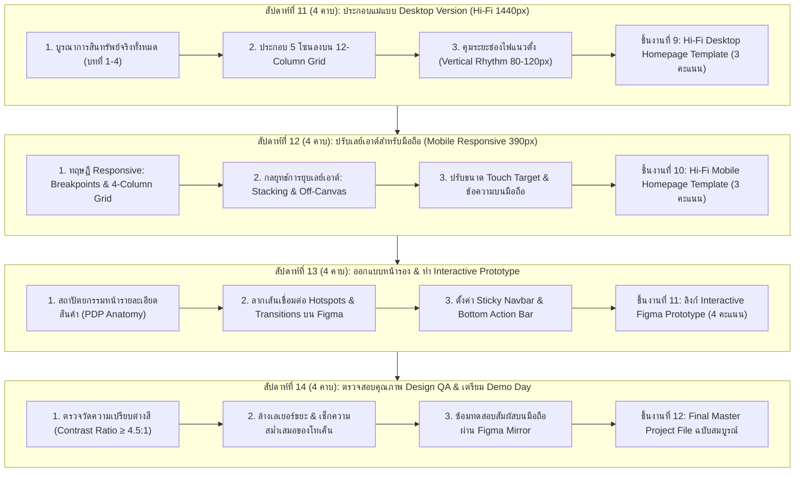
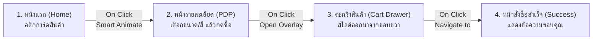

# บทที่ 5: การประกอบแม่แบบเว็บไซต์และการทดสอบต้นแบบเชิงโต้ตอบ
*(Website Template Assembly, Responsive Transformation & Interactive Prototyping)*

วิชา: 31910-2026 โปรแกรมกราฟิกสำหรับการออกแบบเว็บไซต์ (ท-ป-น: 2-2-3)  
ระดับชั้น: ประกาศนียบัตรวิชาชีพชั้นสูง (ปวส.) ชั้นปีที่ 1 สาขาวิชาเทคโนโลยีธุรกิจดิจิทัล  
หน่วยการเรียนรู้: หน่วยที่ 5 (ครอบคลุมการเรียนการสอนสัปดาห์ที่ 11, 12, 13 และ 14 รวม 16 คาบเรียน)  
อาจารย์ผู้สอน: ครูแม็ค (แผนกวิชาเทคโนโลยีธุรกิจดิจิทัล วิทยาลัยการอาชีพบ้านโป่ง)  

---

## 🎯 จุดประสงค์การเรียนรู้ประจำหน่วยที่ 5

เมื่อศึกษาเนื้อหาบทเรียนนี้และปฏิบัติการตามขั้นตอนเสร็จสิ้น ผู้เรียนสามารถ:
1. **ด้านความรู้ (Knowledge):**
   - อธิบายหลักการประกอบแม่แบบเว็บไซต์ความละเอียดสูง (**High-Fidelity Website Template Assembly**) โดยบูรณาการสินทรัพย์กราฟิกทั้งหมดจากหน่วยที่ 1-4 ได้อย่างเป็นระบบ
   - วิเคราะห์กลยุทธ์การปรับเปลี่ยนเลย์เอาต์สำหรับหน้าจอมือถือ (**Responsive Transformation Patterns**: Stacking, Wrapping, Off-Canvas) ตามมาตรฐานอุปกรณ์พกพาได้
   - อธิบายสถาปัตยกรรมหน้ารายละเอียดสินค้า (**Product Detail Page: PDP Anatomy**) และเส้นทางการเดินทางของผู้ใช้ (**User Journey Flow**) จากหน้าแรกสู่การสั่งซื้อได้
   - อธิบายกลไกการสร้างต้นแบบเชิงโต้ตอบ (**Interactive Prototyping**) ได้แก่ Hotspots, Triggers, Transitions, และการตรึงแถบตำแหน่งคงที่ (**Fixed/Sticky Scroll Position**) บน Figma ได้
   - อธิบายมาตรฐานการเข้าถึงสากล (**Web Accessibility: WCAG 2.1 AA**) โดยเฉพาะเรื่องอัตราส่วนความเปรียบต่างของสี (**Contrast Ratio $\ge 4.5:1$**) ได้
2. **ด้านทักษะปฏิบัติการ (Skill):**
   - **สัปดาห์ที่ 11:** ประกอบแม่แบบหน้าแรกคอมพิวเตอร์ (**Hi-Fi Desktop Homepage Template 1440px**) ครบทั้ง 5 โซนหลัก โดยใช้สินทรัพย์จริงทั้งหมดลงบน 12-Column Grid ได้อย่างประณีต
   - **สัปดาห์ที่ 12:** ปรับแปลงเลย์เอาต์แม่แบบหน้าแรกสู่จอมือถือ (**Hi-Fi Mobile Template 390px**) โดยใช้ระบบ 4-Column Grid และปรับเปลี่ยนระบบนำทางเป็น Drawer Hamburger Menu ได้อย่างสมบูรณ์
   - **สัปดาห์ที่ 13:** ออกแบบหน้ารายละเอียดสินค้า (**PDP**) พร้อมเชื่อมต่อเส้นทางปฏิสัมพันธ์บนโหมด **Figma Prototype** ให้สามารถคลิกเปลี่ยนหน้า เปิดแผ่นเมนู และเลื่อนหน้าจอแบบ Sticky Bar ได้เสมือนเว็บไซต์จริง
   - **สัปดาห์ที่ 14:** ปฏิบัติการตรวจสอบคุณภาพการออกแบบ (**Design QA Audit**), ตรวจวัดค่า Contrast Ratio, จัดระเบียบเลเยอร์ 100%, และทดสอบสัมผัสใช้งานจริงผ่านแอปพลิเคชัน **Figma Mirror** บนสมาร์ตโฟนได้
3. **ด้านจิตพิสัยและจรรยาบรรณวิชาชีพ (Attitude):**
   - มีความประณีตในการจัดระยะช่องไฟแนวตั้ง (Vertical Rhythm) และรักษาความสม่ำเสมอของ Design System ตลอดทั้งเว็บไซต์
   - มีจิตสำนึกในการออกแบบที่คำนึงถึงผู้พิการทางสายตาและผู้สูงอายุ (Digital Inclusivity)
   - มีทักษะการทำงานเป็นทีม วินัยในการส่งมอบงาน และความพร้อมในการนำเสนอผลงานระดับมืออาชีพ

---

## 🧭 แผนผังโครงสร้างการเรียนรู้ประจำหน่วย (สัปดาห์ที่ 11 - 14 | รวม 16 คาบ)



---

## บทนำ: จุดบรรจบของกระบวนการออกแบบ UI/UX สู่ผลงานระดับมืออาชีพ

ยินดีด้วยที่นักศึกษาได้เดินทางมาถึง **หน่วยที่ 5** ซึ่งเป็นหน่วยการเรียนรู้บทสุดท้ายและเป็นช่วงเวลาที่น่าตื่นเต้นที่สุดของวิชานี้!

ตลอด 10 สัปดาห์ที่ผ่านมา นักศึกษาได้สะสมชิ้นส่วนต่างๆ เปรียบเสมือนการผลิตอะไหล่ของรถยนต์ทีละชิ้น:
- **หน่วยที่ 1:** วางแนวคิดแบรนด์ จานสี 60-30-10 และตัวอักษรคู่หู (Typography)
- **หน่วยที่ 2:** สร้างพิมพ์เขียวขาว-ดำ (Wireframe), ระบบนำทาง (Navigation), และการ์ดสินค้าด้วย Auto-layout
- **หน่วยที่ 3:** ผลิตสินทรัพย์จริง โลโก้เวกเตอร์, ชุดไอคอน SVG, ภาพสินค้าไดคัทพร้อมเงา, และการบีบอัดไฟล์ WebP
- **หน่วยที่ 4:** สร้างสตอรี่บอร์ดและแบนเนอร์ภาพเคลื่อนไหว (Hero Animation)

ในหน่วยนี้ เราจะนำอะไหล่ทั้งหมดมา **"ประกอบร่างเข้าด้วยกัน (Template Assembly)"** เพื่อสร้างเว็บไซต์ธุรกิจจริงที่ตอบสนองทุกขนาดหน้าจอ (Responsive Web Design) และเชื่อมโยงให้คลิกสัมผัสได้จริง (Interactive Prototype) พร้อมสำหรับการนำเสนอผลงานในวัน **Demo Day (สัปดาห์ที่ 15)**

---

## ตอนที่ 1 (สัปดาห์ที่ 11): การประกอบแม่แบบหน้าแรกความละเอียดสูง (Hi-Fi Desktop Template 1440px)

```
┌────────────────────────────────────────────────────────────────────────────────┐
│ ข้อมูลการจัดการเรียนการสอนสัปดาห์ที่ 11:                                        │
│ • ระยะเวลา: 4 คาบเรียน (ทฤษฎีการประกอบแม่แบบ 2 คาบ / ปฏิบัติการ Figma 2 คาบ)   │
│ • เครื่องมือหลัก: โปรแกรม Figma (12-Column Grid, Component Assets)              │
│ • ชิ้นงานส่งตรวจ: ลิงก์ไฟล์งานชิ้นที่ 9: Hi-Fi Desktop Homepage Template (3 คะแนน)│
└────────────────────────────────────────────────────────────────────────────────┘
```

### 1.1 การบูรณาการสินทรัพย์จริงทั้งหมดเข้าสู่พิมพ์เขียว (From Low-Fi to Hi-Fi)

กระบวนการเปลี่ยนจากพิมพ์เขียวขาว-ดำ (Low-Fi Wireframe ในบทที่ 2) ไปสู่แม่แบบความละเอียดสูง (High-Fidelity Mockup) มีหัวใจสำคัญคือ **"การแทนที่กล่องสี่เหลี่ยมสีเทาด้วยชิ้นส่วนจริงที่สมบูรณ์ 100%"**:

```
┌─────────────────────────────────────────────────────────────────────────────────────────────┐
│                           ตารางการแทนที่ชิ้นส่วนจาก Low-Fi สู่ Hi-Fi                        │
├─────────────────────┬─────────────────────────────────────┬─────────────────────────────────┤
│ โซนบนหน้าเว็บ       │ ชิ้นงานเดิมใน Wireframe (บทที่ 2)   │ สิ่งที่ต้องแทนที่ใน Hi-Fi (บทที่ 5)│
├─────────────────────┼─────────────────────────────────────┼─────────────────────────────────┤
│ 1. Header Navbar    │ กล่องเทา พิมพ์ข้อความว่า `[LOGO]`    │ โลโก้เวกเตอร์จริง (SVG) + เมนูมีสี│
├─────────────────────┼─────────────────────────────────────┼─────────────────────────────────┤
│ 2. Hero Section     │ กล่องสี่เหลี่ยมสีเทามีกากบาท X      │ Interactive Animated Hero Banner│
│                     │ ข้อความสีเทากลาง                    │ ที่สร้างจากบทที่ 4 (พร้อมแสงเงา)│
├─────────────────────┼─────────────────────────────────────┼─────────────────────────────────┤
│ 3. Product Grid     │ การ์ดสินค้ากล่องภาพสีเทา            │ การ์ดสินค้าจริงที่ใส่ภาพไดคัท   │
│                     │                                     │ WebP + ป้ายลดราคา + ราคาจริง    │
├─────────────────────┼─────────────────────────────────────┼─────────────────────────────────┤
│ 4. Trust Badges     │ ข้อความธรรมดาไม่มีไอคอน             │ ชุดไอคอนบริการ 4 รูป (SVG) จากบท3│
├─────────────────────┼─────────────────────────────────────┼─────────────────────────────────┤
│ 5. Footer           │ กล่องสี่เหลี่ยมผืนผ้าสีเทา          │ ส่วนท้ายสีแบรนด์เข้ม ลิงก์ครบถ้วน│
└─────────────────────┴─────────────────────────────────────┴─────────────────────────────────┘
```

---

### 1.2 กฎการคุมจังหวะช่องไฟแนวตั้ง (Vertical Rhythm & Section Spacing)

ข้อผิดพลาดที่ทำให้หน้าเว็บดูอึดอัดหรือกระจัดกระจาย คือการเว้นระยะห่างระหว่างแต่ละโซนไม่เท่ากัน 

ในการออกแบบระดับมืออาชีพ เราจะใช้ระบบ **Base Unit 8px** ในการควบคุมระยะห่างแนวตั้ง (Vertical Spacing):

```
┌─────────────────────────────────────────────────────────────────────────────────────────┐
│                    มาตรฐานระยะเว้นช่องไฟแนวตั้ง (Vertical Rhythm Hierarchy)              │
├─────────────────────────┬───────────────────┬───────────────────────────────────────────┤
│ ระดับช่องไฟ             │ ขนาดพิกเซลแนะนำ   │ ตำแหน่งการใช้งาน                          │
├─────────────────────────┼───────────────────┼───────────────────────────────────────────┤
│ 1. Micro Spacing        │ 8px ถึง 16px      │ ภายใน Component เดียวกัน (เช่น ชื่อกับราคา)│
├─────────────────────────┼───────────────────┼───────────────────────────────────────────┤
│ 2. Component Spacing    │ 24px ถึง 32px     │ ระหว่างการ์ดสินค้าแต่ละใบในแถวเดียวกัน    │
├─────────────────────────┼───────────────────┼───────────────────────────────────────────┤
│ 3. Sub-section Spacing  │ 40px ถึง 48px     │ ระหว่างหัวข้อหมวด (H2) กับแผงการ์ดสินค้า  │
├─────────────────────────┼───────────────────┼───────────────────────────────────────────┤
│ 4. Major Section Spacing│ 80px ถึง 120px    │ **ระยะห่างระหว่างแต่ละโซนใหญ่**           │
│                         │                   │ (เช่น ระหว่าง Hero กับ Product Grid)     │
└─────────────────────────┴───────────────────┴───────────────────────────────────────────┘
```

> [!TIP]
> **เคล็ดลับความโปร่งสบายตา (White Space Mastery):**
> ระหว่างโซนที่ 2 (Hero) กับโซนที่ 3 (Products) และระหว่างโซนที่ 3 กับโซนที่ 4 (Trust) ให้ตั้งค่า Padding แนวตั้งอย่างน้อย **`80px` หรือ `96px`** เสมอ หน้าเว็บจะดูพรีเมียม สบายตา และอ่านง่ายขึ้นทันที 200%

---

## ตอนที่ 2 (สัปดาห์ที่ 12): การแปลงเลย์เอาต์แม่แบบสำหรับมือถือ (Mobile Responsive 390px)

```
┌────────────────────────────────────────────────────────────────────────────────┐
│ ข้อมูลการจัดการเรียนการสอนสัปดาห์ที่ 12:                                        │
│ • ระยะเวลา: 4 คาบเรียน (ทฤษฎี Responsive 2 คาบ / ปฏิบัติการ Figma 2 คาบ)       │
│ • เครื่องมือหลัก: Figma Frame Mobile (390px), 4-Column Mobile Grid               │
│ • ชิ้นงานส่งตรวจ: ลิงก์ไฟล์งานชิ้นที่ 10: Hi-Fi Mobile Homepage Template (3 คะแนน)│
└────────────────────────────────────────────────────────────────────────────────┘
```

### 2.1 ทฤษฎีจุดตัดหน้าจอ (Responsive Breakpoints) และระบบตารางมือถือ

ในการพัฒนาเว็บไซต์จริง หน้าจอจะถูกแบ่งออกเป็น 3 ช่วงขนาดหลักตามจุดตัด (Breakpoints):
1. **Desktop:** กว้างตั้งแต่ $1024\text{px}$ ขึ้นไป (เราใช้มาตรฐานยอดนิยม **1440px**)
2. **Tablet:** กว้างระหว่าง $768\text{px} - 1023\text{px}$
3. **Mobile:** กว้างระหว่าง $320\text{px} - 480\text{px}$ (เราใช้มาตรฐาน **390px** อิงตาม iPhone 13/14/15/16)

```
┌─────────────────────────────────────────────────────────────────────────────────────────┐
│           เปรียบเทียบระบบโครงตาราง: Desktop 1440px vs Mobile 390px                      │
├───────────────────────────────────┬─────────────────────────────────────────────────────┤
│ หน้าจอคอมพิวเตอร์ (Desktop 1440px) │ หน้าจอมือถือ (Mobile 390px)                         │
├───────────────────────────────────┼─────────────────────────────────────────────────────┤
│ • Columns: **12 คอลัมน์**         │ • Columns: **4 คอลัมน์**                            │
│ • Type: Stretch                   │ • Type: Stretch                                     │
│ • Margin ขอบซ้าย-ขวา: **80px**    │ • Margin ขอบซ้าย-ขวา: **16px ถึง 20px**             │
│ • Gutter ช่องไฟระหว่างเสา: **24px**│ • Gutter ช่องไฟระหว่างเสา: **12px ถึง 16px**         │
│ • Content Area: 1280px            │ • Content Area: 350 - 358px                         │
└───────────────────────────────────┴─────────────────────────────────────────────────────┘
```

---

### 2.2 4 กลยุทธ์การปรับเปลี่ยนเลย์เอาต์ (Responsive Layout Transformation Patterns)

เมื่อย่อจากหน้าจอคอมพิวเตอร์ที่กว้าง 1440px ลงมาเหลือเพียง 390px บนมือถือ เราไม่สามารถ "ย่อสเกลภาพให้เล็กลงเฉยๆ" ได้ เพราะตัวหนังสือจะเล็กจิ๋วจนอ่านไม่ออก นักศึกษาต้องใช้ **4 กลยุทธ์การแปลงเลย์เอาต์**:

```
┌─────────────────────────────────────────────────────────────────────────────────────────┐
│                    4 กลยุทธ์การแปลงหน้าจอ Desktop สู่ Mobile Responsive                 │
├─────────────────────────────────────────────────────────────────────────────────────────┤
│ 1. Stacking (การซ้อนแถวดิ่ง):                                                           │
│    จากเดิมข้อความอยู่ซ้าย-รูปอยู่ขวา (2 คอลัมน์) ──► จับรูปภาพขึ้นบน ข้อความตกลงมาล่าง  │
│                                                                                         │
│ 2. Wrapping / Grid Reduction (การลดจำนวนคอลัมน์การ์ด):                                  │
│    จากเดิมการ์ดสินค้าเรียงแถวละ 4 ชิ้น ──► ยุบเหลือเรียงแถวละ 1 ชิ้น หรือ 2 ชิ้นต่อแถว    │
│                                                                                         │
│ 3. Off-Canvas Drawer (การซ่อนเมนูลงลิ้นชัก):                                            │
│    แถบเมนู 5 ปุ่มแนวนอน ──► ซ่อนไว้ใต้ปุ่มแฮมเบอร์เกอร์ (☰) เมื่อแตะจึงสไลด์ออกมา        │
│                                                                                         │
│ 4. Touch Target Enlargement (การขยายพื้นที่แตะ):                                        │
│    ปุ่มคลิกด้วยเมาส์ ──► ขยายความกว้างเต็มจอ (Full Width) ความสูงขั้นต่ำ ≥ 48px         │
└─────────────────────────────────────────────────────────────────────────────────────────┘
```

```
[ภาพเปรียบเทียบการจัดวางเลย์เอาต์จริง]

[Desktop Version 1440px]                     [Mobile Version 390px]
┌──────────────────────────────────────┐     ┌──────────────────────┐
│ [LOGO]     เมนู 1  เมนู 2  [ปุ่ม]    │     │ [LOGO]          [☰]  │
├──────────────────────────────────────┤     ├──────────────────────┤
│ ┌────────────────┐ ┌───────────────┐ │     │ ┌──────────────────┐ │
│ │ ข้อความพาดหัว  │ │   รูปสินค้า   │ │     │ │    รูปสินค้า     │ │
│ │ และปุ่มสั่งซื้อ │ │               │ │     │ └──────────────────┘ │
│ └────────────────┘ └───────────────┘ │     │ ข้อความพาดหัว        │
├──────────────────────────────────────┤     │ [ ปุ่มสั่งซื้อเต็มจอ ]│
│ ┌────┐ ┌────┐ ┌────┐ ┌────┐          │     ├──────────────────────┤
│ │การ์ด│ │การ์ด│ │การ์ด│ │การ์ด│ (4 คอลัมน์)  │     │ ┌────────┐ ┌────────┐│
│ └────┘ └────┘ └────┘ └────┘          │     │ │ การ์ด 1 │ │ การ์ด 2 ││ (2 คอลัมน์)
└──────────────────────────────────────┘     │ └────────┘ └────────┘│
                                             └──────────────────────┘
```

---

## ตอนที่ 3 (สัปดาห์ที่ 13): หน้ารายละเอียดสินค้า (PDP) และการสร้าง Interactive Prototype

```
┌────────────────────────────────────────────────────────────────────────────────┐
│ ข้อมูลการจัดการเรียนการสอนสัปดาห์ที่ 13:                                        │
│ • ระยะเวลา: 4 คาบเรียน (ทฤษฎี Prototype 2 คาบ / ปฏิบัติการเชื่อมต่อ 2 คาบ)      │
│ • เครื่องมือหลัก: Figma Prototype Engine, Smart Animate, Sticky Overlay         │
│ • ชิ้นงานส่งตรวจ: ลิงก์ไฟล์งานชิ้นที่ 11: ลิงก์ Interactive Figma Prototype (4 ค.)│
└────────────────────────────────────────────────────────────────────────────────┘
```

### 3.1 สถาปัตยกรรมหน้ารายละเอียดสินค้า (Product Detail Page: PDP Anatomy)

หน้าแรกมีหน้าที่ "ดึงดูดความสนใจ" แต่หน้าที่จะ **"ปิดการขายและสร้างรายได้จริง"** คือหน้ารายละเอียดสินค้า (PDP)

```
┌─────────────────────────────────────────────────────────────────────────────────────────┐
│              กายวิภาคหน้ารายละเอียดสินค้าบนคอมพิวเตอร์ (PDP Layout Blueprint)            │
├─────────────────────────────────────────────────────────────────────────────────────────┤
│ [Breadcrumbs: หน้าแรก > เสื้อผ้าบุรุษ > เสื้อเชิ้ต Oxford Slim-Fit]                      │
│ ┌───────────────────────────────────────┬─────────────────────────────────────────────┐ │
│ │ [ฝั่งซ้าย: แกลเลอรีรูปภาพสินค้า 6 คอลัมน์] │ [ฝั่งขวา: รายละเอียดและการสั่งซื้อ 6 คอลัมน์]│ │
│ │ ┌───────────────────────────────────┐ │ เสื้อผ้าแฟชั่นบุรุษเกรดพรีเมียม             │ │
│ │ │                                   │ │ เสื้อเชิ้ตแขนยาว Oxford Slim-Fit (สีขาว)    │ │
│ │ │        รูปภาพหลักความละเอียดสูง   │ │ ⭐ 4.9 (142 รีวิว) • ขายแล้ว 1.5k ชิ้น       │ │
│ │ │               (1:1)               │ │ -----------------------------------------   │ │
│ │ └───────────────────────────────────┘ │ ฿ 490.00   <strike>฿ 650.00</strike> (-25%)│ │
│ │ ┌─────┐ ┌─────┐ ┌─────┐ ┌─────┐     │ -----------------------------------------   │ │
│ │ │ 🖼️1 │ │ 🖼️2 │ │ 🖼️3 │ │ 🖼️4 │     │ ตัวเลือกสี: [⚪ ขาว] [🔵 ยีนส์] [⚫ ดำ]      │ │
│ │ └─────┘ └─────┘ └─────┘ └─────┘     │ ขนาด (Size): ( S )  [ M ]  ( L )  ( XL )     │ │
│ │ (รูปย่อย Thumbnails สลับดูมุมต่างๆ)   │ จำนวน: [ - ]  1  [ + ]                      │ │
│ │                                     │ ┌─────────────────────────────────────────┐ │ │
│ │                                     │ │   [ + เพิ่มลงในตะกร้าสินค้า ]           │ │ │
│ │                                     │ ├─────────────────────────────────────────┤ │ │
│ │                                     │ │   [ ซื้อสินค้าทันที (Buy Now) ]         │ │ │
│ │                                     │ └─────────────────────────────────────────┘ │ │
│ └───────────────────────────────────────┴─────────────────────────────────────────────┘ │
└─────────────────────────────────────────────────────────────────────────────────────────┘
```

---

### 3.2 ศาสตร์แห่งการสร้างต้นแบบเชิงโต้ตอบ (Interactive Prototyping)

ต้นแบบ (Prototype) คือสิ่งที่ทำให้นักศึกษาแตกต่างจากช่างวาดรูปทั่วไป เพราะมันคือ **"การจำลองซอฟต์แวร์ที่เหมือนจริงโดยไม่ต้องเขียนโค้ดแม้แต่บรรทัดเดียว"**

```
┌─────────────────────────────────────────────────────────────────────────────────────────┐
│                         3 เสาหลักของการผูก Prototype บน Figma                           │
├─────────────────────┬───────────────────────────────────────────────────────────────────┤
│ 1. Trigger (ตัวกระตุ้น)│ ผู้ใช้ทำอะไร? เช่น `On Click` (คลิก), `While Hovering` (เมาส์ชี้), │
│                     │ `After Delay` (รอเวลาอัตโนมัติ), `On Drag` (ลากนิ้ว)              │
├─────────────────────┼───────────────────────────────────────────────────────────────────┤
│ 2. Action (การกระทำ)│ เกิดอะไรขึ้น? เช่น `Navigate to` (เปลี่ยนหน้า), `Open Overlay`     │
│                     │ (เปิดหน้าต่างลิ้นชักเมนูลอย), `Scroll to` (เลื่อนไปยังโซนเป้าหมาย) │
├─────────────────────┼───────────────────────────────────────────────────────────────────┤
│ 3. Animation        │ ขยับแบบไหน? เช่น `Instant` (ทันที), `Dissolve` (จางหายข้ามหน้า),   │
│    (รูปแบบการเปลี่ยน)│ `Smart Animate` (วัตถุเดิมขยับแปลงร่าง), `Slide In` (สไลด์จากขอบ) │
└─────────────────────┴───────────────────────────────────────────────────────────────────┘
```

#### การตั้งค่าแถบเมนูคงที่เมื่อเลื่อนจอ (Sticky / Fixed Position):
1. คลิกเลือกแถบ Navbar หรือแถบสั่งซื้อด้านล่าง
2. มองที่แผงขวามือ หัวข้อ **Constraints** ตรวจสอบว่าตรึงอยู่กับขอบบนหรือขอบล่าง
3. ในหัวข้อ **Scroll Behavior** เปลี่ยนจาก *Scroll with parent* ให้เป็น **`Fixed (stay in place)`**  
*(เมื่อเปิดโหมดทดสอบ แถบเมนูจะลอยอยู่กับที่ตลอดเวลา แม้ผู้ใช้จะเลื่อนอ่านเนื้อหายาวลงมาด้านล่างก็ตาม)*

---

### 3.3 แผนผังเส้นทางผู้ใช้ (Complete User Flow Mapping)

ในสัปดาห์ที่ 13 นักศึกษาต้องลากเส้นเชื่อมโยง Prototype ให้ครบถ้วนทั้ง 4 ขั้นตอน:



---

## ตอนที่ 4 (สัปดาห์ที่ 14): การตรวจสอบคุณภาพการออกแบบ (Design QA) และเตรียม Demo Day

```
┌────────────────────────────────────────────────────────────────────────────────┐
│ ข้อมูลการจัดการเรียนการสอนสัปดาห์ที่ 14:                                        │
│ • ระยะเวลา: 4 คาบเรียน (ทฤษฎี Accessibility 2 คาบ / ปฏิบัติการ Design QA 2 คาบ) │
│ • เครื่องมือหลัก: Contrast Checker Plugin, Figma Mirror App                     │
│ • ชิ้นงานส่งตรวจ: ลิงก์ไฟล์งานชิ้นที่ 12: Final Master Project File ฉบับสมบูรณ์   │
└────────────────────────────────────────────────────────────────────────────────┘
```

### 4.1 การตรวจสอบการเข้าถึง (Web Accessibility Audit & Contrast Ratio)

การออกแบบที่ดีต้องไม่ทอดทิ้งผู้ใช้งานที่มีปัญหาด้านสายตา หรือผู้สูงอายุ 

มาตรฐานสากล **W3C Web Content Accessibility Guidelines (WCAG 2.1 Level AA)** กำหนดเกณฑ์ **อัตราส่วนความเปรียบต่างของสี (Contrast Ratio)** ระหว่าง "สีตัวอักษร" กับ "สีพื้นหลัง" ไว้ดังนี้:

```
┌─────────────────────────────────────────────────────────────────────────┐
│            เกณฑ์มาตรฐานความเปรียบต่างสี (WCAG 2.1 AA Contrast Ratio)     │
├─────────────────────────────────────────────────────────────────────────┤
│                                                                         │
│ 1. ข้อความทั่วไป (Body Text ขนาด < 18px):                               │
│    ต้องมีอัตราส่วนความเปรียบต่างไม่ต่ำกว่า  ★★★  4.5 : 1  ★★★           │
│                                                                         │
│ 2. ข้อความหัวข้อขนาดใหญ่ (Headings ขนาด ≥ 18px Bold หรือ ≥ 24px Regular):│
│    ต้องมีอัตราส่วนความเปรียบต่างไม่ต่ำกว่า  ★★☆  3.0 : 1  ★★☆           │
│                                                                         │
│ 3. เส้นขอบฟอร์มและไอคอนสำคัญ (UI Components & Icons):                   │
│    ต้องมีอัตราส่วนความเปรียบต่างไม่ต่ำกว่า  ★★☆  3.0 : 1  ★★☆           │
└─────────────────────────────────────────────────────────────────────────┘
```

```
[ตัวอย่างจริงของการสอบตก vs สอบผ่าน Accessibility]

❌ ตัวอย่างที่สอบตก (Failed AA - ห้ามทำเด็ดขาด!):
┌───────────────────────────────┐
│  ข้อความสีเทาอ่อนบนพื้นหลังขาว │ ◄── Contrast เพียง 1.8 : 1 (อ่านยากมาก ผู้สูงอายุอ่านไม่ออก)
└───────────────────────────────┘

✅ ตัวอย่างที่สอบผ่าน (Passed AA - มาตรฐานสากล):
┌───────────────────────────────┐
│  ข้อความสีเทาเข้ม #374151 บนขาว│ ◄── Contrast สูงถึง 7.2 : 1 (คมชัด สบายตา อ่านง่ายทุกวัย)
└───────────────────────────────┘
```

---

### 4.2 การทำความสะอาดไฟล์งานขั้นสุดท้าย (Layer Hygiene & File Organization)

ก่อนส่งมอบงานระดับ Final หรือนำเสนอต่อหน้าคณะกรรมการ ไฟล์ Figma ต้องสะอาดสะอ้านตามหลักสากล:
- [ ] **การจัดหน้า Pages ฝั่งซ้ายสุด:** แบ่งหน้าเป็นสัดส่วนชัดเจน เช่น:
  - `📱 01_Desktop_Homepage`
  - `📱 02_Mobile_Homepage`
  - `🛍️ 03_Product_Detail_Page`
  - `🎨 04_UI_Component_Library`
  - `🎬 05_Hero_Animation_Storyboard`
- [ ] **ลบล้างเลเยอร์ขยะ (No Garbage Layers):** ต้องไม่มีเลเยอร์ที่ถูกซ่อนตาไว้แล้วลืมลบ ไม่มี Frame ว่างเปล่าลอยอยู่นอกพื้นที่ทำงาน
- [ ] **การล็อก Styles:** ฟอนต์ทุกจุดต้องผูกกับ Text Styles และสีทุกจุดต้องผูกกับ Color Styles

---

### 4.3 การทดสอบสัมผัสบนมือถือจริงผ่าน Figma Mirror

ห้ามเชื่อสายตาตัวเองบนจอคอมพิวเตอร์เพียงอย่างเดียว! นักศึกษาทุกคนต้องดาวน์โหลดแอปพลิเคชัน **Figma** บนสมาร์ตโฟน (iOS / Android):
1. เปิดแอป Figma บนโทรศัพท์ ล็อกอินด้วยบัญชีเดียวกัน
2. แตะที่แท็บ **Mirror**
3. บนจอคอมพิวเตอร์ ให้คลิกเลือกที่กรอบ `Mobile_Homepage` (390px)
4. หน้าจอสมาร์ตโฟนจะแสดงผลขนาดจริง $1:1$ ทันที
5. **ใช้นิ้วหัวแม่มือทดลองแตะ:** ตรวจดูว่าปุ่มกดสั่งซื้อแตะง่ายหรือไม่ ตัวหนังสือเล็กเกินไปหรือไม่ และเมนูลิ้นชักเปิดออกมาราบรื่นหรือไม่

---

## ตอนที่ 5: ใบงานปฏิบัติการประจำหน่วยที่ 5 (Workshops & Tasks)

```
┌────────────────────────────────────────────────────────────────────────────────┐
│ สรุปภารกิจการส่งงานและคะแนนเก็บประจำหน่วยที่ 5 (รวม 10 คะแนน):                  │
│ • ชิ้นงานที่ 9 (สัปดาห์ที่ 11): Hi-Fi Desktop Homepage Template [3 คะแนน]       │
│ • ชิ้นงานที่ 10 (สัปดาห์ที่ 12): Hi-Fi Mobile Homepage Template [3 คะแนน]       │
│ • ชิ้นงานที่ 11 (สัปดาห์ที่ 13): PDP & Interactive Prototype [4 คะแนน]          │
│ • ชิ้นงานที่ 12 (สัปดาห์ที่ 14): Final Project Master File (ตรวจความสมบูรณ์)    │
└────────────────────────────────────────────────────────────────────────────────┘
```

### 📋 ใบงานที่ 5.1 (สัปดาห์ที่ 11): ประกอบแม่แบบ Desktop Version (Hi-Fi)
- **คะแนนเต็ม:** 3 คะแนน
- **กำหนดส่ง:** ท้ายคาบเรียนสัปดาห์ที่ 11
- **โจทย์ภารกิจ:**
  1. สร้าง Frame Desktop ขนาด **1440 x 1024 px** (ยืดความยาวลงมาได้ตามเนื้อหา) บน 12-Column Grid
  2. ประกอบ 5 โซนหลักโดยใช้สินทรัพย์จริงทั้งหมด: Navbar โลโก้เวกเตอร์, Hero Section ภาพเคลื่อนไหว, Product Grid การ์ดสินค้าจริง, Trust Badges ไอคอน SVG 4 ชิ้น, และ Footer
  3. คุมระยะห่างแนวตั้งระหว่างแต่ละโซนใหญ่ (Section Spacing) ให้ได้ระยะระหว่าง **80px ถึง 120px** อย่างสม่ำเสมอ

---

### 📋 ใบงานที่ 5.2 (สัปดาห์ที่ 12): ปรับเลย์เอาต์แม่แบบสำหรับมือถือ (Mobile Responsive)
- **คะแนนเต็ม:** 3 คะแนน
- **กำหนดส่ง:** ท้ายคาบเรียนสัปดาห์ที่ 12
- **โจทย์ภารกิจ:**
  1. สร้าง Frame Mobile ขนาด **390 x 844 px** (สามารถยืดความยาวลงมาได้) บน 4-Column Grid
  2. ปรับแปลงเลย์เอาต์จากหน้า Desktop ตามหลัก Stacking, Wrapping, และ Off-Canvas
  3. เปลี่ยนระบบนำทางเป็น Mobile Header พร้อมหน้าต่าง Drawer Menu ลอยออกมาเมื่อกด
  4. ปรับขนาดพื้นที่สัมผัส Touch Target บนมือถือให้มีขนาดไม่ต่ำกว่า **48 x 48 px** ทุกจุด

---

### 📋 ใบงานที่ 5.3 (สัปดาห์ที่ 13): ออกแบบหน้ารายละเอียดสินค้า & ทำ Interactive Prototype
- **คะแนนเต็ม:** 4 คะแนน
- **กำหนดส่ง:** ท้ายคาบเรียนสัปดาห์ที่ 13
- **โจทย์ภารกิจ:**
  1. ออกแบบหน้ารายละเอียดสินค้า (**PDP**) ทั้งเวอร์ชัน Desktop และ Mobile ประกอบด้วยแกลเลอรีรูปภาพ, ข้อมูลสินค้า, ตัวเลือกสี/ขนาด, ราคา, และปุ่มสั่งซื้อ
  2. ผูกปฏิสัมพันธ์ในโหมด **Figma Prototype** ครบตาม User Flow: `Home` $\rightarrow$ `PDP` $\rightarrow$ `Cart Drawer` $\rightarrow$ `Success`
  3. ตั้งค่าแถบ Navbar และปุ่มสั่งซื้อด้านล่างให้เป็น **Sticky / Fixed Position** ลอยค้างเมื่อเลื่อนหน้าจอ

---

### 📋 ใบงานที่ 5.4 (สัปดาห์ที่ 14): ตรวจสอบคุณภาพ Design QA & แฟ้มผลงาน Final Master File
- **การประเมิน:** ตรวจสอบความพร้อม 100% ก่อนขึ้นเวทีนำเสนอปลายภาค (Demo Day สัปดาห์ที่ 15)
- **โจทย์ภารกิจ:**
  1. ติดตั้งและรันปลั๊กอิน **Contrast Checker** บน Figma ตรวจสอบตัวอักษรทุกจุดให้ผ่านเกณฑ์ **WCAG 2.1 AA ($\ge 4.5:1$)**
  2. ทำความสะอาดเลเยอร์ทั้งหมด จัดแบ่งหน้า Pages และผูก Color/Text Styles ครบถ้วน
  3. ทดสอบการกดจริงผ่านแอป **Figma Mirror** บนโทรศัพท์มือถือ และส่งลิงก์ตรวจ Final Master Project

---

## แบบตรวจสอบตนเองขั้นสุดท้าย (Final Comprehensive Self-Checklist)

ก่อนส่งลิงก์ Final Project ตรวจสอบความสมบูรณ์ระดับ 100% ตามรายการนี้:

- [ ] **ความสมบูรณ์ของหน้าจอ (Completeness):**
  - [ ] มีหน้าแรก Desktop (1440px) สมบูรณ์ ครบ 5 โซน
  - [ ] มีหน้าแรก Mobile (390px) แบบ Responsive ถูกต้อง
  - [ ] มีหน้ารายละเอียดสินค้า (PDP) ทั้ง Desktop และ Mobile
  - [ ] มีหน้าต่างแผ่นเมนูลิ้นชัก (Drawer Menu) บนมือถือ
- [ ] **ระบบปฏิสัมพันธ์ (Prototype Interactivity):**
  - [ ] กดคลิกจากการ์ดสินค้าหน้าแรกแล้วเปิดเข้าหน้ารายละเอียดสินค้าได้จริง
  - [ ] กดเปิด-ปิดเมนูลิ้นชักบนมือถือได้อย่างลื่นไหล
  - [ ] แถบเมนูด้านบนถูกล็อกแบบ Fixed Scroll ลอยค้างไม่เลื่อนหาย
  - [ ] แอนิเมชัน Hero Banner เล่นลูปขยับนุ่มนวล ไม่กระตุก
- [ ] **คุณภาพเชิงวิศวกรรม (Engineering & Accessibility):**
  - [ ] สีตัวอักษรและปุ่มผ่านเกณฑ์ความเปรียบต่าง Contrast Ratio $\ge 4.5:1$
  - [ ] ปุ่มกดบนมือถือทุกปุ่มมีขนาดพื้นที่แตะไม่ต่ำกว่า $48 \times 48\text{px}$
  - [ ] เลเยอร์ทุกตัวในแผงซ้ายมือเปลี่ยนชื่อเป็นภาษาอังกฤษเรียบร้อย ปราศจากชื่อขยะ
  - [ ] ลิงก์ไฟล์ Figma ตั้งค่าการแชร์เป็น `Anyone with the link can view` พร้อมนำเสนอในวัน Demo Day
